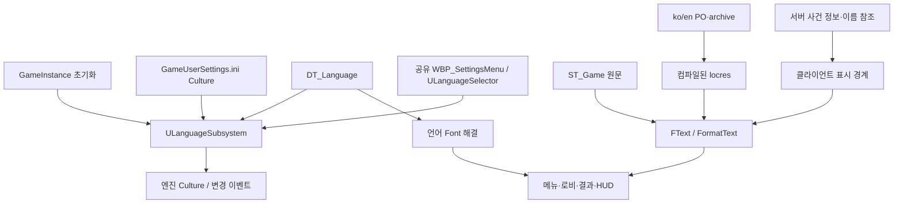

# 언어 변경 시스템

2026-11-11 구현입니다. 요구사항은 제공된 `261111_언어_변경_시스템.md`이며, 현행 근거는 [구현 검증 기록](evidence/language-implementation-2026-11-11.json)에 기록합니다. 초기 조사·이관 자료는 사용자 요청에 따라 저장소 밖의 작업 백업으로 분리했습니다.

## 플레이어 사용 경로

메인 메뉴의 **나가기 아래 한국어 / English** 바로가기 또는 **설정 → 게임 플레이 → 언어 / Language** 드롭다운을 사용합니다. 메인 메뉴와 경기 중 일시정지 메뉴는 `/Game/QuakeLike_1_0/GameProgressFlow/WBP_SettingsMenu`를 공유합니다. 언어 영역은 게임 플레이 탭의 설정 목록 안에 있으며 조작·비디오·사운드 탭에서는 전체 영역이 Collapsed됩니다.

- `한국어`, `English`는 해당 언어의 고정 이름으로 표시합니다. 내부 선택값은 `ko`, `en`입니다.
- 선택은 즉시 적용·저장합니다. 화면을 파괴·재생성하여 다른 옵션이나 입력 상태를 초기화하지 않습니다.
- 기본 언어는 `ko`입니다. 저장된 언어 → 저장이 없을 때 OS 언어 → 기본 언어 순으로 결정합니다. 저장된 값이 미지원/disabled이면 OS를 건너뛰고 기본 언어로 복구합니다.
- OS 언어의 지역 코드를 그대로 지원하지 않으면 가장 구체적인 지원 상위 코드를 사용합니다. 예를 들어 향후 `en`과 `en-GB`를 함께 지원하면 `en-GB-x-test`는 행 순서에 관계없이 `en-GB`로 결정합니다. 저장된 미지원 값에는 이 상위 코드 추정을 적용하지 않습니다.
- Culture는 서버에 복제하지 않습니다. 선택한 프로세스의 클라이언트 UI에 적용합니다.
- 다른 맵에서 생성되는 UI도 같은 언어를 사용하도록 GameInstance 수명으로 관리합니다.

## 코드와 에셋 책임



| 위치 | 책임 |
|---|---|
| `Source/ShootingArena/Public/Localization/LanguageSubsystem.h` 및 대응 cpp | 언어 행 자료형, 시작 언어 결정, 저장, 선택 UI, Text/표시 이름·글꼴 API입니다. |
| `/Game/QuakeLike_1_0/Localization/DT_Language` | 사용 언어, 기본 언어, 고정 언어 이름, 언어별 UFont를 편집합니다. 2026-11-13 UI 수정 시작 시 이미 JsonAssetSync에 등록되어 있었으며 `Content/DataTables/DT_Language.json`과 함께 관리합니다. 이번 UI 수정에서 Registry를 변경하지 않았습니다. |
| `/Game/QuakeLike_1_0/Localization/ST_Game` | 번역 원문과 안정된 문구 키를 편집합니다. |
| `Content/Localization/Game/` | 엔진 표준 manifest, ko/en archive·PO·locres, locmeta입니다. |
| `Config/Localization/Game.ini` | String Table 범위의 표준 Gather → Import → Compile → Export 작업입니다. |
| `Config/DefaultEditor.ini` | Localization Dashboard의 Game Target, native culture `ko`, 지원 `ko/en`입니다. |
| `Config/DefaultEngine.ini`, `DefaultGame.ini` | localization 경로, EFIGSCJK ICU 데이터, ko/en stage, localization 에셋 cook 경로입니다. |
| `Source/ShootingArenaEditorTools/Private/LanguageAuthoringLibrary.*` | 엔진 형식 검사 후 locres 바이트를 메모리에서 생성하는 에디터 전용 도구입니다. 파일을 직접 덮어쓰지 않습니다. |
| `Scripts/Localization/CompileLocalization.py` | String Table과 PO의 누락·stale/fuzzy·치환 인수·언어 설정을 검사하고, 모든 언어의 리소스가 생성된 뒤 파일을 교체합니다. |

언어 처리는 클라이언트 GameInstance subsystem 초기화에서 수행합니다. 기존 BP Event Init은 새 subsystem 생성 전이므로 언어 선택 호출을 거기에 추가하지 않습니다. 로딩 subsystem과의 언어 초기화 의존성은 제거했습니다.

2026-11-12 main 통합 시 사용자 요청에 따라 `/Game/QuakeLike_1_0/GameFlow/UI/Loading/WBP_LoadingScreen_Ref`는 언어 패치에서 제외했습니다. 로딩 WBP는 main의 원본을 유지하며 하위 위젯도 전역 글꼴 교체에서 제외합니다. 기존 호출자의 `StatusText` 번역 연결 13개도 해제했습니다. 전환별 위젯 재생성·배경 선택·페이드·BGM·준비 보고는 main의 구현을 유지합니다. 상세 표시 경로는 [클라이언트 로딩 문서](../../ClientGameplayReady.md)를 참조합니다.

## 저장 원본

2026-11-13 재병합: `main`의 `37bf8ddff`와 작업 중 추가된 `f05565081`까지 현재 작업 브랜치에 통합했습니다. 병합 커밋은 `e27153dbb`, `1b8db4b3c`입니다. 충돌한 BP 8개는 최신 main에 번역 참조·표시 이름 처리를 재적용했고, 원본 실행 핀 2,467개의 연결을 유지했습니다. 맵 DT는 자동 병합된 `Content/DataTables/DT_MapData.json`에서 반영해 main의 타이머 변경과 기존 번역 참조를 함께 보존했습니다. 기존 미커밋 작업은 별도 백업·stash 후 복원했습니다. [부분 병합 검증 기록](evidence/main-merge-2026-11-13.json)을 참조합니다.

선택한 언어는 엔진 `GGameUserSettingsIni`의 `[Internationalization] Culture`에 저장합니다. 기존 `PlayerSettings` SaveGame 슬롯의 감도·음량·표시 토글과 분리했습니다. `SG_Settings`를 새로 만들고 저장해도 언어 값은 소실되지 않습니다.

에디터 PIE와 패키지 실행은 서로 다른 설정 프로필을 사용할 수 있으므로, 재실행 유지 검증은 같은 실행 환경·설정 파일을 기준으로 합니다. PIE 종료 시 에디터 Culture/현지화 preview 상태를 복원합니다.

## 번역 연결 범위

현재 사용 경로와 그 공유 위젯의 정적 Text, 설명, 확인창·접속 안내, 로비 피드/준비 문구, 결과 복귀 문구, 리스폰 카운트다운을 String Table에 연결했습니다. 기존 테스트·데모의 모든 화면을 번역 완료로 판정하지 않습니다.

- 메인 진입점은 `TestMainMenu_Level → WBP_MainMenu_SDM`입니다. `MainMenuLanguageSelector`는 기존 메뉴 VerticalBox의 나가기 다음에 있는 한국어·영어 바로가기입니다. 공유 설정창의 `LanguageSelector`는 `SB_SettingList` 내부에서 언어 제목과 드롭다운을 표시합니다. 두 곳 모두 같은 `ULanguageSubsystem`의 즉시 적용·저장·변경 이벤트를 사용합니다.
- `리스폰까지 {A}초`, `{A} 님이 입장했습니다`, 준비 인원, 로비 복귀 투표 등은 문장 조각 연결 대신 전체 번역 문장과 인수로 만듭니다.
- 기존 한국어 String 옵션을 내부 식별값으로 사용하는 밝기 콤보는 그 값을 유지하고, `UStyleableComboBoxString.LocalizedOptions`에서 표시 Text만 해결합니다.
- 맵·봇·무기 이름은 기존 행/Name/String 식별값을 변경하지 않고 표시 키로 조회합니다. 초기 봇·맵 고유명사는 ko/en에서 같은 표기를 유지한 항목도 있습니다. 기획자가 String Table/번역에서 바꿀 수 있습니다.
- 무기 7종의 이름 키에는 `Fist`도 포함합니다. 맵 설명 4개의 JSON 원본은 `LOCTABLE` 참조로 바꾸고 실제 DT에도 반영했습니다.
- 기존 메달 CDO의 Text override 5개도 연결했습니다. native 기본값만 변경하면 기존 Blueprint override가 남기 때문에 별도로 확인했습니다.
- 기존 HUD가 아이콘·수치만 표시하는 아이템/버프에 새 설명 화면을 만들지는 않았습니다. 향후 표시 이름·설명 UI를 추가하면 같은 String Table의 키로 연결해야 합니다.

### 기존 String 표시 인터페이스

일부 기존 BP UI·사망/알림 함수는 String 매개변수입니다. 모든 RPC·인터페이스를 동시에 바꾸는 대신 `DisplayString`/`ReadDisplayString` 어댑터로 **명시적으로 표식한 FText 이력**을 전달합니다. 런타임에 한국어 문구를 검색하여 번역을 치환하는 사전 방식이 아닙니다.

- `DisplayString`은 String Table 참조와 Format 인수를 직렬화하며, 표시 경계의 `ReadDisplayString`이 이를 Text로 복원합니다.
- 보통의 문자열과 닉네임은 culture-invariant Text로 처리합니다. 닉네임에 `LOCTABLE(...)` 같은 글자가 있어도 일반 문자열 자체를 해석하지 않습니다.
- `BP_QuakePlayerState.GetDisplayName`은 native `ParticipantDisplayString`에 연결합니다. 봇은 `CampaignName` 또는 `SelectedCharacterRow` ID에서 `Character_<ID>`를 참조합니다. 사람에게 선택 캐릭터가 있어도 이름을 캐릭터명으로 바꾸지 않고 입력 닉네임을 보존합니다.
- 확인한 BP GetDisplayName 소비자는 BPC_Life의 3개 표시 경계였으며 모두 decoder에 연결했습니다. native `ShooterDisplayLibrary`도 decoder를 사용합니다.
- 이 어댑터 출력은 표시 전용입니다. 이름 비교·ID·DB 저장·콘솔 명령의 입력으로 새로 사용하지 않습니다. 새 UI API는 처음부터 FText를 권장합니다.
- 피해·점수·게임 규칙·아이템 ID와 언어 설정의 복제 변수/RPC를 추가하지 않았습니다.

## 글꼴

DT_Language의 ko/en은 초기값으로 기존 `F_Pretendard`를 참조합니다. 언어별로 다른 composite font를 지정할 수 있습니다. 영어 UI에서도 한글 닉네임을 표시할 수 있도록 fallback을 포함해야 합니다.

크기·외곽선·자간·단색 숫자 설정은 기존 스타일을 유지하며 FontObject와 유효한 typeface를 해결합니다. 공통 스타일·콤보, viewport의 TextBlock/입력 필드, 조준 닉네임 NativePaint, Canvas 자막을 연결했습니다. 로딩 WBP와 하위 위젯은 제외합니다. 글꼴 행 조회는 프레임·언어별로 캐시하고 실제 Font가 달라질 때만 위젯에 다시 설정합니다.

공통 버튼의 `UReusableStyleHost::ApplyStyle`은 `UCommonButtonStyle.MinWidth`를 최소 너비로만 적용하고 고정 WidthOverride는 제거합니다. 번역된 Text와 기존 버튼 padding이 더 넓은 경우 버튼의 원하는 너비가 커집니다. 글꼴 크기·높이·기존 부모 배치 규칙은 유지합니다. 특수한 고정 부모 영역·긴 문장의 전체 화면 겹침은 별도 확인이 필요합니다.

## 2026-11-13 언어 선택 위치와 버튼 너비

- 기존 설정창 전체 상단의 언어 행을 게임 플레이 탭 목록의 두 표시 토글 아래로 이동했습니다. `ULanguageSelector.bShowSectionHeading`, 기존 `TS_Setting_Eyebrow`와 `WS_Setting_Combo`를 사용합니다.
- 기존 `SelectTab`에서 SelectedTabIndex를 저장한 뒤 `LanguageSelector.SetSettingsTab`을 호출합니다. 게임 플레이(0)에서만 표시하므로 이전/다음 화살표와 직접 탭 선택 모두 같은 규칙을 따릅니다.
- 게임 플레이 탭의 `기본값으로`는 선택한 언어를 유지합니다. `SetOutlineSetting(true)` → `SetAimNameSetting(true)`로 기존 두 표시 옵션을 현재 BP 기본값인 켜기로 복원하며, 각 기존 처리에서 GameInstance 설정·SaveGame·버튼 강조 표시·소유 플레이어의 표시 컴포넌트를 갱신합니다. 언어 초기화 연결과 `ResetToDefaultLanguage` 함수는 제거했습니다. 다른 탭의 기본값 분기는 변경하지 않았습니다.
- `GameplayDefaultsPreserveLanguage`는 실제 `WBP_SettingsMenu`의 기본값 버튼 이벤트를 호출해 ko/en 유지, 두 설정의 BP 기본값 복원, SaveGame 결과와 활성 버튼 색 갱신, 반복 복원을 검증합니다. 임시 월드·임시 저장 슬롯을 사용하며 게임 Init·화면 Construct·BeginPlay·PIE는 실행하지 않습니다. 실제 플레이 중 표시 컴포넌트의 변화는 사용자 검증 범위입니다.
- 메인 메뉴의 `bInlineChoices` 모드는 `한국어`, `English` 버튼을 표시하고 현재 선택을 기존 강조색으로 표시합니다. disabled 언어는 선택할 수 없습니다. 설정창과 양방향으로 갱신하며 새로운 저장 슬롯이나 RPC를 만들지 않습니다.
- 메인 메뉴 바로가기는 `MainMenuLanguageSelector.RenderTransform.Translation.Y = 120`으로 아래쪽에 배치합니다. 메뉴 VerticalBox의 공간 배분은 유지하여 기존 싱글·멀티·옵션·나가기 버튼이 이동하지 않습니다. 두 언어 버튼은 Fill 대신 내용 크기의 Auto 슬롯을 사용해 가운데에 모읍니다. 버튼 사이의 슬롯 여백은 양쪽 4단위이고, 글자 양옆의 기존 클릭 여백은 유지합니다.
- 참고 PPT를 기준으로 화면을 재구성하지 않고 실제 사용 중인 두 WBP와 공통 버튼 코드만 변경했습니다. 로딩 WBP는 계속 언어 패치 대상에서 제외합니다.
- 회귀 테스트는 기존 언어 테스트와 `ButtonContentSizing`, `SelectorPlacementAndImmediateApply`, `ScreenLayoutPreview`입니다. 화면 검사는 Screen Construct·BeginPlay·PIE·네트워크 접속·영상 재생 없이 실제 WBP의 초기화된 디자이너 트리와 SelectTab을 오프스크린 렌더링합니다. 실제 플레이의 포커스·입력·전환 검증과 구분합니다. 최종 결과는 [UI 배치 검증 기록](evidence/language-layout-2026-11-13.json)에 기록합니다.

## 기획자 편집 절차

1. 언어 목록·기본 언어·Font는 `DT_Language`에서 편집합니다. enabled 기본 언어는 정확히 하나여야 합니다.
2. 원문은 `ST_Game`에서 수정합니다. 기존 문구 키는 유지합니다. `UI_<hash>` 키도 초기 이관 때 고정된 ID이며 원문 변경 시 다시 생성하지 않습니다.
3. Localization Dashboard의 Game Target에서 Gather하고, 번역을 편집하거나 ko/en PO를 Import합니다. Export로 기획자 전달용 PO를 만들 수 있습니다.
4. 아래 엄격 검사를 실행합니다. 누락·fuzzy·원문 변경 미검토·인수 불일치가 있으면 에디터 오류를 출력하고 기존 locres를 보존합니다.
5. 엔진 표준 Compile 및 배포 Cook/Stage를 수행합니다. 새 언어를 활성화할 때 Dashboard, PO/locres, CulturesToStage, ICU·Font도 함께 확장합니다.

MCP `util.execute_python`에서 검증/컴파일합니다.

```python
import json, runpy, unreal
from pathlib import Path
root = Path(unreal.Paths.project_dir()).resolve()
print(json.dumps(runpy.run_path(str(root / 'Scripts/Localization/CompileLocalization.py'))['compile_all']()))
```

현행 원문은 String Table, 번역은 Dashboard의 archive/PO입니다. 초기 이관 스크립트와 seed는 실행·편집 절차에 필요하지 않아 작업 백업으로 분리했습니다. native 리소스 생성 경로도 현행 원문·PO를 검증한 결과만 사용합니다.

기존 JSON-bound 맵 설명은 `Content/DataTables/DT_MapData.json`도 원본입니다. DT 에셋만 수정하면 JsonAssetSync 시작 적용으로 되돌아갈 수 있으므로 이 JSON의 `LOCTABLE` 참조도 함께 관리합니다. `DT_MultiRules`의 Label은 에셋에서 직접 관리합니다.

## 오류 입력과 종료 처리

2026-11-12 안전성 보강입니다.

- 표시용 직렬화 문자열은 65,536자·중첩 32단계 이내에서만 복원합니다. 괄호·따옴표가 깨졌거나 뒤에 해석되지 않은 문자가 남으면 입력 전체를 번역하지 않는 일반 Text로 보존합니다. 닉네임 따옴표 안의 괄호와 이스케이프는 중첩에 포함하지 않습니다.
- 언어 선택 위젯은 실제로 구독한 subsystem을 약한 참조로 기억하고 종료 시 같은 대상에서 해제합니다. 글꼴 갱신은 파괴 중인 위젯을 제외하며, 로딩 Text 콜백은 UObject 수명을 추적합니다.
- PO 형식 오류는 파일명·행 번호로 보고합니다. native `BuildLocalizationResource`는 엔진의 형식 문법과 치환 인수를 검사하며 파일을 쓰지 않습니다. Python에서는 바이트 배열 또는 실패 시 `None`을 반환받습니다.
- 모든 언어의 새 파일과 복구용 파일을 같은 폴더에 먼저 준비한 뒤 `os.replace`로 파일별 교체를 수행합니다. 처리 가능한 저장 오류가 발생하면 이미 교체한 언어도 이전 파일로 복구합니다. 복구 자체가 실패하면 백업 파일을 남기고 경로를 오류로 알립니다. 프로세스 강제 종료까지 포함한 여러 파일의 동시 교체를 보장하는 방식은 아닙니다.

## 검증과 사용자 플레이 확인

확인한 항목은 다음과 같습니다.

- Editor Development, Shipping C++ 빌드입니다. Shipping 실행·패키지 플레이 검증과 구분합니다.
- MCP 이관 대상 Blueprint 92개를 처리했으며 변경/저장한 에셋을 컴파일했습니다. 최초 8개와 변경 목록 정리 시 추가 32개의 기능 변경 없는 재저장은 원본으로 복구했습니다. 단순 교체 횟수가 0이어도 실제 번역 연결이 있던 설정 콤보와 IP 입력창은 유지했습니다.
- `ShootingArena.Localization.StartupSelection`, `TextHistoryAndNickname`, `ParticipantDisplayName`, `MalformedDisplayString`, `LoadingWidgetExcluded` 자동 테스트 5개가 통과했습니다. OS 지역 코드의 가장 구체적인 상위 코드 선택과 실제 PlayerState 클래스의 사람 닉네임·봇 이름 참조, 잘못된 직렬화 문자열, 로딩 위젯 제외 경계도 검사합니다. 이름 검사는 PIE·BeginPlay 없이 임시 월드에서 실행합니다.
- 두 번째 언어의 파일 교체에 실패를 주입했을 때 두 언어 모두 이전 파일로 복구되고 임시 파일이 정리됨을 확인했습니다. 정상 교체, 불완전한 PO·중복 필드 거부, native 번역 누락·잘못된 인수·형식 문법 거부와 기존 리소스 보존도 확인했습니다.
- ko/en PO와 치환 인수 검사, 번역 1개 제거 시 에디터 오류·컴파일 거부·기존 locres 보존, 인수 불일치 거부입니다.
- 엔진 표준 Gather/Import/Compile/Export로 manifest·archive·locmeta·locres·PO를 생성했습니다.
- 사용자 요청 전 제한적으로 수행한 PIE 검사에서 기존 설정창의 영어 문구·설명 갱신, 현재 선택, 미지원 선택 거부, 지정 Font, 혼합 닉네임의 로비 문장 표시를 확인했습니다. UI 전체 시각 검증이나 전체 플레이 성공으로 확대하지 않습니다.

사용자가 직접 플레이 테스트를 진행하기로 했으므로 이후 PIE·시각·네트워크 플레이 테스트는 중단했습니다. 다음 항목은 사용자가 확인합니다.

1. 메인과 경기 중 설정창에서 ko↔en 전환, 뒤 화면·팝업·설명·새 화면의 갱신입니다.
2. 감도·음량·입력 포커스가 유지되며 게임 재실행·맵 이동·재접속 후 언어가 유지되는지입니다.
3. 서로 다른 프로세스의 두 클라이언트가 같은 경기에서 다른 언어의 처치·사망·로비 알림을 보는지입니다. 같은 프로세스의 다중 PIE는 엔진 Culture를 공유합니다.
4. 한글/영문 혼합 닉네임, 긴 버튼/설명, 리스폰·결과·랭킹에서 글리프·잘림·겹침이 없는지입니다.
5. 실제 배포 패키지의 언어 선택·저장·cook된 번역/Font 포함입니다.

원래부터 있던 미디어 소스 누락, 레거시 에셋의 deprecated 노드/구조체 로드 경고는 언어 구현 완료 근거에 포함하지 않습니다. 자동 검사를 통과해도 수동·배포 검증이 완료된 것은 아닙니다.
