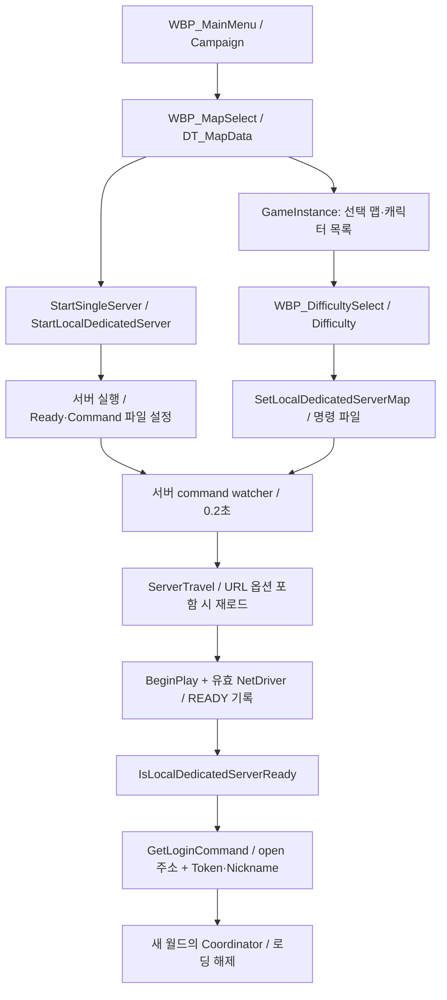
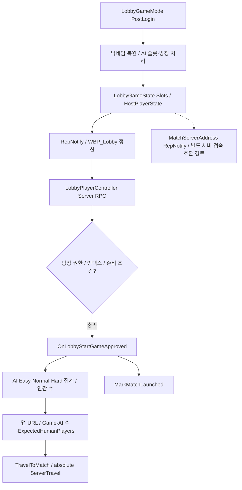
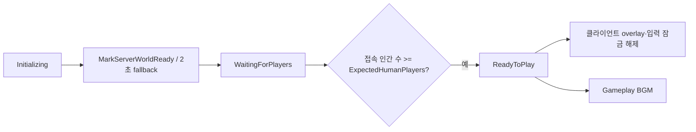

# 01. 진입·로비·서버·로딩

## 소유자와 진입점

| 대상 | 책임 / 확인 위치 |
|---|---|
| `BP_QuakeGameInstance` → `UShootingArenaGameInstance` | Token 생성, 접속 정보, 메뉴 선택, 저장 설정, 닉네임·AI 슬롯의 travel 간 유지 |
| `WBP_MainMenu`, `WBP_MapSelect`, `WBP_DifficultySelect` | 캠페인/멀티 선택, DT 맵 선택, 난이도, 서버 준비 대기와 접속 명령 |
| `BP_LobbyGameMode/State/PlayerController` | 네이티브 Lobby 클래스의 슬롯·방장·RPC에 Blueprint UI와 travel URL 조립 연결 |
| `ULocalDedicatedServerLibrary` | 서버 프로세스 시작·정지, Ready/Command 파일, 같은 프로세스의 맵 전환 |
| `LoadingCoordinatorWorldSubsystem` | 서버 월드 BeginPlay에서 replicated Coordinator 자동 생성 |
| `LoadingScreenSubsystem` | 로컬 overlay, 입력 잠금, 맵 전환 완료 감지·fade |

`DefaultEngine.ini`: 시작 맵 `MainMenu_Level`, 서버 기본 맵 `Lobby/StartLobby`, GameInstance `BP_QuakeGameInstance`. 전역 기본 GameMode는 FirstPerson 템플릿이지만 실제 메뉴·로비·경기 맵은 WorldSettings override를 사용합니다. [설정](../../Config/DefaultEngine.ini), [맵 조사](Evidence/map-settings.json).

## 캠페인 / 로컬 서버

명령 파일 경로와 Ready 파일은 프로세스별 상태입니다. 캠페인 서버 핸들과 `GMatchServerHandle`은 별도 관리합니다. watcher의 `ServerTravel(TargetMap, false)`는 기존 URL 옵션을 유지합니다. 옵션이 붙은 요청은 같은 맵이어도 재로드합니다. 메뉴로 복귀할 때 GameInstance의 **PreLoadMap**에서 로컬 서버를 정리합니다.

## 로비 / 경기 시작

슬롯 타입은 Open/Locked/Player/AI. 방장만 슬롯·AI·맵·시작 변경을 요청하며, 실제 플레이어 슬롯을 AI로 덮어쓰지 않습니다. 일반 참가자는 자신의 준비·닉네임을 바꿉니다. 맵 변경 시 채워진 슬롯 수가 새 최대 인원을 넘으면 거부합니다. 닉네임은 로비 RPC에서 trim 후 20자로 제한합니다.

현재 `BP_LobbyGameMode` 시작 이벤트에는 `TravelToMatch` 연결이 있습니다. `PollMatchServerReady`, 별도 서버 주소를 통한 클라이언트 이동 코드도 남아 있습니다. 소스 주석에 과거 프로세스 모델이 섞여 있으므로, 모델 판단은 [현재 BP 그래프](Blueprints/QuakeLike_1_0/GameFlow/Lobby/BP_LobbyGameMode.md)와 [TravelToMatch 구현](../../Source/ShootingArena/Private/LobbyGameMode.cpp)을 우선합니다.

## 로딩의 별도 상태

Coordinator는 0.2초 주기로 갱신합니다. URL 인원이 없으면 현재 접속 수를 최소 1로 사용합니다. 이것은 **접속한 인간 수 검사**이며 각 클라이언트의 asset 로딩 완료 ACK는 아닙니다. overlay는 원격 Coordinator 미도착 10초, 외부 로딩 45초 등에 fallback을 갖습니다. 이전 메뉴 월드의 Ready 상태로 새 서버 대기를 끝내지 않도록 시작 월드를 따로 추적합니다.

## 리팩토링 경계 제안

서버 프로세스 관리, 여행 URL 생성, 로비 정책, 로컬 overlay를 분리할 수 있습니다. 먼저 `MatchTravelOptions`와 `LoadingState`의 소유자를 정하고, BP의 readiness polling과 네이티브 watcher를 함께 이행합니다. absolute travel의 옵션 초기화, 메뉴 진입 전 서버 정리, 원격 접속의 즉시 disconnect 순서는 보존 후보입니다.

근거: [GI 그래프](Blueprints/QuakeLike_1_0/GameMode/BP_QuakeGameInstance.md), [Lobby RPC](../../Source/ShootingArena/Private/LobbyPlayerController.cpp), [서버 관리](../../Source/ShootingArena/Private/LocalDedicatedServerLibrary.cpp), [로딩 상태](../../Source/ShootingArena/Private/Loading/LoadingCoordinator.cpp), [overlay](../../Source/ShootingArena/Private/Loading/LoadingScreenSubsystem.cpp).
