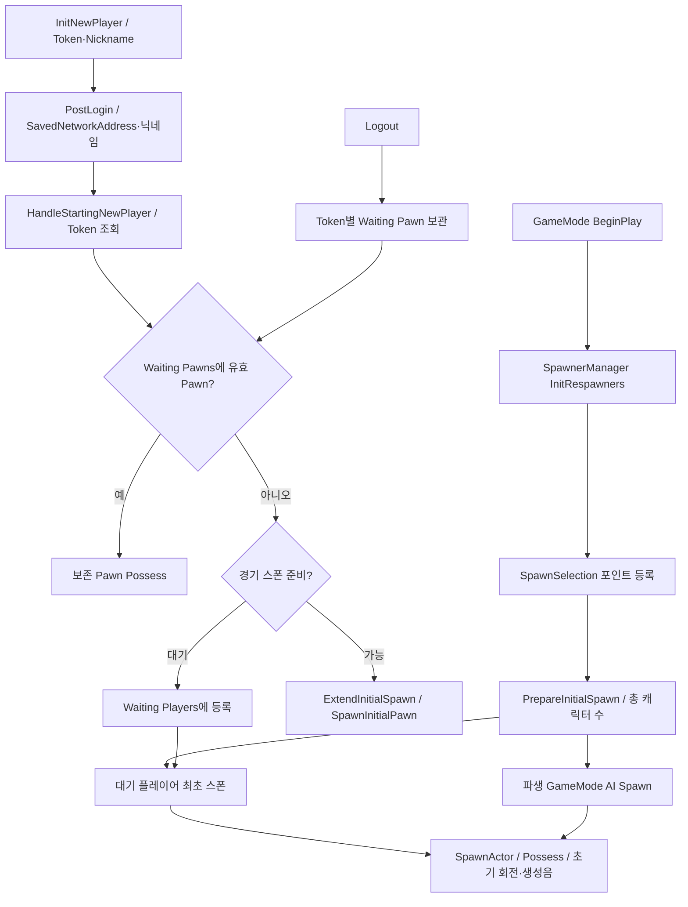
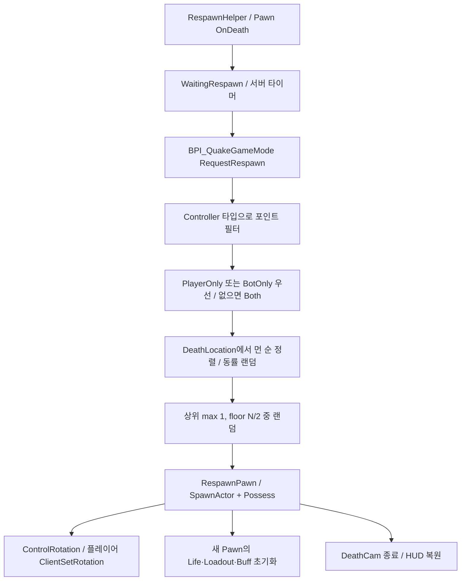
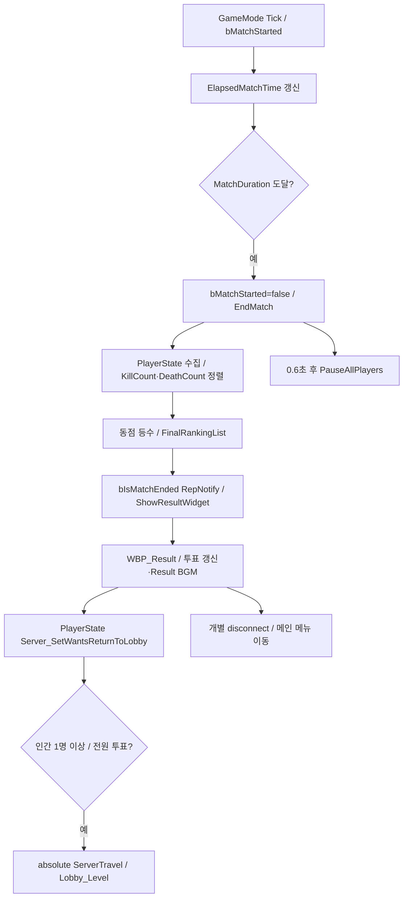

# 02. 경기·스폰·재접속

## 책임과 데이터

| 소유자 | 현재 책임 |
|---|---|
| `BP_QuakeGameMode` / `MyReconnectionGameMode` | 플레이어 대기·재접속, 경기 시계, 리스폰 요청, kill log 방송, 종료·순위 |
| `BP_QuakeAIGameMode` | 캠페인 맵의 Character_List와 난이도로 AI 구성 |
| `BP_MultiplayerAIGameMode` | URL의 AIEasy/AINormal/AIHard로 AI 구성 |
| `SpawnSelectionComponent` | 스폰 포인트 탐색·최초 배정·사망 위치 기반 리스폰, Spawn/Possess/회전 |
| `BPC_RespawnHelper` | Controller에 부착, Pawn 사망 바인딩·대기 타이머·새 Pawn 설정 |
| `BP_QuakeGameState` | 경기 시간·설정·최종 순위·종료 상태의 복제와 결과창 |
| `BP_QuakePlayerState` | 킬/데스·표시 이름·복수 대상·로비 복귀 의사 |

## 최초 접속·재접속

`AMyPlayerController::PawnLeavingGame`는 기본 Pawn 파괴를 생략합니다. GameMode의 Waiting Pawns / Token 복구와 함께 설계된 동작입니다. 재접속 정책을 없애려면 이 override와 보존 Pawn 정리도 같이 변경해야 합니다.

## 선택 규칙·리스폰

최초 배정은 `ceil(전체 캐릭터 수 / 전체 유효 포인트 수)`를 제한으로 사용하고, 후보 안에서 랜덤 선택합니다. 전용 포인트·Both·제한 초과 허용의 fallback 순서가 있습니다. 선택 즉시 횟수를 선점하며 Spawn/Possess 실패 시 `ReleaseInitialSpawnSelection`으로 복구합니다. **초기화와 위치 선택은 분리되어 있습니다**: HP·Armor·인벤토리·버프는 Pawn/Controller가 초기화합니다.

스폰 포인트 자동 탐색은 클래스 이름 `BP_PlayerSpawnPoint` 접두어와 `Spawn_Type/spawnType/SpawnType` Reflection에 의존합니다. 기존 Controller 없는 위치 선택 API는 타입 필터를 생략합니다. [선택 구현](../../Source/ShootingArena/SpawnSelectionSystem/SpawnSelectionComponent.cpp).

## 종료·결과·복귀

현재 `CheckEndCondition`에서 확인된 종료 조건은 **시간**입니다. `MaxScore`, `EndKillPoint`, `IsSuddenDeath`, 팀 점수 변수가 존재한다고 해서 점수 종료·서든데스가 연결되었다고 해석하지 않습니다. `DA_MatchSetting` 현재 값은 MatchDuration=600초, MaxScore=0입니다.

결과 순위는 킬이 많은 쪽, 같은 킬이면 데스가 적은 쪽을 우선합니다. 킬·데스가 모두 같으면 같은 등수를 부여합니다. 종료 시 FinalRankingList를 작성한 후 종료 flag를 알리고 0.6초 뒤 강제 pause를 예약합니다. 인간 판정은 PlayerState의 `bIsHumanPlayer`를 서버가 Owner 설정에서 기록합니다.

전원 투표 경로 외에 `MyPlayerController::ServerReturnToLobby`의 직접 travel API도 남아 있습니다. 로비 복귀 API를 통합할 때 결과창 실제 호출과 직접 RPC 호출자 모두 확인해야 합니다. 중복 travel은 NextURL/SeamlessTravel 상태로 막습니다.

## 리팩토링 경계 제안

경기 단계·시계·종료 정책을 GameMode에서 분리하고, 스폰 선택 로직은 독립 정책으로 보존할 수 있습니다. 스폰 요청 결과는 새 Pawn 포인터와 실패 이유를 명시하는 계약이 적합합니다. Token 복구, 늦은 참가, 모든 인간의 복귀 투표, 결과 데이터 복제 완료 후 pause를 회귀 검증 대상으로 남깁니다.

근거: [GameMode](Blueprints/QuakeLike_1_0/GameMode/BP_QuakeGameMode.md), [RespawnHelper](Blueprints/QuakeLike_1_0/Spawner/Component/BPC_RespawnHelper.md), [GameState](Blueprints/QuakeLike_1_0/GameMode/BP_QuakeGameState.md), [복귀 투표](../../Source/ShootingArena/Private/MyReconnectionGameMode.cpp), [PlayerState](../../Source/ShootingArena/Private/MyPlayerState.cpp).
