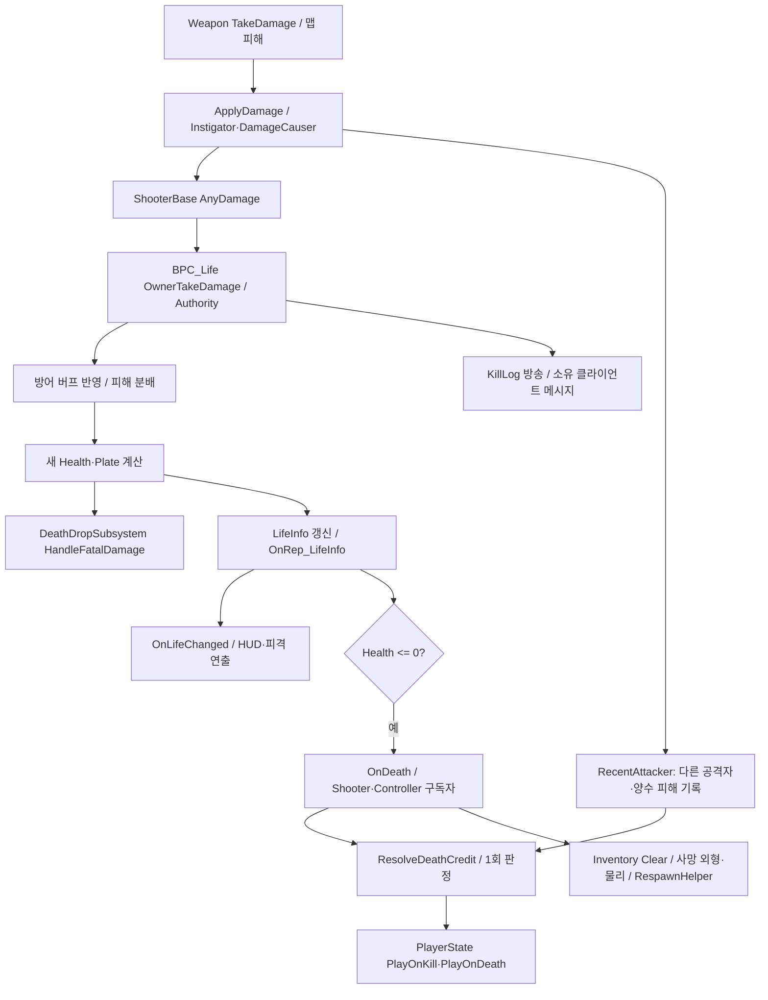
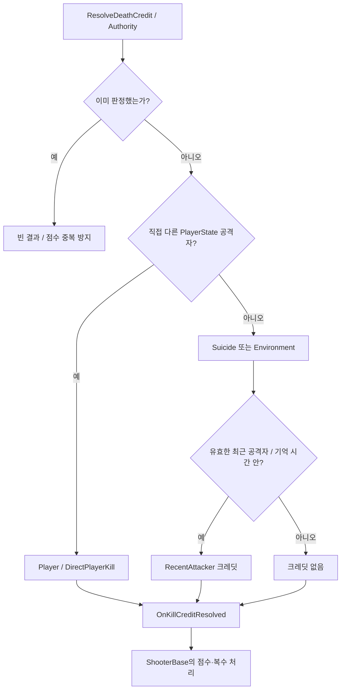

# 03. 피해·사망·킬 크레딧

## 피해 입력과 상태 소유

서버의 무기/맵 기믹이 `ApplyDamage`를 호출하고, `BP_ShooterBase.AnyDamage`가 `BPI_Life.OwnerTakeDamage`로 넘깁니다. HP/Armor와 damage packet은 `BPC_Life.LifeInfo`가 소유합니다. `RecentAttackerComponent`는 같은 Pawn의 OnTakeAnyDamage를 서버에서 구독하지만, Life 값은 직접 수정하지 않습니다.



화살표는 확인된 연계이며 delegate 구독자끼리의 실행 순서는 이 그림에서 보장하지 않습니다. 최근 공격자 기록과 사망 판정이 같은 damage 이벤트에 걸려 있어, 다중 delegate와 같은 프레임의 순서도 이행 시 검증해야 합니다.

## 피해 분배와 회복

`Calc Dmg Distribution`의 현재 수식:

```text
NewPlate  = max(0, NowPlate - Dmg * 0.66)
NewHealth = max(0, NowHealth - (Dmg * 0.34 + max(0, Dmg * 0.66 - NowPlate)))
```

Armor 부족분은 HP로 넘어갑니다. `GetBuffTakeDamage`는 피해자의 `BPC_Buff.CalcDefenceBuff`를 경유합니다. 공격 버프는 무기/발사 구성에서 별도로 적용됩니다. 공격·방어 적용을 중앙화할 때 같은 버프가 중복 곱해지지 않도록 구간을 보존해야 합니다.

`DA_DefaultLife`: startHealth=200, maxHealth=100, overMaxHealth=200, startPlate=0, maxPlate=100, overMaxPlate=200, DecayRate=3. 초과 Life 감소는 1초 반복 타이머로 `HandleOverLife`를 호출합니다. 일반/초과 회복과 상한 처리는 `Apply Heal`에 있으며 성공 연출은 Multicast_PlayHealFeedback에 분리되어 있습니다.

`BPC_Life` 클래스 CDO의 replicates=false와 ShooterBase의 **SCS Life template replicates=true**가 다릅니다. 클래스 기본값만 보고 LifeInfo 동기화를 미사용으로 판단하면 안 됩니다. [컴포넌트 증거](Evidence/component-defaults.json).

## 킬 소유권과 사망 부수 효과



직접 공격자 찾기는 Controller → DamageCauser Instigator → Owner Controller/Pawn 순의 fallback을 갖습니다. 최근 공격자의 기본 기억 시간은 설정이 없으면 5초입니다. 사망 원인과 점수를 받을 플레이어는 구분됩니다. `bDeathCreditResolved`는 같은 Pawn의 반복 사망 callback에 재크레딧을 주지 않습니다.

`BP_QuakePlayerState`의 점수·복수 규칙은 Blueprint에 남고, `ShooterRevengeComponent`가 PlayerState.RevengeTarget을 읽어 소유 클라이언트에 복제합니다. 캐릭터를 파괴하기 전에 사망 드롭이 선택 무기·버프 상태를 읽어야 하므로 Inventory Clear와 순서를 뒤집으면 드롭 내용이 달라집니다.

사망 드롭은 `HandleFatalDamage`에서 Pawn별 1회 처리, DT_DropItemSetting 검증, 무기/버프/작은 HP/작은 Armor 후보 생성, 최대 수 제한 후 Carrier를 생성합니다. 같은 후보의 중복 추첨은 하지 않습니다. 기본 무기 사망 드롭은 `GrantedWeapons[0]` 행을 사용하며, DT의 `SubstituteWeapon` 존재만으로 현재 선택 정책을 설명할 수 없습니다.

## 리팩토링 경계 제안

DamageRequest → Life 변경 결과 → DeathResult → 점수/드롭/리스폰/표현 이벤트로 나눌 수 있습니다. 보존할 계약은 서버 권한, 66/34 분배, 초과 HP decay, Pawn당 1회 사망 처리, 최근 공격자 크레딧, 드롭 이후 인벤토리 정리입니다. 재현할 시나리오는 직접 킬·자해·환경사·최근 공격자 만료·동시 피해·중복 사망 callback입니다.

근거: [Life 그래프](Blueprints/QuakeLike_1_0/Life/BPC_Life.md), [Shooter callbacks](Blueprints/QuakeLike_1_0/Character/BP_ShooterBase.md), [크레딧 구현](../../Source/ShootingArena/Private/Combat/RecentAttackerComponent.cpp), [드롭 구현](../../Source/ShootingArena/Private/Items/DeathDropSubsystem.cpp), [Carrier](../../Source/ShootingArena/Private/Items/DeathDropCarrier.cpp).
