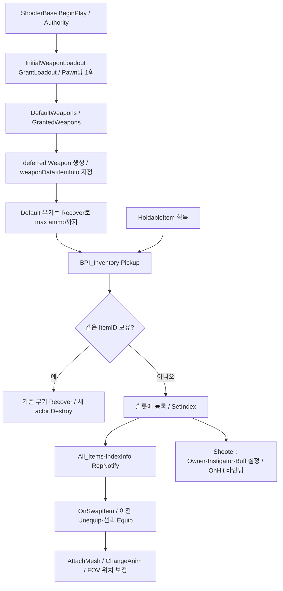
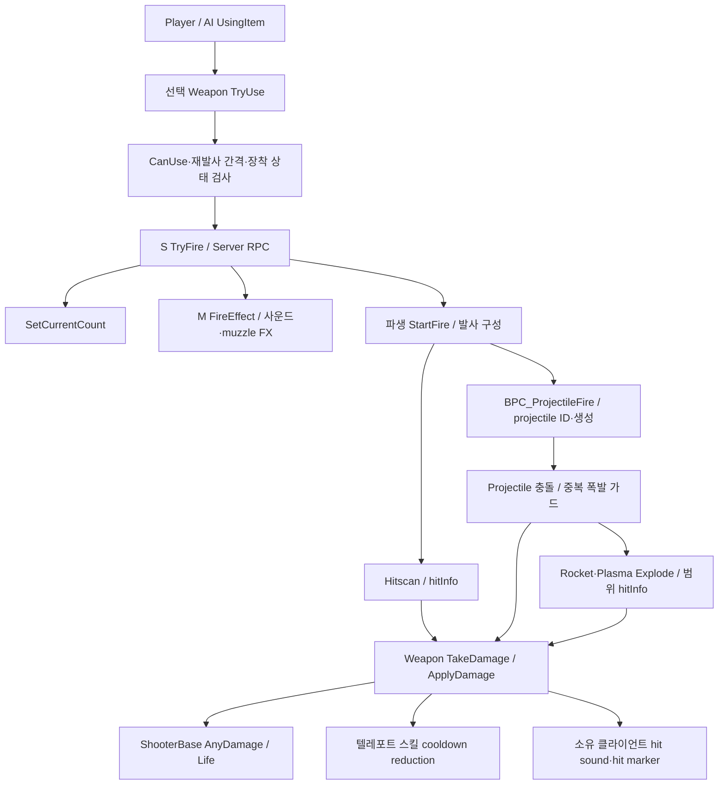
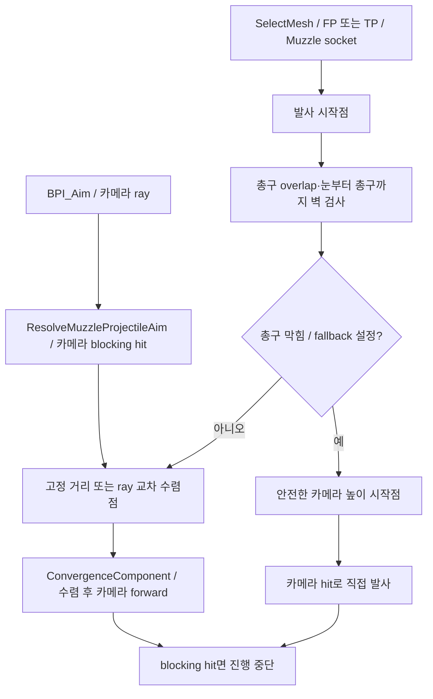

# 04. 무기·인벤토리·발사체

## 소유자와 설정

`BP_HeldItem`이 사용 횟수·장착 상태·FP/TP 메시·애니메이션을 갖고 `BP_WeaponBase`가 발사/피해/연출을 확장합니다. Pistol, MachineGun, ShotGun, RailGun, PlasmaGun, RocketLauncher 여섯 파생 무기와 대응 DA가 존재합니다. `PDA_HeldItem/PDA_WeaponBase`는 설정 스키마이며 실제 수치는 `Data/Item/DA_*` 인스턴스에 있습니다.

## 초기 지급·획득·교체

현재 loadout DA는 DefaultWeapons=Pistol, GrantedWeapons=MachineGun. 기본 무기는 탄약 상한까지 채우고, 추가 지급 무기는 시작 사용 횟수를 유지합니다. 동일 클래스 중복 지급을 건너뜁니다. C++는 BPI_Inventory 경로와 Pickup, Recover, weaponData, itemInfo의 이름/필드 형태에 의존합니다. Standalone 장착 보완은 `WeaponPresentationLibrary::ReconcileStandaloneEquip`가 기존 Swap handler를 재사용합니다.

## 발사·피해·연출

`TryUse`와 서버 RPC 본문은 별도 그래프 구간입니다. 호출 위치의 조건이 서버에서 동일하게 재검증되는지는 새 발사 API를 만들 때 확인할 항목입니다. 현재 파이프라인을 클라이언트·서버 공통 정책으로 오해하지 않습니다. projectile의 권한 분기·ID별 정리·multicast 효과와 actual damage를 함께 이행해야 합니다.

RailGun은 hit scan beam 생성/표현 함수가 따로 있으며 Collision 설정에 RailGunTraceChannel이 있습니다. Rocket/Plasma에는 직격·범위 폭발 구간, exploded 상태, 무기 소유자와 hitInfo 연결이 있습니다. 무기 설정은 [data-assets.json](Evidence/data-assets.json), 개별 파생 그래프는 [무기 색인](BlueprintIndex.md)을 참조합니다.

## 조준·수렴·표현

`WeaponAimAlignmentComponent`와 AnimNode는 무기/몸 포즈 정렬, `ProjectileFirstPersonRenderingComponent`와 `ProjectileMuzzleFlashLibrary`는 로컬 FP 렌더링을 담당합니다. 실제 피해 조준과 연출용 총구·beam transform이 분리되어 있습니다. Convergence driver는 비유도·중력 없는 ProjectileMovement만 지원하고 원래 movement tick을 직접 나누어 호출합니다.

## 리팩토링 경계 제안

인벤토리 상태, 탄약/재발사 정책, 서버 damage 생성, 발사체 이동, 로컬 표현을 분리합니다. 조준/수렴 math와 기존 테스트는 보존 후보입니다. 먼저 typed Item/Weapon 데이터 계약을 정해야 loadout·드롭·AI 무기 선택도 안정적으로 옮길 수 있습니다.

근거: [WeaponBase](Blueprints/QuakeLike_1_0/HeldItem/Gun/BP_WeaponBase.md), [HeldItem](Blueprints/QuakeLike_1_0/HeldItem/BP_HeldItem.md), [Inventory](Blueprints/QuakeLike_1_0/Inventory/BPC_Inventory.md), [초기 지급](../../Source/ShootingArena/Private/Weapon/InitialWeaponLoadoutComponent.cpp), [조준](../../Source/ShootingArena/Private/Weapon/WeaponProjectileAimLibrary.cpp), [수렴](../../Source/ShootingArena/Private/Weapon/ProjectileConvergenceComponent.cpp).
