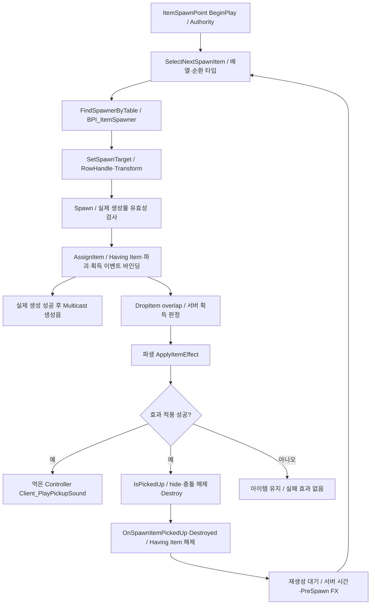
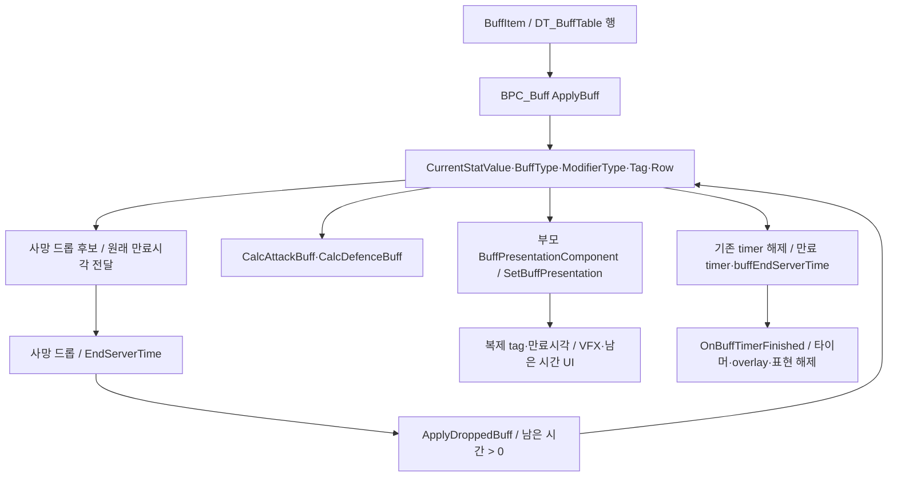

# 05. 아이템 스폰·획득·버프

## 스폰과 획득

`BP_ItemSpawnPoint`는 RowHandle/스폰 배열, 순환 인덱스, Having Item, 재생성 시각과 feedback을 관리합니다. Held/Ammo/Life/Buff spawner 컴포넌트가 테이블 종류별 생성물을 만듭니다. `BP_FixedItemSpawnPoint`도 별도 에셋으로 남아 있습니다.

`ItemSpawnSelectionLibrary`는 Sequential, PingPong, Random을 지원합니다. 빈 배열은 실패, 하나는 반복, invalid DT 행은 실패를 반환합니다. BP는 결과 인덱스·방향·현재 RowHandle을 보관합니다. `PreSpawnFeedbackLeadTime`은 사전 FX, 생성음은 Assign 완료 후 실제 성공 구간에 있으므로 서로 다른 타이밍입니다.

| Pickup | 적용 대상 / 데이터 |
|---|---|
| `BP_HoldableItem` | DT_HeldItemTable → 무기 actor → Inventory.Pickup |
| `BP_AmmoItem` | DT_AmmoItemTable.TargetItemID → 보유 무기 Recharge |
| `BP_LifeItem` | DT_LifeItemTable → Life 회복, 일반/mega/초과 상한 |
| `BP_BuffItem` | DT_BuffTable → Buff 적용, 드롭된 경우 원래 만료 시각 유지 |

맵 무기 획득의 자동 장착음은 pickup sound와 중복되지 않도록 억제 flag가 있습니다. 초기 지급과 이후 교체의 장착음은 별도 구간입니다. 기존 [아이템 사운드 문서](../ItemSoundSettings.md)의 일부 값 설명은 이전 시점 기록이며 이번 MCP DT 스냅샷 값을 우선합니다.

## 버프 상태·표현·드롭

상태 변수는 단일 current buff 슬롯 형태입니다. ApplyBuff는 이전 타이머를 지우고 새 type/value/end time을 기록합니다. Add 공격은 원 피해+값, Multiply 공격은 원 피해×값, Add 방어는 원 피해-값, Multiply 방어는 원 피해×값이며 음수 피해 방지 노드가 있습니다. 네 행의 현재 지속시간은 Multiply 30초, Add 60초입니다. Multiply Atk=3, Def=0.6, Add Atk/Def=10.

`BPC_Buff`의 부모는 **UBuffPresentationComponent**입니다. Blueprint는 효과 계산·timer, 네이티브는 표현용 상태 복제·VFX·사망 정리·서버 시간 기반 UI를 담당합니다.

`BuffSpawnCycleSubsystem`는 0.1초마다 월드 Actor를 순회합니다. 서버에서 `BP_ItemSpawnPoint_C`의 `Having Item`이 유→무로 바뀌는 것을 관찰해 `Buff.Multi.Atk ↔ Buff.Multi.Def`, `Buff.Add.Atk ↔ Buff.Add.Def`를 교환합니다. 클라이언트에서는 RowHandle 도착을 기다린 후 BuffItem.Setup Mesh를 호출합니다. 이 보완 시스템은 BP의 재생성 timer를 소유하지 않습니다.

## 사망 Carrier

DeathDropCarrier는 pickup을 비활성 상태로 생성·물리 몸체에 붙인 후 충돌/감속·착지 상태에 따라 실제 획득 가능한 위치로 마무리합니다. Pickup·Settled 상태를 복제하고 수명 후 정리합니다. 버프 Carrier는 원래 만료시각을 전달하여 드롭 후 전체 지속시간이 다시 시작되지 않게 합니다. [Carrier](../../Source/ShootingArena/Private/Items/DeathDropCarrier.cpp).

## 리팩토링 경계 제안

RowHandle 기반 아이템 생성/적용과 스폰 스케줄러를 분리하고, Having Item polling을 획득/파괴 이벤트 계약으로 교체할 수 있습니다. Buff 논리와 표현은 현재 나뉜 책임을 유지하되 태그·시간·RowName의 중복 상태를 줄이는 방향이 적합합니다. 실패한 획득, 재생성 순환, 드롭 버프 남은 시간, 사전 FX와 성공음의 구분을 보존합니다.

근거: [SpawnPoint](Blueprints/QuakeLike_1_0/Spawner/SpawnPoint/BP_ItemSpawnPoint.md), [DropItem](Blueprints/QuakeLike_1_0/DropItem/BP_DropItem.md), [Buff](Blueprints/QuakeLike_1_0/Buff/BPC_Buff.md), [선택 정책](../../Source/ShootingArena/Private/Spawner/ItemSpawnSelectionLibrary.cpp), [버프 보완](../../Source/ShootingArena/Private/Buff/BuffSpawnCycleSubsystem.cpp), [표현](../../Source/ShootingArena/Private/Buff/BuffPresentationComponent.cpp).
