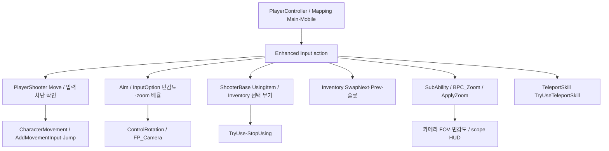
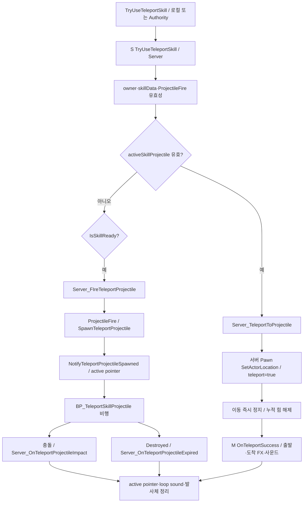

# 06. 플레이어 입력·이동·텔레포트 스킬

## 입력과 Pawn

`BP_QuakePlayerController`가 Mapping Main/Mobile, UI 입력 모드, Possess 알림과 메뉴를 관리합니다. `BP_PlayerShooter`는 ShooterBase를 상속하며 FP_Camera·FP_Mesh·JumpPadFlight·ProjectileFirstPersonRendering을 추가합니다. `BP_AIShooter`는 같은 Life/Inventory/스킬을 상속하고 GetAim 입력만 AI 경로로 제공합니다.

기본 이동에서는 ShooterBase Tick이 movingTime/MovementOption에 따른 MaxWalkSpeed와 발소리 타이머를 갱신합니다. PlayerShooter는 감도·줌·FOV·held item grip을 처리합니다. 시간 제한 입력 차단은 ShooterBase.Set Input Stop Timer와 PlayerShooter.Block Movement Input For Duration 경로가 함께 존재합니다. 점프패드가 호출하는 인터페이스를 통합할 때 두 차단 API의 범위를 확인해야 합니다.

## 스킬의 두 단계 사용

첫 사용은 발사체 생성, 유효한 발사체가 있을 때 재사용은 발사체 위치로 이동입니다. 무효 설정·cooldown이면 새 발사를 진행하지 않습니다. 스킬 projectile은 ProjectileBase를 상속하고 충돌/Destroyed를 스킬 컴포넌트로 통지합니다. 네트워크 연출 actor와 서버 active pointer 설정은 `NotifyTeleportProjectileSpawned`에서 연결됩니다.

서버 스킬 이동은 현재 `SetActorLocation(bSweep=false, bTeleport=true)`이며, 호출 전에 별도 목적지 충돌 보정을 했다고 확정할 수 없습니다. 이동 결과·도착 가능성을 새 정책으로 바꿀지는 기획 결정 사항입니다. 맵 포탈의 출구 배치·회전 정책과는 별도 구현입니다.

cooldown은 `skillCooldownEndTime`과 서버 시간 기반 GetCooldownPercent로 표현합니다. 피해/킬로 `AddSkillGaugeByCooldownReduction`을 호출하는 연결이 있습니다. DA_TeleportSkill의 현재 기본값: projectileSpeed=3000, maxDistance=12000, skillCooldown=1, killCooldownReduce=60, itemCooldownReduce=0. 값은 설계 의도가 아닌 현재 스냅샷입니다.

## 리팩토링 경계 제안

플레이어 입력을 명령 생성으로 한정하고 Pawn의 이동/스킬 실행을 공통화하면 AI 입력도 같은 계약을 사용할 수 있습니다. 스킬 상태를 Ready/ProjectileActive/Cooldown/Ending으로 명시할 후보가 있습니다. 발사체 정리와 cooldown 보정, death/respawn 시 ResetTeleportSkill, 재입력 race를 함께 다룹니다.

근거: [PlayerShooter](Blueprints/QuakeLike_1_0/Character/BP_PlayerShooter.md), [Controller](Blueprints/QuakeLike_1_0/Controller/BP_QuakePlayerController.md), [스킬](Blueprints/QuakeLike_1_0/Skill/BPC_TeleportSkill.md), [스킬 projectile](Blueprints/QuakeLike_1_0/Skill/BP_TeleportSkillProjectile.md), [스킬 DA](Evidence/data-assets.json).
