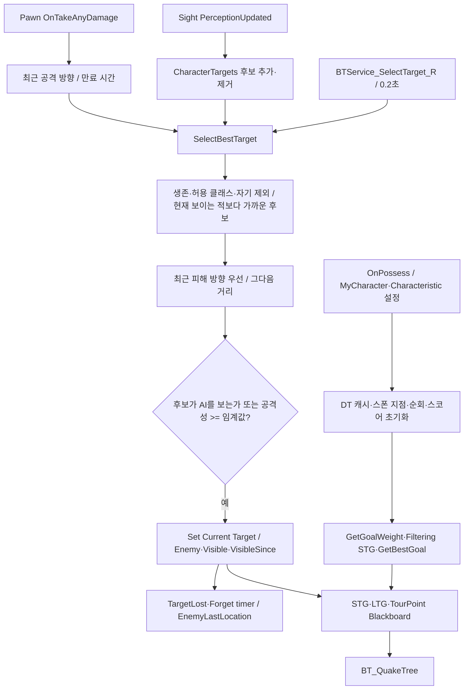
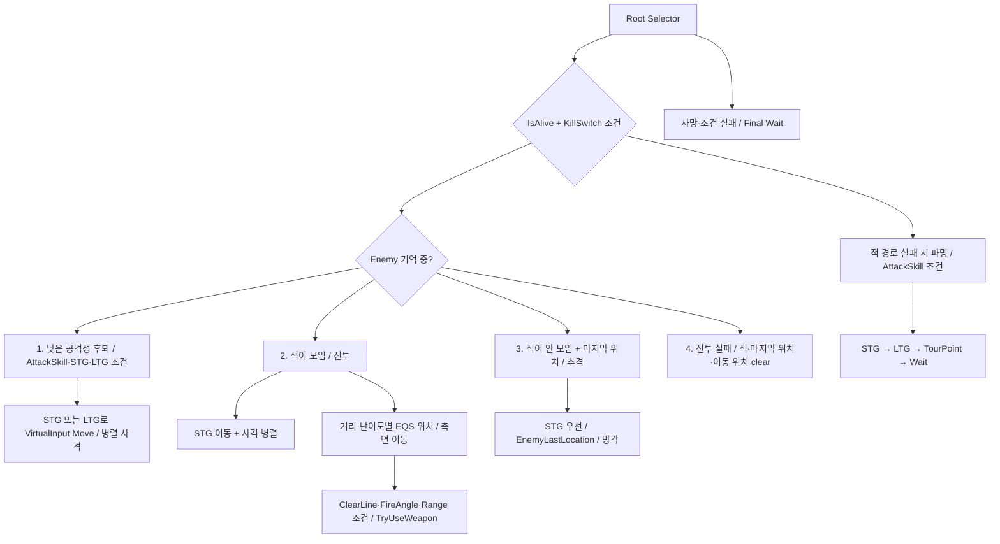

# 07. AI 의사결정·전투

## 현재 AI 계통

실제 경기 파생 GameMode는 `BP_AIShooter`와 `AI/AIC/BP_QuakeAIController2`를 사용합니다. Controller2의 부모는 **AQuakeTargetSelectionAIController**입니다. `Controller/BP_QuakeAIController`, AITest_YJS의 별도 Controller/BT, 기존 StateTree 템플릿은 구분 대상입니다. 이름에 Refactoring/Test가 있어도 현재 BT에 꽂힌 Task/Service는 유지 대상에 포함됩니다.

| 컴포넌트 / 데이터 | 역할 |
|---|---|
| AIPerception + 네이티브 Controller | 시야 후보, 최근 피해 방향, 새 Enemy 선택 |
| BPC_AIDataCache | Characteristic·아이템·무기 교체 DT 캐시 |
| BPC_VariousScore / GoalWeightCalculator | 생존·무기·높이·퍼지 가중치 |
| Controller2의 STG/LTG 함수 | 아이템/장기·단기 목표 비교·도달시간·타이머 |
| BPC_AIWeaponSelection | 거리·탄약 curve 점수, 교체 요청/지연 |
| BPC_PointsTourist | TourPoint 순회 |
| BPC_VirtualInputAIMovement | 경로 실행, 도착·막힘·점프패드 연결 |
| RespawnHelper + Base의 DeathCountTracker | AI 사망·재스폰과 데스 수 |

## 타깃과 목표 선택

시야 이벤트는 새 후보를 바로 선택하지 않습니다. 기존 Enemy를 다시 봤을 때는 visibility 복구와 망각 timer 해제를 수행합니다. 네이티브 Controller가 BP의 `Try Get Aggression Score`, `Get Characteristic`, `Set Current Target`, `Clear Target Lost Timer`, Life의 `Is Death`를 Reflection으로 찾습니다. 이 함수 이름·출력 구조체도 이행 계약입니다.

맵 캐릭터 데이터는 DT_MapData.Character_List → DT_Character.Characteristic_ID → DT_Characteristic으로 연결되고, 캠페인 난이도별 행 선택도 GameInstance 함수에 있습니다. 공격성 설정은 DA_DefaultAggression의 생존/무기/높이 가중치 등과 BP 점수 계산이 조합됩니다.

## 실제 Behavior Tree 우선순위

Selector는 왼쪽부터 조건을 만족하는 가지를 평가하고 Sequence는 자식 성공을 순서대로 요구합니다. 그림의 여러 화살표는 순차 이벤트 방송이 아니라 **BT의 우선순위 가지**입니다. 실제 노드 전체·Decorator/Service 목록은 [원본 BT](Evidence/behavior-tree.json), [BT 상세 Mermaid](Diagrams/behavior-tree.mmd)를 참조합니다.

현재 후퇴는 STG/LTG로 이동하며 `BTS_TryUseWeapon_R`와 `BTS_Test_UpdateDroneLocation` 등을 사용합니다. **BTS_UpdateRetreatDecision / BTT_SelectRetreatAreaStep 네이티브 노드는 이 BT에 없습니다.** Area 후퇴가 이미 현재 의사결정을 대신한다고 해석하면 안 됩니다.

사격은 clear line/range/fire angle decorator와 서비스 호출, aim은 Drone/Orbital focus 경로, 점프는 BTS_RandomJump_R로 분리됩니다. AIWeaponSelection은 거리 curve와 보유 탄약 비율 curve를 base weight와 곱해 최적 무기 tag를 고르고 교체 timer를 사용합니다.

## 리팩토링 경계 제안

인지 기억, 타깃 정책, 목표 점수, 행동 BT, 이동 실행을 분리할 수 있습니다. Blackboard key의 이름·타입을 먼저 고정하고 현재 트리의 각 가지를 회귀 시나리오로 남깁니다. 현재 BT에서 쓰는 `Test` 이름 서비스는 이름만으로 폐기하지 않습니다. 새 Area 후퇴 도입은 별도 기능 전환으로 취급합니다.

근거: [Controller2](Blueprints/QuakeLike_1_0/AI/AIC/BP_QuakeAIController2.md), [타깃 정책](../../Source/ShootingArena/Private/AI/QuakeTargetSelectionAIController.cpp), [서비스](../../Source/ShootingArena/Private/AI/BTService_SelectTarget_R.cpp), [무기 선택](Blueprints/QuakeLike_1_0/AI/BP/BPC_AIWeaponSelection.md), [BT 스냅샷](Evidence/behavior-tree.json).
