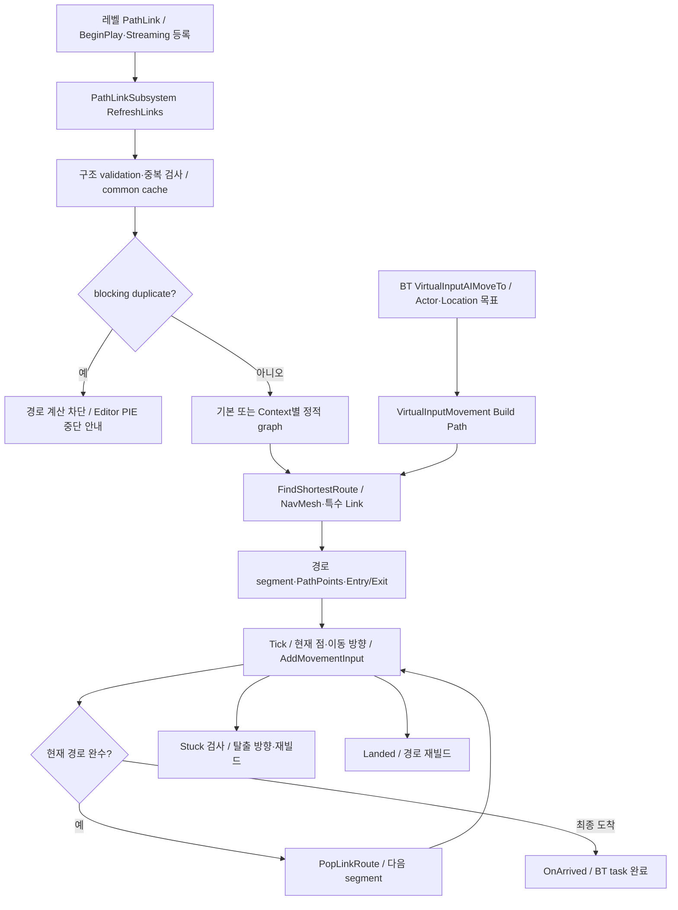
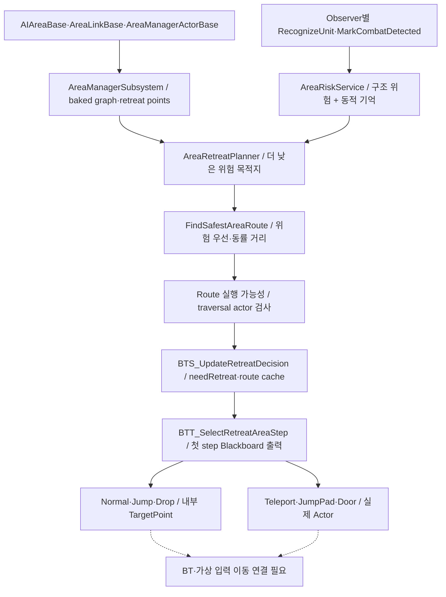

# 08. AI 경로·가상 입력·Area 위험도

## 현재 연결된 PathLink 경로

PathLinkSubsystem의 route 계산은 서버/Standalone에서만 진행합니다. NavMesh의 실제 PathPoints와 Link의 방향별 Entry/Exit를 함께 사용합니다. 등록/해제 시 cache를 무효화하고 static graph를 재사용합니다. VirtualInputMovement.Build Path의 현재 `PathfindingContext` 핀은 연결되지 않은 상태이므로, 구현에 Context별 cache가 있다는 사실과 실제 호출 사용을 구분해야 합니다.

VirtualInputMovement는 `CharacterMovement`에 가상 입력을 주며 경로점 완료, off-path, stuck, 목표 위치 변경, jump pad/portal 완료 처리를 갖습니다. BT task의 시작/abort·OnArrived와 clear/rebuild timer가 하나의 수명 경계입니다. Route를 만들고 실제 이동 입력은 다른 단계입니다.

## 구현되어 있는 C++ Area 시스템

이 그림은 **구현 파이프라인**입니다. 현재 BT_QuakeTree에서 Service/Task 호출이 확인되지 않았으며 `BB_QuakeBoard`의 현재 16개 key에도 needRetreat/isRetreating/retreatTraversal* 출력이 없습니다. StartLobby의 로드된 Actor에는 BP_AIArea/BP_AreaLink/BP_AreaManager 구형 BP가 있고, Cpp 파생 Actor와 동일한 것으로 볼 수 없습니다.

위험도는 연결 구조의 dead-end 요소와 Observer별 인지 유닛·전투 기억을 조합합니다. memory lifetime이 지나면 동적 위험에서 제외합니다. planner는 현 구역보다 위험 개선을 만족하는 후보와 baked retreat point를 우선하고, 위험이 같으면 이동 거리가 짧은 route를 고릅니다. graph 미준비·구역 미포함·경로 실패·traversal actor 누락의 fallback도 있습니다.

## 중복·미연결 계통

| 계통 | 조사 판정 |
|---|---|
| PathLinkSubsystem + BP_PathLink | VirtualInputMovement.Build Path에서 호출 연결 확인 |
| C++ Area graph/risk/planner | 구현 존재, 현재 주 BT 후퇴에 미연결 |
| BP_AIArea/AreaManager/AreaRiskComponent | 별도 BP 구현·StartLobby 배치 확인, C++ 대체 완료로 볼 수 없음 |
| Test/WayPointLink 및 NonNavMesh 시험 | 상세 조사했지만 주 경기 사용 여부는 별도 확인 |

## 리팩토링 경계 제안

경로 계산 결과와 이동 실행 명령을 타입 있는 segment 계약으로 나눕니다. PathLink의 등록/cache/중복 validation은 유지 후보입니다. Area 위험도 도입 여부를 먼저 정하고 구형 BP와 C++를 함께 남길 기간을 제한합니다. 도입 시 Blackboard key 추가·BT 배치·인지 이벤트 공급·실제 traversal Actor 실행을 모두 연결해야 합니다.

근거: [이동 BP](Blueprints/QuakeLike_1_0/AI/VirtualInputMovement/BPC_VirtualInputAIMovement.md), [PathLink](../../Source/ShootingArena/Private/AI/PathLink/PathLinkSubsystem.cpp), [route finder](../../Source/ShootingArena/Private/AI/PathLink/Internal/PathLinkRouteFinder.cpp), [Area planner](../../Source/ShootingArena/Private/AI/Area/Internal/AreaRetreatPlanner.cpp), [Area service](../../Source/ShootingArena/Private/AI/Area/BTS_UpdateRetreatDecision.cpp), [Area task](../../Source/ShootingArena/Private/AI/Area/BTT_SelectRetreatAreaStep.cpp), [맵 Actor](Evidence/map-actor-classes.json).
