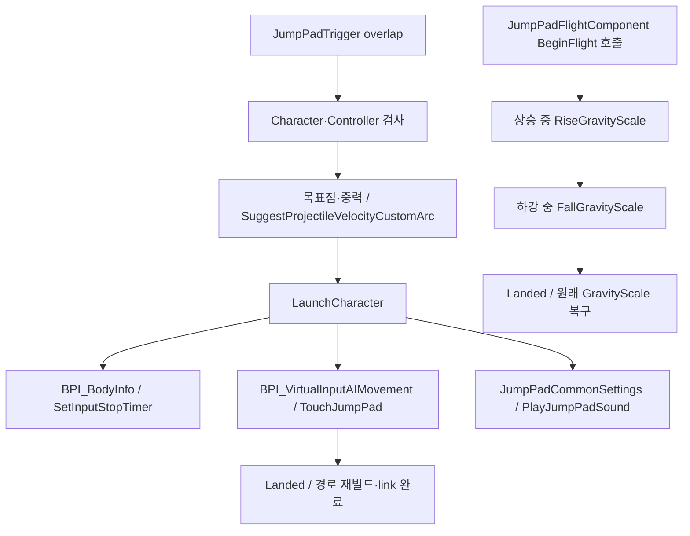
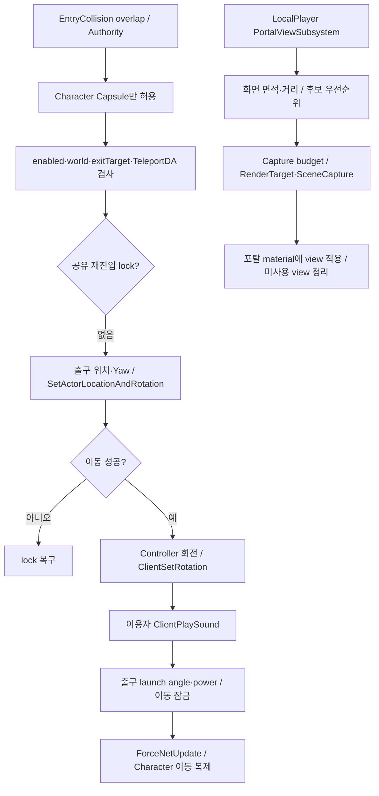

# 09. 맵 기믹·포탈

## 실제 배치와 여러 구현

| 맵 / 구현 | 현재 로드된 Actor에서 확인한 내용 |
|---|---|
| Lvl_QuakeMap_00 | 네이티브 파생 BP_OneWayPortal 2개, BP_PathLink 1개 |
| Lvl_PortalMap | BP_OneWayPortal 6개, PathLink 17개, 방향 점프패드 4개 |
| Lvl_QuakeMap_04 | 구형 BPA_YJS_Portal_OneWay/TwoWay 각 4개, PathLink 27개, 방향 점프패드 8개, 피해판 2개 |
| Lvl_QuakeMap_02 / Lvl_02Map | 방향 점프패드 각 4개 |
| StartLobby | BP_Portal 및 구형 BP Area 계통 배치 |

전체 World Partition 외부 Actor/서브레벨을 보장하는 수량은 아닙니다. [메모리 Actor 클래스 스냅샷](Evidence/map-actor-classes.json). 포탈을 전면 교체하려면 구형/신형 두 계통의 맵 인스턴스 설정을 모두 이행해야 합니다.

## 방향 점프패드 / 비행 보완

위쪽은 현재 방향 점프패드 그래프, 아래쪽은 C++ 비행 컴포넌트의 독립 API입니다. 방향 패드에서 `BeginFlight` 호출은 이번 top-level 그래프에서 확인되지 않았습니다. Pawn에 컴포넌트가 붙었다는 이유만으로 모든 패드가 상승/하강 중력 보정을 사용한다고 판단하지 않습니다.

Normal, Normal_Nav, Direction, ApexTime, LaunchAngle 패드와 JumpPadNavLink가 함께 존재합니다. 방향 패드의 Nav projection과 AI TouchJumpPad, Controller 입력 차단을 유지할지 확인해야 합니다. 반복 패드 비행에서는 최초 원래 중력값을 덮어쓰지 않도록 C++가 보존합니다.

## 네이티브 OneWay 포탈

실제 이동은 서버 Actor, 관찰 화면은 LocalPlayer Subsystem이 소유합니다. 재진입 lock은 포탈 간 공유하여 출구의 즉시 overlap으로 재텔레포트되는 것을 막습니다. 출구가 자기 자신/없음, 설정 누락, 월드 종료면 이동하지 않습니다. PortalView는 출력 해상도·갱신 예산·가시 후보를 관리하며 Dedicated Server의 실제 텔레포트 정책과 분리 가능합니다.

## 다른 기믹

| 기믹 | 확인된 파이프라인 / 이행 대상 |
|---|---|
| Door | overlap → Timeline 재생률·Lerp → 상대 위치; CloseByTimer와 Remote 제어 |
| PressurePlate | Begin/End overlap → 연결 Door.CloseDoorRemote |
| MovingPlatform | BeginPlay·overlap → Timeline → Lerp·상대 위치 |
| CrumblingPlatform | overlap → Delay → Hidden Platform·collision off → Show Platform |
| DamagePlate | overlap → ApplyDamage → 공통 Life/사망 파이프라인 |
| 구형 OneWay/TwoWay Portal | Blueprint 구현이 남고 일부 실제 경기 맵에 배치되어 있음 |

Timeline 내부 curve, 모든 맵 인스턴스별 목표/문 참조, 멀티플레이에서 기믹 transform 복제 결과는 이번 API/정적 조사만으로 확정하지 않았습니다. 개별 Blueprint 상세 도표에 top-level exec 연결은 보존했습니다.

## 리팩토링 경계 제안

기믹 동작과 AI traversal metadata를 분리하되 Entry/Exit/실행 Actor 계약은 유지합니다. 포탈 visual subsystem과 실제 이동은 서로 다른 교체 단위입니다. 점프패드 variant를 합칠 경우 각 발사 계산법과 이동 잠금·AI 완료 알림을 먼저 공통 테스트 조건으로 정의합니다.

근거: [방향 패드](Blueprints/QuakeLike_1_0/MapDesign/MapGimmick/BPA_YJS_Direction_JumpPad.md), [비행](../../Source/ShootingArena/JumpPadFlightComponent.cpp), [공통 사운드](../../Source/ShootingArena/JumpPadCommonSettings.cpp), [포탈 이동](../../Source/ShootingArena/Teleport/OneWayTeleportActor.cpp), [포탈 화면](../../Source/ShootingArena/Teleport/PortalViewSubsystem.cpp), [기믹 색인](BlueprintIndex.md).
