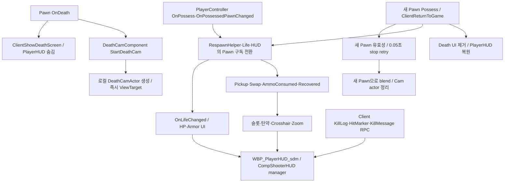
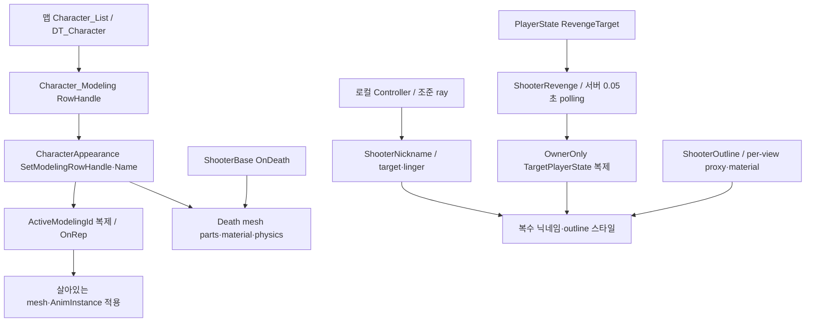
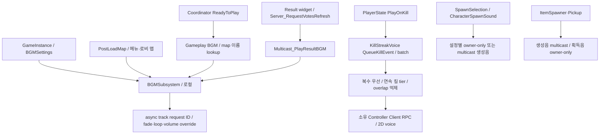

# 10. HUD·카메라·외형·애니메이션·오디오

## HUD·데스캠

실제 Controller 그래프가 참조하는 커스텀 전투 HUD는 **`/Game/QuakeLike_Base/SDM/UI/Combat_UI/WBP_PlayerHUD_sdm`**입니다. `/Game/QuakeLike_1_0/UI/PlayerUI/WBP_PlayerHUD`와 동일한 구현으로 취급하면 안 됩니다. 커스텀 HUD는 CompShooterHUD의 manager/함수/다수 위젯을 참조합니다. GameMode HUDClass도 HUD_CompShooter입니다.

HUD의 `RF_SetDisplayedPawn`, `RF_UnbindDisplayedSources`, `RF_InitializeLife/Inventory` 등이 대상 Pawn 변경 시 delegate를 바꿉니다. 사망/복귀 시 바인딩 수명과 기존 상태 캐시를 같이 이행해야 합니다. Base의 `BPC_DeathCountTracker`도 Player/AI Controller에 붙어 있으며 Increment Death Count 연결이 있습니다. Life 사망과 PlayerState 이벤트만 보고 데스 증가 책임을 제거하면 안 됩니다.

DeathCam은 시작 즉시 ViewTarget을 바꾸고 중복 callback을 Pawn/사망 위치로 막습니다. 새 Pawn 포인터가 아직 도착하지 않으면 종료를 재시도하고 blend 뒤 actor를 정리합니다. tick은 엔진/다른 코드가 ViewTarget을 덮어쓴 경우 복원합니다. 메뉴/결과의 입력 모드도 별도 Controller/UI 코드가 바꿉니다.

## 외형·조준 표시

CharacterAppearance는 DT_CharacterAppearance/DT_CharacterModeling 및 설정된 live/death mesh 이름·태그를 사용합니다. `ShooterDisplayLibrary`는 살아있는 Shooter의 mesh와 표시 이름/사망 상태를 읽는 공통 함수입니다. Outline/Nickname은 로컬 표시이며 damage collision을 바꾸는 시스템으로 취급하지 않습니다. Nickname은 DeathCam ViewTarget에서 표시를 비우고 조준 대상 상실 후 linger 규칙을 적용합니다.

WeaponAimAlignmentComponent → AnimNode_WeaponAimAlignment는 목표·spine 제한·free hand pose를 전달하고 AnimGraph에서 포즈를 정렬합니다. FP/TP AnimBlueprint와 Muzzle/AimDirection socket이 실제 발사/연출 transform의 의존성입니다. state machine 내부는 MCP helper 범위 밖이므로 애니메이션 전체 전환 규칙은 미확정입니다.

## 오디오 상태와 재생 범위

BGM은 GameInstance 수명이며 전용 서버에서 재생하지 않습니다. gameplay 맵으로 travel할 때 기존 BGM을 fade out하고 ReadyToPlay 후 시작합니다. Result BGM은 결과 위젯의 투표 갱신 RPC를 신호로 사용하므로 오디오와 로비 투표가 현재 결합되어 있습니다. BGM map key는 실제 맵 이름을 정규화해 찾습니다.

KillStreakVoice는 같은 batch의 킬 수를 합산하고 복수 음성을 우선합니다. 정확한 tier 또는 최고 tier 초과의 fallback, one-shot 검사, voice overlap time, 사망 시 상태/대기 음성 정리가 있습니다. 발소리·무기·버프·포탈 소리는 별도의 BP/C++ 생성 경로와 attenuation/concurrency를 사용합니다.

## 리팩토링 경계 제안

HUD는 gameplay 상태를 구독하고 Pawn 교체 때 구독을 정리하는 presenter로 남길 수 있습니다. BGM 시작을 경기 단계 이벤트로 옮겨 투표 RPC와 분리합니다. 복수 대상은 PlayerState를 원본으로 유지하며 polling bridge를 이벤트형 API로 교체할 후보입니다. DeathCam의 즉시 시작·늦게 도착한 새 Pawn 처리, 사운드 청취 범위는 유지 계약입니다.

근거: [실제 HUD](Blueprints/QuakeLike_Base/SDM/UI/Combat_UI/WBP_PlayerHUD_sdm.md), [DeathCountTracker](Blueprints/QuakeLike_Base/SDM/UI/Combat_UI/BPC_DeathCountTracker.md), [데스캠](../../Source/ShootingArena/Private/Camera/DeathCamComponent.cpp), [외형](../../Source/ShootingArena/Private/Character/CharacterAppearanceComponent.cpp), [복수 bridge](../../Source/ShootingArena/Private/Camera/ShooterRevengeComponent.cpp), [BGM](../../Source/ShootingArena/Private/Audio/BGMSubsystem.cpp), [음성](../../Source/ShootingArena/Private/Audio/KillStreakVoiceComponent.cpp).
