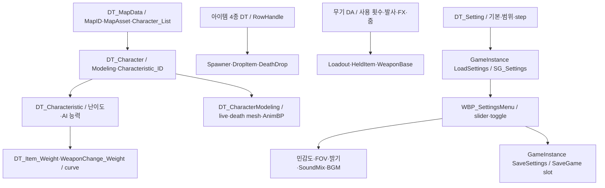
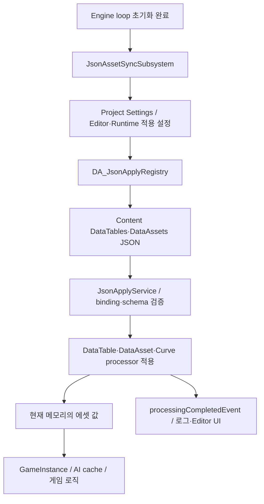
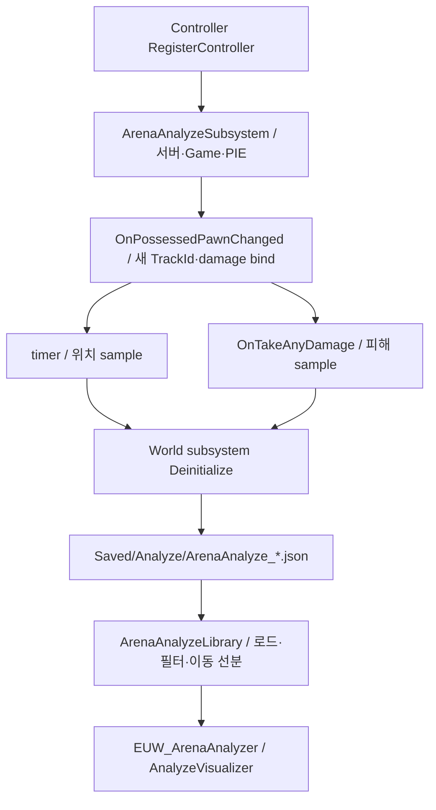

# 11. 데이터·설정 저장·분석·Editor 도구

## 현재 데이터 흐름

DataTable의 RowName/GameplayTag/클래스와 DA 스키마가 BP·C++ 양쪽의 공통 계약입니다. [15개 DT 전체 행](Evidence/data-tables.json), [DA 현재값](Evidence/data-assets.json). 같은 의미의 이름도 Map_ID/실제 맵 이름/Map_Asset, ItemID/WeaponTag/RowName으로 여러 형태가 있으므로 타입 경계를 먼저 정해야 합니다.

| 테이블 | 주요 필드 / 사용처 |
|---|---|
| DT_MapData, DT_Character | 메뉴·로비·캠페인 생성 / 맵·캐릭터·AI 특징 연결 |
| DT_Characteristic | Attack_Skill·Aim_Skill·Accuracy·ReactionTime·Aggression·Self_Preservation 등 |
| DT_Item_Weight | Item_Tag·Base_Score·Reference_Tag·Curve_FuzzyWeight |
| DT_WeaponChange_Weight | Weapon_Tag·Base_Weight·DistanceCurve·AmmoCurve·IsRadialWeapon |
| DT_HeldItemTable | item class·Item DA·Weapon DA·mesh·생성/획득음 |
| DT_LifeItemTable / DT_AmmoItemTable | 회복 type/amount/mega, 대상 item tag/ammo |
| DT_BuffTable / DT_DropItemSetting | 효과 수치·기간·표현, 사망 드롭 정책/클래스 |
| DT_CharacterAppearance/Modeling | 모델 ID·skeletal mesh·death parts·AnimInstance |
| DT_Setting | H/V/Zoom 감도·FOV·Brightness·5종 볼륨 기본값/범위 |
| DT_FLobbySlot / DT_JsonParserTest | 로비 구조 표 / JSON 시험 데이터 |

`BP_QuakeGameInstance.LoadSettings`는 SaveGame 유무에 따라 저장 데이터/기본값을 준비하고, FillDefaultsFromDT가 설정 기본값을 보완합니다. WBP_SettingsMenu의 Apply* 함수가 입력·카메라·밝기·오디오에 즉시 적용합니다. `BPC_InputOption`과 BP_SaveInputOption/WBP_PlayerOption도 별도 입력 옵션 경로로 존재하므로 통합 전 실제 호출자를 확인해야 합니다.

## JSON의 런타임 적용

현재 설정은 `editorApplyMode=MemoryOnly`, `applyOnRuntimeStartup=True`. registry에는 DT_Character.json → DT_Character, DT_Characteristic.json → DT_Characteristic, TestDataAsset.json → DA_Testda가 있고 curve/float curve binding은 비어 있습니다. [실제 registry](Evidence/json-apply-registry.json), [설정](../../Config/DefaultGame.ini).

MCP가 읽은 에셋 값은 현재 에디터 메모리 값입니다. JSON startup 적용으로 디스크와 값이 달라질 수 있으므로 전체 스냅샷을 디스크 저장본이라고 단정하지 않습니다. 패키징은 JsonAssetSync 디렉터리 cook와 JSON의 NonUFS stage 설정에 의존합니다. 에셋 값만 이행하고 JSON 바인딩을 남기면 다음 실행에 다시 덮어쓰는 일이 생길 수 있습니다.

## 플레이 분석과 개발 도구

Subsystem은 자동 생성되지만 Controller 등록이 필요합니다. Source/Blueprint 호출 위치는 [색인](CppIndex.md)과 Blueprint 세부 목록에서 확인합니다. 위치·피해 데이터, Pawn track과 Controller ID, delegate 정리는 리팩토링 전후 행동 비교에 활용할 수 있는 보존 후보입니다.

| 개발 전용 대상 | 현재 역할 / 게임 실행과 구분 |
|---|---|
| ShootingArenaEditorTools | DressSwapTool, 무기 조준·발사체·muzzle·Plasma·사운드 이전 라이브러리, AnimGraph editor node |
| GameplayValidatorEditor | 포탈·JumpPad·PathLink 월드 validation / 네이티브 PathLink bridge |
| BlackboardUsageScanner | Blueprint/BT의 key 사용 검사 |
| JsonAssetSyncEditor | schema export·적용 UI·packaging preflight |
| UnrealMCPython / Tools/mcp-server | 에디터 조사·조작 도구 |
| NiagaraUIRenderer | HUD Niagara 표현 의존성 |

이전용 스크립트·Editor 라이브러리 존재가 매 실행 자동 migration을 뜻하지 않습니다. JsonAssetSync처럼 startup 등록이 있는 시스템과 일회성 이전 도구를 구분합니다. GameplayStateTree plugin은 켜져 있지만 주 AI 연결은 이번 조사에서 BT로 확인되었습니다. OnlineSubsystem 기본값은 Null, 네트워크 드라이버는 IpNetDriver, Steam은 비활성입니다.

## 기존 테스트 자산

ProjectileMuzzleAim, ProjectileConvergence, CharacterDisplay, RevengePlayerStateBridge, Buff.Presentation, BGM loop/PausedPIE, ItemSound/Timing, Spawner.SelectionModes 테스트가 Source에 있습니다. 이번에는 실행하지 않았으며 과거 결과를 이번 통과로 표시하지 않습니다. 무기/표현/사운드 테스트는 해당 이행 단계의 유지 후보이고, 경기 단계·재접속·전체 BT 행동은 별도 회귀 시나리오가 필요합니다.

근거: [GI 설정 그래프](Blueprints/QuakeLike_1_0/GameMode/BP_QuakeGameInstance.md), [설정 UI](Blueprints/QuakeLike_1_0/GameProgressFlow/WBP_SettingsMenu.md), [JSON subsystem](../../Plugins/JsonAssetSync/Source/JsonAssetSync/Private/JsonAssetSyncSubsystem.cpp), [분석 subsystem](../../Source/ShootingArena/Private/Analyzer/ArenaAnalyzeSubsystem.cpp), [분석 library](../../Source/ShootingArena/Private/Analyzer/ArenaAnalyzeLibrary.cpp), [모듈 경계](../../Source/ShootingArena/ShootingArena.Build.cs).
