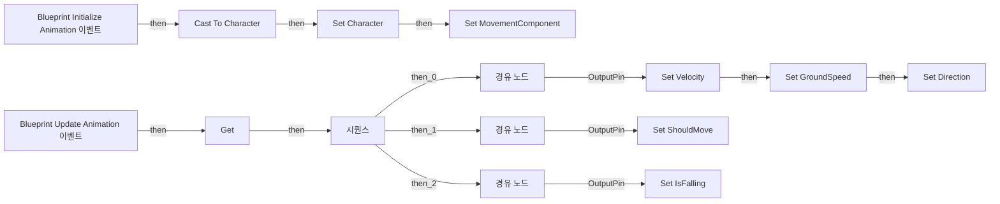

# ABP_Unarmed

에셋: `/Game/Characters/Mannequins/Anims/Unarmed/ABP_Unarmed`

부모: `/Script/CoreUObject.Class'/Script/Engine.AnimInstance'`

수집일: 2026-10-12. MCP에서 읽은 그래프·핀 연결의 자동 전사입니다. 상속된 그래프는 부모 문서를 함께 확인합니다.

정적 루트 참조 도달: 있음. 실행 여부 또는 삭제 가능 여부의 확정이 아닙니다.

컴포넌트 목록은 이 BP가 직접 정의한 SCS만 포함합니다. 부모·네이티브 생성 컴포넌트, 인스턴스 설정은 별도입니다.

## 변수와 기본값

| 이름 | 타입 | CDO 기본값 |
|---|---|---|
| `Character` | `Character` | None |
| `MovementComponent` | `CharacterMovementComponent` | None |
| `Velocity` | `Vector` | &lt;Struct 'Vector' {x: 0.000000, y: 0.000000, z: 0.000000}&gt; |
| `GroundSpeed` | `real` | 0.0 |
| `Direction` | `real` | 0.0 |
| `ShouldMove` | `bool` | False |
| `IsFalling` | `bool` | False |

## 그래프 목록

| 그래프 | 전체 노드 수 |
|---|---|
| AnimGraph | 8 |
| EventGraph | 43 |

## 그래프별 실행 연결

실선은 출력 exec 핀의 실제 연결입니다. 여러 분기는 출력 핀 이름을 표시합니다. 함수 호출·delegate·타이머의 다음 그래프 실행은 이 그림에서 자동으로 이어 붙이지 않습니다.

순수 계산 노드 및 데이터 핀은 아래 목록과 원본 JSON을 확인합니다. 연결되지 않은 이벤트도 표시되므로, 노드가 있다는 이유만으로 실행된다고 판단하면 안 됩니다.

### AnimGraph

전체 노드·기본 입력 목록

| 노드 ID | 제목 | 미연결 기본 입력 / 에셋 입력 |
|---|---|---|
| `AnimGraphNode_Root_0` | 출력 포즈 AnimGraph |  |
| `AnimGraphNode_StateMachine_0` | Locomotion State Machine |  |
| `AnimGraphNode_SaveCachedPose_0` | Save cached pose 'Locomotion' |  |
| `AnimGraphNode_StateMachine_1` | Main States State Machine |  |
| `AnimGraphNode_Slot_0` | Slot 'DefaultSlot' Group 'DefaultGroup' |  |
| `K2Node_VariableGet_0` | Get IsFalling |  |
| `K2Node_CallFunction_0` | NOT Boolean |  |
| `AnimGraphNode_ControlRig_0` | 컨트롤 릭 | Alpha=1.000000 |

### EventGraph

실행 핀 플로우차트

전체 노드·기본 입력 목록

| 노드 ID | 제목 | 미연결 기본 입력 / 에셋 입력 |
|---|---|---|
| `K2Node_Event_0` | Blueprint Update Animation 이벤트 | DeltaTimeX=0.0 |
| `K2Node_Event_1` | Blueprint Initialize Animation 이벤트 |  |
| `K2Node_VariableGet_0` | Get |  |
| `K2Node_CallFunction_4` | Get Owning Actor 타깃은 애님 인스턴스 |  |
| `K2Node_DynamicCast_0` | Cast To Character |  |
| `K2Node_VariableGet_2` | Get CharacterMovement |  |
| `K2Node_VariableSet_1` | Set Character |  |
| `K2Node_VariableSet_2` | Set MovementComponent |  |
| `K2Node_ExecutionSequence_0` | 시퀀스 |  |
| `K2Node_VariableSet_3` | Set Velocity |  |
| `K2Node_VariableGet_6` | Get MovementComponent |  |
| `K2Node_VariableGet_4` | Get Velocity |  |
| `K2Node_CallFunction_5` | Vector Length XY |  |
| `K2Node_VariableSet_4` | Set GroundSpeed | Output_Get=0.0 |
| `K2Node_Knot_0` | 경유 노드 |  |
| `K2Node_VariableSet_5` | Set ShouldMove | Output_Get=false |
| `K2Node_Knot_1` | 경유 노드 |  |
| `K2Node_VariableGet_5` | Get GroundSpeed |  |
| `K2Node_PromotableOperator_0` | float &gt; float | B=5.000000 |
| `K2Node_VariableGet_7` | Get MovementComponent |  |
| `K2Node_CallFunction_6` | Get Current Acceleration 타깃은 캐릭터 무브먼트 컴포넌트 |  |
| `K2Node_PromotableOperator_2` | Not Equal (Vector) |  |
| `K2Node_VariableSet_6` | Set IsFalling | Output_Get=false |
| `K2Node_Knot_2` | 경유 노드 |  |
| `K2Node_VariableGet_3` | Get MovementComponent |  |
| `K2Node_CallFunction_7` | Is Falling 타깃은 내비 무브먼트 컴포넌트 |  |
| `EdGraphNode_Comment_0` | 이 블루프린트가 초기화될 때 소유 캐릭터에 대한 참조를 설정합니다. |  |
| `EdGraphNode_Comment_1` | 캐릭터가 유효한 경우에만 값을 업데이트합니다 (캐릭터가 월드에 존재하고 참조가 설정된 경우). |  |
| `EdGraphNode_Comment_2` | 이동 컴포넌트의 속도값으로 속도와 지면 속도 설정. 지면 속도는 속도의 X, Y 축만 사용하여 계산되므로 수직 이동은 영향 없음. |  |
| `EdGraphNode_Comment_3` | 지면 속도가 최소 임계값 이상이고 가속도(입력)가 적용 중일 때만 Should Move를 true로 설정 (미세한 속도로 인한 애니메이션 트리거 방지).  |  |
| `EdGraphNode_Comment_4` | 이동 컴포넌트의 낙하 상태로부터 Is Falling을 설정합니다. |  |
| `K2Node_VariableSet_9` | Set Direction | Output_Get=0.0 |
| `K2Node_CallFunction_8` | Calculate Direction 타깃은 애님 인스턴스 |  |
| `K2Node_VariableGet_12` | Get Velocity |  |
| `K2Node_VariableGet_13` | Get Character |  |
| `K2Node_CallFunction_10` | Get Actor Rotation 타깃은 액터 |  |
| `K2Node_CallFunction_12` | Clamp (Float) | Min=-45.000000; Max=45.000000 |
| `EdGraphNode_Comment_6` | 속도와 액터 회전의 차이로 방향 계산. 비-스트레이프 시 -45도~+45도로 제한 (회전 시 후진 애니메이션 방지, 벽 충돌 시 자연스러운 표현). |  |
| `K2Node_VariableGet_1` | Get MovementComponent |  |
| `K2Node_VariableGet_8` | Get bOrientRotationToMovement |  |
| `K2Node_Select_0` | 선택 |  |
| `K2Node_CommutativeAssociativeBinaryOperator_1` | AND Boolean | ReturnValue=false |
| `EdGraphNode_Comment_5` | AI Move 버그 해결용 |  |

## 조회 범위의 한계

ObjectIterator로 발견했으나 MCP helper가 반환하지 않은 그래프입니다. delegate signature·컴파일된 중간 그래프·macro·애니메이션 내부 그래프가 섞일 수 있습니다.

- `AnimGraph__AnimFunc`: Graph 'AnimGraph__AnimFunc' not found in Blueprint.
- `AnimGraph__AnimFunc_MERGED`: Graph 'AnimGraph__AnimFunc_MERGED' not found in Blueprint.
- `BlueprintInitializeAnimation`: Graph 'BlueprintInitializeAnimation' not found in Blueprint.
- `BlueprintUpdateAnimation`: Graph 'BlueprintUpdateAnimation' not found in Blueprint.
- `EvaluateGraphExposedInputs_ExecuteUbergraph_ABP_Unarmed_AnimGraphNode_TransitionResult_0E3DC2854F5C527DFEECC298E8C3D6FA`: Graph 'EvaluateGraphExposedInputs_ExecuteUbergraph_ABP_Unarmed_AnimGraphNode_TransitionResult_0E3DC2854F5C527DFEECC298E8C3D6FA' not found in Blueprint.
- `ExecuteUbergraph_ABP_Unarmed`: Graph 'ExecuteUbergraph_ABP_Unarmed' not found in Blueprint.

[원본 MCP 스냅샷](../../../../../Evidence/blueprints-351.json)
