# HUD_CompShooter

에셋: `/Game/CompShooterHUD/Blueprints/HUD_CompShooter`

부모: `/Script/CoreUObject.Class'/Script/Engine.HUD'`

수집일: 2026-10-12. MCP에서 읽은 그래프·핀 연결의 자동 전사입니다. 상속된 그래프는 부모 문서를 함께 확인합니다.

정적 루트 참조 도달: 있음. 실행 여부 또는 삭제 가능 여부의 확정이 아닙니다.

컴포넌트 목록은 이 BP가 직접 정의한 SCS만 포함합니다. 부모·네이티브 생성 컴포넌트, 인스턴스 설정은 별도입니다.

## 직접 정의한 컴포넌트

| 이름 | 클래스 | 부모 컴포넌트 |
|---|---|---|
| `DefaultSceneRoot` | `SceneComponent` | `` |
| `CSHUDCameraCapture2D` | `SceneCaptureComponent2D` | `DefaultSceneRoot` |

## 변수와 기본값

| 이름 | 타입 | CDO 기본값 |
|---|---|---|
| `WB_ShooterHUD` | `WB_ShooterHUD_C` | None |
| `CSH_ZOrder` | `int` | 1 |
| `WB_MainTutorialMessage` | `WB_MainTutorialMessage_C` | None |
| `KillEntryVisible` | `bool` | False |
| `TutorialMessageActive` | `bool` | False |
| `TutorialMessageInputListener` | `mcdelegate` | &lt;Delegate 'DelegateBase' &lt;Unbound&gt;&gt; |
| `RemovingMainTutorial` | `bool` | False |
| `MainTutorialMessageConfirmed` | `mcdelegate` | &lt;Delegate 'DelegateBase' &lt;Unbound&gt;&gt; |
| `WB_Crosshair_Base` | `WB_CrosshairBase_C` | None |
| `CrosshairCamera` | `CameraComponent` | None |
| `ZoomValueDegrees` | `real` | 0.0 |
| `DefaultFOV` | `real` | 0.0 |
| `DeltaSeconds` | `real` | 0.0 |
| `UseScope` | `bool` | False |
| `bZoomIn` | `bool` | False |
| `OnProgressBarCompleted` | `mcdelegate` | &lt;Delegate 'DelegateBase' &lt;Unbound&gt;&gt; |
| `CSH_EmptySettings` | `PostProcessSettings` | &lt;Struct 'PostProcessSettings' {override_temperature_type: False, override_white_temp: False, override_white_tint: False, override_color_saturation: False, override_color_contrast: False, override_color_gamma: False, override_color_gain: False, override_color_offset: False, override_color_saturation_shadows: False, override_color_contrast_shadows: False, override_color_gamma_shadows: False, override_color_gain_shadows: False, override_color_offset_shadows: False, override_color_saturation_midtones: False, override_color_contrast_midtones: False, override_color_gamma_midtones: False, override_color_gain_midtones: False, override_color_offset_midtones: False, override_color_saturation_highlights: False, override_color_contrast_highlights: False, override_color_gamma_highlights: False, override_color_gain_highlights: False, override_color_offset_highlights: False, override_color_correction_shadows_max: False, override_color_correction_highlights_min: False, override_color_correction_highlights_max: False, override_blue_correction: False, override_expand_gamut: False, override_tone_curve_amount: False, override_film_slope: False, override_film_toe: False, override_film_shoulder: False, override_film_black_clip: False, override_film_white_clip: False, override_scene_color_tint: False, override_scene_fringe_intensity: False, override_chromatic_aberration_start_offset: False, override_b_mega_lights: False, override_ambient_cubemap_tint: False, override_ambient_cubemap_intensity: False, override_bloom_method: False, override_bloom_intensity: False, override_bloom_threshold: False, override_bloom1_tint: False, override_bloom1_size: False, override_bloom2_size: False, override_bloom2_tint: False, override_bloom3_tint: False, override_bloom3_size: False, override_bloom4_tint: False, override_bloom4_size: False, override_bloom5_tint: False, override_bloom5_size: False, override_bloom6_tint: False, override_bloom6_size: False, override_bloom_size_scale: False, override_bloom_convolution_texture: False, override_bloom_convolution_scatter_dispersion: False, override_bloom_convolution_size: False, override_bloom_convolution_center_uv: False, override_bloom_convolution_pre_filter_min: False, override_bloom_convolution_pre_filter_max: False, override_bloom_convolution_pre_filter_mult: False, override_bloom_convolution_buffer_scale: False, override_bloom_dirt_mask_intensity: False, override_bloom_dirt_mask_tint: False, override_bloom_dirt_mask: False, override_camera_shutter_speed: False, override_camera_iso: False, override_auto_exposure_method: False, override_auto_exposure_low_percent: False, override_auto_exposure_high_percent: False, override_auto_exposure_min_brightness: False, override_auto_exposure_max_brightness: False, override_auto_exposure_speed_up: False, override_auto_exposure_speed_down: False, override_auto_exposure_bias: False, override_auto_exposure_bias_curve: False, override_auto_exposure_meter_mask: False, override_auto_exposure_apply_physical_camera_exposure: False, override_histogram_log_min: False, override_histogram_log_max: False, override_local_exposure_method: False, override_local_exposure_highlight_contrast_scale: False, override_local_exposure_shadow_contrast_scale: False, override_local_exposure_highlight_contrast_curve: False, override_local_exposure_shadow_contrast_curve: False, override_local_exposure_highlight_threshold: False, override_local_exposure_shadow_threshold: False, override_local_exposure_detail_strength: False, override_local_exposure_blurred_luminance_blend: False, override_local_exposure_blurred_luminance_kernel_size_percent: False, override_local_exposure_highlight_threshold_strength: False, override_local_exposure_shadow_threshold_strength: False, override_local_exposure_middle_grey_bias: False, override_lens_flare_intensity: False, override_lens_flare_tint: False, override_lens_flare_tints: False, override_lens_flare_bokeh_size: False, override_lens_flare_bokeh_shape: False, override_lens_flare_threshold: False, override_vignette_intensity: False, override_sharpen: False, override_film_grain_intensity: False, override_film_grain_intensity_shadows: False, override_film_grain_intensity_midtones: False, override_film_grain_intensity_highlights: False, override_film_grain_shadows_max: False, override_film_grain_highlights_min: False, override_film_grain_highlights_max: False, override_film_grain_texel_size: False, override_film_grain_texture: False, override_ambient_occlusion_intensity: False, override_ambient_occlusion_static_fraction: False, override_ambient_occlusion_radius: False, override_ambient_occlusion_fade_distance: False, override_ambient_occlusion_fade_radius: False, override_ambient_occlusion_radius_in_ws: False, override_ambient_occlusion_power: False, override_ambient_occlusion_bias: False, override_ambient_occlusion_quality: False, override_ambient_occlusion_mip_blend: False, override_ambient_occlusion_mip_scale: False, override_ambient_occlusion_mip_threshold: False, override_ambient_occlusion_temporal_blend_weight: False, override_ray_tracing_ao: False, override_ray_tracing_ao_samples_per_pixel: False, override_ray_tracing_ao_intensity: False, override_ray_tracing_ao_radius: False, override_indirect_lighting_color: False, override_indirect_lighting_intensity: False, override_color_grading_intensity: False, override_color_grading_lut: False, override_depth_of_field_focal_distance: False, override_depth_of_field_fstop: False, override_depth_of_field_min_fstop: False, override_depth_of_field_blade_count: False, override_depth_of_field_sensor_width: False, override_depth_of_field_squeeze_factor: False, override_depth_of_field_depth_blur_radius: False, override_depth_of_field_use_hair_depth: False, override_depth_of_field_petzval_bokeh: False, override_depth_of_field_petzval_bokeh_falloff: False, override_depth_of_field_petzval_exclusion_box_extents: False, override_depth_of_field_petzval_exclusion_box_radius: False, override_depth_of_field_aspect_ratio_scalar: False, override_depth_of_field_matte_box_flags: False, override_depth_of_field_barrel_radius: False, override_depth_of_field_barrel_length: False, override_depth_of_field_depth_blur_amount: False, override_depth_of_field_focal_region: False, override_depth_of_field_near_transition_region: False, override_depth_of_field_far_transition_region: False, override_depth_of_field_scale: False, override_depth_of_field_near_blur_size: False, override_depth_of_field_far_blur_size: False, override_mobile_hq_gaussian: False, override_depth_of_field_occlusion: False, override_depth_of_field_sky_focus_distance: False, override_depth_of_field_vignette_size: False, override_motion_blur_amount: False, override_motion_blur_max: False, override_motion_blur_target_fps: False, override_motion_blur_per_object_size: False, override_reflection_method: False, override_lumen_reflection_quality: False, override_screen_space_reflection_intensity: False, override_screen_space_reflection_quality: False, override_screen_space_reflection_max_roughness: False, override_screen_space_reflection_roughness_scale: False, override_user_flags: False, override_ray_tracing_reflections_max_roughness: False, override_ray_tracing_reflections_max_bounces: False, override_ray_tracing_reflections_samples_per_pixel: False, override_ray_tracing_reflections_shadows: False, override_ray_tracing_reflections_translucency: False, override_translucency_type: False, override_ray_tracing_translucency_max_roughness: False, override_ray_tracing_translucency_refraction_rays: False, override_ray_tracing_translucency_samples_per_pixel: False, override_ray_tracing_translucency_shadows: False, override_ray_tracing_translucency_refraction: False, override_ray_tracing_translucency_max_primary_hit_events: False, override_ray_tracing_translucency_max_secondary_hit_events: False, override_ray_tracing_translucency_use_ray_traced_refraction: False, override_dynamic_global_illumination_method: False, override_lumen_scene_lighting_quality: False, override_lumen_scene_detail: False, override_lumen_scene_view_distance: False, override_lumen_scene_lighting_update_speed: False, override_lumen_final_gather_quality: False, override_lumen_final_gather_lighting_update_speed: False, override_lumen_final_gather_screen_traces: False, override_lumen_max_trace_distance: False, override_lumen_diffuse_color_boost: False, override_lumen_skylight_leaking: False, override_lumen_skylight_leaking_tint: False, override_lumen_full_skylight_leaking_distance: False, override_lumen_ray_lighting_mode: False, override_lumen_reflections_screen_traces: False, override_lumen_front_layer_translucency_reflections: False, override_lumen_max_roughness_to_trace_reflections: False, override_lumen_max_reflection_bounces: False, override_lumen_max_refraction_bounces: False, override_lumen_surface_cache_resolution: False, override_ray_tracing_gi: False, override_ray_tracing_gi_max_bounces: False, override_ray_tracing_gi_samples_per_pixel: False, override_path_tracing_max_bounces: False, override_path_tracing_samples_per_pixel: False, override_path_tracing_max_path_intensity: False, override_path_tracing_enable_emissive_materials: False, override_path_tracing_enable_reference_dof: False, override_path_tracing_enable_reference_atmosphere: False, override_path_tracing_enable_denoiser: False, override_path_tracing_include_emissive: False, override_path_tracing_include_diffuse: False, override_path_tracing_include_indirect_diffuse: False, override_path_tracing_include_specular: False, override_path_tracing_include_indirect_specular: False, override_path_tracing_include_volume: False, override_path_tracing_include_indirect_volume: False, mobile_hq_gaussian: False, bloom_method: BM_SOG, auto_exposure_method: AEM_Histogram, temperature_type: TEMP_WhiteBalance, white_temp: 6500.000000, white_tint: 0.000000, color_saturation: {x: 1.000000, y: 1.000000, z: 1.000000, w: 1.000000}, color_contrast: {x: 1.000000, y: 1.000000, z: 1.000000, w: 1.000000}, color_gamma: {x: 1.000000, y: 1.000000, z: 1.000000, w: 1.000000}, color_gain: {x: 1.000000, y: 1.000000, z: 1.000000, w: 1.000000}, color_offset: {x: 0.000000, y: 0.000000, z: 0.000000, w: 0.000000}, color_saturation_shadows: {x: 1.000000, y: 1.000000, z: 1.000000, w: 1.000000}, color_contrast_shadows: {x: 1.000000, y: 1.000000, z: 1.000000, w: 1.000000}, color_gamma_shadows: {x: 1.000000, y: 1.000000, z: 1.000000, w: 1.000000}, color_gain_shadows: {x: 1.000000, y: 1.000000, z: 1.000000, w: 1.000000}, color_offset_shadows: {x: 0.000000, y: 0.000000, z: 0.000000, w: 0.000000}, color_saturation_midtones: {x: 1.000000, y: 1.000000, z: 1.000000, w: 1.000000}, color_contrast_midtones: {x: 1.000000, y: 1.000000, z: 1.000000, w: 1.000000}, color_gamma_midtones: {x: 1.000000, y: 1.000000, z: 1.000000, w: 1.000000}, color_gain_midtones: {x: 1.000000, y: 1.000000, z: 1.000000, w: 1.000000}, color_offset_midtones: {x: 0.000000, y: 0.000000, z: 0.000000, w: 0.000000}, color_saturation_highlights: {x: 1.000000, y: 1.000000, z: 1.000000, w: 1.000000}, color_contrast_highlights: {x: 1.000000, y: 1.000000, z: 1.000000, w: 1.000000}, color_gamma_highlights: {x: 1.000000, y: 1.000000, z: 1.000000, w: 1.000000}, color_gain_highlights: {x: 1.000000, y: 1.000000, z: 1.000000, w: 1.000000}, color_offset_highlights: {x: 0.000000, y: 0.000000, z: 0.000000, w: 0.000000}, color_correction_highlights_min: 0.500000, color_correction_highlights_max: 1.000000, color_correction_shadows_max: 0.090000, blue_correction: 0.600000, expand_gamut: 1.000000, tone_curve_amount: 1.000000, film_slope: 0.880000, film_toe: 0.550000, film_shoulder: 0.260000, film_black_clip: 0.000000, film_white_clip: 0.040000, scene_color_tint: {r: 1.000000, g: 1.000000, b: 1.000000, a: 1.000000}, scene_fringe_intensity: 0.000000, chromatic_aberration_start_offset: 0.000000, bloom_intensity: 0.675000, bloom_threshold: -1.000000, bloom_size_scale: 4.000000, bloom1_size: 0.300000, bloom2_size: 1.000000, bloom3_size: 2.000000, bloom4_size: 10.000000, bloom5_size: 30.000000, bloom6_size: 64.000000, bloom1_tint: {r: 0.346500, g: 0.346500, b: 0.346500, a: 1.000000}, bloom2_tint: {r: 0.138000, g: 0.138000, b: 0.138000, a: 1.000000}, bloom3_tint: {r: 0.117600, g: 0.117600, b: 0.117600, a: 1.000000}, bloom4_tint: {r: 0.066000, g: 0.066000, b: 0.066000, a: 1.000000}, bloom5_tint: {r: 0.066000, g: 0.066000, b: 0.066000, a: 1.000000}, bloom6_tint: {r: 0.061000, g: 0.061000, b: 0.061000, a: 1.000000}, bloom_convolution_scatter_dispersion: 1.000000, bloom_convolution_size: 1.000000, bloom_convolution_texture: None, bloom_convolution_center_uv: {x: 0.500000, y: 0.500000}, bloom_convolution_pre_filter_min: 7.000000, bloom_convolution_pre_filter_max: 15000.000000, bloom_convolution_pre_filter_mult: 15.000000, bloom_convolution_buffer_scale: 0.133000, bloom_dirt_mask: None, bloom_dirt_mask_intensity: 0.000000, bloom_dirt_mask_tint: {r: 0.500000, g: 0.500000, b: 0.500000, a: 1.000000}, dynamic_global_illumination_method: Lumen, indirect_lighting_color: {r: 1.000000, g: 1.000000, b: 1.000000, a: 1.000000}, indirect_lighting_intensity: 1.000000, lumen_ray_lighting_mode: Default, lumen_scene_lighting_quality: 1.000000, lumen_scene_detail: 1.000000, lumen_scene_view_distance: 20000.000000, lumen_scene_lighting_update_speed: 1.000000, lumen_final_gather_quality: 1.000000, lumen_final_gather_lighting_update_speed: 1.000000, lumen_final_gather_screen_traces: True, lumen_max_trace_distance: 20000.000000, lumen_diffuse_color_boost: 1.000000, lumen_skylight_leaking: 0.000000, lumen_skylight_leaking_tint: {r: 1.000000, g: 1.000000, b: 1.000000, a: 1.000000}, lumen_full_skylight_leaking_distance: 1000.000000, lumen_surface_cache_resolution: 1.000000, reflection_method: Lumen, lumen_reflection_quality: 1.000000, lumen_reflections_screen_traces: True, lumen_front_layer_translucency_reflections: False, lumen_max_roughness_to_trace_reflections: 0.400000, lumen_max_reflection_bounces: 1, lumen_max_refraction_bounces: 0, screen_space_reflection_intensity: 100.000000, screen_space_reflection_quality: 50.000000, screen_space_reflection_max_roughness: 0.600000, mega_lights: True, ambient_cubemap_tint: {r: 1.000000, g: 1.000000, b: 1.000000, a: 1.000000}, ambient_cubemap_intensity: 1.000000, ambient_cubemap: None, camera_shutter_speed: 60.000000, camera_iso: 100.000000, depth_of_field_fstop: 4.000000, depth_of_field_min_fstop: 1.200000, depth_of_field_blade_count: 5, auto_exposure_bias: 0.000000, auto_exposure_apply_physical_camera_exposure: True, auto_exposure_bias_curve: None, auto_exposure_meter_mask: None, auto_exposure_low_percent: 80.000000, auto_exposure_high_percent: 98.300003, auto_exposure_min_brightness: 0.030000, auto_exposure_max_brightness: 2.000000, auto_exposure_speed_up: 3.000000, auto_exposure_speed_down: 1.000000, histogram_log_min: -8.000000, histogram_log_max: 4.000000, local_exposure_method: Bilateral, local_exposure_highlight_contrast_scale: 1.000000, local_exposure_shadow_contrast_scale: 1.000000, local_exposure_highlight_contrast_curve: None, local_exposure_shadow_contrast_curve: None, local_exposure_highlight_threshold: 0.000000, local_exposure_shadow_threshold: 0.000000, local_exposure_detail_strength: 1.000000, local_exposure_blurred_luminance_blend: 0.600000, local_exposure_blurred_luminance_kernel_size_percent: 50.000000, local_exposure_highlight_threshold_strength: 1.000000, local_exposure_shadow_threshold_strength: 1.000000, local_exposure_middle_grey_bias: 0.000000, lens_flare_intensity: 1.000000, lens_flare_tint: {r: 1.000000, g: 1.000000, b: 1.000000, a: 1.000000}, lens_flare_bokeh_size: 3.000000, lens_flare_threshold: 8.000000, lens_flare_bokeh_shape: None, vignette_intensity: 0.400000, sharpen: 0.000000, film_grain_intensity: 0.000000, film_grain_intensity_shadows: 1.000000, film_grain_intensity_midtones: 1.000000, film_grain_intensity_highlights: 1.000000, film_grain_shadows_max: 0.090000, film_grain_highlights_min: 0.500000, film_grain_highlights_max: 1.000000, film_grain_texel_size: 1.000000, film_grain_texture: None, ambient_occlusion_intensity: 0.500000, ambient_occlusion_static_fraction: 1.000000, ambient_occlusion_radius: 200.000000, ambient_occlusion_radius_in_ws: False, ambient_occlusion_fade_distance: 8000.000000, ambient_occlusion_fade_radius: 5000.000000, ambient_occlusion_power: 2.000000, ambient_occlusion_bias: 3.000000, ambient_occlusion_quality: 50.000000, ambient_occlusion_mip_blend: 0.600000, ambient_occlusion_mip_scale: 1.700000, ambient_occlusion_mip_threshold: 0.010000, ambient_occlusion_temporal_blend_weight: 0.100000, ray_tracing_ao: True, ray_tracing_ao_samples_per_pixel: 1, ray_tracing_ao_intensity: 1.000000, ray_tracing_ao_radius: 200.000000, color_grading_intensity: 1.000000, color_grading_lut: None, depth_of_field_sensor_width: 24.576000, depth_of_field_squeeze_factor: 1.000000, depth_of_field_focal_distance: 0.000000, depth_of_field_depth_blur_amount: 1.000000, depth_of_field_depth_blur_radius: 0.000000, depth_of_field_use_hair_depth: False, depth_of_field_petzval_bokeh: 0.000000, depth_of_field_petzval_bokeh_falloff: 1.000000, depth_of_field_petzval_exclusion_box_extents: {}, depth_of_field_petzval_exclusion_box_radius: 0.000000, depth_of_field_aspect_ratio_scalar: 1.000000, depth_of_field_barrel_radius: 5.000000, depth_of_field_barrel_length: 0.000000, depth_of_field_focal_region: 0.000000, depth_of_field_near_transition_region: 300.000000, depth_of_field_far_transition_region: 500.000000, depth_of_field_scale: 0.000000, depth_of_field_near_blur_size: 15.000000, depth_of_field_far_blur_size: 15.000000, depth_of_field_occlusion: 0.400000, depth_of_field_sky_focus_distance: 0.000000, depth_of_field_vignette_size: 200.000000, motion_blur_amount: 0.500000, motion_blur_max: 5.000000, motion_blur_target_fps: 30, motion_blur_per_object_size: 0.500000, translucency_type: Raster, ray_tracing_translucency_max_roughness: 0.600000, ray_tracing_translucency_refraction_rays: 3, ray_tracing_translucency_samples_per_pixel: 1, ray_tracing_translucency_max_primary_hit_events: 4, ray_tracing_translucency_max_secondary_hit_events: 2, ray_tracing_translucency_shadows: Hard_shadows, ray_tracing_translucency_refraction: True, ray_tracing_translucency_use_ray_traced_refraction: False, path_tracing_max_bounces: 32, path_tracing_samples_per_pixel: 16384, path_tracing_max_path_intensity: 24.000000, path_tracing_enable_emissive_materials: True, path_tracing_enable_reference_dof: False, path_tracing_enable_reference_atmosphere: False, path_tracing_enable_denoiser: True, path_tracing_include_emissive: True, path_tracing_include_diffuse: True, path_tracing_include_indirect_diffuse: True, path_tracing_include_specular: True, path_tracing_include_indirect_specular: True, path_tracing_include_volume: True, path_tracing_include_indirect_volume: True, user_flags: 0, weighted_blendables: {array: }}&gt; |
| `bDamageStatesActive` | `bool` | False |
| `DamageColor` | `LinearColor` | &lt;Struct 'LinearColor' {r: 0.000000, g: 0.000000, b: 0.000000, a: 0.000000}&gt; |
| `HealthColor` | `LinearColor` | &lt;Struct 'LinearColor' {r: 0.000000, g: 0.000000, b: 0.000000, a: 0.000000}&gt; |
| `ArmorColor` | `LinearColor` | &lt;Struct 'LinearColor' {r: 0.000000, g: 0.000000, b: 0.000000, a: 0.000000}&gt; |
| `ArmorDamageColor` | `LinearColor` | &lt;Struct 'LinearColor' {r: 0.000000, g: 0.000000, b: 0.000000, a: 0.000000}&gt; |
| `OnTimerCompleted` | `mcdelegate` | &lt;Delegate 'DelegateBase' &lt;Unbound&gt;&gt; |
| `HitPointContainer` | `WB_Hitpoint_Container_C` | None |

## 그래프 목록

| 그래프 | 전체 노드 수 |
|---|---|
| CreateCSCrosshair | 7 |
| CreateCSHUD | 7 |
| CreateCSTutorial | 7 |
| CurrentHealth | 7 |
| CurrentMaxHealth | 7 |
| EventGraph | 438 |
| FindFadeDuration | 5 |
| GetZoomValue | 5 |
| InterpCameraFOV | 8 |
| SetCharacterInput | 14 |
| UpdateCameraZoom | 30 |
| UpdateHUD_Camera | 10 |
| UserConstructionScript | 1 |

## 그래프별 실행 연결

실선은 출력 exec 핀의 실제 연결입니다. 여러 분기는 출력 핀 이름을 표시합니다. 함수 호출·delegate·타이머의 다음 그래프 실행은 이 그림에서 자동으로 이어 붙이지 않습니다.

순수 계산 노드 및 데이터 핀은 아래 목록과 원본 JSON을 확인합니다. 연결되지 않은 이벤트도 표시되므로, 노드가 있다는 이유만으로 실행된다고 판단하면 안 됩니다.

### CreateCSCrosshair

실행 핀 플로우차트

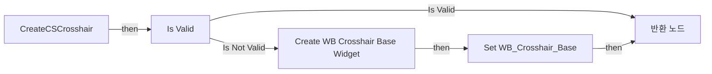

전체 노드·기본 입력 목록

| 노드 ID | 제목 | 미연결 기본 입력 / 에셋 입력 |
|---|---|---|
| `K2Node_FunctionEntry_329` | CreateCSCrosshair |  |
| `K2Node_CreateWidget_13` | Create WB Crosshair Base Widget | Class=/Game/CompShooterHUD/UI/Content/Crosshairs/WB_CrosshairBase.WB_CrosshairBase_C |
| `K2Node_MacroInstance_0` | Is Valid |  |
| `K2Node_FunctionResult_0` | 반환 노드 |  |
| `K2Node_VariableSet_62` | Set WB_Crosshair_Base |  |
| `K2Node_VariableGet_84` | Get WB_Crosshair_Base |  |
| `K2Node_CallFunction_6223` | Get Owning Player Controller 타깃은 HUD |  |

### CreateCSHUD

실행 핀 플로우차트

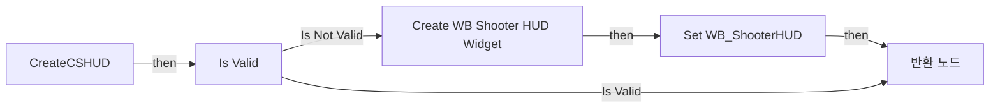

전체 노드·기본 입력 목록

| 노드 ID | 제목 | 미연결 기본 입력 / 에셋 입력 |
|---|---|---|
| `K2Node_FunctionEntry_65` | CreateCSHUD |  |
| `K2Node_CreateWidget_13` | Create WB Shooter HUD Widget | Class=/Game/CompShooterHUD/UI/WB_ShooterHUD.WB_ShooterHUD_C |
| `K2Node_VariableSet_3` | Set WB_ShooterHUD |  |
| `K2Node_VariableGet_19` | Get WB_ShooterHUD |  |
| `K2Node_MacroInstance_0` | Is Valid |  |
| `K2Node_FunctionResult_0` | 반환 노드 |  |
| `K2Node_CallFunction_6223` | Get Owning Player Controller 타깃은 HUD |  |

### CreateCSTutorial

실행 핀 플로우차트

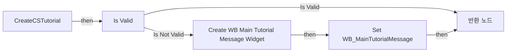

전체 노드·기본 입력 목록

| 노드 ID | 제목 | 미연결 기본 입력 / 에셋 입력 |
|---|---|---|
| `K2Node_FunctionEntry_329` | CreateCSTutorial |  |
| `K2Node_CreateWidget_13` | Create WB Main Tutorial Message Widget | Class=/Game/CompShooterHUD/UI/Content/MainTutorialMessage/WB_MainTutorialMessage.WB_MainTutorialMessage_C |
| `K2Node_MacroInstance_0` | Is Valid |  |
| `K2Node_VariableSet_520` | Set WB_MainTutorialMessage |  |
| `K2Node_FunctionResult_0` | 반환 노드 |  |
| `K2Node_VariableGet_660` | Get WB_MainTutorialMessage |  |
| `K2Node_CallFunction_6223` | Get Owning Player Controller 타깃은 HUD |  |

### CurrentHealth

실행 핀 플로우차트

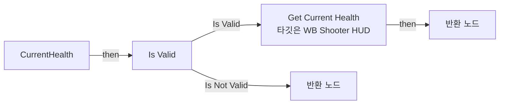

전체 노드·기본 입력 목록

| 노드 ID | 제목 | 미연결 기본 입력 / 에셋 입력 |
|---|---|---|
| `K2Node_FunctionEntry_1969` | CurrentHealth |  |
| `K2Node_MacroInstance_2850` | Is Valid |  |
| `K2Node_CallFunction_9353` | Get Current Health 타깃은 WB Shooter HUD |  |
| `K2Node_Knot_1102` | 경유 노드 |  |
| `K2Node_VariableGet_1424` | Get WB_ShooterHUD |  |
| `K2Node_FunctionResult_1` | 반환 노드 |  |
| `K2Node_FunctionResult_0` | 반환 노드 | HealthValue=0 |

### CurrentMaxHealth

실행 핀 플로우차트

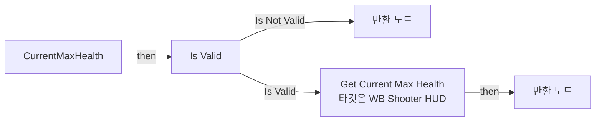

전체 노드·기본 입력 목록

| 노드 ID | 제목 | 미연결 기본 입력 / 에셋 입력 |
|---|---|---|
| `K2Node_FunctionEntry_2134` | CurrentMaxHealth |  |
| `K2Node_Knot_1102` | 경유 노드 |  |
| `K2Node_VariableGet_1424` | Get WB_ShooterHUD |  |
| `K2Node_FunctionResult_2` | 반환 노드 | CurrentMaxHealth=0 |
| `K2Node_FunctionResult_3` | 반환 노드 |  |
| `K2Node_MacroInstance_2850` | Is Valid |  |
| `K2Node_CallFunction_11432` | Get Current Max Health 타깃은 WB Shooter HUD |  |

### EventGraph

실행 핀 플로우차트

```mermaid
flowchart LR
  n0["DisplayShooterHUD 이벤트<br/>I Shooter Hud Manager에서"]
  n1["Create CSHUD<br/>타깃은 HUD Comp Shooter"]
  n2["Create CSHUD<br/>타깃은 HUD Comp Shooter"]
  n3["Set CSH_ZOrder"]
  n4["HandleDisplayShooterHUD<br/>Collapsed Graph"]
  n5["AddNewKillEntry 이벤트<br/>I Shooter Hud Manager에서"]
  n6["Add New Kill Entry<br/>타깃은 WB Shooter HUD"]
  n7["Display Shooter HUD<br/>타깃은 I Shooter Hud Manager"]
  n8["BeginPlay 이벤트"]
  n9["CSHUD Validator"]
  n10["RemoveKillEntrys 이벤트<br/>I Shooter Hud Manager에서"]
  n11["RemoveMainTutorialMessage 이벤트<br/>I Shooter Hud Manager에서"]
  n12["Create CSTutorial<br/>타깃은 HUD Comp Shooter"]
  n13["OnMainTutorialMessageRemoved<br/>Custom Event"]
  n14["Remove from Parent<br/>타깃은 위젯"]
  n15["AddMainTutorialMessage 이벤트<br/>I Shooter Hud Manager에서"]
  n16["Branch"]
  n17["Set KillEntryVisible"]
  n18["Set TutorialMessageActive"]
  n19["ConfirmTutorialMessage<br/>Custom Event"]
  n20["Branch"]
  n21["Call Tutorial Message Input Listener"]
  n22["SendTutorialData<br/>Collapsed Graph"]
  n23["HandleCharacterInputs<br/>Collapsed Graph"]
  n24["RemoveEntrys<br/>Collapsed Graph"]
  n25["Set RemovingMainTutorial"]
  n26["HandleRemoveTutorial<br/>Collapsed Graph"]
  n27["HandleInputs<br/>Collapsed Graph"]
  n28["Branch"]
  n29["Call Main Tutorial Message Confirmed"]
  n30["AddOrUpdateCrosshair 이벤트<br/>I Shooter Hud Manager에서"]
  n31["Create CSCrosshair<br/>타깃은 HUD Comp Shooter"]
  n32["Tick 이벤트"]
  n33["Get"]
  n34["Set DeltaSeconds"]
  n35["Update Camera Zoom<br/>타깃은 HUD Comp Shooter"]
  n36["Set ZoomValueDegrees"]
  n37["Handle Crosshair References"]
  n38["Zoom<br/>타깃은 WB Crosshair Base"]
  n39["Add Crosshair Widget"]
  n40["Add Crosshair Widget"]
  n41["Set bZoomIn"]
  n42["AddOrUpdateZoom 이벤트<br/>I Shooter Hud Manager에서"]
  n43["Add Crosshair<br/>타깃은 WB Crosshair Base"]
  n44["AddRecoil 이벤트<br/>I Shooter Hud Manager에서"]
  n45["Add Recoil<br/>타깃은 WB Crosshair Base"]
  n46["Validate Crosshair"]
  n47["Add Movement Sensitivity<br/>타깃은 WB Crosshair Base"]
  n48["Collect Garbage"]
  n49["RemoveCrosshair 이벤트<br/>I Shooter Hud Manager에서"]
  n50["Get"]
  n51["Remove Crosshair<br/>타깃은 WB Crosshair Base"]
  n52["HitIndicator 이벤트<br/>I Shooter Hud Manager에서"]
  n53["Add Crosshair Widget"]
  n54["Add Hit Indicator<br/>타깃은 WB Crosshair Base"]
  n55["AddOrUpdateProgressBar 이벤트<br/>I Shooter Hud Manager에서"]
  n56["RemoveProgressBar 이벤트<br/>I Shooter Hud Manager에서"]
  n57["Remove Progress Bar<br/>타깃은 WB Crosshair Base"]
  n58["Is Valid"]
  n59["OnProgressBarCompleted_Event<br/>Custom Event"]
  n60["DisplayHitPoint 이벤트<br/>I Shooter Hud Manager에서"]
  n61["RemoveHitPoint 이벤트<br/>I Shooter Hud Manager에서"]
  n62["HandleDisplayHitPoint<br/>Collapsed Graph"]
  n63["CSHUD Validator"]
  n64["Update Damage Indicator<br/>타깃은 WB Shooter HUD"]
  n65["CSHUD Validator"]
  n66["Remove All Damage Indicator<br/>타깃은 WB Shooter HUD"]
  n67["AddDamageIndicator 이벤트<br/>I Shooter Hud Manager에서"]
  n68["RemoveAllDamageIndicator 이벤트<br/>I Shooter Hud Manager에서"]
  n69["HandleDisplaySpecialHitPoint<br/>Collapsed Graph"]
  n70["DisplaySpecialHitPoint 이벤트<br/>I Shooter Hud Manager에서"]
  n71["RemoveSpecialHitPoint 이벤트<br/>I Shooter Hud Manager에서"]
  n72["AddDamageFeedback 이벤트<br/>I Shooter Hud Manager에서"]
  n73["RemoveDamageFeedback 이벤트<br/>I Shooter Hud Manager에서"]
  n74["DamageFeedback<br/>Collapsed Graph"]
  n75["Set Scalar Parameter Value"]
  n76["CSHUD Validator"]
  n77["Add Kill Message 1<br/>타깃은 WB Shooter HUD"]
  n78["CSHUD Validator"]
  n79["Remove Kill Messages<br/>타깃은 WB Shooter HUD"]
  n80["AddKillMessage1 이벤트<br/>I Shooter Hud Manager에서"]
  n81["RemoveKillMessages 이벤트<br/>I Shooter Hud Manager에서"]
  n82["AddKillMessage2 이벤트<br/>I Shooter Hud Manager에서"]
  n83["CSHUD Validator"]
  n84["Add Kill Message 2<br/>타깃은 WB Shooter HUD"]
  n85["AddMedal 이벤트<br/>I Shooter Hud Manager에서"]
  n86["RemoveMedal 이벤트<br/>I Shooter Hud Manager에서"]
  n87["CSHUD Validator"]
  n88["Add Medal<br/>타깃은 WB Shooter HUD"]
  n89["CSHUD Validator"]
  n90["Remove Medal<br/>타깃은 WB Shooter HUD"]
  n91["CSHUD Validator"]
  n92["Add Achievement<br/>타깃은 WB Shooter HUD"]
  n93["CSHUD Validator"]
  n94["Remove Achievement<br/>타깃은 WB Shooter HUD"]
  n95["AddAchievement 이벤트<br/>I Shooter Hud Manager에서"]
  n96["RemoveAchievement 이벤트<br/>I Shooter Hud Manager에서"]
  n97["AddIntermediatePoints 이벤트<br/>I Shooter Hud Manager에서"]
  n98["CSHUD Validator"]
  n99["Add Intermediate Point<br/>타깃은 WB Shooter HUD"]
  n100["CSHUD Validator"]
  n101["RemoveIntermediatePoints 이벤트<br/>I Shooter Hud Manager에서"]
  n102["Remove Intermediate Points<br/>타깃은 WB Shooter HUD"]
  n103["HandleProgressBarSystem<br/>Collapsed Graph"]
  n104["CSHUD Validator"]
  n105["Add Health Bar<br/>타깃은 WB Shooter HUD"]
  n106["CSHUD Validator"]
  n107["Remove Health Bar<br/>타깃은 WB Shooter HUD"]
  n108["CSHUD Validator"]
  n109["Update Health<br/>타깃은 WB Shooter HUD"]
  n110["CSHUD Validator"]
  n111["Update Max Health<br/>타깃은 WB Shooter HUD"]
  n112["AddHealthBar 이벤트<br/>I Shooter Hud Manager에서"]
  n113["RemoveHealthBar 이벤트<br/>I Shooter Hud Manager에서"]
  n114["UpdateHealth 이벤트<br/>I Shooter Hud Manager에서"]
  n115["UpdateMaxHealth 이벤트<br/>I Shooter Hud Manager에서"]
  n116["RemoveHealth 이벤트<br/>I Shooter Hud Manager에서"]
  n117["CSHUD Validator"]
  n118["Remove Health<br/>타깃은 WB Shooter HUD"]
  n119["Switch on E_UpdateTypes"]
  n120["Update Health<br/>타깃은 WB Shooter HUD"]
  n121["Set bDamageStatesActive"]
  n122["Set bDamageStatesActive"]
  n123["Set DamageColor"]
  n124["Set HealthColor"]
  n125["HealthColorImpact<br/>Collapsed Graph"]
  n126["DamageColorImpact<br/>Collapsed Graph"]
  n127["Branch"]
  n128["Branch"]
  n129["Get Current Health<br/>타깃은 HUD Comp Shooter"]
  n130["CSHUD Validator"]
  n131["Add Armor Bar<br/>타깃은 WB Shooter HUD"]
  n132["Set ArmorColor"]
  n133["CSHUD Validator"]
  n134["Remove Armor Bar<br/>타깃은 WB Shooter HUD"]
  n135["CSHUD Validator"]
  n136["Switch on E_UpdateTypes"]
  n137["Update Armor<br/>타깃은 WB Shooter HUD"]
  n138["Update Armor<br/>타깃은 WB Shooter HUD"]
  n139["CSHUD Validator"]
  n140["Remove Armor<br/>타깃은 WB Shooter HUD"]
  n141["CSHUD Validator"]
  n142["Update Max Armor<br/>타깃은 WB Shooter HUD"]
  n143["AddArmorBar 이벤트<br/>I Shooter Hud Manager에서"]
  n144["RemoveArmorBar 이벤트<br/>I Shooter Hud Manager에서"]
  n145["UpdateArmor 이벤트<br/>I Shooter Hud Manager에서"]
  n146["RemoveArmor 이벤트<br/>I Shooter Hud Manager에서"]
  n147["UpdateMaxArmor 이벤트<br/>I Shooter Hud Manager에서"]
  n148["Get Current Armor<br/>타깃은 HUD Comp Shooter"]
  n149["ArmorColorImpact<br/>Collapsed Graph"]
  n150["Branch"]
  n151["ArmorDamageColorImpact<br/>Collapsed Graph"]
  n152["Branch"]
  n153["Set ArmorDamageColor"]
  n154["AddWeaponBar 이벤트<br/>I Shooter Hud Manager에서"]
  n155["RemoveWeaponBar 이벤트<br/>I Shooter Hud Manager에서"]
  n156["CSHUD Validator"]
  n157["CSHUD Validator"]
  n158["Add Weapon Bar<br/>타깃은 WB Shooter HUD"]
  n159["Remove Weapon Bar<br/>타깃은 WB Shooter HUD"]
  n160["CSHUD Validator"]
  n161["Add or Update Ammo Icon<br/>타깃은 WB Shooter HUD"]
  n162["CSHUD Validator"]
  n163["Remove Ammo Icon<br/>타깃은 WB Shooter HUD"]
  n164["AddOrUpdateAmmoIcon 이벤트<br/>I Shooter Hud Manager에서"]
  n165["RemoveAmmoIcon 이벤트<br/>I Shooter Hud Manager에서"]
  n166["CSHUD Validator"]
  n167["Update Weapon Bar<br/>타깃은 WB Shooter HUD"]
  n168["UpdateAmmo 이벤트<br/>I Shooter Hud Manager에서"]
  n169["UpdateMaxAmmo 이벤트<br/>I Shooter Hud Manager에서"]
  n170["UpdateWeaponBar 이벤트<br/>I Shooter Hud Manager에서"]
  n171["CSHUD Validator"]
  n172["Update Ammo<br/>타깃은 WB Shooter HUD"]
  n173["CSHUD Validator"]
  n174["Update Max Ammo<br/>타깃은 WB Shooter HUD"]
  n175["RemoveAmmo 이벤트<br/>I Shooter Hud Manager에서"]
  n176["RemoveMaxAmmo 이벤트<br/>I Shooter Hud Manager에서"]
  n177["CSHUD Validator"]
  n178["Remove Max Ammo<br/>타깃은 WB Shooter HUD"]
  n179["CSHUD Validator"]
  n180["Remove Ammo<br/>타깃은 WB Shooter HUD"]
  n181["CSHUD Validator"]
  n182["Add or Update Action Slot<br/>타깃은 WB Shooter HUD"]
  n183["CSHUD Validator"]
  n184["Remove Action Slot<br/>타깃은 WB Shooter HUD"]
  n185["CSHUD Validator"]
  n186["Remove All Action Slots<br/>타깃은 WB Shooter HUD"]
  n187["AddOrUpdateActionSlot 이벤트<br/>I Shooter Hud Manager에서"]
  n188["RemoveActionSlot 이벤트<br/>I Shooter Hud Manager에서"]
  n189["RemoveAllActionSlots 이벤트<br/>I Shooter Hud Manager에서"]
  n190["SlotImpact 이벤트<br/>I Shooter Hud Manager에서"]
  n191["CSHUD Validator"]
  n192["Slot Impact<br/>타깃은 WB Shooter HUD"]
  n193["CSHUD Validator"]
  n194["Add or Update Team Kill Count<br/>타깃은 WB Shooter HUD"]
  n195["CSHUD Validator"]
  n196["Remove Team Kill Count<br/>타깃은 WB Shooter HUD"]
  n197["CSHUD Validator"]
  n198["Update Value<br/>타깃은 WB Shooter HUD"]
  n199["CSHUD Validator"]
  n200["Remove Value<br/>타깃은 WB Shooter HUD"]
  n201["CSHUD Validator"]
  n202["Update Max Value<br/>타깃은 WB Shooter HUD"]
  n203["CSHUD Validator"]
  n204["Remove Max Value<br/>타깃은 WB Shooter HUD"]
  n205["AddOrUpdateTeamKillCount 이벤트<br/>I Shooter Hud Manager에서"]
  n206["RemoveTeamKillCount 이벤트<br/>I Shooter Hud Manager에서"]
  n207["UpdateTeamKillCountValue 이벤트<br/>I Shooter Hud Manager에서"]
  n208["RemoveTeamKillCountValue 이벤트<br/>I Shooter Hud Manager에서"]
  n209["RemoveTeamKillCountMaxValue 이벤트<br/>I Shooter Hud Manager에서"]
  n210["UpdateTeamKillCountMaxValue 이벤트<br/>I Shooter Hud Manager에서"]
  n211["Bind Event to On Timer Completed"]
  n212["Unbind all Events from On Timer Completed"]
  n213["Unbind Event from On Timer Completed"]
  n214["CreateTimer 이벤트<br/>I Shooter Hud Manager에서"]
  n215["StartTimer 이벤트<br/>I Shooter Hud Manager에서"]
  n216["PauseTimer 이벤트<br/>I Shooter Hud Manager에서"]
  n217["RemoveTimer 이벤트<br/>I Shooter Hud Manager에서"]
  n218["AddExtraTime 이벤트<br/>I Shooter Hud Manager에서"]
  n219["CSHUD Validator"]
  n220["Create Timer<br/>타깃은 WB Shooter HUD"]
  n221["CSHUD Validator"]
  n222["Start Timer<br/>타깃은 WB Shooter HUD"]
  n223["CSHUD Validator"]
  n224["Pause Timer<br/>타깃은 WB Shooter HUD"]
  n225["CSHUD Validator"]
  n226["Remove Timer<br/>타깃은 WB Shooter HUD"]
  n227["CSHUD Validator"]
  n228["Add Extra Time<br/>타깃은 WB Shooter HUD"]
  n229["ImprovePerformance<br/>Collapsed Graph"]
  n230["UpdateBlackscreen_CSHUD 이벤트<br/>I Shooter Hud Manager에서"]
  n231["UpdateDamageFX_CSHUD 이벤트<br/>I Shooter Hud Manager에서"]
  n232["UpdateColorImpact_CSHUD 이벤트<br/>I Shooter Hud Manager에서"]
  n233["HandleUpdateHUD_Camera<br/>Collapsed Graph"]
  n234["CollapseGraph_0<br/>Collapsed Graph"]
  n235["RemoveDamageFX_CSHUD 이벤트<br/>I Shooter Hud Manager에서"]
  n236["RemoveColorImpact_CSHUD 이벤트<br/>I Shooter Hud Manager에서"]
  n237["Update Damage FX<br/>타깃은 WB Shooter HUD"]
  n238["Remove Damage FX<br/>타깃은 WB Shooter HUD"]
  n239["Remove Color Impact<br/>타깃은 WB Shooter HUD"]
  n240["Update Color Impact<br/>타깃은 WB Shooter HUD"]
  n241["Create WB Hitpoint Container Widget"]
  n242["Set HitPointContainer"]
  n243["Add to Viewport<br/>타깃은 사용자 위젯"]
  n244["Get"]
  n245["Remove Hitpoints<br/>타깃은 WB Hitpoint Container"]
  n246["Get"]
  n247["Remove Hitpoints<br/>타깃은 WB Hitpoint Container"]
  n0 -->|"then"| n3
  n1 -->|"then"| n12
  n2 -->|"then"| n4
  n3 -->|"then"| n2
  n5 -->|"then"| n9
  n6 -->|"then"| n17
  n7 -->|"then"| n241
  n8 -->|"then"| n1
  n9 -->|"then"| n6
  n10 -->|"then"| n24
  n11 -->|"then"| n26
  n12 -->|"then"| n31
  n13 -->|"then"| n14
  n14 -->|"then"| n18
  n15 -->|"then"| n28
  n16 -->|"then"| n23
  n18 -->|"then"| n25
  n19 -->|"then"| n20
  n20 -->|"then"| n21
  n22 -->|"then"| n16
  n25 -->|"then"| n29
  n26 -->|"then"| n27
  n28 -->|"then"| n22
  n30 -->|"then"| n39
  n31 -->|"then"| n7
  n32 -->|"then"| n34
  n33 -->|"then"| n43
  n34 -->|"then"| n233
  n36 -->|"then"| n229
  n37 -->|"then"| n40
  n39 -->|"then"| n33
  n40 -->|"then"| n38
  n41 -->|"then"| n36
  n42 -->|"then"| n41
  n43 -->|"then"| n47
  n44 -->|"then"| n46
  n46 -->|"IsValid"| n45
  n49 -->|"then"| n50
  n50 -->|"then"| n51
  n52 -->|"then"| n53
  n53 -->|"then"| n54
  n55 -->|"then"| n103
  n56 -->|"then"| n58
  n58 -->|"Is Valid"| n57
  n59 -->|"then"| n103
  n60 -->|"then"| n62
  n61 -->|"then"| n244
  n63 -->|"then"| n64
  n65 -->|"then"| n66
  n67 -->|"then"| n63
  n68 -->|"then"| n65
  n70 -->|"then"| n69
  n71 -->|"then"| n246
  n72 -->|"then"| n74
  n73 -->|"then"| n75
  n76 -->|"then"| n77
  n78 -->|"then"| n79
  n80 -->|"then"| n76
  n81 -->|"then"| n78
  n82 -->|"then"| n83
  n83 -->|"then"| n84
  n85 -->|"then"| n87
  n86 -->|"then"| n89
  n87 -->|"then"| n88
  n89 -->|"then"| n90
  n91 -->|"then"| n92
  n93 -->|"then"| n94
  n95 -->|"then"| n91
  n96 -->|"then"| n93
  n97 -->|"then"| n98
  n98 -->|"then"| n99
  n100 -->|"then"| n102
  n101 -->|"then"| n100
  n104 -->|"then"| n105
  n105 -->|"then"| n121
  n106 -->|"then"| n107
  n107 -->|"then"| n122
  n108 -->|"then"| n119
  n109 -->|"then"| n127
  n110 -->|"then"| n111
  n112 -->|"then"| n104
  n113 -->|"then"| n106
  n114 -->|"then"| n108
  n115 -->|"then"| n110
  n116 -->|"then"| n117
  n117 -->|"then"| n118
  n118 -->|"then"| n128
  n119 -->|"NewEnumerator0"| n109
  n119 -->|"NewEnumerator1"| n129
  n120 -->|"then"| n127
  n121 -->|"then"| n123
  n123 -->|"then"| n124
  n127 -->|"then"| n125
  n128 -->|"then"| n126
  n129 -->|"then"| n120
  n130 -->|"then"| n131
  n131 -->|"then"| n132
  n132 -->|"then"| n153
  n133 -->|"then"| n134
  n135 -->|"then"| n136
  n136 -->|"NewEnumerator0"| n137
  n136 -->|"NewEnumerator1"| n148
  n137 -->|"then"| n150
  n138 -->|"then"| n150
  n139 -->|"then"| n140
  n140 -->|"then"| n152
  n141 -->|"then"| n142
  n143 -->|"then"| n130
  n144 -->|"then"| n133
  n145 -->|"then"| n135
  n146 -->|"then"| n139
  n147 -->|"then"| n141
  n148 -->|"then"| n138
  n150 -->|"then"| n149
  n152 -->|"then"| n151
  n154 -->|"then"| n156
  n155 -->|"then"| n157
  n156 -->|"then"| n158
  n157 -->|"then"| n159
  n160 -->|"then"| n161
  n162 -->|"then"| n163
  n164 -->|"then"| n160
  n165 -->|"then"| n162
  n166 -->|"then"| n167
  n168 -->|"then"| n171
  n169 -->|"then"| n173
  n170 -->|"then"| n166
  n171 -->|"then"| n172
  n173 -->|"then"| n174
  n175 -->|"then"| n179
  n176 -->|"then"| n177
  n177 -->|"then"| n178
  n179 -->|"then"| n180
  n181 -->|"then"| n182
  n183 -->|"then"| n184
  n185 -->|"then"| n186
  n187 -->|"then"| n181
  n188 -->|"then"| n183
  n189 -->|"then"| n185
  n190 -->|"then"| n191
  n191 -->|"then"| n192
  n193 -->|"then"| n194
  n195 -->|"then"| n196
  n197 -->|"then"| n198
  n199 -->|"then"| n200
  n201 -->|"then"| n202
  n203 -->|"then"| n204
  n205 -->|"then"| n193
  n206 -->|"then"| n195
  n207 -->|"then"| n197
  n208 -->|"then"| n199
  n209 -->|"then"| n203
  n210 -->|"then"| n201
  n214 -->|"then"| n219
  n215 -->|"then"| n221
  n216 -->|"then"| n223
  n217 -->|"then"| n225
  n218 -->|"then"| n227
  n219 -->|"then"| n220
  n221 -->|"then"| n222
  n223 -->|"then"| n224
  n225 -->|"then"| n226
  n227 -->|"then"| n228
  n229 -->|"then"| n37
  n230 -->|"then"| n234
  n231 -->|"then"| n237
  n232 -->|"then"| n240
  n233 -->|"then"| n35
  n235 -->|"then"| n238
  n236 -->|"then"| n239
  n241 -->|"then"| n242
  n242 -->|"then"| n243
  n244 -->|"then"| n245
  n246 -->|"then"| n247
```

전체 노드·기본 입력 목록

| 노드 ID | 제목 | 미연결 기본 입력 / 에셋 입력 |
|---|---|---|
| `K2Node_Event_7` | DisplayShooterHUD 이벤트 I Shooter Hud Manager에서 |  |
| `K2Node_CallFunction_27` | Create CSHUD 타깃은 HUD Comp Shooter |  |
| `EdGraphNode_Comment_1` | Event Beginplay |  |
| `K2Node_CallFunction_160` | Create CSHUD 타깃은 HUD Comp Shooter |  |
| `K2Node_VariableSet_67` | Set CSH_ZOrder | Output_Get=0 |
| `K2Node_Knot_1` | 경유 노드 |  |
| `K2Node_Knot_2` | 경유 노드 |  |
| `K2Node_Composite_0` | HandleDisplayShooterHUD Collapsed Graph |  |
| `EdGraphNode_Comment_2` | Event Display Shooter HUD |  |
| `K2Node_Event_14` | AddNewKillEntry 이벤트 I Shooter Hud Manager에서 |  |
| `K2Node_VariableGet_285` | Get WB_ShooterHUD |  |
| `K2Node_CallFunction_150` | Add New Kill Entry 타깃은 WB Shooter HUD |  |
| `EdGraphNode_Comment_127` | Event Add New Kill Entry |  |
| `K2Node_CallFunction_5384` | Display Shooter HUD 타깃은 I Shooter Hud Manager | State=NewEnumerator0; ZOrder=1 |
| `K2Node_Event_395` | BeginPlay 이벤트 |  |
| `K2Node_MacroInstance_234` | CSHUD Validator |  |
| `K2Node_Event_50` | RemoveKillEntrys 이벤트 I Shooter Hud Manager에서 |  |
| `EdGraphNode_Comment_186` | Event Remove Kill Entry |  |
| `K2Node_Event_123` | RemoveMainTutorialMessage 이벤트 I Shooter Hud Manager에서 |  |
| `K2Node_CallFunction_731` | Create CSTutorial 타깃은 HUD Comp Shooter |  |
| `K2Node_CustomEvent_0` | OnMainTutorialMessageRemoved Custom Event |  |
| `K2Node_CallFunction_1303` | Remove from Parent 타깃은 위젯 |  |
| `EdGraphNode_Comment_7` | Event Add Main Tutorial Message |  |
| `EdGraphNode_Comment_8` | Event Remove Main Tutorial Message |  |
| `K2Node_Event_523` | AddMainTutorialMessage 이벤트 I Shooter Hud Manager에서 |  |
| `K2Node_IfThenElse_470` | Branch |  |
| `K2Node_VariableSet_60` | Set KillEntryVisible | KillEntryVisible=true; Output_Get=false |
| `K2Node_VariableSet_644` | Set TutorialMessageActive | TutorialMessageActive=false; Output_Get=false |
| `K2Node_CustomEvent_63` | ConfirmTutorialMessage Custom Event |  |
| `K2Node_IfThenElse_1582` | Branch |  |
| `K2Node_VariableGet_718` | Get TutorialMessageActive |  |
| `K2Node_CallDelegate_95` | Call Tutorial Message Input Listener |  |
| `EdGraphNode_Comment_9` | Event Confirm Tutorial Message |  |
| `K2Node_Composite_1` | SendTutorialData Collapsed Graph |  |
| `K2Node_Composite_991` | HandleCharacterInputs Collapsed Graph |  |
| `K2Node_Composite_992` | RemoveEntrys Collapsed Graph |  |
| `K2Node_VariableSet_424` | Set RemovingMainTutorial | RemovingMainTutorial=false; Output_Get=false |
| `K2Node_VariableGet_267` | Get WB_MainTutorialMessage |  |
| `K2Node_Composite_993` | HandleRemoveTutorial Collapsed Graph |  |
| `K2Node_Composite_994` | HandleInputs Collapsed Graph |  |
| `K2Node_IfThenElse_411` | Branch |  |
| `K2Node_VariableGet_499` | Get RemovingMainTutorial |  |
| `K2Node_CallFunction_1474` | NOT Boolean |  |
| `K2Node_CallDelegate_9` | Call Main Tutorial Message Confirmed |  |
| `K2Node_Event_25` | AddOrUpdateCrosshair 이벤트 I Shooter Hud Manager에서 |  |
| `K2Node_CallFunction_979` | Create CSCrosshair 타깃은 HUD Comp Shooter |  |
| `K2Node_Event_583` | Tick 이벤트 |  |
| `EdGraphNode_Comment_5391` | Event Tick |  |
| `K2Node_VariableGet_535` | Get |  |
| `K2Node_VariableSet_294` | Set DeltaSeconds | Output_Get=0.0 |
| `K2Node_CallFunction_5413` | Update Camera Zoom 타깃은 HUD Comp Shooter | Interp_Speed=160 |
| `K2Node_VariableSet_190` | Set ZoomValueDegrees | Output_Get=0.0 |
| `K2Node_MacroInstance_648` | Handle Crosshair References |  |
| `K2Node_Knot_250` | 경유 노드 |  |
| `K2Node_Knot_251` | 경유 노드 |  |
| `K2Node_VariableGet_66` | Get WB_Crosshair_Base |  |
| `K2Node_CallFunction_8007` | Zoom 타깃은 WB Crosshair Base |  |
| `K2Node_MacroInstance_1951` | Add Crosshair Widget |  |
| `K2Node_MacroInstance_91` | Add Crosshair Widget |  |
| `K2Node_VariableSet_44` | Set bZoomIn | Output_Get=false |
| `K2Node_BreakStruct_26` | Break S Scope Info |  |
| `EdGraphNode_Comment_3` | Event Add or Update Zoom |  |
| `K2Node_Event_292` | AddOrUpdateZoom 이벤트 I Shooter Hud Manager에서 |  |
| `K2Node_CallFunction_356` | Add Crosshair 타깃은 WB Crosshair Base |  |
| `K2Node_Event_21` | AddRecoil 이벤트 I Shooter Hud Manager에서 |  |
| `K2Node_VariableGet_3853` | Get WB_Crosshair_Base |  |
| `K2Node_CallFunction_222` | Add Recoil 타깃은 WB Crosshair Base |  |
| `K2Node_Knot_35` | 경유 노드 |  |
| `EdGraphNode_Comment_98` | Event Add Recoil |  |
| `K2Node_MacroInstance_120` | Validate Crosshair |  |
| `K2Node_Knot_41` | 경유 노드 |  |
| `K2Node_CallFunction_886` | Add Movement Sensitivity 타깃은 WB Crosshair Base |  |
| `K2Node_Knot_60` | 경유 노드 |  |
| `K2Node_Knot_61` | 경유 노드 |  |
| `K2Node_Knot_62` | 경유 노드 |  |
| `K2Node_Knot_63` | 경유 노드 |  |
| `K2Node_Knot_64` | 경유 노드 |  |
| `K2Node_Knot_65` | 경유 노드 |  |
| `K2Node_Knot_66` | 경유 노드 |  |
| `K2Node_Knot_67` | 경유 노드 |  |
| `EdGraphNode_Comment_4` | Event Add or Update Crosshair |  |
| `K2Node_Knot_149` | 경유 노드 |  |
| `K2Node_Knot_150` | 경유 노드 |  |
| `K2Node_VariableGet_380` | Get bZoomIn |  |
| `K2Node_Knot_48` | 경유 노드 |  |
| `K2Node_CallFunction_146` | Collect Garbage |  |
| `K2Node_Event_199` | RemoveCrosshair 이벤트 I Shooter Hud Manager에서 |  |
| `K2Node_VariableGet_84` | Get |  |
| `K2Node_CallFunction_1458` | Remove Crosshair 타깃은 WB Crosshair Base |  |
| `EdGraphNode_Comment_6` | Event Remove Crosshair |  |
| `K2Node_Event_30` | HitIndicator 이벤트 I Shooter Hud Manager에서 |  |
| `K2Node_MacroInstance_374` | Add Crosshair Widget |  |
| `K2Node_VariableGet_81` | Get WB_Crosshair_Base |  |
| `K2Node_CallFunction_653` | Add Hit Indicator 타깃은 WB Crosshair Base |  |
| `EdGraphNode_Comment_29` | Event Hit Indicator |  |
| `K2Node_Event_241` | AddOrUpdateProgressBar 이벤트 I Shooter Hud Manager에서 |  |
| `K2Node_Event_243` | RemoveProgressBar 이벤트 I Shooter Hud Manager에서 |  |
| `K2Node_VariableGet_653` | Get WB_Crosshair_Base |  |
| `K2Node_CallFunction_1677` | Remove Progress Bar 타깃은 WB Crosshair Base |  |
| `K2Node_MacroInstance_456` | Is Valid |  |
| `K2Node_Knot_1483` | 경유 노드 |  |
| `K2Node_CustomEvent_92` | OnProgressBarCompleted_Event Custom Event |  |
| `EdGraphNode_Comment_99` | Event Add Or Update Progress Bar |  |
| `EdGraphNode_Comment_101` | Event Remove Progress Bar |  |
| `K2Node_Event_206` | DisplayHitPoint 이벤트 I Shooter Hud Manager에서 |  |
| `K2Node_Event_207` | RemoveHitPoint 이벤트 I Shooter Hud Manager에서 |  |
| `EdGraphNode_Comment_2298` | Event Remove Hit Point |  |
| `EdGraphNode_Comment_609` | Event Display Hit Point |  |
| `K2Node_Composite_130` | HandleDisplayHitPoint Collapsed Graph |  |
| `K2Node_VariableGet_310` | Get WB_ShooterHUD |  |
| `K2Node_MacroInstance_250` | CSHUD Validator |  |
| `K2Node_CallFunction_826` | Update Damage Indicator 타깃은 WB Shooter HUD |  |
| `K2Node_VariableGet_27` | Get WB_ShooterHUD |  |
| `K2Node_MacroInstance_25` | CSHUD Validator |  |
| `K2Node_CallFunction_884` | Remove All Damage Indicator 타깃은 WB Shooter HUD |  |
| `K2Node_Event_211` | AddDamageIndicator 이벤트 I Shooter Hud Manager에서 |  |
| `K2Node_Event_213` | RemoveAllDamageIndicator 이벤트 I Shooter Hud Manager에서 |  |
| `EdGraphNode_Comment_65` | Event Add Damage Indicator |  |
| `EdGraphNode_Comment_67` | Event Remove All Damage Indicator |  |
| `EdGraphNode_Comment_136` | Event Remove Special Hit Point |  |
| `EdGraphNode_Comment_139` | Event Display Special Hit Point |  |
| `K2Node_Composite_16` | HandleDisplaySpecialHitPoint Collapsed Graph |  |
| `K2Node_Event_349` | DisplaySpecialHitPoint 이벤트 I Shooter Hud Manager에서 |  |
| `K2Node_Event_371` | RemoveSpecialHitPoint 이벤트 I Shooter Hud Manager에서 |  |
| `EdGraphNode_Comment_962` | HUD Commands |  |
| `EdGraphNode_Comment_56` | Post Process Commands |  |
| `EdGraphNode_Comment_0` | Event Update Color Impact |  |
| `EdGraphNode_Comment_5` | Event Update Damage FX |  |
| `EdGraphNode_Comment_51` | Event Update Black Screen |  |
| `K2Node_Event_815` | AddDamageFeedback 이벤트 I Shooter Hud Manager에서 |  |
| `K2Node_Event_853` | RemoveDamageFeedback 이벤트 I Shooter Hud Manager에서 |  |
| `K2Node_Composite_674` | DamageFeedback Collapsed Graph |  |
| `K2Node_CallMaterialParameterCollectionFunction_57` | Set Scalar Parameter Value | ParameterName=Opacity; ParameterValue=0.0 |
| `EdGraphNode_Comment_267` | Event Add Damage Feedback |  |
| `EdGraphNode_Comment_274` | Event Remove Damage Feedback |  |
| `K2Node_VariableGet_495` | Get WB_ShooterHUD |  |
| `K2Node_MacroInstance_354` | CSHUD Validator |  |
| `K2Node_CallFunction_7607` | Add Kill Message 1 타깃은 WB Shooter HUD |  |
| `K2Node_VariableGet_2661` | Get WB_ShooterHUD |  |
| `K2Node_MacroInstance_2460` | CSHUD Validator |  |
| `K2Node_CallFunction_7720` | Remove Kill Messages 타깃은 WB Shooter HUD |  |
| `K2Node_Event_2340` | AddKillMessage1 이벤트 I Shooter Hud Manager에서 |  |
| `K2Node_Event_2405` | RemoveKillMessages 이벤트 I Shooter Hud Manager에서 |  |
| `EdGraphNode_Comment_402` | Event Add Kill Message 1 |  |
| `EdGraphNode_Comment_409` | Event Remove Kill Messages |  |
| `K2Node_Event_321` | AddKillMessage2 이벤트 I Shooter Hud Manager에서 |  |
| `K2Node_VariableGet_1893` | Get WB_ShooterHUD |  |
| `K2Node_MacroInstance_1375` | CSHUD Validator |  |
| `K2Node_CallFunction_5637` | Add Kill Message 2 타깃은 WB Shooter HUD |  |
| `EdGraphNode_Comment_273` | Event Add Kill Message 2 |  |
| `K2Node_Event_1117` | AddMedal 이벤트 I Shooter Hud Manager에서 |  |
| `K2Node_Event_1155` | RemoveMedal 이벤트 I Shooter Hud Manager에서 |  |
| `K2Node_VariableGet_3803` | Get WB_ShooterHUD |  |
| `K2Node_MacroInstance_3216` | CSHUD Validator |  |
| `K2Node_CallFunction_4876` | Add Medal 타깃은 WB Shooter HUD |  |
| `K2Node_VariableGet_3235` | Get WB_ShooterHUD |  |
| `K2Node_MacroInstance_1637` | CSHUD Validator |  |
| `K2Node_CallFunction_5312` | Remove Medal 타깃은 WB Shooter HUD |  |
| `EdGraphNode_Comment_220` | Event Remove Medal |  |
| `EdGraphNode_Comment_227` | Event Add Medal |  |
| `K2Node_VariableGet_1502` | Get WB_ShooterHUD |  |
| `K2Node_MacroInstance_1408` | CSHUD Validator |  |
| `K2Node_CallFunction_9227` | Add Achievement 타깃은 WB Shooter HUD |  |
| `K2Node_VariableGet_2070` | Get WB_ShooterHUD |  |
| `K2Node_MacroInstance_1519` | CSHUD Validator |  |
| `K2Node_CallFunction_9350` | Remove Achievement 타깃은 WB Shooter HUD |  |
| `K2Node_Event_2413` | AddAchievement 이벤트 I Shooter Hud Manager에서 |  |
| `K2Node_Event_2451` | RemoveAchievement 이벤트 I Shooter Hud Manager에서 |  |
| `EdGraphNode_Comment_390` | Event Remove Achievement |  |
| `EdGraphNode_Comment_397` | Event Add Achievement |  |
| `K2Node_Event_1332` | AddIntermediatePoints 이벤트 I Shooter Hud Manager에서 |  |
| `K2Node_VariableGet_281` | Get WB_ShooterHUD |  |
| `K2Node_MacroInstance_271` | CSHUD Validator |  |
| `K2Node_CallFunction_5850` | Add Intermediate Point 타깃은 WB Shooter HUD |  |
| `K2Node_VariableGet_3804` | Get WB_ShooterHUD |  |
| `K2Node_MacroInstance_3217` | CSHUD Validator |  |
| `K2Node_Event_302` | RemoveIntermediatePoints 이벤트 I Shooter Hud Manager에서 |  |
| `K2Node_CallFunction_1652` | Remove Intermediate Points 타깃은 WB Shooter HUD |  |
| `EdGraphNode_Comment_701` | Event Remove Intermediate Points |  |
| `EdGraphNode_Comment_71` | Event Add Intermediate Points |  |
| `K2Node_Composite_79` | HandleProgressBarSystem Collapsed Graph |  |
| `K2Node_VariableGet_5763` | Get WB_ShooterHUD |  |
| `K2Node_MacroInstance_6352` | CSHUD Validator |  |
| `K2Node_CallFunction_3636` | Add Health Bar 타깃은 WB Shooter HUD |  |
| `K2Node_VariableGet_1455` | Get WB_ShooterHUD |  |
| `K2Node_MacroInstance_1837` | CSHUD Validator |  |
| `K2Node_CallFunction_3770` | Remove Health Bar 타깃은 WB Shooter HUD |  |
| `K2Node_VariableGet_7638` | Get WB_ShooterHUD |  |
| `K2Node_MacroInstance_8264` | CSHUD Validator |  |
| `K2Node_CallFunction_22395` | Update Health 타깃은 WB Shooter HUD |  |
| `K2Node_VariableGet_9046` | Get WB_ShooterHUD |  |
| `K2Node_MacroInstance_9782` | CSHUD Validator |  |
| `K2Node_CallFunction_4044` | Update Max Health 타깃은 WB Shooter HUD |  |
| `K2Node_Event_1740` | AddHealthBar 이벤트 I Shooter Hud Manager에서 |  |
| `K2Node_Event_1932` | RemoveHealthBar 이벤트 I Shooter Hud Manager에서 |  |
| `K2Node_Event_2123` | UpdateHealth 이벤트 I Shooter Hud Manager에서 |  |
| `K2Node_Event_2161` | UpdateMaxHealth 이벤트 I Shooter Hud Manager에서 |  |
| `EdGraphNode_Comment_1696` | Event Add Health Bar |  |
| `EdGraphNode_Comment_1697` | Event Remove Health Bar |  |
| `EdGraphNode_Comment_1782` | Event Update Health |  |
| `EdGraphNode_Comment_1781` | Event Update Max Health |  |
| `K2Node_Event_740` | RemoveHealth 이벤트 I Shooter Hud Manager에서 |  |
| `EdGraphNode_Comment_1780` | Event Remove Health |  |
| `K2Node_VariableGet_8605` | Get WB_ShooterHUD |  |
| `K2Node_MacroInstance_9291` | CSHUD Validator |  |
| `K2Node_CallFunction_1407` | Remove Health 타깃은 WB Shooter HUD |  |
| `K2Node_SwitchEnum_652` | Switch on E_UpdateTypes |  |
| `K2Node_VariableGet_7639` | Get WB_ShooterHUD |  |
| `K2Node_CallFunction_22396` | Update Health 타깃은 WB Shooter HUD |  |
| `K2Node_Knot_15468` | 경유 노드 |  |
| `K2Node_Knot_15469` | 경유 노드 |  |
| `K2Node_Knot_15470` | 경유 노드 |  |
| `K2Node_CommutativeAssociativeBinaryOperator_240` | int + int |  |
| `K2Node_VariableSet_946` | Set bDamageStatesActive | Output_Get=false |
| `K2Node_VariableSet_600` | Set bDamageStatesActive | bDamageStatesActive=false; Output_Get=false |
| `K2Node_Knot_1963` | 경유 노드 |  |
| `K2Node_Knot_1964` | 경유 노드 |  |
| `K2Node_Knot_15471` | 경유 노드 |  |
| `K2Node_Knot_15472` | 경유 노드 |  |
| `K2Node_VariableSet_203` | Set DamageColor |  |
| `K2Node_VariableSet_247` | Set HealthColor |  |
| `K2Node_Knot_477` | 경유 노드 |  |
| `K2Node_Knot_478` | 경유 노드 |  |
| `K2Node_Knot_479` | 경유 노드 |  |
| `K2Node_Knot_480` | 경유 노드 |  |
| `K2Node_VariableGet_394` | Get DamageColor |  |
| `K2Node_VariableGet_372` | Get HealthColor |  |
| `K2Node_Composite_62` | HealthColorImpact Collapsed Graph |  |
| `K2Node_Composite_139` | DamageColorImpact Collapsed Graph |  |
| `K2Node_IfThenElse_1023` | Branch |  |
| `K2Node_Knot_226` | 경유 노드 |  |
| `K2Node_Knot_227` | 경유 노드 |  |
| `K2Node_IfThenElse_1633` | Branch |  |
| `K2Node_Knot_270` | 경유 노드 |  |
| `K2Node_Knot_271` | 경유 노드 |  |
| `EdGraphNode_Comment_2301` | Event Remove Armor |  |
| `EdGraphNode_Comment_608` | Event Update Max Armor |  |
| `EdGraphNode_Comment_1170` | Event Update Armor |  |
| `EdGraphNode_Comment_2299` | Event Add Armor Bar |  |
| `EdGraphNode_Comment_2300` | Event Remove Armor Bar |  |
| `K2Node_CallFunction_22397` | Get Current Health 타깃은 HUD Comp Shooter |  |
| `K2Node_VariableGet_320` | Get WB_ShooterHUD |  |
| `K2Node_MacroInstance_1360` | CSHUD Validator |  |
| `K2Node_CallFunction_16840` | Add Armor Bar 타깃은 WB Shooter HUD |  |
| `K2Node_VariableSet_1046` | Set ArmorColor |  |
| `K2Node_VariableGet_1460` | Get WB_ShooterHUD |  |
| `K2Node_MacroInstance_1361` | CSHUD Validator |  |
| `K2Node_CallFunction_20475` | Remove Armor Bar 타깃은 WB Shooter HUD |  |
| `K2Node_Knot_2407` | 경유 노드 |  |
| `K2Node_Knot_2408` | 경유 노드 |  |
| `K2Node_VariableGet_7911` | Get WB_ShooterHUD |  |
| `K2Node_MacroInstance_414` | CSHUD Validator |  |
| `K2Node_SwitchEnum_35` | Switch on E_UpdateTypes |  |
| `K2Node_Knot_215` | 경유 노드 |  |
| `K2Node_Knot_216` | 경유 노드 |  |
| `K2Node_Knot_235` | 경유 노드 |  |
| `K2Node_CommutativeAssociativeBinaryOperator_10` | int + int |  |
| `K2Node_Knot_367` | 경유 노드 |  |
| `K2Node_Knot_368` | 경유 노드 |  |
| `K2Node_CallFunction_23200` | Update Armor 타깃은 WB Shooter HUD |  |
| `K2Node_VariableGet_363` | Get WB_ShooterHUD |  |
| `K2Node_CallFunction_23199` | Update Armor 타깃은 WB Shooter HUD |  |
| `K2Node_VariableGet_501` | Get WB_ShooterHUD |  |
| `K2Node_MacroInstance_1397` | CSHUD Validator |  |
| `K2Node_CallFunction_25317` | Remove Armor 타깃은 WB Shooter HUD |  |
| `K2Node_VariableGet_3234` | Get WB_ShooterHUD |  |
| `K2Node_MacroInstance_1636` | CSHUD Validator |  |
| `K2Node_CallFunction_26591` | Update Max Armor 타깃은 WB Shooter HUD |  |
| `K2Node_Event_10388` | AddArmorBar 이벤트 I Shooter Hud Manager에서 |  |
| `K2Node_Event_10838` | RemoveArmorBar 이벤트 I Shooter Hud Manager에서 |  |
| `K2Node_Event_11211` | UpdateArmor 이벤트 I Shooter Hud Manager에서 |  |
| `K2Node_Event_11629` | RemoveArmor 이벤트 I Shooter Hud Manager에서 |  |
| `K2Node_Event_12010` | UpdateMaxArmor 이벤트 I Shooter Hud Manager에서 |  |
| `K2Node_CallFunction_39438` | Get Current Armor 타깃은 HUD Comp Shooter |  |
| `K2Node_VariableGet_1324` | Get ArmorColor |  |
| `K2Node_Composite_309` | ArmorColorImpact Collapsed Graph |  |
| `K2Node_IfThenElse_2645` | Branch |  |
| `K2Node_Knot_320` | 경유 노드 |  |
| `K2Node_Knot_321` | 경유 노드 |  |
| `K2Node_VariableGet_395` | Get ArmorDamageColor |  |
| `K2Node_Composite_586` | ArmorDamageColorImpact Collapsed Graph |  |
| `K2Node_IfThenElse_1230` | Branch |  |
| `K2Node_VariableSet_96` | Set ArmorDamageColor |  |
| `K2Node_Knot_545` | 경유 노드 |  |
| `K2Node_Knot_546` | 경유 노드 |  |
| `K2Node_Knot_724` | 경유 노드 |  |
| `K2Node_Knot_725` | 경유 노드 |  |
| `K2Node_Event_602` | AddWeaponBar 이벤트 I Shooter Hud Manager에서 |  |
| `K2Node_Event_694` | RemoveWeaponBar 이벤트 I Shooter Hud Manager에서 |  |
| `EdGraphNode_Comment_18464` | Event Add Weapon Bar |  |
| `EdGraphNode_Comment_18465` | Event Remove Weapon Bar |  |
| `K2Node_VariableGet_2021` | Get WB_ShooterHUD |  |
| `K2Node_MacroInstance_2514` | CSHUD Validator |  |
| `K2Node_VariableGet_10430` | Get WB_ShooterHUD |  |
| `K2Node_MacroInstance_18244` | CSHUD Validator |  |
| `K2Node_CallFunction_5907` | Add Weapon Bar 타깃은 WB Shooter HUD |  |
| `K2Node_CallFunction_5908` | Remove Weapon Bar 타깃은 WB Shooter HUD |  |
| `K2Node_VariableGet_1131` | Get WB_ShooterHUD |  |
| `K2Node_MacroInstance_1527` | CSHUD Validator |  |
| `K2Node_CallFunction_2570` | Add or Update Ammo Icon 타깃은 WB Shooter HUD |  |
| `K2Node_VariableGet_1456` | Get WB_ShooterHUD |  |
| `K2Node_MacroInstance_1838` | CSHUD Validator |  |
| `K2Node_CallFunction_2738` | Remove Ammo Icon 타깃은 WB Shooter HUD |  |
| `K2Node_Event_888` | AddOrUpdateAmmoIcon 이벤트 I Shooter Hud Manager에서 |  |
| `K2Node_Event_1121` | RemoveAmmoIcon 이벤트 I Shooter Hud Manager에서 |  |
| `EdGraphNode_Comment_1633` | Event Add Or Update Ammo Icon |  |
| `EdGraphNode_Comment_1770` | Event Remove Ammo Icon |  |
| `EdGraphNode_Comment_2126` | Event Update Weapon Bar |  |
| `K2Node_VariableGet_3385` | Get WB_ShooterHUD |  |
| `K2Node_MacroInstance_4050` | CSHUD Validator |  |
| `K2Node_CallFunction_5356` | Update Weapon Bar 타깃은 WB Shooter HUD |  |
| `EdGraphNode_Comment_18466` | Event Update Ammo |  |
| `EdGraphNode_Comment_18467` | Event Update Max Ammo |  |
| `K2Node_Event_2035` | UpdateAmmo 이벤트 I Shooter Hud Manager에서 |  |
| `K2Node_Event_2082` | UpdateMaxAmmo 이벤트 I Shooter Hud Manager에서 |  |
| `K2Node_Event_2423` | UpdateWeaponBar 이벤트 I Shooter Hud Manager에서 |  |
| `K2Node_VariableGet_3637` | Get WB_ShooterHUD |  |
| `K2Node_MacroInstance_4359` | CSHUD Validator |  |
| `K2Node_CallFunction_9383` | Update Ammo 타깃은 WB Shooter HUD |  |
| `K2Node_VariableGet_5631` | Get WB_ShooterHUD |  |
| `K2Node_MacroInstance_7360` | CSHUD Validator |  |
| `K2Node_CallFunction_10095` | Update Max Ammo 타깃은 WB Shooter HUD |  |
| `EdGraphNode_Comment_18468` | Event Remove Ammo |  |
| `EdGraphNode_Comment_1771` | Event Remove Max Ammo |  |
| `K2Node_Event_3957` | RemoveAmmo 이벤트 I Shooter Hud Manager에서 |  |
| `K2Node_Event_4003` | RemoveMaxAmmo 이벤트 I Shooter Hud Manager에서 |  |
| `K2Node_VariableGet_5953` | Get WB_ShooterHUD |  |
| `K2Node_MacroInstance_7738` | CSHUD Validator |  |
| `K2Node_CallFunction_15919` | Remove Max Ammo 타깃은 WB Shooter HUD |  |
| `K2Node_VariableGet_964` | Get WB_ShooterHUD |  |
| `K2Node_MacroInstance_1285` | CSHUD Validator |  |
| `K2Node_CallFunction_16654` | Remove Ammo 타깃은 WB Shooter HUD |  |
| `EdGraphNode_Comment_3652` | Event Add Or Update Action Slot |  |
| `EdGraphNode_Comment_1353` | Event Remove Action Slot |  |
| `EdGraphNode_Comment_3732` | Event Remove All Action Slots |  |
| `K2Node_VariableGet_1402` | Get WB_ShooterHUD |  |
| `K2Node_MacroInstance_1883` | CSHUD Validator |  |
| `K2Node_CallFunction_3100` | Add or Update Action Slot 타깃은 WB Shooter HUD |  |
| `K2Node_VariableGet_1403` | Get WB_ShooterHUD |  |
| `K2Node_MacroInstance_1884` | CSHUD Validator |  |
| `K2Node_CallFunction_3852` | Remove Action Slot 타깃은 WB Shooter HUD |  |
| `K2Node_VariableGet_2991` | Get WB_ShooterHUD |  |
| `K2Node_MacroInstance_4227` | CSHUD Validator |  |
| `K2Node_CallFunction_4034` | Remove All Action Slots 타깃은 WB Shooter HUD |  |
| `K2Node_Event_265` | AddOrUpdateActionSlot 이벤트 I Shooter Hud Manager에서 |  |
| `K2Node_Event_314` | RemoveActionSlot 이벤트 I Shooter Hud Manager에서 |  |
| `K2Node_Event_420` | RemoveAllActionSlots 이벤트 I Shooter Hud Manager에서 |  |
| `EdGraphNode_Comment_3653` | Event Slot Impact |  |
| `K2Node_Event_2002` | SlotImpact 이벤트 I Shooter Hud Manager에서 |  |
| `K2Node_VariableGet_965` | Get WB_ShooterHUD |  |
| `K2Node_MacroInstance_1286` | CSHUD Validator |  |
| `K2Node_CallFunction_10412` | Slot Impact 타깃은 WB Shooter HUD |  |
| `EdGraphNode_Comment_972` | Event Add Or Update Team Kill Count |  |
| `EdGraphNode_Comment_2127` | Event Remove Team Kill Count |  |
| `EdGraphNode_Comment_6738` | Event Update TeamCount Value |  |
| `EdGraphNode_Comment_6739` | Event Update TeamCount Max Value |  |
| `EdGraphNode_Comment_1783` | Event Remove TeamCount Value |  |
| `EdGraphNode_Comment_1784` | Event Remove TeamCount MaxValue |  |
| `K2Node_VariableGet_10714` | Get WB_ShooterHUD |  |
| `K2Node_MacroInstance_18625` | CSHUD Validator |  |
| `K2Node_CallFunction_30036` | Add or Update Team Kill Count 타깃은 WB Shooter HUD |  |
| `K2Node_VariableGet_10715` | Get WB_ShooterHUD |  |
| `K2Node_MacroInstance_18626` | CSHUD Validator |  |
| `K2Node_CallFunction_30143` | Remove Team Kill Count 타깃은 WB Shooter HUD |  |
| `K2Node_VariableGet_10785` | Get WB_ShooterHUD |  |
| `K2Node_MacroInstance_18685` | CSHUD Validator |  |
| `K2Node_CallFunction_30333` | Update Value 타깃은 WB Shooter HUD |  |
| `K2Node_VariableGet_10856` | Get WB_ShooterHUD |  |
| `K2Node_MacroInstance_18745` | CSHUD Validator |  |
| `K2Node_CallFunction_30524` | Remove Value 타깃은 WB Shooter HUD |  |
| `K2Node_VariableGet_13360` | Get WB_ShooterHUD |  |
| `K2Node_MacroInstance_19239` | CSHUD Validator |  |
| `K2Node_CallFunction_30717` | Update Max Value 타깃은 WB Shooter HUD |  |
| `K2Node_VariableGet_6941` | Get WB_ShooterHUD |  |
| `K2Node_MacroInstance_7475` | CSHUD Validator |  |
| `K2Node_CallFunction_30910` | Remove Max Value 타깃은 WB Shooter HUD |  |
| `K2Node_Event_4651` | AddOrUpdateTeamKillCount 이벤트 I Shooter Hud Manager에서 |  |
| `K2Node_Event_4756` | RemoveTeamKillCount 이벤트 I Shooter Hud Manager에서 |  |
| `K2Node_Event_7647` | UpdateTeamKillCountValue 이벤트 I Shooter Hud Manager에서 |  |
| `K2Node_Event_8022` | RemoveTeamKillCountValue 이벤트 I Shooter Hud Manager에서 |  |
| `K2Node_Event_8396` | RemoveTeamKillCountMaxValue 이벤트 I Shooter Hud Manager에서 |  |
| `K2Node_Event_8660` | UpdateTeamKillCountMaxValue 이벤트 I Shooter Hud Manager에서 |  |
| `EdGraphNode_Comment_15928` | Event Remove Timer |  |
| `EdGraphNode_Comment_18469` | Event Create Timer |  |
| `K2Node_AddDelegate_288` | Bind Event to On Timer Completed |  |
| `K2Node_ClearDelegate_297` | Unbind all Events from On Timer Completed |  |
| `K2Node_RemoveDelegate_297` | Unbind Event from On Timer Completed |  |
| `K2Node_Event_5051` | CreateTimer 이벤트 I Shooter Hud Manager에서 |  |
| `EdGraphNode_Comment_15927` | Event Start Timer |  |
| `EdGraphNode_Comment_15929` | Event Pause Timer |  |
| `EdGraphNode_Comment_15926` | Event Add Extra Time |  |
| `EdGraphNode_Comment_1634` | Bind Dispatcher: On Timer completed |  |
| `K2Node_Event_5394` | StartTimer 이벤트 I Shooter Hud Manager에서 |  |
| `K2Node_Event_8187` | PauseTimer 이벤트 I Shooter Hud Manager에서 |  |
| `K2Node_Event_8234` | RemoveTimer 이벤트 I Shooter Hud Manager에서 |  |
| `K2Node_Event_8348` | AddExtraTime 이벤트 I Shooter Hud Manager에서 |  |
| `K2Node_VariableGet_13984` | Get WB_ShooterHUD |  |
| `K2Node_MacroInstance_20107` | CSHUD Validator |  |
| `K2Node_CallFunction_36950` | Create Timer 타깃은 WB Shooter HUD |  |
| `K2Node_VariableGet_13985` | Get WB_ShooterHUD |  |
| `K2Node_MacroInstance_20108` | CSHUD Validator |  |
| `K2Node_CallFunction_37737` | Start Timer 타깃은 WB Shooter HUD |  |
| `K2Node_VariableGet_14061` | Get WB_ShooterHUD |  |
| `K2Node_MacroInstance_20173` | CSHUD Validator |  |
| `K2Node_CallFunction_37944` | Pause Timer 타깃은 WB Shooter HUD |  |
| `K2Node_VariableGet_14138` | Get WB_ShooterHUD |  |
| `K2Node_MacroInstance_20239` | CSHUD Validator |  |
| `K2Node_CallFunction_38152` | Remove Timer 타깃은 WB Shooter HUD |  |
| `K2Node_VariableGet_10928` | Get WB_ShooterHUD |  |
| `K2Node_MacroInstance_18806` | CSHUD Validator |  |
| `K2Node_CallFunction_38361` | Add Extra Time 타깃은 WB Shooter HUD |  |
| `K2Node_BreakStruct_40` | Break S Kill Count Entry |  |
| `K2Node_Composite_23` | ImprovePerformance Collapsed Graph |  |
| `K2Node_Event_38` | UpdateBlackscreen_CSHUD 이벤트 I Shooter Hud Manager에서 |  |
| `K2Node_Event_72` | UpdateDamageFX_CSHUD 이벤트 I Shooter Hud Manager에서 |  |
| `K2Node_Event_171` | UpdateColorImpact_CSHUD 이벤트 I Shooter Hud Manager에서 |  |
| `K2Node_Composite_3` | HandleUpdateHUD_Camera Collapsed Graph |  |
| `K2Node_Composite_4` | CollapseGraph_0 Collapsed Graph |  |
| `K2Node_VariableGet_2` | Get WB_ShooterHUD |  |
| `K2Node_VariableGet_3` | Get WB_ShooterHUD |  |
| `EdGraphNode_Comment_298` | Event Remove Color Impact |  |
| `EdGraphNode_Comment_23` | Event Remove Damage FX |  |
| `K2Node_Event_0` | RemoveDamageFX_CSHUD 이벤트 I Shooter Hud Manager에서 |  |
| `K2Node_Event_1` | RemoveColorImpact_CSHUD 이벤트 I Shooter Hud Manager에서 |  |
| `K2Node_VariableGet_1` | Get WB_ShooterHUD |  |
| `K2Node_VariableGet_5` | Get WB_ShooterHUD |  |
| `K2Node_CallFunction_0` | Update Damage FX 타깃은 WB Shooter HUD |  |
| `K2Node_CallFunction_1` | Remove Damage FX 타깃은 WB Shooter HUD |  |
| `K2Node_CallFunction_2` | Remove Color Impact 타깃은 WB Shooter HUD |  |
| `K2Node_CallFunction_3` | Update Color Impact 타깃은 WB Shooter HUD |  |
| `K2Node_CreateWidget_0` | Create WB Hitpoint Container Widget | Class=/Game/CompShooterHUD/UI/Content/HitPoints/WB_Hitpoint_Container.WB_Hitpoint_Container_C |
| `K2Node_VariableSet_0` | Set HitPointContainer |  |
| `K2Node_CallFunction_4` | Add to Viewport 타깃은 사용자 위젯 |  |
| `K2Node_VariableGet_4` | Get CSH_ZOrder |  |
| `K2Node_VariableGet_6` | Get |  |
| `K2Node_CallFunction_6` | Remove Hitpoints 타깃은 WB Hitpoint Container | SpecialHitPoints=false |
| `K2Node_VariableGet_0` | Get |  |
| `K2Node_CallFunction_5` | Remove Hitpoints 타깃은 WB Hitpoint Container | SpecialHitPoints=true |

### FindFadeDuration

실행 핀 플로우차트

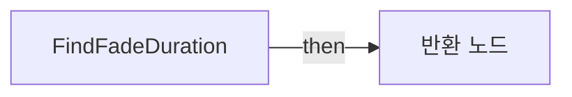

전체 노드·기본 입력 목록

| 노드 ID | 제목 | 미연결 기본 입력 / 에셋 입력 |
|---|---|---|
| `K2Node_FunctionEntry_0` | FindFadeDuration |  |
| `K2Node_CallFunction_54` | float &lt;= float | B=0.0 |
| `K2Node_Select_0` | 선택 | Option 1=0.010000 |
| `K2Node_Knot_0` | 경유 노드 |  |
| `K2Node_FunctionResult_0` | 반환 노드 |  |

### GetZoomValue

실행 핀 플로우차트

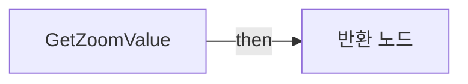

전체 노드·기본 입력 목록

| 노드 ID | 제목 | 미연결 기본 입력 / 에셋 입력 |
|---|---|---|
| `K2Node_FunctionEntry_1576` | GetZoomValue |  |
| `K2Node_FunctionResult_1` | 반환 노드 |  |
| `K2Node_VariableGet_282` | Get ZoomValueDegrees |  |
| `K2Node_VariableGet_308` | Get DefaultFOV |  |
| `K2Node_CallFunction_2859` | float - float |  |

### InterpCameraFOV

실행 핀 플로우차트

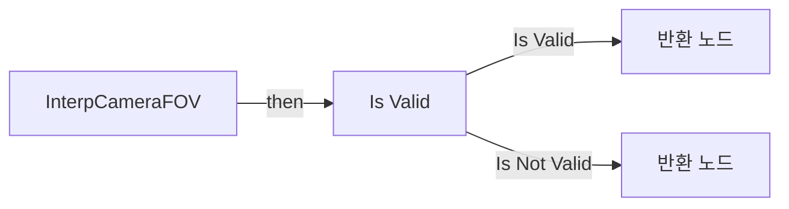

전체 노드·기본 입력 목록

| 노드 ID | 제목 | 미연결 기본 입력 / 에셋 입력 |
|---|---|---|
| `K2Node_FunctionEntry_1453` | InterpCameraFOV |  |
| `K2Node_FunctionResult_5` | 반환 노드 |  |
| `K2Node_VariableGet_309` | Get CrosshairCamera |  |
| `K2Node_VariableGet_1292` | Get FieldOfView |  |
| `K2Node_VariableGet_391` | Get DeltaSeconds |  |
| `K2Node_CallFunction_2635` | FInterp to Constant |  |
| `K2Node_MacroInstance_1401` | Is Valid |  |
| `K2Node_FunctionResult_0` | 반환 노드 | ReturnValue=0.0 |

### SetCharacterInput

실행 핀 플로우차트

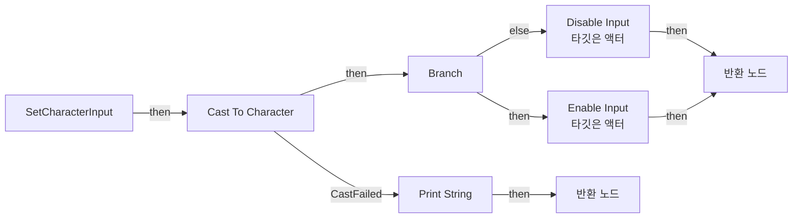

전체 노드·기본 입력 목록

| 노드 ID | 제목 | 미연결 기본 입력 / 에셋 입력 |
|---|---|---|
| `K2Node_FunctionEntry_442` | SetCharacterInput |  |
| `K2Node_VariableGet_192` | Get PlayerOwner |  |
| `K2Node_CallFunction_838` | Get Owning Pawn 타깃은 HUD |  |
| `K2Node_DynamicCast_0` | Cast To Character |  |
| `K2Node_CallFunction_839` | Disable Input 타깃은 액터 |  |
| `K2Node_CallFunction_840` | Print String | InString=HUD: Cast to Character failed!; bPrintToScreen=true; bPrintToLog=true; TextColor=(R=0.000000,G=0.660000,B=1.000000,A=1.000000); Duration=5; Key=None |
| `K2Node_IfThenElse_973` | Branch |  |
| `K2Node_CallFunction_1105` | Enable Input 타깃은 액터 |  |
| `K2Node_Knot_77` | 경유 노드 |  |
| `K2Node_Knot_78` | 경유 노드 |  |
| `K2Node_Knot_79` | 경유 노드 |  |
| `K2Node_Knot_80` | 경유 노드 |  |
| `K2Node_FunctionResult_3` | 반환 노드 |  |
| `K2Node_FunctionResult_2` | 반환 노드 |  |

### UpdateCameraZoom

실행 핀 플로우차트

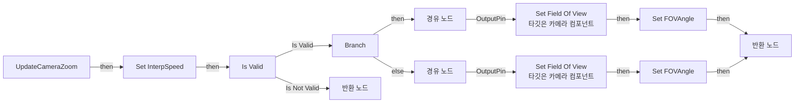

전체 노드·기본 입력 목록

| 노드 ID | 제목 | 미연결 기본 입력 / 에셋 입력 |
|---|---|---|
| `K2Node_FunctionEntry_1699` | UpdateCameraZoom |  |
| `K2Node_VariableGet_295` | Get CrosshairCamera |  |
| `K2Node_CallFunction_2858` | Set Field Of View 타깃은 카메라 컴포넌트 |  |
| `K2Node_VariableGet_1293` | Get DefaultFOV |  |
| `K2Node_VariableGet_1324` | Get CrosshairCamera |  |
| `K2Node_VariableGet_310` | Get ZoomValueDegrees |  |
| `K2Node_CallFunction_1811` | float &gt; float | B=0.0 |
| `K2Node_IfThenElse_1125` | Branch |  |
| `K2Node_CallFunction_1539` | Set Field Of View 타깃은 카메라 컴포넌트 |  |
| `K2Node_VariableGet_1291` | Get CrosshairCamera |  |
| `K2Node_CommutativeAssociativeBinaryOperator_54` | AND Boolean |  |
| `K2Node_VariableGet_2709` | Get CSHUDCameraCapture2D |  |
| `K2Node_VariableSet_899` | Set FOVAngle | Output_Get=0.0 |
| `K2Node_Knot_148` | 경유 노드 |  |
| `K2Node_VariableSet_898` | Set FOVAngle | Output_Get=0.0 |
| `K2Node_Knot_149` | 경유 노드 |  |
| `K2Node_CallFunction_4893` | Interp Camera FOV |  |
| `K2Node_CallFunction_4552` | Interp Camera FOV |  |
| `K2Node_CallFunction_4985` | Get Zoom Value |  |
| `K2Node_Knot_182` | 경유 노드 |  |
| `K2Node_VariableGet_481` | Get CSHUDCameraCapture2D |  |
| `K2Node_Knot_185` | 경유 노드 |  |
| `K2Node_Knot_186` | 경유 노드 |  |
| `K2Node_Knot_187` | 경유 노드 |  |
| `K2Node_VariableSet_413` | Set InterpSpeed | Output_Get=0.0 |
| `K2Node_VariableGet_512` | Get InterpSpeed |  |
| `K2Node_FunctionResult_4` | 반환 노드 |  |
| `K2Node_MacroInstance_1431` | Is Valid |  |
| `K2Node_FunctionResult_6` | 반환 노드 |  |
| `K2Node_VariableGet_0` | Get bZoomIn |  |

### UpdateHUD_Camera

실행 핀 플로우차트

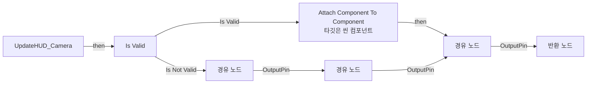

전체 노드·기본 입력 목록

| 노드 ID | 제목 | 미연결 기본 입력 / 에셋 입력 |
|---|---|---|
| `K2Node_FunctionEntry_1286` | UpdateHUD_Camera |  |
| `K2Node_VariableGet_1994` | Get CSHUDCameraCapture2D |  |
| `K2Node_CallFunction_4932` | Attach Component To Component 타깃은 씬 컴포넌트 | SocketName=None; LocationRule=SnapToTarget; RotationRule=SnapToTarget; ScaleRule=SnapToTarget; bWeldSimulatedBodies=false; ReturnValue=false |
| `K2Node_MacroInstance_1017` | Is Valid |  |
| `K2Node_VariableGet_278` | Get CrosshairCamera |  |
| `K2Node_Knot_260` | 경유 노드 |  |
| `K2Node_FunctionResult_7` | 반환 노드 |  |
| `K2Node_Knot_262` | 경유 노드 |  |
| `K2Node_Knot_263` | 경유 노드 |  |
| `K2Node_Knot_264` | 경유 노드 |  |

### UserConstructionScript

실행 핀 플로우차트

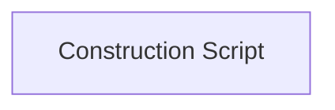

전체 노드·기본 입력 목록

| 노드 ID | 제목 | 미연결 기본 입력 / 에셋 입력 |
|---|---|---|
| `K2Node_FunctionEntry_0` | Construction Script |  |

## 조회 범위의 한계

ObjectIterator로 발견했으나 MCP helper가 반환하지 않은 그래프입니다. delegate signature·컴파일된 중간 그래프·macro·애니메이션 내부 그래프가 섞일 수 있습니다.

- `AddAchievement`: Graph 'AddAchievement' not found in Blueprint.
- `AddArmorBar`: Graph 'AddArmorBar' not found in Blueprint.
- `AddCrosshairWidget`: Graph 'AddCrosshairWidget' not found in Blueprint.
- `AddDamageFeedback`: Graph 'AddDamageFeedback' not found in Blueprint.
- `AddDamageIndicator`: Graph 'AddDamageIndicator' not found in Blueprint.
- `AddExtraTime`: Graph 'AddExtraTime' not found in Blueprint.
- `AddHealthBar`: Graph 'AddHealthBar' not found in Blueprint.
- `AddIntermediatePoints`: Graph 'AddIntermediatePoints' not found in Blueprint.
- `AddKillMessage1`: Graph 'AddKillMessage1' not found in Blueprint.
- `AddKillMessage2`: Graph 'AddKillMessage2' not found in Blueprint.
- `AddMainTutorialMessage`: Graph 'AddMainTutorialMessage' not found in Blueprint.
- `AddMedal`: Graph 'AddMedal' not found in Blueprint.
- `AddNewKillEntry`: Graph 'AddNewKillEntry' not found in Blueprint.
- `AddOrUpdateActionSlot`: Graph 'AddOrUpdateActionSlot' not found in Blueprint.
- `AddOrUpdateAmmoIcon`: Graph 'AddOrUpdateAmmoIcon' not found in Blueprint.
- `AddOrUpdateCrosshair`: Graph 'AddOrUpdateCrosshair' not found in Blueprint.
- `AddOrUpdateProgressBar`: Graph 'AddOrUpdateProgressBar' not found in Blueprint.
- `AddOrUpdateTeamKillCount`: Graph 'AddOrUpdateTeamKillCount' not found in Blueprint.
- `AddOrUpdateZoom`: Graph 'AddOrUpdateZoom' not found in Blueprint.
- `AddRecoil`: Graph 'AddRecoil' not found in Blueprint.
- `AddWeaponBar`: Graph 'AddWeaponBar' not found in Blueprint.
- `CSHUD_Validator`: Graph 'CSHUD_Validator' not found in Blueprint.
- `CSH_ClearPP`: Graph 'CSH_ClearPP' not found in Blueprint.
- `CSH_SetBlackScreen`: Graph 'CSH_SetBlackScreen' not found in Blueprint.
- `CSH_SetChromAberation`: Graph 'CSH_SetChromAberation' not found in Blueprint.
- `CSH_SetDamageFX`: Graph 'CSH_SetDamageFX' not found in Blueprint.
- `CSH_SetPlayCameraShake`: Graph 'CSH_SetPlayCameraShake' not found in Blueprint.
- `CSH_SetPowerUp`: Graph 'CSH_SetPowerUp' not found in Blueprint.
- `CSH_SetSaturation`: Graph 'CSH_SetSaturation' not found in Blueprint.
- `CSH_SetVignette`: Graph 'CSH_SetVignette' not found in Blueprint.
- `ConfirmTutorialMessage`: Graph 'ConfirmTutorialMessage' not found in Blueprint.
- `CreateTimer`: Graph 'CreateTimer' not found in Blueprint.
- `DamageOpacityTL__FinishedFunc`: Graph 'DamageOpacityTL__FinishedFunc' not found in Blueprint.
- `DamageOpacityTL__UpdateFunc`: Graph 'DamageOpacityTL__UpdateFunc' not found in Blueprint.
- `DisplayHitPoint`: Graph 'DisplayHitPoint' not found in Blueprint.
- `DisplayShooterHUD`: Graph 'DisplayShooterHUD' not found in Blueprint.
- `DisplaySpecialHitPoint`: Graph 'DisplaySpecialHitPoint' not found in Blueprint.
- `GetCurrentAmmo`: Graph 'GetCurrentAmmo' not found in Blueprint.
- `GetCurrentAmmoType`: Graph 'GetCurrentAmmoType' not found in Blueprint.
- `GetCurrentArmor`: Graph 'GetCurrentArmor' not found in Blueprint.
- `GetCurrentHealth`: Graph 'GetCurrentHealth' not found in Blueprint.
- `GetCurrentMaxAmmo`: Graph 'GetCurrentMaxAmmo' not found in Blueprint.
- `GetCurrentMaxArmor`: Graph 'GetCurrentMaxArmor' not found in Blueprint.
- `GetCurrentMaxHealth`: Graph 'GetCurrentMaxHealth' not found in Blueprint.
- `GetCurrentStackSize`: Graph 'GetCurrentStackSize' not found in Blueprint.
- `GetHealthPercent`: Graph 'GetHealthPercent' not found in Blueprint.
- `GetLastKillEntry`: Graph 'GetLastKillEntry' not found in Blueprint.
- `GetTeamKillCountMaxValue`: Graph 'GetTeamKillCountMaxValue' not found in Blueprint.
- `GetTeamKillCountValue`: Graph 'GetTeamKillCountValue' not found in Blueprint.
- `GetTime`: Graph 'GetTime' not found in Blueprint.
- `HandleCrosshairReferences`: Graph 'HandleCrosshairReferences' not found in Blueprint.
- `HandleCrosshairWidget`: Graph 'HandleCrosshairWidget' not found in Blueprint.
- `HandleMainTutorialWidget`: Graph 'HandleMainTutorialWidget' not found in Blueprint.
- `HitIndicator`: Graph 'HitIndicator' not found in Blueprint.
- `MainTutorialMessageConfirmed`: Graph 'MainTutorialMessageConfirmed' not found in Blueprint.
- `OnMainTutorialMessageRemoved`: Graph 'OnMainTutorialMessageRemoved' not found in Blueprint.
- `OnProgressBarCompleted`: Graph 'OnProgressBarCompleted' not found in Blueprint.
- `OnProgressBarCompleted_Event`: Graph 'OnProgressBarCompleted_Event' not found in Blueprint.
- `OnTimerCompleted`: Graph 'OnTimerCompleted' not found in Blueprint.
- `PauseTimer`: Graph 'PauseTimer' not found in Blueprint.
- `ReceiveBeginPlay`: Graph 'ReceiveBeginPlay' not found in Blueprint.
- `ReceiveTick`: Graph 'ReceiveTick' not found in Blueprint.
- `RemoveAchievement`: Graph 'RemoveAchievement' not found in Blueprint.
- `RemoveActionSlot`: Graph 'RemoveActionSlot' not found in Blueprint.
- `RemoveAllActionSlots`: Graph 'RemoveAllActionSlots' not found in Blueprint.
- `RemoveAllDamageIndicator`: Graph 'RemoveAllDamageIndicator' not found in Blueprint.
- `RemoveAmmo`: Graph 'RemoveAmmo' not found in Blueprint.
- `RemoveAmmoIcon`: Graph 'RemoveAmmoIcon' not found in Blueprint.
- `RemoveArmor`: Graph 'RemoveArmor' not found in Blueprint.
- `RemoveArmorBar`: Graph 'RemoveArmorBar' not found in Blueprint.
- `RemoveColorImpact_CSHUD`: Graph 'RemoveColorImpact_CSHUD' not found in Blueprint.
- `RemoveCrosshair`: Graph 'RemoveCrosshair' not found in Blueprint.
- `RemoveDamageFX_CSHUD`: Graph 'RemoveDamageFX_CSHUD' not found in Blueprint.
- `RemoveDamageFeedback`: Graph 'RemoveDamageFeedback' not found in Blueprint.
- `RemoveHealth`: Graph 'RemoveHealth' not found in Blueprint.
- `RemoveHealthBar`: Graph 'RemoveHealthBar' not found in Blueprint.
- `RemoveHitPoint`: Graph 'RemoveHitPoint' not found in Blueprint.
- `RemoveIntermediatePoints`: Graph 'RemoveIntermediatePoints' not found in Blueprint.
- `RemoveKillEntrys`: Graph 'RemoveKillEntrys' not found in Blueprint.
- `RemoveKillMessages`: Graph 'RemoveKillMessages' not found in Blueprint.
- `RemoveMainTutorialMessage`: Graph 'RemoveMainTutorialMessage' not found in Blueprint.
- `RemoveMaxAmmo`: Graph 'RemoveMaxAmmo' not found in Blueprint.
- `RemoveMedal`: Graph 'RemoveMedal' not found in Blueprint.
- `RemoveProgressBar`: Graph 'RemoveProgressBar' not found in Blueprint.
- `RemoveSpecialHitPoint`: Graph 'RemoveSpecialHitPoint' not found in Blueprint.
- `RemoveTeamKillCount`: Graph 'RemoveTeamKillCount' not found in Blueprint.
- `RemoveTeamKillCountMaxValue`: Graph 'RemoveTeamKillCountMaxValue' not found in Blueprint.
- `RemoveTeamKillCountValue`: Graph 'RemoveTeamKillCountValue' not found in Blueprint.
- `RemoveTimer`: Graph 'RemoveTimer' not found in Blueprint.
- `RemoveWeaponBar`: Graph 'RemoveWeaponBar' not found in Blueprint.
- `SlotImpact`: Graph 'SlotImpact' not found in Blueprint.
- `StartTimer`: Graph 'StartTimer' not found in Blueprint.
- `Timeline_17__FinishedFunc`: Graph 'Timeline_17__FinishedFunc' not found in Blueprint.
- `Timeline_17__UpdateFunc`: Graph 'Timeline_17__UpdateFunc' not found in Blueprint.
- `Timeline_18__FinishedFunc`: Graph 'Timeline_18__FinishedFunc' not found in Blueprint.
- `Timeline_18__UpdateFunc`: Graph 'Timeline_18__UpdateFunc' not found in Blueprint.
- `Timeline_19__FinishedFunc`: Graph 'Timeline_19__FinishedFunc' not found in Blueprint.
- `Timeline_19__UpdateFunc`: Graph 'Timeline_19__UpdateFunc' not found in Blueprint.
- `Timeline_20__FinishedFunc`: Graph 'Timeline_20__FinishedFunc' not found in Blueprint.
- `Timeline_20__UpdateFunc`: Graph 'Timeline_20__UpdateFunc' not found in Blueprint.
- `TutorialMessageInputListener`: Graph 'TutorialMessageInputListener' not found in Blueprint.
- `UpdateAmmo`: Graph 'UpdateAmmo' not found in Blueprint.
- `UpdateArmor`: Graph 'UpdateArmor' not found in Blueprint.
- `UpdateBlackscreen_CSHUD`: Graph 'UpdateBlackscreen_CSHUD' not found in Blueprint.
- `UpdateColorImpact_CSHUD`: Graph 'UpdateColorImpact_CSHUD' not found in Blueprint.
- `UpdateDamageFX_CSHUD`: Graph 'UpdateDamageFX_CSHUD' not found in Blueprint.
- `UpdateHealth`: Graph 'UpdateHealth' not found in Blueprint.
- `UpdateMaxAmmo`: Graph 'UpdateMaxAmmo' not found in Blueprint.
- `UpdateMaxArmor`: Graph 'UpdateMaxArmor' not found in Blueprint.
- `UpdateMaxHealth`: Graph 'UpdateMaxHealth' not found in Blueprint.
- `UpdateTeamKillCountMaxValue`: Graph 'UpdateTeamKillCountMaxValue' not found in Blueprint.
- `UpdateTeamKillCountValue`: Graph 'UpdateTeamKillCountValue' not found in Blueprint.
- `UpdateWeaponBar`: Graph 'UpdateWeaponBar' not found in Blueprint.
- `ValidateCrosshair`: Graph 'ValidateCrosshair' not found in Blueprint.

[원본 MCP 스냅샷](../../../Evidence/blueprints-316.json)
