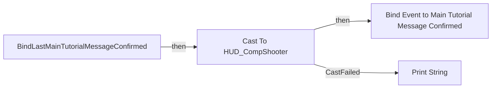
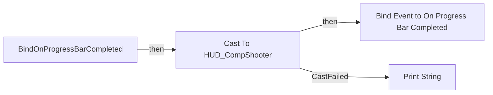
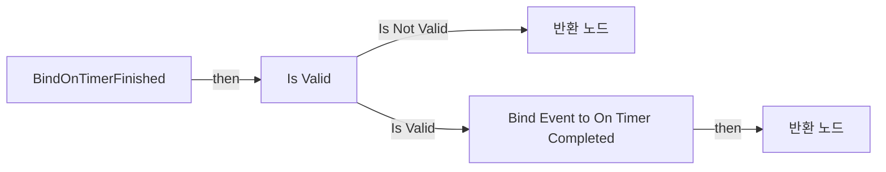
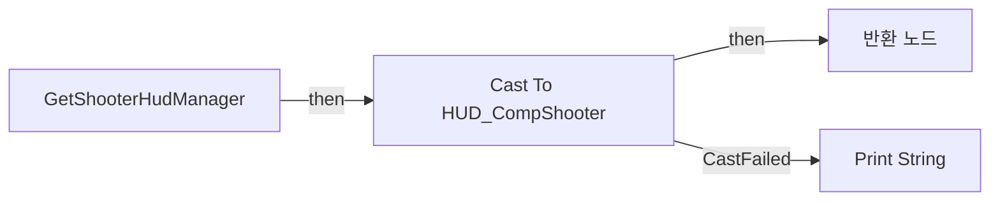
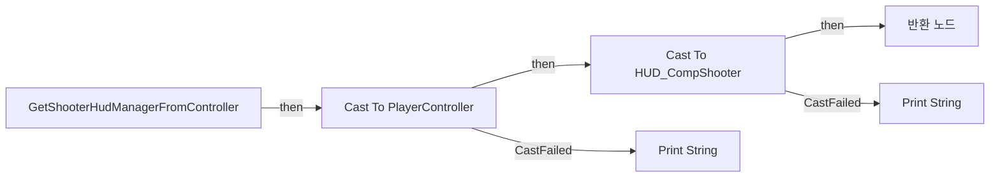
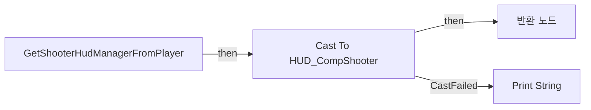
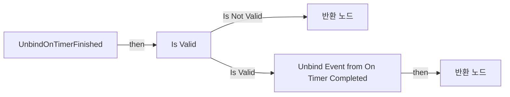

# FL_ShooterHud

에셋: `/Game/CompShooterHUD/Blueprints/Interfaces/FL_ShooterHud`

부모: `/Script/CoreUObject.Class'/Script/Engine.BlueprintFunctionLibrary'`

수집일: 2026-10-12. MCP에서 읽은 그래프·핀 연결의 자동 전사입니다. 상속된 그래프는 부모 문서를 함께 확인합니다.

정적 루트 참조 도달: 있음. 실행 여부 또는 삭제 가능 여부의 확정이 아닙니다.

컴포넌트 목록은 이 BP가 직접 정의한 SCS만 포함합니다. 부모·네이티브 생성 컴포넌트, 인스턴스 설정은 별도입니다.

## 그래프 목록

| 그래프 | 전체 노드 수 |
|---|---|
| BindLastMainTutorialMessageConfirmed | 7 |
| BindOnProgressBarCompleted | 7 |
| BindOnTimerFinished | 8 |
| GetShooterHud | 5 |
| GetShooterHudManager | 6 |
| GetShooterHudManagerFromController | 7 |
| GetShooterHudManagerFromPlayer | 6 |
| UnbindOnTimerFinished | 8 |

## 그래프별 실행 연결

실선은 출력 exec 핀의 실제 연결입니다. 여러 분기는 출력 핀 이름을 표시합니다. 함수 호출·delegate·타이머의 다음 그래프 실행은 이 그림에서 자동으로 이어 붙이지 않습니다.

순수 계산 노드 및 데이터 핀은 아래 목록과 원본 JSON을 확인합니다. 연결되지 않은 이벤트도 표시되므로, 노드가 있다는 이유만으로 실행된다고 판단하면 안 됩니다.

### BindLastMainTutorialMessageConfirmed

실행 핀 플로우차트

전체 노드·기본 입력 목록

| 노드 ID | 제목 | 미연결 기본 입력 / 에셋 입력 |
|---|---|---|
| `K2Node_FunctionEntry_0` | BindLastMainTutorialMessageConfirmed |  |
| `K2Node_CallFunction_2` | Get HUD 타깃은 플레이어 컨트롤러 |  |
| `K2Node_DynamicCast_1` | Cast To HUD_CompShooter |  |
| `K2Node_AddDelegate_0` | Bind Event to Main Tutorial Message Confirmed |  |
| `K2Node_CallFunction_6` | Print String | InString=Cast to HUD failed. Please check your PC Reference!; bPrintToScreen=true; bPrintToLog=true; TextColor=(R=0.000000,G=0.660000,B=1.000000,A=1.000000); Duration=4; Key=None |
| `K2Node_Knot_37` | 경유 노드 |  |
| `K2Node_Knot_38` | 경유 노드 |  |

### BindOnProgressBarCompleted

실행 핀 플로우차트

전체 노드·기본 입력 목록

| 노드 ID | 제목 | 미연결 기본 입력 / 에셋 입력 |
|---|---|---|
| `K2Node_FunctionEntry_0` | BindOnProgressBarCompleted |  |
| `K2Node_CallFunction_2` | Get HUD 타깃은 플레이어 컨트롤러 |  |
| `K2Node_DynamicCast_1` | Cast To HUD_CompShooter |  |
| `K2Node_CallFunction_6` | Print String | InString=Cast to HUD failed. Please check your PC Reference!; bPrintToScreen=true; bPrintToLog=true; TextColor=(R=0.000000,G=0.660000,B=1.000000,A=1.000000); Duration=4; Key=None |
| `K2Node_AddDelegate_0` | Bind Event to On Progress Bar Completed |  |
| `K2Node_Knot_146` | 경유 노드 |  |
| `K2Node_Knot_147` | 경유 노드 |  |

### BindOnTimerFinished

실행 핀 플로우차트

전체 노드·기본 입력 목록

| 노드 ID | 제목 | 미연결 기본 입력 / 에셋 입력 |
|---|---|---|
| `K2Node_FunctionEntry_0` | BindOnTimerFinished |  |
| `K2Node_CallFunction_1` | Get Shooter Hud |  |
| `K2Node_FunctionResult_0` | 반환 노드 |  |
| `K2Node_MacroInstance_0` | Is Valid |  |
| `K2Node_Knot_3097` | 경유 노드 |  |
| `K2Node_Knot_3098` | 경유 노드 |  |
| `K2Node_FunctionResult_1` | 반환 노드 |  |
| `K2Node_AddDelegate_0` | Bind Event to On Timer Completed |  |

### GetShooterHud

실행 핀 플로우차트

전체 노드·기본 입력 목록

| 노드 ID | 제목 | 미연결 기본 입력 / 에셋 입력 |
|---|---|---|
| `K2Node_FunctionEntry_1` | GetShooterHud |  |
| `K2Node_CallFunction_1` | Get Player Controller |  |
| `K2Node_CallFunction_2` | Get HUD 타깃은 플레이어 컨트롤러 |  |
| `K2Node_DynamicCast_1` | Cast To HUD_CompShooter |  |
| `K2Node_FunctionResult_1` | 반환 노드 |  |

### GetShooterHudManager

실행 핀 플로우차트

전체 노드·기본 입력 목록

| 노드 ID | 제목 | 미연결 기본 입력 / 에셋 입력 |
|---|---|---|
| `K2Node_FunctionEntry_0` | GetShooterHudManager |  |
| `K2Node_CallFunction_0` | Get Player Controller | PlayerIndex=0 |
| `K2Node_CallFunction_1` | Get HUD 타깃은 플레이어 컨트롤러 |  |
| `K2Node_FunctionResult_0` | 반환 노드 |  |
| `K2Node_DynamicCast_0` | Cast To HUD_CompShooter |  |
| `K2Node_CallFunction_3` | Print String | InString=FL_ShooterHUD: Cast to HUD_CompShooter failed!; bPrintToScreen=true; bPrintToLog=true; TextColor=(R=1.000000,G=0.230857,B=0.000000,A=1.000000); Duration=10; Key=None |

### GetShooterHudManagerFromController

실행 핀 플로우차트

전체 노드·기본 입력 목록

| 노드 ID | 제목 | 미연결 기본 입력 / 에셋 입력 |
|---|---|---|
| `K2Node_FunctionEntry_0` | GetShooterHudManagerFromController |  |
| `K2Node_CallFunction_1` | Get HUD 타깃은 플레이어 컨트롤러 |  |
| `K2Node_FunctionResult_0` | 반환 노드 |  |
| `K2Node_DynamicCast_0` | Cast To HUD_CompShooter |  |
| `K2Node_CallFunction_5` | Print String | InString=FL_ShooterHUD: Cast to HUD_CompShooter failed!; bPrintToScreen=true; bPrintToLog=true; TextColor=(R=1.000000,G=0.230857,B=0.000000,A=1.000000); Duration=10; Key=None |
| `K2Node_DynamicCast_2` | Cast To PlayerController |  |
| `K2Node_CallFunction_3` | Print String | InString=FL_ShooterHUD: Cast to PlayerController Instance failed!; bPrintToScreen=true; bPrintToLog=true; TextColor=(R=1.000000,G=0.230857,B=0.000000,A=1.000000); Duration=10; Key=None |

### GetShooterHudManagerFromPlayer

실행 핀 플로우차트

전체 노드·기본 입력 목록

| 노드 ID | 제목 | 미연결 기본 입력 / 에셋 입력 |
|---|---|---|
| `K2Node_FunctionEntry_0` | GetShooterHudManagerFromPlayer |  |
| `K2Node_CallFunction_1` | Get HUD 타깃은 플레이어 컨트롤러 |  |
| `K2Node_FunctionResult_0` | 반환 노드 |  |
| `K2Node_DynamicCast_0` | Cast To HUD_CompShooter |  |
| `K2Node_CallFunction_3` | Print String | InString=FL_ShooterHUD: Cast to HUD_CompShooter failed!; bPrintToScreen=true; bPrintToLog=true; TextColor=(R=1.000000,G=0.230857,B=0.000000,A=1.000000); Duration=10; Key=None |
| `K2Node_Knot_1` | 경유 노드 |  |

### UnbindOnTimerFinished

실행 핀 플로우차트

전체 노드·기본 입력 목록

| 노드 ID | 제목 | 미연결 기본 입력 / 에셋 입력 |
|---|---|---|
| `K2Node_FunctionEntry_0` | UnbindOnTimerFinished |  |
| `K2Node_CallFunction_1` | Get Shooter Hud |  |
| `K2Node_FunctionResult_0` | 반환 노드 |  |
| `K2Node_MacroInstance_0` | Is Valid |  |
| `K2Node_Knot_3097` | 경유 노드 |  |
| `K2Node_Knot_3098` | 경유 노드 |  |
| `K2Node_FunctionResult_1` | 반환 노드 |  |
| `K2Node_RemoveDelegate_0` | Unbind Event from On Timer Completed |  |

[원본 MCP 스냅샷](../../../../Evidence/blueprints-351.json)
