# I_ShooterHudManager

에셋: `/Game/CompShooterHUD/Blueprints/Interfaces/I_ShooterHudManager`

부모: `/Script/CoreUObject.Class'/Script/CoreUObject.Interface'`

수집일: 2026-10-12. MCP에서 읽은 그래프·핀 연결의 자동 전사입니다. 상속된 그래프는 부모 문서를 함께 확인합니다.

정적 루트 참조 도달: 있음. 실행 여부 또는 삭제 가능 여부의 확정이 아닙니다.

컴포넌트 목록은 이 BP가 직접 정의한 SCS만 포함합니다. 부모·네이티브 생성 컴포넌트, 인스턴스 설정은 별도입니다.

## 그래프 목록

| 그래프 | 전체 노드 수 |
|---|---|
| AddAchievement | 1 |
| AddArmorBar | 1 |
| AddDamageFeedback | 1 |
| AddDamageIndicator | 1 |
| AddExtraTime | 1 |
| AddHealthBar | 1 |
| AddIntermediatePoints | 1 |
| AddKillMessage1 | 1 |
| AddKillMessage2 | 1 |
| AddMainTutorialMessage | 2 |
| AddMedal | 1 |
| AddNewKillEntry | 1 |
| AddOrUpdateActionSlot | 1 |
| AddOrUpdateAmmoIcon | 1 |
| AddOrUpdateCrosshair | 1 |
| AddOrUpdateProgressBar | 1 |
| AddOrUpdateTeamKillCount | 1 |
| AddOrUpdateZoom | 1 |
| AddRecoil | 1 |
| AddWeaponBar | 1 |
| CreateTimer | 1 |
| DisplayHitPoint | 1 |
| DisplayShooterHUD | 1 |
| DisplaySpecialHitPoint | 1 |
| GetCurrentAmmo | 2 |
| GetCurrentAmmoType | 2 |
| GetCurrentArmor | 2 |
| GetCurrentHealth | 2 |
| GetCurrentMaxAmmo | 2 |
| GetCurrentMaxArmor | 2 |
| GetCurrentMaxHealth | 2 |
| GetCurrentStackSize | 2 |
| GetLastKillEntry | 2 |
| GetTeamKillCountMaxValue | 2 |
| GetTeamKillCountValue | 2 |
| GetTime | 2 |
| HitIndicator | 1 |
| PauseTimer | 1 |
| RemoveAchievement | 1 |
| RemoveActionSlot | 1 |
| RemoveAllActionSlots | 1 |
| RemoveAllDamageIndicator | 1 |
| RemoveAmmo | 1 |
| RemoveAmmoIcon | 1 |
| RemoveArmor | 1 |
| RemoveArmorBar | 1 |
| RemoveColorImpact_CSHUD | 1 |
| RemoveCrosshair | 1 |
| RemoveDamageFX_CSHUD | 1 |
| RemoveDamageFeedback | 1 |
| RemoveHealth | 1 |
| RemoveHealthBar | 1 |
| RemoveHitPoint | 1 |
| RemoveIntermediatePoints | 1 |
| RemoveKillEntrys | 1 |
| RemoveKillMessages | 1 |
| RemoveMainTutorialMessage | 2 |
| RemoveMaxAmmo | 1 |
| RemoveMedal | 1 |
| RemoveProgressBar | 1 |
| RemoveSpecialHitPoint | 1 |
| RemoveTeamKillCount | 1 |
| RemoveTeamKillCountMaxValue | 1 |
| RemoveTeamKillCountValue | 1 |
| RemoveTimer | 1 |
| RemoveWeaponBar | 1 |
| SlotImpact | 1 |
| StartTimer | 1 |
| UpdateAmmo | 1 |
| UpdateArmor | 1 |
| UpdateBlackscreen_CSHUD | 1 |
| UpdateColorImpact_CSHUD | 1 |
| UpdateDamageFX_CSHUD | 1 |
| UpdateHealth | 1 |
| UpdateMaxAmmo | 1 |
| UpdateMaxArmor | 1 |
| UpdateMaxHealth | 1 |
| UpdateTeamKillCountMaxValue | 1 |
| UpdateTeamKillCountValue | 1 |
| UpdateWeaponBar | 1 |

## 그래프별 실행 연결

실선은 출력 exec 핀의 실제 연결입니다. 여러 분기는 출력 핀 이름을 표시합니다. 함수 호출·delegate·타이머의 다음 그래프 실행은 이 그림에서 자동으로 이어 붙이지 않습니다.

순수 계산 노드 및 데이터 핀은 아래 목록과 원본 JSON을 확인합니다. 연결되지 않은 이벤트도 표시되므로, 노드가 있다는 이유만으로 실행된다고 판단하면 안 됩니다.

### AddAchievement

<details>
<summary>실행 핀 플로우차트</summary>

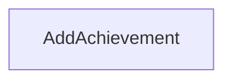

</details>

<details>
<summary>전체 노드·기본 입력 목록</summary>

| 노드 ID | 제목 | 미연결 기본 입력 / 에셋 입력 |
|---|---|---|
| `K2Node_FunctionEntry_0` | AddAchievement |  |

</details>

### AddArmorBar

<details>
<summary>실행 핀 플로우차트</summary>

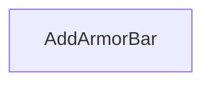

</details>

<details>
<summary>전체 노드·기본 입력 목록</summary>

| 노드 ID | 제목 | 미연결 기본 입력 / 에셋 입력 |
|---|---|---|
| `K2Node_FunctionEntry_0` | AddArmorBar |  |

</details>

### AddDamageFeedback

<details>
<summary>실행 핀 플로우차트</summary>

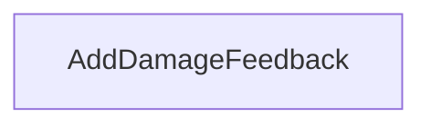

</details>

<details>
<summary>전체 노드·기본 입력 목록</summary>

| 노드 ID | 제목 | 미연결 기본 입력 / 에셋 입력 |
|---|---|---|
| `K2Node_FunctionEntry_1` | AddDamageFeedback |  |

</details>

### AddDamageIndicator

<details>
<summary>실행 핀 플로우차트</summary>

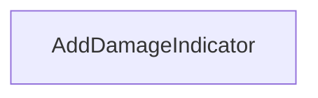

</details>

<details>
<summary>전체 노드·기본 입력 목록</summary>

| 노드 ID | 제목 | 미연결 기본 입력 / 에셋 입력 |
|---|---|---|
| `K2Node_FunctionEntry_0` | AddDamageIndicator |  |

</details>

### AddExtraTime

<details>
<summary>실행 핀 플로우차트</summary>

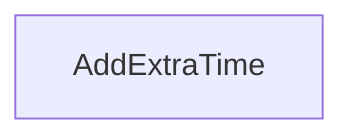

</details>

<details>
<summary>전체 노드·기본 입력 목록</summary>

| 노드 ID | 제목 | 미연결 기본 입력 / 에셋 입력 |
|---|---|---|
| `K2Node_FunctionEntry_0` | AddExtraTime |  |

</details>

### AddHealthBar

<details>
<summary>실행 핀 플로우차트</summary>

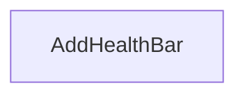

</details>

<details>
<summary>전체 노드·기본 입력 목록</summary>

| 노드 ID | 제목 | 미연결 기본 입력 / 에셋 입력 |
|---|---|---|
| `K2Node_FunctionEntry_0` | AddHealthBar |  |

</details>

### AddIntermediatePoints

<details>
<summary>실행 핀 플로우차트</summary>

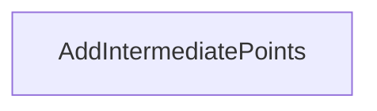

</details>

<details>
<summary>전체 노드·기본 입력 목록</summary>

| 노드 ID | 제목 | 미연결 기본 입력 / 에셋 입력 |
|---|---|---|
| `K2Node_FunctionEntry_0` | AddIntermediatePoints |  |

</details>

### AddKillMessage1

<details>
<summary>실행 핀 플로우차트</summary>


</details>

<details>
<summary>전체 노드·기본 입력 목록</summary>

| 노드 ID | 제목 | 미연결 기본 입력 / 에셋 입력 |
|---|---|---|
| `K2Node_FunctionEntry_0` | AddKillMessage1 |  |

</details>

### AddKillMessage2

<details>
<summary>실행 핀 플로우차트</summary>

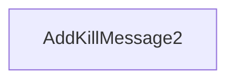

</details>

<details>
<summary>전체 노드·기본 입력 목록</summary>

| 노드 ID | 제목 | 미연결 기본 입력 / 에셋 입력 |
|---|---|---|
| `K2Node_FunctionEntry_0` | AddKillMessage2 |  |

</details>

### AddMainTutorialMessage

<details>
<summary>실행 핀 플로우차트</summary>

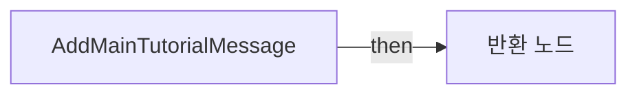

</details>

<details>
<summary>전체 노드·기본 입력 목록</summary>

| 노드 ID | 제목 | 미연결 기본 입력 / 에셋 입력 |
|---|---|---|
| `K2Node_FunctionEntry_0` | AddMainTutorialMessage |  |
| `K2Node_FunctionResult_0` | 반환 노드 |  |

</details>

### AddMedal

<details>
<summary>실행 핀 플로우차트</summary>

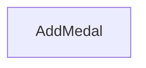

</details>

<details>
<summary>전체 노드·기본 입력 목록</summary>

| 노드 ID | 제목 | 미연결 기본 입력 / 에셋 입력 |
|---|---|---|
| `K2Node_FunctionEntry_0` | AddMedal |  |

</details>

### AddNewKillEntry

<details>
<summary>실행 핀 플로우차트</summary>

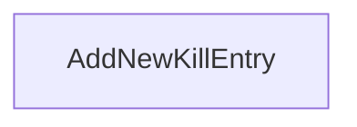

</details>

<details>
<summary>전체 노드·기본 입력 목록</summary>

| 노드 ID | 제목 | 미연결 기본 입력 / 에셋 입력 |
|---|---|---|
| `K2Node_FunctionEntry_0` | AddNewKillEntry |  |

</details>

### AddOrUpdateActionSlot

<details>
<summary>실행 핀 플로우차트</summary>

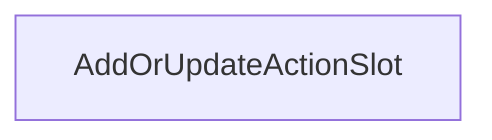

</details>

<details>
<summary>전체 노드·기본 입력 목록</summary>

| 노드 ID | 제목 | 미연결 기본 입력 / 에셋 입력 |
|---|---|---|
| `K2Node_FunctionEntry_0` | AddOrUpdateActionSlot | E_Slot=NewEnumerator0 |

</details>

### AddOrUpdateAmmoIcon

<details>
<summary>실행 핀 플로우차트</summary>

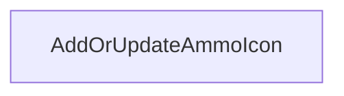

</details>

<details>
<summary>전체 노드·기본 입력 목록</summary>

| 노드 ID | 제목 | 미연결 기본 입력 / 에셋 입력 |
|---|---|---|
| `K2Node_FunctionEntry_0` | AddOrUpdateAmmoIcon | Icon_Slot=NewEnumerator0 |

</details>

### AddOrUpdateCrosshair

<details>
<summary>실행 핀 플로우차트</summary>

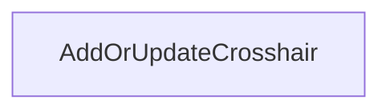

</details>

<details>
<summary>전체 노드·기본 입력 목록</summary>

| 노드 ID | 제목 | 미연결 기본 입력 / 에셋 입력 |
|---|---|---|
| `K2Node_FunctionEntry_0` | AddOrUpdateCrosshair | CrosshairType=NewEnumerator0; CrosshairScale=1 |

</details>

### AddOrUpdateProgressBar

<details>
<summary>실행 핀 플로우차트</summary>

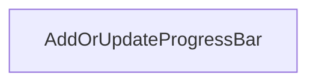

</details>

<details>
<summary>전체 노드·기본 입력 목록</summary>

| 노드 ID | 제목 | 미연결 기본 입력 / 에셋 입력 |
|---|---|---|
| `K2Node_FunctionEntry_0` | AddOrUpdateProgressBar | ProgressBarType=NewEnumerator0; ProgressType=NewEnumerator0 |

</details>

### AddOrUpdateTeamKillCount

<details>
<summary>실행 핀 플로우차트</summary>

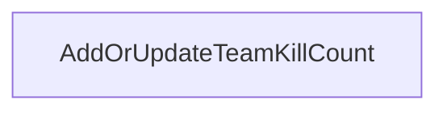

</details>

<details>
<summary>전체 노드·기본 입력 목록</summary>

| 노드 ID | 제목 | 미연결 기본 입력 / 에셋 입력 |
|---|---|---|
| `K2Node_FunctionEntry_0` | AddOrUpdateTeamKillCount | E_Team=NewEnumerator0 |

</details>

### AddOrUpdateZoom

<details>
<summary>실행 핀 플로우차트</summary>

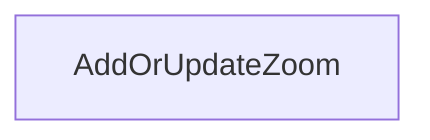

</details>

<details>
<summary>전체 노드·기본 입력 목록</summary>

| 노드 ID | 제목 | 미연결 기본 입력 / 에셋 입력 |
|---|---|---|
| `K2Node_FunctionEntry_0` | AddOrUpdateZoom |  |

</details>

### AddRecoil

<details>
<summary>실행 핀 플로우차트</summary>

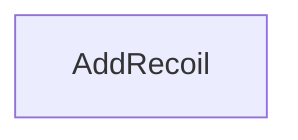

</details>

<details>
<summary>전체 노드·기본 입력 목록</summary>

| 노드 ID | 제목 | 미연결 기본 입력 / 에셋 입력 |
|---|---|---|
| `K2Node_FunctionEntry_0` | AddRecoil |  |

</details>

### AddWeaponBar

<details>
<summary>실행 핀 플로우차트</summary>

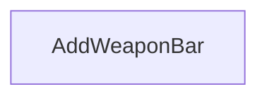

</details>

<details>
<summary>전체 노드·기본 입력 목록</summary>

| 노드 ID | 제목 | 미연결 기본 입력 / 에셋 입력 |
|---|---|---|
| `K2Node_FunctionEntry_0` | AddWeaponBar |  |

</details>

### CreateTimer

<details>
<summary>실행 핀 플로우차트</summary>

```mermaid
flowchart LR
  n0["CreateTimer"]
```

</details>

<details>
<summary>전체 노드·기본 입력 목록</summary>

| 노드 ID | 제목 | 미연결 기본 입력 / 에셋 입력 |
|---|---|---|
| `K2Node_FunctionEntry_0` | CreateTimer | ETimerMode=NewEnumerator0 |

</details>

### DisplayHitPoint

<details>
<summary>실행 핀 플로우차트</summary>

```mermaid
flowchart LR
  n0["DisplayHitPoint"]
```

</details>

<details>
<summary>전체 노드·기본 입력 목록</summary>

| 노드 ID | 제목 | 미연결 기본 입력 / 에셋 입력 |
|---|---|---|
| `K2Node_FunctionEntry_0` | DisplayHitPoint |  |

</details>

### DisplayShooterHUD

<details>
<summary>실행 핀 플로우차트</summary>

```mermaid
flowchart LR
  n0["DisplayShooterHUD"]
```

</details>

<details>
<summary>전체 노드·기본 입력 목록</summary>

| 노드 ID | 제목 | 미연결 기본 입력 / 에셋 입력 |
|---|---|---|
| `K2Node_FunctionEntry_0` | DisplayShooterHUD | State=NewEnumerator0; ZOrder=1 |

</details>

### DisplaySpecialHitPoint

<details>
<summary>실행 핀 플로우차트</summary>

```mermaid
flowchart LR
  n0["DisplaySpecialHitPoint"]
```

</details>

<details>
<summary>전체 노드·기본 입력 목록</summary>

| 노드 ID | 제목 | 미연결 기본 입력 / 에셋 입력 |
|---|---|---|
| `K2Node_FunctionEntry_0` | DisplaySpecialHitPoint |  |

</details>

### GetCurrentAmmo

<details>
<summary>실행 핀 플로우차트</summary>

```mermaid
flowchart LR
  n0["GetCurrentAmmo"]
  n1["반환 노드"]
  n0 -->|"then"| n1
```

</details>

<details>
<summary>전체 노드·기본 입력 목록</summary>

| 노드 ID | 제목 | 미연결 기본 입력 / 에셋 입력 |
|---|---|---|
| `K2Node_FunctionEntry_0` | GetCurrentAmmo |  |
| `K2Node_FunctionResult_3` | 반환 노드 | Ammo=0 |

</details>

### GetCurrentAmmoType

<details>
<summary>실행 핀 플로우차트</summary>

```mermaid
flowchart LR
  n0["GetCurrentAmmoType"]
  n1["반환 노드"]
  n0 -->|"then"| n1
```

</details>

<details>
<summary>전체 노드·기본 입력 목록</summary>

| 노드 ID | 제목 | 미연결 기본 입력 / 에셋 입력 |
|---|---|---|
| `K2Node_FunctionEntry_3` | GetCurrentAmmoType |  |
| `K2Node_FunctionResult_0` | 반환 노드 | AmmoType=NewEnumerator0 |

</details>

### GetCurrentArmor

<details>
<summary>실행 핀 플로우차트</summary>

```mermaid
flowchart LR
  n0["GetCurrentArmor"]
  n1["반환 노드"]
  n0 -->|"then"| n1
```

</details>

<details>
<summary>전체 노드·기본 입력 목록</summary>

| 노드 ID | 제목 | 미연결 기본 입력 / 에셋 입력 |
|---|---|---|
| `K2Node_FunctionEntry_3` | GetCurrentArmor |  |
| `K2Node_FunctionResult_0` | 반환 노드 | ArmorValue=0 |

</details>

### GetCurrentHealth

<details>
<summary>실행 핀 플로우차트</summary>

```mermaid
flowchart LR
  n0["GetCurrentHealth"]
  n1["반환 노드"]
  n0 -->|"then"| n1
```

</details>

<details>
<summary>전체 노드·기본 입력 목록</summary>

| 노드 ID | 제목 | 미연결 기본 입력 / 에셋 입력 |
|---|---|---|
| `K2Node_FunctionEntry_0` | GetCurrentHealth |  |
| `K2Node_FunctionResult_0` | 반환 노드 | HealthValue=0 |

</details>

### GetCurrentMaxAmmo

<details>
<summary>실행 핀 플로우차트</summary>

```mermaid
flowchart LR
  n0["GetCurrentMaxAmmo"]
  n1["반환 노드"]
  n0 -->|"then"| n1
```

</details>

<details>
<summary>전체 노드·기본 입력 목록</summary>

| 노드 ID | 제목 | 미연결 기본 입력 / 에셋 입력 |
|---|---|---|
| `K2Node_FunctionEntry_2` | GetCurrentMaxAmmo |  |
| `K2Node_FunctionResult_1` | 반환 노드 | MaxAmmo=0 |

</details>

### GetCurrentMaxArmor

<details>
<summary>실행 핀 플로우차트</summary>

```mermaid
flowchart LR
  n0["GetCurrentMaxArmor"]
  n1["반환 노드"]
  n0 -->|"then"| n1
```

</details>

<details>
<summary>전체 노드·기본 입력 목록</summary>

| 노드 ID | 제목 | 미연결 기본 입력 / 에셋 입력 |
|---|---|---|
| `K2Node_FunctionEntry_3` | GetCurrentMaxArmor |  |
| `K2Node_FunctionResult_0` | 반환 노드 | CurrentMaxArmor=0 |

</details>

### GetCurrentMaxHealth

<details>
<summary>실행 핀 플로우차트</summary>

```mermaid
flowchart LR
  n0["GetCurrentMaxHealth"]
  n1["반환 노드"]
  n0 -->|"then"| n1
```

</details>

<details>
<summary>전체 노드·기본 입력 목록</summary>

| 노드 ID | 제목 | 미연결 기본 입력 / 에셋 입력 |
|---|---|---|
| `K2Node_FunctionEntry_0` | GetCurrentMaxHealth |  |
| `K2Node_FunctionResult_0` | 반환 노드 | CurrentMaxHealth=0 |

</details>

### GetCurrentStackSize

<details>
<summary>실행 핀 플로우차트</summary>

```mermaid
flowchart LR
  n0["GetCurrentStackSize"]
  n1["반환 노드"]
  n0 -->|"then"| n1
```

</details>

<details>
<summary>전체 노드·기본 입력 목록</summary>

| 노드 ID | 제목 | 미연결 기본 입력 / 에셋 입력 |
|---|---|---|
| `K2Node_FunctionEntry_1` | GetCurrentStackSize |  |
| `K2Node_FunctionResult_2` | 반환 노드 | Stack_Size=0 |

</details>

### GetLastKillEntry

<details>
<summary>실행 핀 플로우차트</summary>

```mermaid
flowchart LR
  n0["GetLastKillEntry"]
  n1["반환 노드"]
  n0 -->|"then"| n1
```

</details>

<details>
<summary>전체 노드·기본 입력 목록</summary>

| 노드 ID | 제목 | 미연결 기본 입력 / 에셋 입력 |
|---|---|---|
| `K2Node_FunctionEntry_0` | GetLastKillEntry |  |
| `K2Node_FunctionResult_0` | 반환 노드 |  |

</details>

### GetTeamKillCountMaxValue

<details>
<summary>실행 핀 플로우차트</summary>

```mermaid
flowchart LR
  n0["GetTeamKillCountMaxValue"]
  n1["반환 노드"]
  n0 -->|"then"| n1
```

</details>

<details>
<summary>전체 노드·기본 입력 목록</summary>

| 노드 ID | 제목 | 미연결 기본 입력 / 에셋 입력 |
|---|---|---|
| `K2Node_FunctionEntry_0` | GetTeamKillCountMaxValue | E_Team=NewEnumerator0 |
| `K2Node_FunctionResult_0` | 반환 노드 | TeamKillCountMaxValue=0 |

</details>

### GetTeamKillCountValue

<details>
<summary>실행 핀 플로우차트</summary>

```mermaid
flowchart LR
  n0["GetTeamKillCountValue"]
  n1["반환 노드"]
  n0 -->|"then"| n1
```

</details>

<details>
<summary>전체 노드·기본 입력 목록</summary>

| 노드 ID | 제목 | 미연결 기본 입력 / 에셋 입력 |
|---|---|---|
| `K2Node_FunctionEntry_0` | GetTeamKillCountValue | E_Team=NewEnumerator0 |
| `K2Node_FunctionResult_0` | 반환 노드 | TeamKillCountValue=0 |

</details>

### GetTime

<details>
<summary>실행 핀 플로우차트</summary>

```mermaid
flowchart LR
  n0["GetTime"]
  n1["반환 노드"]
  n0 -->|"then"| n1
```

</details>

<details>
<summary>전체 노드·기본 입력 목록</summary>

| 노드 ID | 제목 | 미연결 기본 입력 / 에셋 입력 |
|---|---|---|
| `K2Node_FunctionEntry_0` | GetTime |  |
| `K2Node_FunctionResult_0` | 반환 노드 | Minutes=0; Seconds=0 |

</details>

### HitIndicator

<details>
<summary>실행 핀 플로우차트</summary>

```mermaid
flowchart LR
  n0["HitIndicator"]
```

</details>

<details>
<summary>전체 노드·기본 입력 목록</summary>

| 노드 ID | 제목 | 미연결 기본 입력 / 에셋 입력 |
|---|---|---|
| `K2Node_FunctionEntry_0` | HitIndicator | IndicatorType=NewEnumerator0 |

</details>

### PauseTimer

<details>
<summary>실행 핀 플로우차트</summary>

```mermaid
flowchart LR
  n0["PauseTimer"]
```

</details>

<details>
<summary>전체 노드·기본 입력 목록</summary>

| 노드 ID | 제목 | 미연결 기본 입력 / 에셋 입력 |
|---|---|---|
| `K2Node_FunctionEntry_0` | PauseTimer |  |

</details>

### RemoveAchievement

<details>
<summary>실행 핀 플로우차트</summary>

```mermaid
flowchart LR
  n0["RemoveAchievement"]
```

</details>

<details>
<summary>전체 노드·기본 입력 목록</summary>

| 노드 ID | 제목 | 미연결 기본 입력 / 에셋 입력 |
|---|---|---|
| `K2Node_FunctionEntry_1` | RemoveAchievement |  |

</details>

### RemoveActionSlot

<details>
<summary>실행 핀 플로우차트</summary>

```mermaid
flowchart LR
  n0["RemoveActionSlot"]
```

</details>

<details>
<summary>전체 노드·기본 입력 목록</summary>

| 노드 ID | 제목 | 미연결 기본 입력 / 에셋 입력 |
|---|---|---|
| `K2Node_FunctionEntry_0` | RemoveActionSlot | ActionSlot=NewEnumerator0 |

</details>

### RemoveAllActionSlots

<details>
<summary>실행 핀 플로우차트</summary>

```mermaid
flowchart LR
  n0["RemoveAllActionSlots"]
```

</details>

<details>
<summary>전체 노드·기본 입력 목록</summary>

| 노드 ID | 제목 | 미연결 기본 입력 / 에셋 입력 |
|---|---|---|
| `K2Node_FunctionEntry_0` | RemoveAllActionSlots |  |

</details>

### RemoveAllDamageIndicator

<details>
<summary>실행 핀 플로우차트</summary>

```mermaid
flowchart LR
  n0["RemoveAllDamageIndicator"]
```

</details>

<details>
<summary>전체 노드·기본 입력 목록</summary>

| 노드 ID | 제목 | 미연결 기본 입력 / 에셋 입력 |
|---|---|---|
| `K2Node_FunctionEntry_0` | RemoveAllDamageIndicator |  |

</details>

### RemoveAmmo

<details>
<summary>실행 핀 플로우차트</summary>

```mermaid
flowchart LR
  n0["RemoveAmmo"]
```

</details>

<details>
<summary>전체 노드·기본 입력 목록</summary>

| 노드 ID | 제목 | 미연결 기본 입력 / 에셋 입력 |
|---|---|---|
| `K2Node_FunctionEntry_1` | RemoveAmmo |  |

</details>

### RemoveAmmoIcon

<details>
<summary>실행 핀 플로우차트</summary>

```mermaid
flowchart LR
  n0["RemoveAmmoIcon"]
```

</details>

<details>
<summary>전체 노드·기본 입력 목록</summary>

| 노드 ID | 제목 | 미연결 기본 입력 / 에셋 입력 |
|---|---|---|
| `K2Node_FunctionEntry_1` | RemoveAmmoIcon | IconSlot=NewEnumerator0 |

</details>

### RemoveArmor

<details>
<summary>실행 핀 플로우차트</summary>

```mermaid
flowchart LR
  n0["RemoveArmor"]
```

</details>

<details>
<summary>전체 노드·기본 입력 목록</summary>

| 노드 ID | 제목 | 미연결 기본 입력 / 에셋 입력 |
|---|---|---|
| `K2Node_FunctionEntry_2` | RemoveArmor |  |

</details>

### RemoveArmorBar

<details>
<summary>실행 핀 플로우차트</summary>

```mermaid
flowchart LR
  n0["RemoveArmorBar"]
```

</details>

<details>
<summary>전체 노드·기본 입력 목록</summary>

| 노드 ID | 제목 | 미연결 기본 입력 / 에셋 입력 |
|---|---|---|
| `K2Node_FunctionEntry_1` | RemoveArmorBar |  |

</details>

### RemoveColorImpact_CSHUD

<details>
<summary>실행 핀 플로우차트</summary>

```mermaid
flowchart LR
  n0["RemoveColorImpact_CSHUD"]
```

</details>

<details>
<summary>전체 노드·기본 입력 목록</summary>

| 노드 ID | 제목 | 미연결 기본 입력 / 에셋 입력 |
|---|---|---|
| `K2Node_FunctionEntry_0` | RemoveColorImpact_CSHUD |  |

</details>

### RemoveCrosshair

<details>
<summary>실행 핀 플로우차트</summary>

```mermaid
flowchart LR
  n0["RemoveCrosshair"]
```

</details>

<details>
<summary>전체 노드·기본 입력 목록</summary>

| 노드 ID | 제목 | 미연결 기본 입력 / 에셋 입력 |
|---|---|---|
| `K2Node_FunctionEntry_0` | RemoveCrosshair |  |

</details>

### RemoveDamageFX_CSHUD

<details>
<summary>실행 핀 플로우차트</summary>

```mermaid
flowchart LR
  n0["RemoveDamageFX_CSHUD"]
```

</details>

<details>
<summary>전체 노드·기본 입력 목록</summary>

| 노드 ID | 제목 | 미연결 기본 입력 / 에셋 입력 |
|---|---|---|
| `K2Node_FunctionEntry_0` | RemoveDamageFX_CSHUD |  |

</details>

### RemoveDamageFeedback

<details>
<summary>실행 핀 플로우차트</summary>

```mermaid
flowchart LR
  n0["RemoveDamageFeedback"]
```

</details>

<details>
<summary>전체 노드·기본 입력 목록</summary>

| 노드 ID | 제목 | 미연결 기본 입력 / 에셋 입력 |
|---|---|---|
| `K2Node_FunctionEntry_1` | RemoveDamageFeedback |  |

</details>

### RemoveHealth

<details>
<summary>실행 핀 플로우차트</summary>

```mermaid
flowchart LR
  n0["RemoveHealth"]
```

</details>

<details>
<summary>전체 노드·기본 입력 목록</summary>

| 노드 ID | 제목 | 미연결 기본 입력 / 에셋 입력 |
|---|---|---|
| `K2Node_FunctionEntry_0` | RemoveHealth |  |

</details>

### RemoveHealthBar

<details>
<summary>실행 핀 플로우차트</summary>

```mermaid
flowchart LR
  n0["RemoveHealthBar"]
```

</details>

<details>
<summary>전체 노드·기본 입력 목록</summary>

| 노드 ID | 제목 | 미연결 기본 입력 / 에셋 입력 |
|---|---|---|
| `K2Node_FunctionEntry_0` | RemoveHealthBar |  |

</details>

### RemoveHitPoint

<details>
<summary>실행 핀 플로우차트</summary>

```mermaid
flowchart LR
  n0["RemoveHitPoint"]
```

</details>

<details>
<summary>전체 노드·기본 입력 목록</summary>

| 노드 ID | 제목 | 미연결 기본 입력 / 에셋 입력 |
|---|---|---|
| `K2Node_FunctionEntry_0` | RemoveHitPoint |  |

</details>

### RemoveIntermediatePoints

<details>
<summary>실행 핀 플로우차트</summary>

```mermaid
flowchart LR
  n0["RemoveIntermediatePoints"]
```

</details>

<details>
<summary>전체 노드·기본 입력 목록</summary>

| 노드 ID | 제목 | 미연결 기본 입력 / 에셋 입력 |
|---|---|---|
| `K2Node_FunctionEntry_0` | RemoveIntermediatePoints |  |

</details>

### RemoveKillEntrys

<details>
<summary>실행 핀 플로우차트</summary>

```mermaid
flowchart LR
  n0["RemoveKillEntrys"]
```

</details>

<details>
<summary>전체 노드·기본 입력 목록</summary>

| 노드 ID | 제목 | 미연결 기본 입력 / 에셋 입력 |
|---|---|---|
| `K2Node_FunctionEntry_1` | RemoveKillEntrys |  |

</details>

### RemoveKillMessages

<details>
<summary>실행 핀 플로우차트</summary>

```mermaid
flowchart LR
  n0["RemoveKillMessages"]
```

</details>

<details>
<summary>전체 노드·기본 입력 목록</summary>

| 노드 ID | 제목 | 미연결 기본 입력 / 에셋 입력 |
|---|---|---|
| `K2Node_FunctionEntry_1` | RemoveKillMessages |  |

</details>

### RemoveMainTutorialMessage

<details>
<summary>실행 핀 플로우차트</summary>

```mermaid
flowchart LR
  n0["RemoveMainTutorialMessage"]
  n1["반환 노드"]
  n0 -->|"then"| n1
```

</details>

<details>
<summary>전체 노드·기본 입력 목록</summary>

| 노드 ID | 제목 | 미연결 기본 입력 / 에셋 입력 |
|---|---|---|
| `K2Node_FunctionEntry_0` | RemoveMainTutorialMessage |  |
| `K2Node_FunctionResult_0` | 반환 노드 |  |

</details>

### RemoveMaxAmmo

<details>
<summary>실행 핀 플로우차트</summary>

```mermaid
flowchart LR
  n0["RemoveMaxAmmo"]
```

</details>

<details>
<summary>전체 노드·기본 입력 목록</summary>

| 노드 ID | 제목 | 미연결 기본 입력 / 에셋 입력 |
|---|---|---|
| `K2Node_FunctionEntry_1` | RemoveMaxAmmo |  |

</details>

### RemoveMedal

<details>
<summary>실행 핀 플로우차트</summary>

```mermaid
flowchart LR
  n0["RemoveMedal"]
```

</details>

<details>
<summary>전체 노드·기본 입력 목록</summary>

| 노드 ID | 제목 | 미연결 기본 입력 / 에셋 입력 |
|---|---|---|
| `K2Node_FunctionEntry_1` | RemoveMedal |  |

</details>

### RemoveProgressBar

<details>
<summary>실행 핀 플로우차트</summary>

```mermaid
flowchart LR
  n0["RemoveProgressBar"]
```

</details>

<details>
<summary>전체 노드·기본 입력 목록</summary>

| 노드 ID | 제목 | 미연결 기본 입력 / 에셋 입력 |
|---|---|---|
| `K2Node_FunctionEntry_0` | RemoveProgressBar |  |

</details>

### RemoveSpecialHitPoint

<details>
<summary>실행 핀 플로우차트</summary>

```mermaid
flowchart LR
  n0["RemoveSpecialHitPoint"]
```

</details>

<details>
<summary>전체 노드·기본 입력 목록</summary>

| 노드 ID | 제목 | 미연결 기본 입력 / 에셋 입력 |
|---|---|---|
| `K2Node_FunctionEntry_0` | RemoveSpecialHitPoint |  |

</details>

### RemoveTeamKillCount

<details>
<summary>실행 핀 플로우차트</summary>

```mermaid
flowchart LR
  n0["RemoveTeamKillCount"]
```

</details>

<details>
<summary>전체 노드·기본 입력 목록</summary>

| 노드 ID | 제목 | 미연결 기본 입력 / 에셋 입력 |
|---|---|---|
| `K2Node_FunctionEntry_0` | RemoveTeamKillCount | E_Team=NewEnumerator0 |

</details>

### RemoveTeamKillCountMaxValue

<details>
<summary>실행 핀 플로우차트</summary>

```mermaid
flowchart LR
  n0["RemoveTeamKillCountMaxValue"]
```

</details>

<details>
<summary>전체 노드·기본 입력 목록</summary>

| 노드 ID | 제목 | 미연결 기본 입력 / 에셋 입력 |
|---|---|---|
| `K2Node_FunctionEntry_0` | RemoveTeamKillCountMaxValue | E_Team=NewEnumerator0 |

</details>

### RemoveTeamKillCountValue

<details>
<summary>실행 핀 플로우차트</summary>

```mermaid
flowchart LR
  n0["RemoveTeamKillCountValue"]
```

</details>

<details>
<summary>전체 노드·기본 입력 목록</summary>

| 노드 ID | 제목 | 미연결 기본 입력 / 에셋 입력 |
|---|---|---|
| `K2Node_FunctionEntry_0` | RemoveTeamKillCountValue | E_Team=NewEnumerator0 |

</details>

### RemoveTimer

<details>
<summary>실행 핀 플로우차트</summary>

```mermaid
flowchart LR
  n0["RemoveTimer"]
```

</details>

<details>
<summary>전체 노드·기본 입력 목록</summary>

| 노드 ID | 제목 | 미연결 기본 입력 / 에셋 입력 |
|---|---|---|
| `K2Node_FunctionEntry_0` | RemoveTimer |  |

</details>

### RemoveWeaponBar

<details>
<summary>실행 핀 플로우차트</summary>

```mermaid
flowchart LR
  n0["RemoveWeaponBar"]
```

</details>

<details>
<summary>전체 노드·기본 입력 목록</summary>

| 노드 ID | 제목 | 미연결 기본 입력 / 에셋 입력 |
|---|---|---|
| `K2Node_FunctionEntry_1` | RemoveWeaponBar |  |

</details>

### SlotImpact

<details>
<summary>실행 핀 플로우차트</summary>

```mermaid
flowchart LR
  n0["SlotImpact"]
```

</details>

<details>
<summary>전체 노드·기본 입력 목록</summary>

| 노드 ID | 제목 | 미연결 기본 입력 / 에셋 입력 |
|---|---|---|
| `K2Node_FunctionEntry_0` | SlotImpact | Slot=NewEnumerator0 |

</details>

### StartTimer

<details>
<summary>실행 핀 플로우차트</summary>

```mermaid
flowchart LR
  n0["StartTimer"]
```

</details>

<details>
<summary>전체 노드·기본 입력 목록</summary>

| 노드 ID | 제목 | 미연결 기본 입력 / 에셋 입력 |
|---|---|---|
| `K2Node_FunctionEntry_0` | StartTimer |  |

</details>

### UpdateAmmo

<details>
<summary>실행 핀 플로우차트</summary>

```mermaid
flowchart LR
  n0["UpdateAmmo"]
```

</details>

<details>
<summary>전체 노드·기본 입력 목록</summary>

| 노드 ID | 제목 | 미연결 기본 입력 / 에셋 입력 |
|---|---|---|
| `K2Node_FunctionEntry_1` | UpdateAmmo | Update_Type=NewEnumerator0 |

</details>

### UpdateArmor

<details>
<summary>실행 핀 플로우차트</summary>

```mermaid
flowchart LR
  n0["UpdateArmor"]
```

</details>

<details>
<summary>전체 노드·기본 입력 목록</summary>

| 노드 ID | 제목 | 미연결 기본 입력 / 에셋 입력 |
|---|---|---|
| `K2Node_FunctionEntry_2` | UpdateArmor | UpdateType=NewEnumerator0 |

</details>

### UpdateBlackscreen_CSHUD

<details>
<summary>실행 핀 플로우차트</summary>

```mermaid
flowchart LR
  n0["UpdateBlackscreen_CSHUD"]
```

</details>

<details>
<summary>전체 노드·기본 입력 목록</summary>

| 노드 ID | 제목 | 미연결 기본 입력 / 에셋 입력 |
|---|---|---|
| `K2Node_FunctionEntry_0` | UpdateBlackscreen_CSHUD |  |

</details>

### UpdateColorImpact_CSHUD

<details>
<summary>실행 핀 플로우차트</summary>

```mermaid
flowchart LR
  n0["UpdateColorImpact_CSHUD"]
```

</details>

<details>
<summary>전체 노드·기본 입력 목록</summary>

| 노드 ID | 제목 | 미연결 기본 입력 / 에셋 입력 |
|---|---|---|
| `K2Node_FunctionEntry_0` | UpdateColorImpact_CSHUD |  |

</details>

### UpdateDamageFX_CSHUD

<details>
<summary>실행 핀 플로우차트</summary>

```mermaid
flowchart LR
  n0["UpdateDamageFX_CSHUD"]
```

</details>

<details>
<summary>전체 노드·기본 입력 목록</summary>

| 노드 ID | 제목 | 미연결 기본 입력 / 에셋 입력 |
|---|---|---|
| `K2Node_FunctionEntry_0` | UpdateDamageFX_CSHUD |  |

</details>

### UpdateHealth

<details>
<summary>실행 핀 플로우차트</summary>

```mermaid
flowchart LR
  n0["UpdateHealth"]
```

</details>

<details>
<summary>전체 노드·기본 입력 목록</summary>

| 노드 ID | 제목 | 미연결 기본 입력 / 에셋 입력 |
|---|---|---|
| `K2Node_FunctionEntry_0` | UpdateHealth | UpdateType=NewEnumerator0 |

</details>

### UpdateMaxAmmo

<details>
<summary>실행 핀 플로우차트</summary>

```mermaid
flowchart LR
  n0["UpdateMaxAmmo"]
```

</details>

<details>
<summary>전체 노드·기본 입력 목록</summary>

| 노드 ID | 제목 | 미연결 기본 입력 / 에셋 입력 |
|---|---|---|
| `K2Node_FunctionEntry_2` | UpdateMaxAmmo | Update_Type=NewEnumerator0 |

</details>

### UpdateMaxArmor

<details>
<summary>실행 핀 플로우차트</summary>

```mermaid
flowchart LR
  n0["UpdateMaxArmor"]
```

</details>

<details>
<summary>전체 노드·기본 입력 목록</summary>

| 노드 ID | 제목 | 미연결 기본 입력 / 에셋 입력 |
|---|---|---|
| `K2Node_FunctionEntry_2` | UpdateMaxArmor |  |

</details>

### UpdateMaxHealth

<details>
<summary>실행 핀 플로우차트</summary>

```mermaid
flowchart LR
  n0["UpdateMaxHealth"]
```

</details>

<details>
<summary>전체 노드·기본 입력 목록</summary>

| 노드 ID | 제목 | 미연결 기본 입력 / 에셋 입력 |
|---|---|---|
| `K2Node_FunctionEntry_0` | UpdateMaxHealth |  |

</details>

### UpdateTeamKillCountMaxValue

<details>
<summary>실행 핀 플로우차트</summary>

```mermaid
flowchart LR
  n0["UpdateTeamKillCountMaxValue"]
```

</details>

<details>
<summary>전체 노드·기본 입력 목록</summary>

| 노드 ID | 제목 | 미연결 기본 입력 / 에셋 입력 |
|---|---|---|
| `K2Node_FunctionEntry_0` | UpdateTeamKillCountMaxValue | E_Team=NewEnumerator0; Update_Type=NewEnumerator0 |

</details>

### UpdateTeamKillCountValue

<details>
<summary>실행 핀 플로우차트</summary>

```mermaid
flowchart LR
  n0["UpdateTeamKillCountValue"]
```

</details>

<details>
<summary>전체 노드·기본 입력 목록</summary>

| 노드 ID | 제목 | 미연결 기본 입력 / 에셋 입력 |
|---|---|---|
| `K2Node_FunctionEntry_0` | UpdateTeamKillCountValue | E_Team=NewEnumerator0; Update_Type=NewEnumerator0 |

</details>

### UpdateWeaponBar

<details>
<summary>실행 핀 플로우차트</summary>

```mermaid
flowchart LR
  n0["UpdateWeaponBar"]
```

</details>

<details>
<summary>전체 노드·기본 입력 목록</summary>

| 노드 ID | 제목 | 미연결 기본 입력 / 에셋 입력 |
|---|---|---|
| `K2Node_FunctionEntry_0` | UpdateWeaponBar | Ammo_Type=NewEnumerator0 |

</details>


[원본 MCP 스냅샷](../../../../Evidence/blueprints-281.json)
