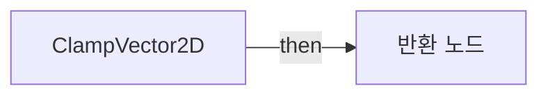
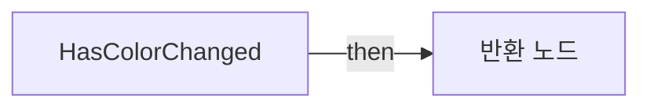
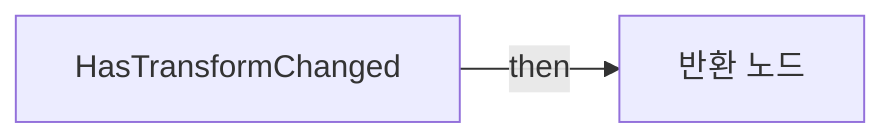
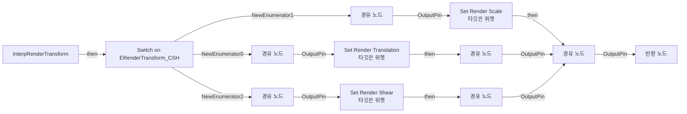
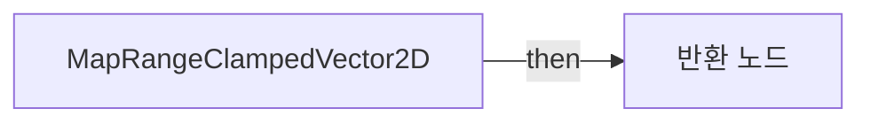
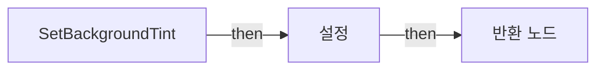

# BP_CSH_Widget_Functions

에셋: `/Game/CompShooterHUD/Blueprints/Libraries/BP_CSH_Widget_Functions`

부모: `/Script/CoreUObject.Class'/Script/Engine.BlueprintFunctionLibrary'`

수집일: 2026-10-12. MCP에서 읽은 그래프·핀 연결의 자동 전사입니다. 상속된 그래프는 부모 문서를 함께 확인합니다.

정적 루트 참조 도달: 있음. 실행 여부 또는 삭제 가능 여부의 확정이 아닙니다.

컴포넌트 목록은 이 BP가 직접 정의한 SCS만 포함합니다. 부모·네이티브 생성 컴포넌트, 인스턴스 설정은 별도입니다.

## 그래프 목록

| 그래프 | 전체 노드 수 |
|---|---|
| AddChildToOverlay | 5 |
| AddChildToVerticalBox | 5 |
| ClampVector2D | 8 |
| Finterpolate | 15 |
| GetFillImage | 3 |
| GetSize | 8 |
| GetTexture2DSize | 8 |
| GetTexture2DSizeClamped | 11 |
| HasColorChanged | 8 |
| HasTransformChanged | 15 |
| InterpRenderAngle | 10 |
| InterpRenderOpacity | 9 |
| InterpRenderTransform | 26 |
| LerpVector2D | 9 |
| MapRangeClampedVector2D | 10 |
| RandomizePositiveNegativeFloat | 6 |
| SetBackgroundTint | 9 |
| SetBorderBrush | 7 |
| SetBorderBrushSize | 5 |
| SetBorderBrushTiling | 7 |
| SetFillImage | 9 |
| SetFillImageDrawAs | 8 |
| SetFillImageMargin | 8 |
| SetFillImageSize | 9 |
| SetFillImageTiling | 10 |
| SetImageBrush | 7 |
| SetImageBrushSize | 5 |
| SetImageBrushTiling | 7 |
| SetMarqueeDrawAs | 8 |
| SetMarqueeImage | 8 |
| SetMarqueeImageSize | 8 |
| SetMarqueeMargin | 8 |
| SetMarqueeMirroring | 8 |
| SetMarqueeTiling | 8 |
| SetMarqueeTint | 9 |
| SetSize | 16 |
| SubtractBrightnessValue | 8 |
| SubtractFromColor | 20 |
| Vector2DInterpolate | 15 |

## 그래프별 실행 연결

실선은 출력 exec 핀의 실제 연결입니다. 여러 분기는 출력 핀 이름을 표시합니다. 함수 호출·delegate·타이머의 다음 그래프 실행은 이 그림에서 자동으로 이어 붙이지 않습니다.

순수 계산 노드 및 데이터 핀은 아래 목록과 원본 JSON을 확인합니다. 연결되지 않은 이벤트도 표시되므로, 노드가 있다는 이유만으로 실행된다고 판단하면 안 됩니다.

### AddChildToOverlay

<details>
<summary>실행 핀 플로우차트</summary>


</details>

<details>
<summary>전체 노드·기본 입력 목록</summary>

| 노드 ID | 제목 | 미연결 기본 입력 / 에셋 입력 |
|---|---|---|
| `K2Node_FunctionEntry_0` | AddChildToOverlay |  |
| `K2Node_CallFunction_5` | Add Child to Overlay<br/>타깃은 오버레이 |  |
| `K2Node_CallFunction_6` | Set Vertical Alignment<br/>타깃은 오버레이 슬롯 |  |
| `K2Node_CallFunction_7` | Set Horizontal Alignment<br/>타깃은 오버레이 슬롯 |  |
| `K2Node_FunctionResult_0` | 반환 노드 |  |

</details>

### AddChildToVerticalBox

<details>
<summary>실행 핀 플로우차트</summary>


</details>

<details>
<summary>전체 노드·기본 입력 목록</summary>

| 노드 ID | 제목 | 미연결 기본 입력 / 에셋 입력 |
|---|---|---|
| `K2Node_FunctionEntry_0` | AddChildToVerticalBox |  |
| `K2Node_FunctionResult_0` | 반환 노드 |  |
| `K2Node_CallFunction_0` | Add Child to Vertical Box<br/>타깃은 세로 박스 |  |
| `K2Node_CallFunction_1` | Set Vertical Alignment<br/>타깃은 세로 박스 슬롯 |  |
| `K2Node_CallFunction_2` | Set Horizontal Alignment<br/>타깃은 세로 박스 슬롯 |  |

</details>

### ClampVector2D

<details>
<summary>실행 핀 플로우차트</summary>



</details>

<details>
<summary>전체 노드·기본 입력 목록</summary>

| 노드 ID | 제목 | 미연결 기본 입력 / 에셋 입력 |
|---|---|---|
| `K2Node_FunctionEntry_0` | ClampVector2D |  |
| `K2Node_CallFunction_2785` | Make Vector 2D |  |
| `K2Node_CallFunction_7` | Clamp (Float) |  |
| `K2Node_CallFunction_6` | Clamp (Float) |  |
| `K2Node_CallFunction_8` | Break Vector 2D |  |
| `K2Node_Knot_0` | 경유 노드 |  |
| `K2Node_Knot_1` | 경유 노드 |  |
| `K2Node_FunctionResult_0` | 반환 노드 |  |

</details>

### Finterpolate

<details>
<summary>실행 핀 플로우차트</summary>


</details>

<details>
<summary>전체 노드·기본 입력 목록</summary>

| 노드 ID | 제목 | 미연결 기본 입력 / 에셋 입력 |
|---|---|---|
| `K2Node_FunctionEntry_0` | Finterpolate |  |
| `K2Node_CallFunction_49` | FInterp To |  |
| `K2Node_CallFunction_50` | FInterp to Constant |  |
| `K2Node_CallFunction_51` | Get World Delta Seconds |  |
| `K2Node_Select_1` | 선택 |  |
| `K2Node_Knot_2` | 경유 노드 |  |
| `K2Node_Knot_0` | 경유 노드 |  |
| `K2Node_Knot_1` | 경유 노드 |  |
| `K2Node_Knot_3` | 경유 노드 |  |
| `K2Node_Knot_4` | 경유 노드 |  |
| `K2Node_Knot_5` | 경유 노드 |  |
| `K2Node_Knot_6` | 경유 노드 |  |
| `K2Node_Knot_11` | 경유 노드 |  |
| `K2Node_Knot_12` | 경유 노드 |  |
| `K2Node_FunctionResult_0` | 반환 노드 |  |

</details>

### GetFillImage

<details>
<summary>실행 핀 플로우차트</summary>


</details>

<details>
<summary>전체 노드·기본 입력 목록</summary>

| 노드 ID | 제목 | 미연결 기본 입력 / 에셋 입력 |
|---|---|---|
| `K2Node_FunctionEntry_3` | GetFillImage |  |
| `K2Node_FunctionResult_3` | 반환 노드 |  |
| `K2Node_VariableGet_0` | Get |  |

</details>

### GetSize

<details>
<summary>실행 핀 플로우차트</summary>


</details>

<details>
<summary>전체 노드·기본 입력 목록</summary>

| 노드 ID | 제목 | 미연결 기본 입력 / 에셋 입력 |
|---|---|---|
| `K2Node_FunctionEntry_1` | GetSize |  |
| `K2Node_FunctionResult_1` | 반환 노드 |  |
| `K2Node_VariableGet_0` | Get WidthOverride |  |
| `K2Node_VariableGet_1` | Get HeightOverride |  |
| `K2Node_Knot_17` | 경유 노드 |  |
| `K2Node_CallFunction_0` | Is Valid |  |
| `K2Node_Select_1` | 선택 | Option 0=0.0 |
| `K2Node_Select_0` | 선택 | Option 0=0.0 |

</details>

### GetTexture2DSize

<details>
<summary>실행 핀 플로우차트</summary>


</details>

<details>
<summary>전체 노드·기본 입력 목록</summary>

| 노드 ID | 제목 | 미연결 기본 입력 / 에셋 입력 |
|---|---|---|
| `K2Node_FunctionEntry_0` | GetTexture2DSize |  |
| `K2Node_CallFunction_2783` | GetSizeX<br/>타깃은 텍스처 2D |  |
| `K2Node_CallFunction_2784` | GetSizeY<br/>타깃은 텍스처 2D |  |
| `K2Node_CallFunction_2785` | Make Vector 2D |  |
| `K2Node_CallFunction_4037` | To Float (Integer) |  |
| `K2Node_CallFunction_4038` | To Float (Integer) |  |
| `K2Node_Knot_30` | 경유 노드 |  |
| `K2Node_FunctionResult_0` | 반환 노드 |  |

</details>

### GetTexture2DSizeClamped

<details>
<summary>실행 핀 플로우차트</summary>


</details>

<details>
<summary>전체 노드·기본 입력 목록</summary>

| 노드 ID | 제목 | 미연결 기본 입력 / 에셋 입력 |
|---|---|---|
| `K2Node_FunctionEntry_0` | GetTexture2DSizeClamped |  |
| `K2Node_FunctionResult_0` | 반환 노드 |  |
| `K2Node_CallFunction_2783` | GetSizeX<br/>타깃은 텍스처 2D |  |
| `K2Node_CallFunction_2784` | GetSizeY<br/>타깃은 텍스처 2D |  |
| `K2Node_CallFunction_2785` | Make Vector 2D |  |
| `K2Node_CallFunction_4037` | To Float (Integer) |  |
| `K2Node_CallFunction_4038` | To Float (Integer) |  |
| `K2Node_Knot_30` | 경유 노드 |  |
| `K2Node_CallFunction_7` | Clamp (Float) | Min=0.0 |
| `K2Node_CallFunction_6` | Clamp (Float) | Min=0.0 |
| `K2Node_CallFunction_8` | Break Vector 2D |  |

</details>

### HasColorChanged

<details>
<summary>실행 핀 플로우차트</summary>



</details>

<details>
<summary>전체 노드·기본 입력 목록</summary>

| 노드 ID | 제목 | 미연결 기본 입력 / 에셋 입력 |
|---|---|---|
| `K2Node_FunctionEntry_0` | HasColorChanged |  |
| `K2Node_FunctionResult_0` | 반환 노드 |  |
| `K2Node_CallFunction_0` | Break Color |  |
| `K2Node_CallFunction_6` | Not Equal (Float) | B=0.0 |
| `K2Node_CallFunction_7` | Not Equal (Float) | B=0.0 |
| `K2Node_CallFunction_8` | Not Equal (Float) | B=0.0 |
| `K2Node_CallFunction_5` | Not Equal (Float) | B=0.0 |
| `K2Node_CommutativeAssociativeBinaryOperator_1` | OR Boolean |  |

</details>

### HasTransformChanged

<details>
<summary>실행 핀 플로우차트</summary>



</details>

<details>
<summary>전체 노드·기본 입력 목록</summary>

| 노드 ID | 제목 | 미연결 기본 입력 / 에셋 입력 |
|---|---|---|
| `K2Node_FunctionEntry_0` | HasTransformChanged |  |
| `K2Node_FunctionResult_0` | 반환 노드 |  |
| `K2Node_BreakStruct_0` | Break Widget Transform |  |
| `K2Node_CallFunction_2` | Break Vector 2D |  |
| `K2Node_CallFunction_13` | Not Equal (Float) | B=0.0 |
| `K2Node_CallFunction_14` | Not Equal (Float) | B=0.0 |
| `K2Node_CommutativeAssociativeBinaryOperator_0` | OR Boolean |  |
| `K2Node_CallFunction_9` | Break Vector 2D |  |
| `K2Node_CallFunction_4` | Not Equal (Float) | B=1.000000 |
| `K2Node_CallFunction_3` | Not Equal (Float) | B=1.000000 |
| `K2Node_CallFunction_12` | Break Vector 2D |  |
| `K2Node_CallFunction_10` | Not Equal (Float) | B=0.0 |
| `K2Node_CallFunction_15` | Not Equal (Float) | B=0.0 |
| `K2Node_CallFunction_11` | Not Equal (Float) | B=0.0 |
| `K2Node_Knot_0` | 경유 노드 |  |

</details>

### InterpRenderAngle

<details>
<summary>실행 핀 플로우차트</summary>


</details>

<details>
<summary>전체 노드·기본 입력 목록</summary>

| 노드 ID | 제목 | 미연결 기본 입력 / 에셋 입력 |
|---|---|---|
| `K2Node_FunctionEntry_0` | InterpRenderAngle |  |
| `K2Node_CallFunction_3` | Finterpolate |  |
| `K2Node_Knot_0` | 경유 노드 |  |
| `K2Node_Knot_1` | 경유 노드 |  |
| `K2Node_Knot_2` | 경유 노드 |  |
| `K2Node_FunctionResult_0` | 반환 노드 |  |
| `K2Node_Knot_3` | 경유 노드 |  |
| `K2Node_VariableGet_0` | Get RenderTransform |  |
| `K2Node_BreakStruct_0` | Break Widget Transform |  |
| `K2Node_CallFunction_1` | Set Render Transform Angle<br/>타깃은 위젯 |  |

</details>

### InterpRenderOpacity

<details>
<summary>실행 핀 플로우차트</summary>


</details>

<details>
<summary>전체 노드·기본 입력 목록</summary>

| 노드 ID | 제목 | 미연결 기본 입력 / 에셋 입력 |
|---|---|---|
| `K2Node_FunctionEntry_0` | InterpRenderOpacity |  |
| `K2Node_CallFunction_2` | Get Render Opacity<br/>타깃은 위젯 |  |
| `K2Node_CallFunction_3` | Finterpolate |  |
| `K2Node_Knot_0` | 경유 노드 |  |
| `K2Node_CallFunction_0` | Set Render Opacity<br/>타깃은 위젯 |  |
| `K2Node_Knot_1` | 경유 노드 |  |
| `K2Node_Knot_2` | 경유 노드 |  |
| `K2Node_FunctionResult_0` | 반환 노드 |  |
| `K2Node_Knot_3` | 경유 노드 |  |

</details>

### InterpRenderTransform

<details>
<summary>실행 핀 플로우차트</summary>



</details>

<details>
<summary>전체 노드·기본 입력 목록</summary>

| 노드 ID | 제목 | 미연결 기본 입력 / 에셋 입력 |
|---|---|---|
| `K2Node_FunctionEntry_0` | InterpRenderTransform |  |
| `K2Node_Knot_0` | 경유 노드 |  |
| `K2Node_FunctionResult_0` | 반환 노드 |  |
| `K2Node_VariableGet_1` | Get RenderTransform |  |
| `K2Node_BreakStruct_1` | Break Widget Transform |  |
| `K2Node_CallFunction_7` | Vector 2DInterpolate |  |
| `K2Node_CallFunction_4` | Set Render Translation<br/>타깃은 위젯 |  |
| `K2Node_CallFunction_5` | Set Render Scale<br/>타깃은 위젯 |  |
| `K2Node_CallFunction_6` | Set Render Shear<br/>타깃은 위젯 |  |
| `K2Node_SwitchEnum_0` | Switch on ERenderTransform_CSH |  |
| `K2Node_Knot_4` | 경유 노드 |  |
| `K2Node_Knot_5` | 경유 노드 |  |
| `K2Node_Knot_6` | 경유 노드 |  |
| `K2Node_Knot_7` | 경유 노드 |  |
| `K2Node_Knot_8` | 경유 노드 |  |
| `K2Node_VariableGet_3` | Get RenderTransform |  |
| `K2Node_BreakStruct_3` | Break Widget Transform |  |
| `K2Node_CallFunction_8` | Vector 2DInterpolate |  |
| `K2Node_Knot_10` | 경유 노드 |  |
| `K2Node_VariableGet_2` | Get RenderTransform |  |
| `K2Node_BreakStruct_2` | Break Widget Transform |  |
| `K2Node_CallFunction_1` | Vector 2DInterpolate |  |
| `K2Node_Knot_11` | 경유 노드 |  |
| `K2Node_Knot_12` | 경유 노드 |  |
| `K2Node_Knot_13` | 경유 노드 |  |
| `K2Node_Knot_14` | 경유 노드 |  |

</details>

### LerpVector2D

<details>
<summary>실행 핀 플로우차트</summary>


</details>

<details>
<summary>전체 노드·기본 입력 목록</summary>

| 노드 ID | 제목 | 미연결 기본 입력 / 에셋 입력 |
|---|---|---|
| `K2Node_FunctionEntry_0` | LerpVector2D |  |
| `K2Node_FunctionResult_0` | 반환 노드 |  |
| `K2Node_CallFunction_1` | Break Vector 2D |  |
| `K2Node_CallFunction_0` | Break Vector 2D |  |
| `K2Node_CallFunction_3` | Lerp |  |
| `K2Node_CallFunction_2` | Lerp |  |
| `K2Node_CallFunction_4` | Make Vector 2D |  |
| `K2Node_Knot_0` | 경유 노드 |  |
| `K2Node_Knot_1` | 경유 노드 |  |

</details>

### MapRangeClampedVector2D

<details>
<summary>실행 핀 플로우차트</summary>



</details>

<details>
<summary>전체 노드·기본 입력 목록</summary>

| 노드 ID | 제목 | 미연결 기본 입력 / 에셋 입력 |
|---|---|---|
| `K2Node_FunctionEntry_0` | MapRangeClampedVector2D |  |
| `K2Node_CallFunction_41` | Break Vector 2D |  |
| `K2Node_CallFunction_44` | Break Vector 2D |  |
| `K2Node_CallFunction_45` | Break Vector 2D |  |
| `K2Node_CallFunction_50` | Map Range Clamped |  |
| `K2Node_CallFunction_48` | Break Vector 2D |  |
| `K2Node_CallFunction_49` | Break Vector 2D |  |
| `K2Node_CallFunction_46` | Map Range Clamped |  |
| `K2Node_CallFunction_51` | Make Vector 2D |  |
| `K2Node_FunctionResult_0` | 반환 노드 |  |

</details>

### RandomizePositiveNegativeFloat

<details>
<summary>실행 핀 플로우차트</summary>


</details>

<details>
<summary>전체 노드·기본 입력 목록</summary>

| 노드 ID | 제목 | 미연결 기본 입력 / 에셋 입력 |
|---|---|---|
| `K2Node_FunctionEntry_0` | RandomizePositiveNegativeFloat |  |
| `K2Node_CallFunction_1042` | Random Bool |  |
| `K2Node_Select_47` | 선택 |  |
| `K2Node_FunctionResult_0` | 반환 노드 |  |
| `K2Node_CommutativeAssociativeBinaryOperator_1` | float * float | B=-1.000000 |
| `K2Node_Knot_109` | 경유 노드 |  |

</details>

### SetBackgroundTint

<details>
<summary>실행 핀 플로우차트</summary>



</details>

<details>
<summary>전체 노드·기본 입력 목록</summary>

| 노드 ID | 제목 | 미연결 기본 입력 / 에셋 입력 |
|---|---|---|
| `K2Node_FunctionEntry_3` | SetBackgroundTint |  |
| `K2Node_FunctionResult_3` | 반환 노드 |  |
| `K2Node_VariableGet_0` | Get |  |
| `K2Node_VariableSet_0` | 설정 | WidgetStyle_BackgroundImage_OutlineSettings=(CornerRadii=(X=0.000000,Y=0.000000,Z=0.000000,W=0.000000),Color=(SpecifiedColor=(R=0.000000,G=0.000000,B=0.000000,A=0.000000),ColorUseRule=UseColor_Specified),Width=0.000000,RoundingType=HalfHeightRadius,bUseBrushTransparency=False); WidgetStyle_EnableFillAnimation=False |
| `K2Node_Knot_3` | 경유 노드 |  |
| `K2Node_Knot_4` | 경유 노드 |  |
| `K2Node_Knot_5` | 경유 노드 |  |
| `K2Node_Knot_55` | 경유 노드 |  |
| `K2Node_Knot_56` | 경유 노드 |  |

</details>

### SetBorderBrush

<details>
<summary>실행 핀 플로우차트</summary>


</details>

<details>
<summary>전체 노드·기본 입력 목록</summary>

| 노드 ID | 제목 | 미연결 기본 입력 / 에셋 입력 |
|---|---|---|
| `K2Node_FunctionEntry_5` | SetBorderBrush |  |
| `K2Node_VariableGet_0` | Get |  |
| `K2Node_Knot_386` | 경유 노드 |  |
| `K2Node_CallFunction_1` | Set Brush<br/>타깃은 보더 | InBrush_OutlineSettings=(CornerRadii=(X=0.000000,Y=0.000000,Z=0.000000,W=0.000000),Color=(SpecifiedColor=(R=0.000000,G=0.000000,B=0.000000,A=0.000000),ColorUseRule=UseColor_Specified),Width=0.000000,RoundingType=HalfHeightRadius,bUseBrushTransparency=False) |
| `K2Node_Knot_387` | 경유 노드 |  |
| `K2Node_Knot_388` | 경유 노드 |  |
| `K2Node_FunctionResult_5` | 반환 노드 |  |

</details>

### SetBorderBrushSize

<details>
<summary>실행 핀 플로우차트</summary>


</details>

<details>
<summary>전체 노드·기본 입력 목록</summary>

| 노드 ID | 제목 | 미연결 기본 입력 / 에셋 입력 |
|---|---|---|
| `K2Node_FunctionEntry_5` | SetBorderBrushSize |  |
| `K2Node_FunctionResult_5` | 반환 노드 |  |
| `K2Node_VariableGet_0` | Get |  |
| `K2Node_Knot_386` | 경유 노드 |  |
| `K2Node_CallFunction_1` | Set Brush<br/>타깃은 보더 | InBrush_OutlineSettings=(CornerRadii=(X=0.000000,Y=0.000000,Z=0.000000,W=0.000000),Color=(SpecifiedColor=(R=0.000000,G=0.000000,B=0.000000,A=0.000000),ColorUseRule=UseColor_Specified),Width=0.000000,RoundingType=HalfHeightRadius,bUseBrushTransparency=False) |

</details>

### SetBorderBrushTiling

<details>
<summary>실행 핀 플로우차트</summary>


</details>

<details>
<summary>전체 노드·기본 입력 목록</summary>

| 노드 ID | 제목 | 미연결 기본 입력 / 에셋 입력 |
|---|---|---|
| `K2Node_FunctionEntry_5` | SetBorderBrushTiling |  |
| `K2Node_FunctionResult_5` | 반환 노드 |  |
| `K2Node_VariableGet_0` | Get |  |
| `K2Node_Knot_386` | 경유 노드 |  |
| `K2Node_CallFunction_1` | Set Brush<br/>타깃은 보더 | InBrush_OutlineSettings=(CornerRadii=(X=0.000000,Y=0.000000,Z=0.000000,W=0.000000),Color=(SpecifiedColor=(R=0.000000,G=0.000000,B=0.000000,A=0.000000),ColorUseRule=UseColor_Specified),Width=0.000000,RoundingType=HalfHeightRadius,bUseBrushTransparency=False) |
| `K2Node_Knot_60` | 경유 노드 |  |
| `K2Node_Knot_61` | 경유 노드 |  |

</details>

### SetFillImage

<details>
<summary>실행 핀 플로우차트</summary>

```mermaid
flowchart LR
  n0["SetFillImage"]
  n1["반환 노드"]
  n2["설정"]
  n0 -->|"then"| n2
  n2 -->|"then"| n1
```

</details>

<details>
<summary>전체 노드·기본 입력 목록</summary>

| 노드 ID | 제목 | 미연결 기본 입력 / 에셋 입력 |
|---|---|---|
| `K2Node_FunctionEntry_3` | SetFillImage |  |
| `K2Node_FunctionResult_3` | 반환 노드 |  |
| `K2Node_VariableGet_0` | Get |  |
| `K2Node_VariableSet_0` | 설정 | WidgetStyle_FillImage_OutlineSettings=(CornerRadii=(X=0.000000,Y=0.000000,Z=0.000000,W=0.000000),Color=(SpecifiedColor=(R=0.000000,G=0.000000,B=0.000000,A=0.000000),ColorUseRule=UseColor_Specified),Width=0.000000,RoundingType=HalfHeightRadius,bUseBrushTransparency=False); WidgetStyle_EnableFillAnimation=False |
| `K2Node_Knot_3` | 경유 노드 |  |
| `K2Node_Knot_4` | 경유 노드 |  |
| `K2Node_Knot_5` | 경유 노드 |  |
| `K2Node_Knot_6` | 경유 노드 |  |
| `K2Node_Knot_7` | 경유 노드 |  |

</details>

### SetFillImageDrawAs

<details>
<summary>실행 핀 플로우차트</summary>

```mermaid
flowchart LR
  n0["SetFillImageDrawAs"]
  n1["반환 노드"]
  n2["설정"]
  n0 -->|"then"| n2
  n2 -->|"then"| n1
```

</details>

<details>
<summary>전체 노드·기본 입력 목록</summary>

| 노드 ID | 제목 | 미연결 기본 입력 / 에셋 입력 |
|---|---|---|
| `K2Node_FunctionEntry_3` | SetFillImageDrawAs |  |
| `K2Node_FunctionResult_3` | 반환 노드 |  |
| `K2Node_VariableGet_1` | Get |  |
| `K2Node_VariableSet_1` | 설정 | WidgetStyle_FillImage_OutlineSettings=(CornerRadii=(X=0.000000,Y=0.000000,Z=0.000000,W=0.000000),Color=(SpecifiedColor=(R=0.000000,G=0.000000,B=0.000000,A=0.000000),ColorUseRule=UseColor_Specified),Width=0.000000,RoundingType=HalfHeightRadius,bUseBrushTransparency=False); WidgetStyle_EnableFillAnimation=False |
| `K2Node_Knot_177` | 경유 노드 |  |
| `K2Node_Knot_178` | 경유 노드 |  |
| `K2Node_Knot_118` | 경유 노드 |  |
| `K2Node_Knot_119` | 경유 노드 |  |

</details>

### SetFillImageMargin

<details>
<summary>실행 핀 플로우차트</summary>

```mermaid
flowchart LR
  n0["SetFillImageMargin"]
  n1["반환 노드"]
  n2["설정"]
  n0 -->|"then"| n2
  n2 -->|"then"| n1
```

</details>

<details>
<summary>전체 노드·기본 입력 목록</summary>

| 노드 ID | 제목 | 미연결 기본 입력 / 에셋 입력 |
|---|---|---|
| `K2Node_FunctionEntry_3` | SetFillImageMargin |  |
| `K2Node_FunctionResult_3` | 반환 노드 |  |
| `K2Node_VariableGet_1` | Get |  |
| `K2Node_VariableSet_1` | 설정 | WidgetStyle_FillImage_OutlineSettings=(CornerRadii=(X=0.000000,Y=0.000000,Z=0.000000,W=0.000000),Color=(SpecifiedColor=(R=0.000000,G=0.000000,B=0.000000,A=0.000000),ColorUseRule=UseColor_Specified),Width=0.000000,RoundingType=HalfHeightRadius,bUseBrushTransparency=False); WidgetStyle_EnableFillAnimation=False |
| `K2Node_Knot_177` | 경유 노드 |  |
| `K2Node_Knot_178` | 경유 노드 |  |
| `K2Node_CallFunction_0` | Make Literal Float |  |
| `K2Node_Knot_117` | 경유 노드 |  |

</details>

### SetFillImageSize

<details>
<summary>실행 핀 플로우차트</summary>

```mermaid
flowchart LR
  n0["SetFillImageSize"]
  n1["반환 노드"]
  n2["설정"]
  n0 -->|"then"| n2
  n2 -->|"then"| n1
```

</details>

<details>
<summary>전체 노드·기본 입력 목록</summary>

| 노드 ID | 제목 | 미연결 기본 입력 / 에셋 입력 |
|---|---|---|
| `K2Node_FunctionEntry_3` | SetFillImageSize |  |
| `K2Node_FunctionResult_3` | 반환 노드 |  |
| `K2Node_VariableGet_0` | Get |  |
| `K2Node_VariableSet_0` | 설정 | WidgetStyle_FillImage_OutlineSettings=(CornerRadii=(X=0.000000,Y=0.000000,Z=0.000000,W=0.000000),Color=(SpecifiedColor=(R=0.000000,G=0.000000,B=0.000000,A=0.000000),ColorUseRule=UseColor_Specified),Width=0.000000,RoundingType=HalfHeightRadius,bUseBrushTransparency=False); WidgetStyle_EnableFillAnimation=False |
| `K2Node_Knot_3` | 경유 노드 |  |
| `K2Node_Knot_4` | 경유 노드 |  |
| `K2Node_Knot_5` | 경유 노드 |  |
| `K2Node_Knot_8` | 경유 노드 |  |
| `K2Node_Knot_9` | 경유 노드 |  |

</details>

### SetFillImageTiling

<details>
<summary>실행 핀 플로우차트</summary>

```mermaid
flowchart LR
  n0["SetFillImageTiling"]
  n1["반환 노드"]
  n2["설정"]
  n3["Set members in Slate Brush"]
  n4["AlternativeSet<br/>Collapsed Graph"]
  n0 -->|"then"| n3
  n2 -->|"then"| n1
  n3 -->|"then"| n2
```

</details>

<details>
<summary>전체 노드·기본 입력 목록</summary>

| 노드 ID | 제목 | 미연결 기본 입력 / 에셋 입력 |
|---|---|---|
| `K2Node_FunctionEntry_3` | SetFillImageTiling |  |
| `K2Node_FunctionResult_3` | 반환 노드 |  |
| `K2Node_VariableGet_1` | Get |  |
| `K2Node_VariableSet_1` | 설정 | WidgetStyle_EnableFillAnimation=False |
| `K2Node_SetFieldsInStruct_0` | Set members in Slate Brush |  |
| `K2Node_Knot_177` | 경유 노드 |  |
| `K2Node_Knot_178` | 경유 노드 |  |
| `K2Node_Knot_179` | 경유 노드 |  |
| `K2Node_Knot_180` | 경유 노드 |  |
| `K2Node_Composite_14` | AlternativeSet<br/>Collapsed Graph | Tiling=NoTile |

</details>

### SetImageBrush

<details>
<summary>실행 핀 플로우차트</summary>

```mermaid
flowchart LR
  n0["SetImageBrush"]
  n1["Set Brush<br/>타깃은 이미지"]
  n2["반환 노드"]
  n0 -->|"then"| n1
  n1 -->|"then"| n2
```

</details>

<details>
<summary>전체 노드·기본 입력 목록</summary>

| 노드 ID | 제목 | 미연결 기본 입력 / 에셋 입력 |
|---|---|---|
| `K2Node_FunctionEntry_4` | SetImageBrush |  |
| `K2Node_VariableGet_1` | Get |  |
| `K2Node_Knot_13` | 경유 노드 |  |
| `K2Node_CallFunction_0` | Set Brush<br/>타깃은 이미지 | InBrush_OutlineSettings=(CornerRadii=(X=0.000000,Y=0.000000,Z=0.000000,W=0.000000),Color=(SpecifiedColor=(R=0.000000,G=0.000000,B=0.000000,A=0.000000),ColorUseRule=UseColor_Specified),Width=0.000000,RoundingType=HalfHeightRadius,bUseBrushTransparency=False) |
| `K2Node_Knot_14` | 경유 노드 |  |
| `K2Node_Knot_15` | 경유 노드 |  |
| `K2Node_FunctionResult_4` | 반환 노드 |  |

</details>

### SetImageBrushSize

<details>
<summary>실행 핀 플로우차트</summary>

```mermaid
flowchart LR
  n0["SetImageBrushSize"]
  n1["반환 노드"]
  n2["Set Brush<br/>타깃은 이미지"]
  n0 -->|"then"| n2
  n2 -->|"then"| n1
```

</details>

<details>
<summary>전체 노드·기본 입력 목록</summary>

| 노드 ID | 제목 | 미연결 기본 입력 / 에셋 입력 |
|---|---|---|
| `K2Node_FunctionEntry_4` | SetImageBrushSize |  |
| `K2Node_FunctionResult_4` | 반환 노드 |  |
| `K2Node_VariableGet_1` | Get |  |
| `K2Node_Knot_13` | 경유 노드 |  |
| `K2Node_CallFunction_0` | Set Brush<br/>타깃은 이미지 | InBrush_OutlineSettings=(CornerRadii=(X=0.000000,Y=0.000000,Z=0.000000,W=0.000000),Color=(SpecifiedColor=(R=0.000000,G=0.000000,B=0.000000,A=0.000000),ColorUseRule=UseColor_Specified),Width=0.000000,RoundingType=HalfHeightRadius,bUseBrushTransparency=False) |

</details>

### SetImageBrushTiling

<details>
<summary>실행 핀 플로우차트</summary>

```mermaid
flowchart LR
  n0["SetImageBrushTiling"]
  n1["반환 노드"]
  n2["Set Brush<br/>타깃은 이미지"]
  n0 -->|"then"| n2
  n2 -->|"then"| n1
```

</details>

<details>
<summary>전체 노드·기본 입력 목록</summary>

| 노드 ID | 제목 | 미연결 기본 입력 / 에셋 입력 |
|---|---|---|
| `K2Node_FunctionEntry_4` | SetImageBrushTiling |  |
| `K2Node_FunctionResult_4` | 반환 노드 |  |
| `K2Node_VariableGet_1` | Get |  |
| `K2Node_Knot_13` | 경유 노드 |  |
| `K2Node_CallFunction_0` | Set Brush<br/>타깃은 이미지 | InBrush_OutlineSettings=(CornerRadii=(X=0.000000,Y=0.000000,Z=0.000000,W=0.000000),Color=(SpecifiedColor=(R=0.000000,G=0.000000,B=0.000000,A=0.000000),ColorUseRule=UseColor_Specified),Width=0.000000,RoundingType=HalfHeightRadius,bUseBrushTransparency=False) |
| `K2Node_Knot_16` | 경유 노드 |  |
| `K2Node_Knot_17` | 경유 노드 |  |

</details>

### SetMarqueeDrawAs

<details>
<summary>실행 핀 플로우차트</summary>

```mermaid
flowchart LR
  n0["SetMarqueeDrawAs"]
  n1["반환 노드"]
  n2["설정"]
  n3["Set members in Slate Brush"]
  n0 -->|"then"| n3
  n2 -->|"then"| n1
  n3 -->|"then"| n2
```

</details>

<details>
<summary>전체 노드·기본 입력 목록</summary>

| 노드 ID | 제목 | 미연결 기본 입력 / 에셋 입력 |
|---|---|---|
| `K2Node_FunctionEntry_3` | SetMarqueeDrawAs |  |
| `K2Node_FunctionResult_3` | 반환 노드 |  |
| `K2Node_Knot_42` | 경유 노드 |  |
| `K2Node_VariableSet_0` | 설정 | WidgetStyle_EnableFillAnimation=False |
| `K2Node_VariableGet_1` | Get |  |
| `K2Node_Knot_43` | 경유 노드 |  |
| `K2Node_Knot_44` | 경유 노드 |  |
| `K2Node_SetFieldsInStruct_4` | Set members in Slate Brush |  |

</details>

### SetMarqueeImage

<details>
<summary>실행 핀 플로우차트</summary>

```mermaid
flowchart LR
  n0["SetMarqueeImage"]
  n1["반환 노드"]
  n2["설정"]
  n3["Set members in Slate Brush"]
  n0 -->|"then"| n3
  n2 -->|"then"| n1
  n3 -->|"then"| n2
```

</details>

<details>
<summary>전체 노드·기본 입력 목록</summary>

| 노드 ID | 제목 | 미연결 기본 입력 / 에셋 입력 |
|---|---|---|
| `K2Node_FunctionEntry_3` | SetMarqueeImage |  |
| `K2Node_FunctionResult_3` | 반환 노드 |  |
| `K2Node_Knot_42` | 경유 노드 |  |
| `K2Node_VariableSet_0` | 설정 | WidgetStyle_EnableFillAnimation=False |
| `K2Node_VariableGet_1` | Get |  |
| `K2Node_Knot_43` | 경유 노드 |  |
| `K2Node_Knot_44` | 경유 노드 |  |
| `K2Node_SetFieldsInStruct_0` | Set members in Slate Brush |  |

</details>

### SetMarqueeImageSize

<details>
<summary>실행 핀 플로우차트</summary>

```mermaid
flowchart LR
  n0["SetMarqueeImageSize"]
  n1["반환 노드"]
  n2["설정"]
  n3["Set members in Slate Brush"]
  n0 -->|"then"| n3
  n2 -->|"then"| n1
  n3 -->|"then"| n2
```

</details>

<details>
<summary>전체 노드·기본 입력 목록</summary>

| 노드 ID | 제목 | 미연결 기본 입력 / 에셋 입력 |
|---|---|---|
| `K2Node_FunctionEntry_3` | SetMarqueeImageSize |  |
| `K2Node_FunctionResult_3` | 반환 노드 |  |
| `K2Node_Knot_42` | 경유 노드 |  |
| `K2Node_VariableSet_0` | 설정 | WidgetStyle_EnableFillAnimation=False |
| `K2Node_VariableGet_1` | Get |  |
| `K2Node_Knot_43` | 경유 노드 |  |
| `K2Node_Knot_44` | 경유 노드 |  |
| `K2Node_SetFieldsInStruct_1` | Set members in Slate Brush |  |

</details>

### SetMarqueeMargin

<details>
<summary>실행 핀 플로우차트</summary>

```mermaid
flowchart LR
  n0["SetMarqueeMargin"]
  n1["반환 노드"]
  n2["설정"]
  n3["Set members in Slate Brush"]
  n0 -->|"then"| n3
  n2 -->|"then"| n1
  n3 -->|"then"| n2
```

</details>

<details>
<summary>전체 노드·기본 입력 목록</summary>

| 노드 ID | 제목 | 미연결 기본 입력 / 에셋 입력 |
|---|---|---|
| `K2Node_FunctionEntry_3` | SetMarqueeMargin |  |
| `K2Node_FunctionResult_3` | 반환 노드 |  |
| `K2Node_Knot_42` | 경유 노드 |  |
| `K2Node_VariableSet_0` | 설정 | WidgetStyle_EnableFillAnimation=False |
| `K2Node_VariableGet_1` | Get |  |
| `K2Node_Knot_43` | 경유 노드 |  |
| `K2Node_Knot_44` | 경유 노드 |  |
| `K2Node_SetFieldsInStruct_2` | Set members in Slate Brush |  |

</details>

### SetMarqueeMirroring

<details>
<summary>실행 핀 플로우차트</summary>

```mermaid
flowchart LR
  n0["SetMarqueeMirroring"]
  n1["반환 노드"]
  n2["설정"]
  n3["Set members in Slate Brush"]
  n0 -->|"then"| n3
  n2 -->|"then"| n1
  n3 -->|"then"| n2
```

</details>

<details>
<summary>전체 노드·기본 입력 목록</summary>

| 노드 ID | 제목 | 미연결 기본 입력 / 에셋 입력 |
|---|---|---|
| `K2Node_FunctionEntry_3` | SetMarqueeMirroring |  |
| `K2Node_FunctionResult_3` | 반환 노드 |  |
| `K2Node_Knot_42` | 경유 노드 |  |
| `K2Node_VariableSet_0` | 설정 | WidgetStyle_EnableFillAnimation=False |
| `K2Node_VariableGet_1` | Get |  |
| `K2Node_Knot_43` | 경유 노드 |  |
| `K2Node_Knot_44` | 경유 노드 |  |
| `K2Node_SetFieldsInStruct_6` | Set members in Slate Brush |  |

</details>

### SetMarqueeTiling

<details>
<summary>실행 핀 플로우차트</summary>

```mermaid
flowchart LR
  n0["SetMarqueeTiling"]
  n1["반환 노드"]
  n2["설정"]
  n3["Set members in Slate Brush"]
  n0 -->|"then"| n3
  n2 -->|"then"| n1
  n3 -->|"then"| n2
```

</details>

<details>
<summary>전체 노드·기본 입력 목록</summary>

| 노드 ID | 제목 | 미연결 기본 입력 / 에셋 입력 |
|---|---|---|
| `K2Node_FunctionEntry_3` | SetMarqueeTiling |  |
| `K2Node_FunctionResult_3` | 반환 노드 |  |
| `K2Node_Knot_42` | 경유 노드 |  |
| `K2Node_VariableSet_0` | 설정 | WidgetStyle_EnableFillAnimation=False |
| `K2Node_VariableGet_1` | Get |  |
| `K2Node_Knot_43` | 경유 노드 |  |
| `K2Node_Knot_44` | 경유 노드 |  |
| `K2Node_SetFieldsInStruct_5` | Set members in Slate Brush |  |

</details>

### SetMarqueeTint

<details>
<summary>실행 핀 플로우차트</summary>

```mermaid
flowchart LR
  n0["SetMarqueeTint"]
  n1["반환 노드"]
  n2["설정"]
  n3["Set members in Slate Brush"]
  n0 -->|"then"| n3
  n2 -->|"then"| n1
  n3 -->|"then"| n2
```

</details>

<details>
<summary>전체 노드·기본 입력 목록</summary>

| 노드 ID | 제목 | 미연결 기본 입력 / 에셋 입력 |
|---|---|---|
| `K2Node_FunctionEntry_3` | SetMarqueeTint |  |
| `K2Node_FunctionResult_3` | 반환 노드 |  |
| `K2Node_Knot_42` | 경유 노드 |  |
| `K2Node_VariableSet_0` | 설정 | WidgetStyle_EnableFillAnimation=False |
| `K2Node_VariableGet_1` | Get |  |
| `K2Node_Knot_43` | 경유 노드 |  |
| `K2Node_Knot_44` | 경유 노드 |  |
| `K2Node_MakeStruct_14` | Make Slate Color | ColorUseRule=UseColor_Specified |
| `K2Node_SetFieldsInStruct_3` | Set members in Slate Brush |  |

</details>

### SetSize

<details>
<summary>실행 핀 플로우차트</summary>

```mermaid
flowchart LR
  n0["SetSize"]
  n1["Set Width Override<br/>타깃은 크기 박스"]
  n2["Set Height Override<br/>타깃은 크기 박스"]
  n3["Is Valid"]
  n4["경유 노드"]
  n5["경유 노드"]
  n6["경유 노드"]
  n7["반환 노드"]
  n0 -->|"then"| n3
  n1 -->|"then"| n2
  n2 -->|"then"| n4
  n3 -->|"Is Valid"| n1
  n3 -->|"Is Not Valid"| n5
  n4 -->|"OutputPin"| n7
  n5 -->|"OutputPin"| n6
  n6 -->|"OutputPin"| n4
```

</details>

<details>
<summary>전체 노드·기본 입력 목록</summary>

| 노드 ID | 제목 | 미연결 기본 입력 / 에셋 입력 |
|---|---|---|
| `K2Node_FunctionEntry_1` | SetSize |  |
| `K2Node_CallFunction_28` | Set Width Override<br/>타깃은 크기 박스 |  |
| `K2Node_CallFunction_29` | Set Height Override<br/>타깃은 크기 박스 |  |
| `K2Node_Knot_6` | 경유 노드 |  |
| `K2Node_MacroInstance_0` | Is Valid |  |
| `K2Node_Knot_7` | 경유 노드 |  |
| `K2Node_Knot_8` | 경유 노드 |  |
| `K2Node_Knot_9` | 경유 노드 |  |
| `K2Node_Knot_10` | 경유 노드 |  |
| `K2Node_Knot_11` | 경유 노드 |  |
| `K2Node_Knot_12` | 경유 노드 |  |
| `K2Node_Knot_13` | 경유 노드 |  |
| `K2Node_Knot_14` | 경유 노드 |  |
| `K2Node_Knot_15` | 경유 노드 |  |
| `K2Node_Knot_16` | 경유 노드 |  |
| `K2Node_FunctionResult_1` | 반환 노드 |  |

</details>

### SubtractBrightnessValue

<details>
<summary>실행 핀 플로우차트</summary>

```mermaid
flowchart LR
  n0["SubtractBrightnessValue"]
  n1["반환 노드"]
  n0 -->|"then"| n1
```

</details>

<details>
<summary>전체 노드·기본 입력 목록</summary>

| 노드 ID | 제목 | 미연결 기본 입력 / 에셋 입력 |
|---|---|---|
| `K2Node_FunctionEntry_2` | SubtractBrightnessValue |  |
| `K2Node_FunctionResult_2` | 반환 노드 |  |
| `K2Node_CallFunction_0` | RGB to HSV |  |
| `K2Node_CallFunction_1` | HSV to RGB |  |
| `K2Node_CallFunction_4` | float &lt;= float | B=0.0 |
| `K2Node_Select_2` | 선택 | Option 1=0.0 |
| `K2Node_Knot_78` | 경유 노드 |  |
| `K2Node_CommutativeAssociativeBinaryOperator_0` | float * float |  |

</details>

### SubtractFromColor

<details>
<summary>실행 핀 플로우차트</summary>

```mermaid
flowchart LR
  n0["SubtractFromColor"]
  n1["반환 노드"]
  n0 -->|"then"| n1
```

</details>

<details>
<summary>전체 노드·기본 입력 목록</summary>

| 노드 ID | 제목 | 미연결 기본 입력 / 에셋 입력 |
|---|---|---|
| `K2Node_FunctionEntry_2` | SubtractFromColor |  |
| `K2Node_CallFunction_536` | Break Color |  |
| `K2Node_CallFunction_539` | float - float |  |
| `K2Node_CallFunction_540` | float - float |  |
| `K2Node_CallFunction_538` | float - float |  |
| `K2Node_CallFunction_547` | float &lt;= float | B=0.0 |
| `K2Node_CallFunction_548` | float &lt;= float | B=0.0 |
| `K2Node_CallFunction_546` | float &lt;= float | B=0.0 |
| `K2Node_Select_6` | 선택 | Option 1=0.0 |
| `K2Node_Select_0` | 선택 | Option 1=0.0 |
| `K2Node_Select_1` | 선택 | Option 1=0.0 |
| `K2Node_MakeStruct_0` | Make Linear Color |  |
| `EdGraphNode_Comment_4` | R |  |
| `EdGraphNode_Comment_5` | G |  |
| `EdGraphNode_Comment_6` | B |  |
| `K2Node_Knot_0` | 경유 노드 |  |
| `K2Node_Knot_73` | 경유 노드 |  |
| `K2Node_Knot_74` | 경유 노드 |  |
| `K2Node_Knot_75` | 경유 노드 |  |
| `K2Node_FunctionResult_2` | 반환 노드 |  |

</details>

### Vector2DInterpolate

<details>
<summary>실행 핀 플로우차트</summary>

```mermaid
flowchart LR
  n0["Vector2DInterpolate"]
  n1["반환 노드"]
  n0 -->|"then"| n1
```

</details>

<details>
<summary>전체 노드·기본 입력 목록</summary>

| 노드 ID | 제목 | 미연결 기본 입력 / 에셋 입력 |
|---|---|---|
| `K2Node_FunctionEntry_0` | Vector2DInterpolate |  |
| `K2Node_CallFunction_51` | Get World Delta Seconds |  |
| `K2Node_Select_1` | 선택 |  |
| `K2Node_Knot_2` | 경유 노드 |  |
| `K2Node_Knot_0` | 경유 노드 |  |
| `K2Node_Knot_1` | 경유 노드 |  |
| `K2Node_Knot_3` | 경유 노드 |  |
| `K2Node_Knot_4` | 경유 노드 |  |
| `K2Node_Knot_5` | 경유 노드 |  |
| `K2Node_Knot_6` | 경유 노드 |  |
| `K2Node_Knot_11` | 경유 노드 |  |
| `K2Node_Knot_12` | 경유 노드 |  |
| `K2Node_FunctionResult_0` | 반환 노드 |  |
| `K2Node_CallFunction_1` | Vector 2DInterp To |  |
| `K2Node_CallFunction_2` | Vector 2DInterp to Constant |  |

</details>


[원본 MCP 스냅샷](../../../../Evidence/blueprints-281.json)
