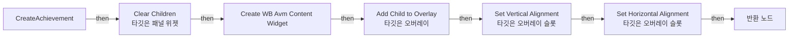
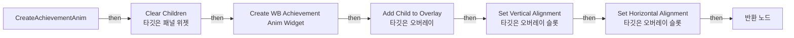
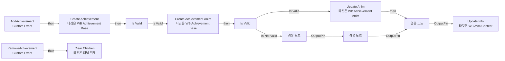

# WB_Achievement_Base

에셋: `/Game/CompShooterHUD/UI/Content/AchievementMessage/WB_Achievement_Base`

부모: `/Script/CoreUObject.Class'/Script/UMG.UserWidget'`

수집일: 2026-10-12. MCP에서 읽은 그래프·핀 연결의 자동 전사입니다. 상속된 그래프는 부모 문서를 함께 확인합니다.

정적 루트 참조 도달: 있음. 실행 여부 또는 삭제 가능 여부의 확정이 아닙니다.

컴포넌트 목록은 이 BP가 직접 정의한 SCS만 포함합니다. 부모·네이티브 생성 컴포넌트, 인스턴스 설정은 별도입니다.

## 그래프 목록

| 그래프 | 전체 노드 수 |
|---|---|
| CreateAchievement | 10 |
| CreateAchievementAnim | 10 |
| EventGraph | 18 |

## 그래프별 실행 연결

실선은 출력 exec 핀의 실제 연결입니다. 여러 분기는 출력 핀 이름을 표시합니다. 함수 호출·delegate·타이머의 다음 그래프 실행은 이 그림에서 자동으로 이어 붙이지 않습니다.

순수 계산 노드 및 데이터 핀은 아래 목록과 원본 JSON을 확인합니다. 연결되지 않은 이벤트도 표시되므로, 노드가 있다는 이유만으로 실행된다고 판단하면 안 됩니다.

### CreateAchievement

실행 핀 플로우차트

전체 노드·기본 입력 목록

| 노드 ID | 제목 | 미연결 기본 입력 / 에셋 입력 |
|---|---|---|
| `K2Node_FunctionEntry_3` | CreateAchievement |  |
| `K2Node_FunctionResult_0` | 반환 노드 |  |
| `K2Node_VariableGet_0` | Get OV_Achievement |  |
| `K2Node_CallFunction_0` | Clear Children 타깃은 패널 위젯 |  |
| `K2Node_CreateWidget_0` | Create WB Avm Content Widget | Class=/Game/CompShooterHUD/UI/Content/AchievementMessage/WB_Avm_Content.WB_Avm_Content_C |
| `K2Node_CallFunction_1` | Get Owning Player 타깃은 위젯 |  |
| `K2Node_VariableGet_133` | Get OV_Achievement |  |
| `K2Node_CallFunction_2` | Add Child to Overlay 타깃은 오버레이 |  |
| `K2Node_CallFunction_3` | Set Vertical Alignment 타깃은 오버레이 슬롯 | InVerticalAlignment=VAlign_Fill |
| `K2Node_CallFunction_4` | Set Horizontal Alignment 타깃은 오버레이 슬롯 | InHorizontalAlignment=HAlign_Fill |

### CreateAchievementAnim

실행 핀 플로우차트

전체 노드·기본 입력 목록

| 노드 ID | 제목 | 미연결 기본 입력 / 에셋 입력 |
|---|---|---|
| `K2Node_FunctionEntry_3` | CreateAchievementAnim |  |
| `K2Node_FunctionResult_0` | 반환 노드 |  |
| `K2Node_VariableGet_0` | Get OV_Anim |  |
| `K2Node_CallFunction_0` | Clear Children 타깃은 패널 위젯 |  |
| `K2Node_CreateWidget_0` | Create WB Achievement Anim Widget | Class=/Game/CompShooterHUD/UI/Content/AchievementMessage/WB_Achievement_Anim.WB_Achievement_Anim_C |
| `K2Node_CallFunction_1` | Get Owning Player 타깃은 위젯 |  |
| `K2Node_VariableGet_133` | Get OV_Anim |  |
| `K2Node_CallFunction_2` | Add Child to Overlay 타깃은 오버레이 |  |
| `K2Node_CallFunction_3` | Set Vertical Alignment 타깃은 오버레이 슬롯 | InVerticalAlignment=VAlign_Fill |
| `K2Node_CallFunction_4` | Set Horizontal Alignment 타깃은 오버레이 슬롯 | InHorizontalAlignment=HAlign_Fill |

### EventGraph

실행 핀 플로우차트

전체 노드·기본 입력 목록

| 노드 ID | 제목 | 미연결 기본 입력 / 에셋 입력 |
|---|---|---|
| `K2Node_CallFunction_24` | Create Achievement Anim 타깃은 WB Achievement Base |  |
| `K2Node_CallFunction_41` | Update Anim 타깃은 WB Achievement Anim |  |
| `K2Node_MacroInstance_1` | Is Valid |  |
| `K2Node_Knot_370` | 경유 노드 |  |
| `K2Node_Knot_372` | 경유 노드 |  |
| `K2Node_Knot_373` | 경유 노드 |  |
| `K2Node_CallFunction_123` | Create Achievement 타깃은 WB Achievement Base |  |
| `K2Node_CallFunction_182` | Update Info 타깃은 WB Avm Content | TextColor_ColorUseRule=UseColor_Specified |
| `K2Node_MacroInstance_51` | Is Valid |  |
| `K2Node_Knot_714` | 경유 노드 |  |
| `K2Node_Knot_715` | 경유 노드 |  |
| `K2Node_CustomEvent_0` | AddAchievement Custom Event |  |
| `EdGraphNode_Comment_252` | Event Add Achievement |  |
| `K2Node_CustomEvent_30` | RemoveAchievement Custom Event |  |
| `K2Node_VariableGet_784` | Get OV_Achievement |  |
| `K2Node_VariableGet_785` | Get OV_Anim |  |
| `K2Node_CallFunction_511` | Clear Children 타깃은 패널 위젯 |  |
| `EdGraphNode_Comment_305` | Event Remove Achievement |  |

## 조회 범위의 한계

ObjectIterator로 발견했으나 MCP helper가 반환하지 않은 그래프입니다. delegate signature·컴파일된 중간 그래프·macro·애니메이션 내부 그래프가 섞일 수 있습니다.

- `AddAchievement`: Graph 'AddAchievement' not found in Blueprint.
- `RemoveAchievement`: Graph 'RemoveAchievement' not found in Blueprint.

[원본 MCP 스냅샷](../../../../../Evidence/blueprints-281.json)
