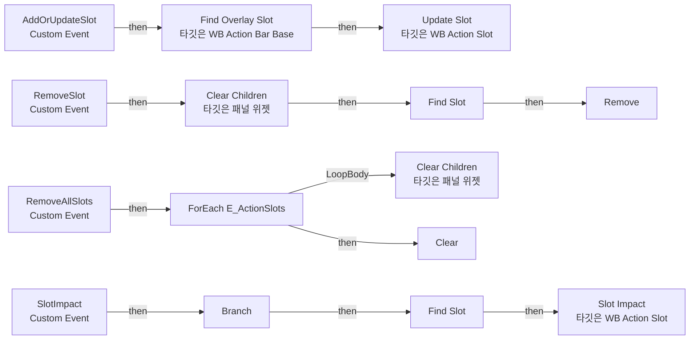
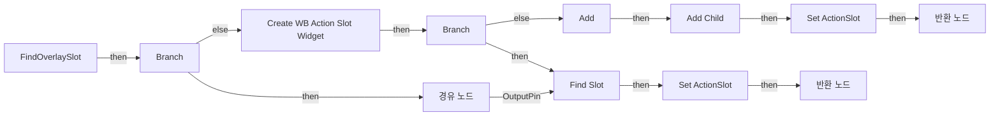
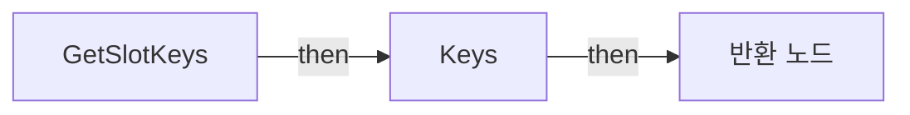
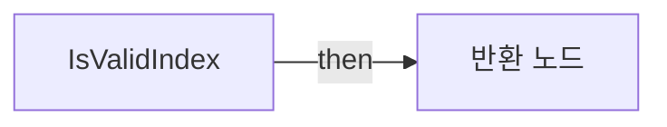

# WB_ActionBar_Base

에셋: `/Game/CompShooterHUD/UI/Content/ActionBar/WB_ActionBar_Base`

부모: `/Script/CoreUObject.Class'/Script/UMG.UserWidget'`

수집일: 2026-10-12. MCP에서 읽은 그래프·핀 연결의 자동 전사입니다. 상속된 그래프는 부모 문서를 함께 확인합니다.

정적 루트 참조 도달: 있음. 실행 여부 또는 삭제 가능 여부의 확정이 아닙니다.

컴포넌트 목록은 이 BP가 직접 정의한 SCS만 포함합니다. 부모·네이티브 생성 컴포넌트, 인스턴스 설정은 별도입니다.

## 변수와 기본값

| 이름 | 타입 | CDO 기본값 |
|---|---|---|
| `SlotMapping` | `WB_Action_Slot_C` | {} |

## 그래프 목록

| 그래프 | 전체 노드 수 |
|---|---|
| EventGraph | 29 |
| FindOverlaySlot | 27 |
| GetSlotKeys | 4 |
| GetSlotValues | 4 |
| IsValidIndex | 6 |

## 그래프별 실행 연결

실선은 출력 exec 핀의 실제 연결입니다. 여러 분기는 출력 핀 이름을 표시합니다. 함수 호출·delegate·타이머의 다음 그래프 실행은 이 그림에서 자동으로 이어 붙이지 않습니다.

순수 계산 노드 및 데이터 핀은 아래 목록과 원본 JSON을 확인합니다. 연결되지 않은 이벤트도 표시되므로, 노드가 있다는 이유만으로 실행된다고 판단하면 안 됩니다.

### EventGraph

실행 핀 플로우차트

전체 노드·기본 입력 목록

| 노드 ID | 제목 | 미연결 기본 입력 / 에셋 입력 |
|---|---|---|
| `K2Node_CustomEvent_0` | AddOrUpdateSlot Custom Event |  |
| `K2Node_CallFunction_183` | Update Slot 타깃은 WB Action Slot |  |
| `EdGraphNode_Comment_42` | Event Add Or Update Slot |  |
| `K2Node_CustomEvent_4` | RemoveSlot Custom Event |  |
| `K2Node_MacroInstance_53` | Find Overlay |  |
| `K2Node_CallFunction_46` | Clear Children 타깃은 패널 위젯 |  |
| `K2Node_CustomEvent_19` | RemoveAllSlots Custom Event |  |
| `K2Node_MacroInstance_504` | Find Overlay |  |
| `K2Node_ForEachElementInEnum_0` | ForEach E_ActionSlots |  |
| `K2Node_CallFunction_108` | Clear Children 타깃은 패널 위젯 |  |
| `EdGraphNode_Comment_162` | Event Remove All Slots |  |
| `EdGraphNode_Comment_63` | Event Remove Slot |  |
| `K2Node_CallFunction_738` | Find Overlay Slot 타깃은 WB Action Bar Base |  |
| `EdGraphNode_Comment_62` | Event Remove All Slots |  |
| `K2Node_CustomEvent_156` | SlotImpact Custom Event |  |
| `K2Node_CallFunction_786` | Slot Impact 타깃은 WB Action Slot |  |
| `K2Node_MacroInstance_173` | Find Overlay |  |
| `K2Node_CallFunction_257` | Has Any Children 타깃은 패널 위젯 |  |
| `K2Node_IfThenElse_58` | Branch |  |
| `K2Node_MacroInstance_96` | Find Slot |  |
| `K2Node_Knot_1031` | 경유 노드 |  |
| `K2Node_Knot_1032` | 경유 노드 |  |
| `K2Node_VariableGet_556` | Get SlotMapping |  |
| `K2Node_CallFunction_1296` | Clear |  |
| `K2Node_VariableGet_1982` | Get SlotMapping |  |
| `K2Node_MacroInstance_3043` | Find Slot |  |
| `K2Node_CallFunction_1303` | Remove | ReturnValue=false |
| `K2Node_Knot_1730` | 경유 노드 |  |
| `K2Node_Knot_1731` | 경유 노드 |  |

### FindOverlaySlot

실행 핀 플로우차트

전체 노드·기본 입력 목록

| 노드 ID | 제목 | 미연결 기본 입력 / 에셋 입력 |
|---|---|---|
| `K2Node_FunctionEntry_201` | FindOverlaySlot |  |
| `K2Node_FunctionResult_1` | 반환 노드 |  |
| `K2Node_MacroInstance_173` | Find Overlay |  |
| `K2Node_Knot_5` | 경유 노드 |  |
| `K2Node_Knot_158` | 경유 노드 |  |
| `K2Node_CallFunction_257` | Has Any Children 타깃은 패널 위젯 |  |
| `K2Node_IfThenElse_58` | Branch |  |
| `K2Node_VariableGet_329` | Get SlotMapping |  |
| `K2Node_CallFunction_258` | Add |  |
| `K2Node_CreateWidget_0` | Create WB Action Slot Widget | Class=/Game/CompShooterHUD/UI/Content/ActionBar/WB_Action_Slot.WB_Action_Slot_C |
| `K2Node_CallFunction_259` | Get Owning Player 타깃은 위젯 |  |
| `K2Node_MacroInstance_51` | Add Child |  |
| `K2Node_MacroInstance_96` | Find Slot |  |
| `K2Node_Knot_498` | 경유 노드 |  |
| `K2Node_Knot_499` | 경유 노드 |  |
| `K2Node_Knot_500` | 경유 노드 |  |
| `K2Node_Knot_501` | 경유 노드 |  |
| `K2Node_Knot_502` | 경유 노드 |  |
| `K2Node_Knot_503` | 경유 노드 |  |
| `K2Node_Knot_504` | 경유 노드 |  |
| `K2Node_VariableSet_0` | Set ActionSlot |  |
| `K2Node_FunctionResult_0` | 반환 노드 |  |
| `K2Node_VariableSet_361` | Set ActionSlot |  |
| `K2Node_Knot_1033` | 경유 노드 |  |
| `K2Node_IfThenElse_128` | Branch |  |
| `K2Node_CallFunction_942` | Is Valid Index |  |
| `K2Node_Knot_1056` | 경유 노드 |  |

### GetSlotKeys

실행 핀 플로우차트

전체 노드·기본 입력 목록

| 노드 ID | 제목 | 미연결 기본 입력 / 에셋 입력 |
|---|---|---|
| `K2Node_FunctionEntry_43` | GetSlotKeys |  |
| `K2Node_VariableGet_45` | Get SlotMapping |  |
| `K2Node_CallFunction_18` | Keys |  |
| `K2Node_FunctionResult_3` | 반환 노드 |  |

### GetSlotValues

실행 핀 플로우차트

전체 노드·기본 입력 목록

| 노드 ID | 제목 | 미연결 기본 입력 / 에셋 입력 |
|---|---|---|
| `K2Node_FunctionEntry_15` | GetSlotValues |  |
| `K2Node_VariableGet_46` | Get SlotMapping |  |
| `K2Node_CallFunction_17` | Values |  |
| `K2Node_FunctionResult_1` | 반환 노드 |  |

### IsValidIndex

실행 핀 플로우차트

전체 노드·기본 입력 목록

| 노드 ID | 제목 | 미연결 기본 입력 / 에셋 입력 |
|---|---|---|
| `K2Node_FunctionEntry_377` | IsValidIndex |  |
| `K2Node_FunctionResult_2` | 반환 노드 |  |
| `K2Node_CallArrayFunction_66` | Find Item |  |
| `K2Node_CallFunction_910` | Get Slot Values |  |
| `K2Node_CallArrayFunction_67` | Is Valid Index |  |
| `K2Node_Knot_1034` | 경유 노드 |  |

## 조회 범위의 한계

ObjectIterator로 발견했으나 MCP helper가 반환하지 않은 그래프입니다. delegate signature·컴파일된 중간 그래프·macro·애니메이션 내부 그래프가 섞일 수 있습니다.

- `AddChild`: Graph 'AddChild' not found in Blueprint.
- `AddOrUpdateSlot`: Graph 'AddOrUpdateSlot' not found in Blueprint.
- `FindOverlay`: Graph 'FindOverlay' not found in Blueprint.
- `FindSlot`: Graph 'FindSlot' not found in Blueprint.
- `RemoveAllSlots`: Graph 'RemoveAllSlots' not found in Blueprint.
- `RemoveSlot`: Graph 'RemoveSlot' not found in Blueprint.
- `SlotImpact`: Graph 'SlotImpact' not found in Blueprint.

[원본 MCP 스냅샷](../../../../../Evidence/blueprints-316.json)
