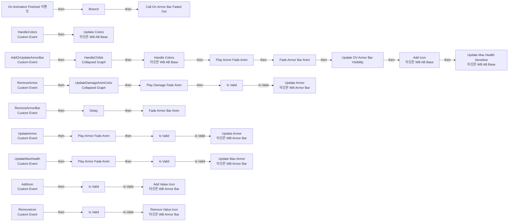
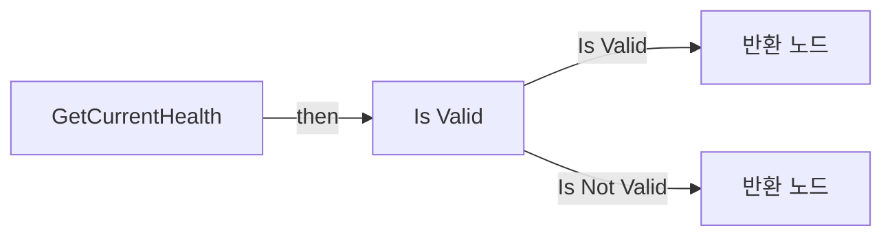
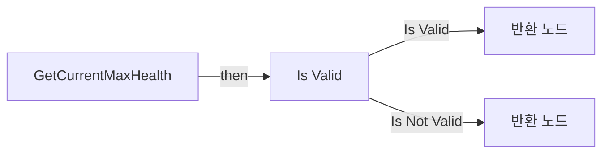
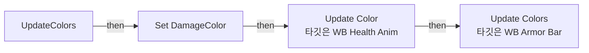
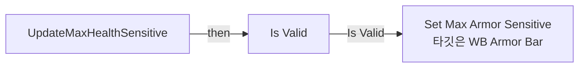

# WB_AB_Base

에셋: `/Game/CompShooterHUD/UI/Content/ArmorBar/WB_AB_Base`

부모: `/Script/CoreUObject.Class'/Script/UMG.UserWidget'`

수집일: 2026-10-12. MCP에서 읽은 그래프·핀 연결의 자동 전사입니다. 상속된 그래프는 부모 문서를 함께 확인합니다.

정적 루트 참조 도달: 있음. 실행 여부 또는 삭제 가능 여부의 확정이 아닙니다.

컴포넌트 목록은 이 BP가 직접 정의한 SCS만 포함합니다. 부모·네이티브 생성 컴포넌트, 인스턴스 설정은 별도입니다.

## 변수와 기본값

| 이름 | 타입 | CDO 기본값 |
|---|---|---|
| `OnArmorBarFadedOut` | `mcdelegate` | &lt;Delegate 'DelegateBase' &lt;Unbound&gt;&gt; |
| `WB_ArmorBar` | `WB_ArmorBar_C` | None |
| `WB_ArmorAnim` | `WB_HealthAnim_C` | None |
| `WB_DamageAnim` | `WB_DamageAnim_C` | None |
| `DamageColor` | `LinearColor` | &lt;Struct 'LinearColor' {r: 0.000000, g: 0.000000, b: 0.000000, a: 0.000000}&gt; |

## 그래프 목록

| 그래프 | 전체 노드 수 |
|---|---|
| EventGraph | 79 |
| GetCurrentHealth | 6 |
| GetCurrentMaxHealth | 6 |
| UpdateColors | 6 |
| UpdateMaxHealthSensitive | 7 |

## 그래프별 실행 연결

실선은 출력 exec 핀의 실제 연결입니다. 여러 분기는 출력 핀 이름을 표시합니다. 함수 호출·delegate·타이머의 다음 그래프 실행은 이 그림에서 자동으로 이어 붙이지 않습니다.

순수 계산 노드 및 데이터 핀은 아래 목록과 원본 JSON을 확인합니다. 연결되지 않은 이벤트도 표시되므로, 노드가 있다는 이유만으로 실행된다고 판단하면 안 됩니다.

### EventGraph

실행 핀 플로우차트

전체 노드·기본 입력 목록

| 노드 ID | 제목 | 미연결 기본 입력 / 에셋 입력 |
|---|---|---|
| `K2Node_CustomEvent_0` | RemoveArmorBar Custom Event |  |
| `K2Node_CallDelegate_44` | Call On Armor Bar Faded Out |  |
| `EdGraphNode_Comment_9` | Event Remove Armor Bar |  |
| `K2Node_Event_3` | On Animation Finished 이벤트 |  |
| `K2Node_CallFunction_15` | Equal (Object) |  |
| `K2Node_IfThenElse_0` | Branch |  |
| `K2Node_CustomEvent_14` | AddOrUpdateArmorBar Custom Event |  |
| `EdGraphNode_Comment_64` | Event Add Or Update Armor Bar |  |
| `K2Node_VariableGet_1189` | Get WB_ArmorBar |  |
| `K2Node_MacroInstance_1570` | Is Valid |  |
| `K2Node_VariableGet_478` | Get WB_ArmorBar |  |
| `K2Node_MacroInstance_44` | Is Valid |  |
| `K2Node_CustomEvent_103` | UpdateArmor Custom Event |  |
| `K2Node_CustomEvent_112` | UpdateMaxHealth Custom Event |  |
| `K2Node_Knot_285` | 경유 노드 |  |
| `K2Node_Knot_1850` | 경유 노드 |  |
| `K2Node_Knot_287` | 경유 노드 |  |
| `K2Node_Knot_288` | 경유 노드 |  |
| `K2Node_Knot_1851` | 경유 노드 |  |
| `K2Node_Knot_290` | 경유 노드 |  |
| `EdGraphNode_Comment_22` | Event Add Armor |  |
| `EdGraphNode_Comment_92` | Event Update Max Health |  |
| `K2Node_VariableGet_324` | Get FadeInArmorBar |  |
| `K2Node_MacroInstance_1509` | Fade Armor Bar Anim |  |
| `K2Node_MacroInstance_1545` | Update OV Armor Bar Visibility | bVisible=true |
| `K2Node_MacroInstance_1592` | Fade Armor Bar Anim | bVisible=true |
| `K2Node_CallFunction_1340` | Update Colors 타깃은 WB AB Base |  |
| `K2Node_CallFunction_1945` | To Color (LinearColor) | InUseSRGB=true |
| `K2Node_CallFunction_1946` | To LinearColor (Color) |  |
| `K2Node_CallFunction_1893` | To Color (LinearColor) | InUseSRGB=true |
| `K2Node_CallFunction_4128` | To LinearColor (Color) |  |
| `K2Node_CallFunction_1988` | To Color (LinearColor) | InUseSRGB=true |
| `K2Node_CallFunction_1989` | To LinearColor (Color) |  |
| `K2Node_CallFunction_1990` | To Color (LinearColor) | InUseSRGB=true |
| `K2Node_CallFunction_1991` | To LinearColor (Color) |  |
| `K2Node_CustomEvent_516` | HandleColors Custom Event |  |
| `EdGraphNode_Comment_96` | Event Handle Colors |  |
| `K2Node_CallFunction_2384` | Handle Colors 타깃은 WB AB Base |  |
| `K2Node_Composite_63` | HandleChilds Collapsed Graph |  |
| `K2Node_CallFunction_97` | Delay | Duration=0.01 |
| `K2Node_MacroInstance_221` | Play Armor Fade Anim |  |
| `K2Node_MacroInstance_845` | Play Armor Fade Anim |  |
| `K2Node_CustomEvent_102` | AddIcon Custom Event |  |
| `K2Node_CustomEvent_110` | RemoveIcon Custom Event |  |
| `K2Node_VariableGet_295` | Get WB_ArmorBar |  |
| `K2Node_MacroInstance_373` | Is Valid |  |
| `K2Node_Knot_300` | 경유 노드 |  |
| `K2Node_Knot_301` | 경유 노드 |  |
| `K2Node_Knot_367` | 경유 노드 |  |
| `K2Node_VariableGet_323` | Get WB_ArmorBar |  |
| `K2Node_MacroInstance_301` | Is Valid |  |
| `K2Node_Knot_302` | 경유 노드 |  |
| `EdGraphNode_Comment_85` | Event Add Icon |  |
| `EdGraphNode_Comment_86` | Event Remove Icon |  |
| `K2Node_MacroInstance_1040` | Play Armor Fade Anim |  |
| `K2Node_CallFunction_1443` | Add Icon 타깃은 WB AB Base |  |
| `K2Node_Knot_303` | 경유 노드 |  |
| `K2Node_Knot_304` | 경유 노드 |  |
| `K2Node_CallFunction_2881` | Update Max Health Sensitive 타깃은 WB AB Base |  |
| `K2Node_Knot_1325` | 경유 노드 |  |
| `K2Node_Knot_1326` | 경유 노드 |  |
| `EdGraphNode_Comment_91` | Event Remove Armor |  |
| `K2Node_CustomEvent_23` | RemoveArmor Custom Event |  |
| `K2Node_MacroInstance_2155` | Play Damage Fade Anim |  |
| `K2Node_Composite_335` | UpdateDamageAnimColor Collapsed Graph |  |
| `K2Node_VariableGet_56` | Get WB_ArmorBar |  |
| `K2Node_MacroInstance_79` | Is Valid |  |
| `K2Node_Knot_286` | 경유 노드 |  |
| `K2Node_Knot_289` | 경유 노드 |  |
| `K2Node_CallFunction_3965` | int - int |  |
| `K2Node_Knot_855` | 경유 노드 |  |
| `K2Node_Knot_2090` | 경유 노드 |  |
| `K2Node_VariableGet_1022` | Get DamageColor |  |
| `K2Node_CallFunction_1131` | Add Value Icon 타깃은 WB Armor Bar |  |
| `K2Node_CallFunction_1265` | Remove Value Icon 타깃은 WB Armor Bar |  |
| `K2Node_CallFunction_1614` | Update Armor 타깃은 WB Armor Bar | bIsAddingArmor=true |
| `K2Node_VariableGet_605` | Get ArmorValue |  |
| `K2Node_CallFunction_1440` | Update Armor 타깃은 WB Armor Bar | bIsAddingArmor=false |
| `K2Node_CallFunction_1716` | Update Max Armor 타깃은 WB Armor Bar |  |

### GetCurrentHealth

실행 핀 플로우차트

전체 노드·기본 입력 목록

| 노드 ID | 제목 | 미연결 기본 입력 / 에셋 입력 |
|---|---|---|
| `K2Node_FunctionEntry_663` | GetCurrentHealth |  |
| `K2Node_FunctionResult_1` | 반환 노드 |  |
| `K2Node_VariableGet_478` | Get WB_ArmorBar |  |
| `K2Node_MacroInstance_44` | Is Valid |  |
| `K2Node_FunctionResult_0` | 반환 노드 | CurrentHealth=0 |
| `K2Node_VariableGet_786` | Get ArmorValue |  |

### GetCurrentMaxHealth

실행 핀 플로우차트

전체 노드·기본 입력 목록

| 노드 ID | 제목 | 미연결 기본 입력 / 에셋 입력 |
|---|---|---|
| `K2Node_FunctionEntry_817` | GetCurrentMaxHealth |  |
| `K2Node_MacroInstance_44` | Is Valid |  |
| `K2Node_VariableGet_478` | Get WB_ArmorBar |  |
| `K2Node_FunctionResult_2` | 반환 노드 | CurrentMaxHealth=0 |
| `K2Node_FunctionResult_0` | 반환 노드 |  |
| `K2Node_VariableGet_823` | Get MaxArmorValue |  |

### UpdateColors

실행 핀 플로우차트

전체 노드·기본 입력 목록

| 노드 ID | 제목 | 미연결 기본 입력 / 에셋 입력 |
|---|---|---|
| `K2Node_FunctionEntry_827` | UpdateColors |  |
| `K2Node_VariableGet_303` | Get WB_ArmorBar |  |
| `K2Node_VariableGet_384` | Get WB_ArmorAnim |  |
| `K2Node_CallFunction_1392` | Update Color 타깃은 WB Health Anim |  |
| `K2Node_VariableSet_716` | Set DamageColor |  |
| `K2Node_CallFunction_2023` | Update Colors 타깃은 WB Armor Bar |  |

### UpdateMaxHealthSensitive

실행 핀 플로우차트

전체 노드·기본 입력 목록

| 노드 ID | 제목 | 미연결 기본 입력 / 에셋 입력 |
|---|---|---|
| `K2Node_FunctionEntry_890` | UpdateMaxHealthSensitive |  |
| `K2Node_VariableGet_478` | Get WB_ArmorBar |  |
| `K2Node_MacroInstance_44` | Is Valid |  |
| `K2Node_Knot_1322` | 경유 노드 |  |
| `K2Node_Knot_1323` | 경유 노드 |  |
| `K2Node_Knot_1324` | 경유 노드 |  |
| `K2Node_CallFunction_2429` | Set Max Armor Sensitive 타깃은 WB Armor Bar |  |

## 조회 범위의 한계

ObjectIterator로 발견했으나 MCP helper가 반환하지 않은 그래프입니다. delegate signature·컴파일된 중간 그래프·macro·애니메이션 내부 그래프가 섞일 수 있습니다.

- `AddArmorAnimToOverlay`: Graph 'AddArmorAnimToOverlay' not found in Blueprint.
- `AddArmorBarToOverlay`: Graph 'AddArmorBarToOverlay' not found in Blueprint.
- `AddDamageAnimToOverlay`: Graph 'AddDamageAnimToOverlay' not found in Blueprint.
- `AddIcon`: Graph 'AddIcon' not found in Blueprint.
- `AddOrUpdateArmorBar`: Graph 'AddOrUpdateArmorBar' not found in Blueprint.
- `FadeArmorBarAnim`: Graph 'FadeArmorBarAnim' not found in Blueprint.
- `HandleColors`: Graph 'HandleColors' not found in Blueprint.
- `OV_ArmorAnim_HasNoChildren?`: Graph 'OV_ArmorAnim_HasNoChildren?' not found in Blueprint.
- `OV_ArmorBar_HasNoChildren?`: Graph 'OV_ArmorBar_HasNoChildren?' not found in Blueprint.
- `OV_DamageAnim_HasNoChildren?`: Graph 'OV_DamageAnim_HasNoChildren?' not found in Blueprint.
- `OnAnimationFinished`: Graph 'OnAnimationFinished' not found in Blueprint.
- `OnArmorBarFadedOut`: Graph 'OnArmorBarFadedOut' not found in Blueprint.
- `PlayArmorFadeAnim`: Graph 'PlayArmorFadeAnim' not found in Blueprint.
- `PlayDamageFadeAnim`: Graph 'PlayDamageFadeAnim' not found in Blueprint.
- `RemoveArmor`: Graph 'RemoveArmor' not found in Blueprint.
- `RemoveArmorBar`: Graph 'RemoveArmorBar' not found in Blueprint.
- `RemoveIcon`: Graph 'RemoveIcon' not found in Blueprint.
- `UpdateArmor`: Graph 'UpdateArmor' not found in Blueprint.
- `UpdateMaxHealth`: Graph 'UpdateMaxHealth' not found in Blueprint.
- `UpdateOV_ArmorBar_Visibility`: Graph 'UpdateOV_ArmorBar_Visibility' not found in Blueprint.

[원본 MCP 스냅샷](../../../../../Evidence/blueprints-316.json)
