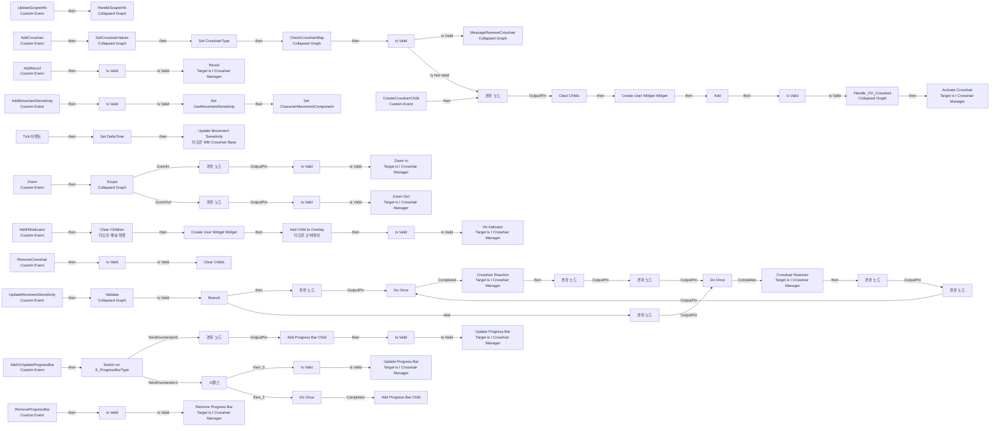
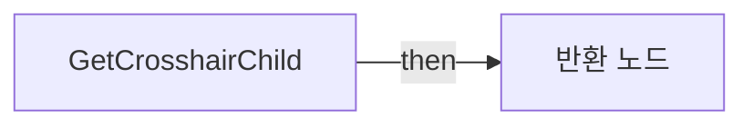
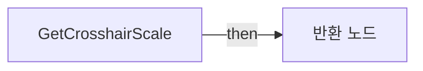
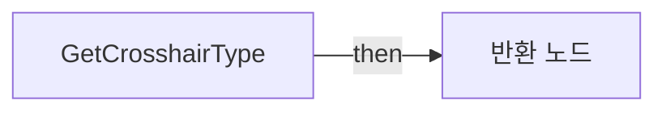
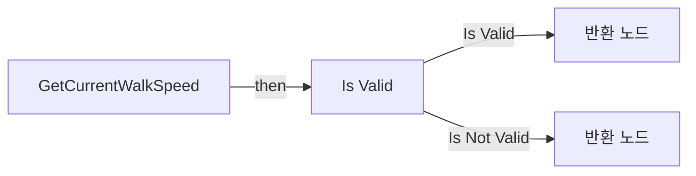
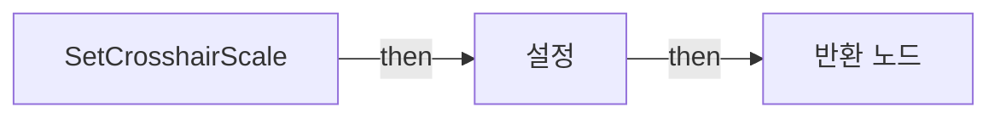

# WB_CrosshairBase

에셋: `/Game/CompShooterHUD/UI/Content/Crosshairs/WB_CrosshairBase`

부모: `/Script/CoreUObject.Class'/Script/UMG.UserWidget'`

수집일: 2026-10-12. MCP에서 읽은 그래프·핀 연결의 자동 전사입니다. 상속된 그래프는 부모 문서를 함께 확인합니다.

정적 루트 참조 도달: 있음. 실행 여부 또는 삭제 가능 여부의 확정이 아닙니다.

컴포넌트 목록은 이 BP가 직접 정의한 SCS만 포함합니다. 부모·네이티브 생성 컴포넌트, 인스턴스 설정은 별도입니다.

## 변수와 기본값

| 이름 | 타입 | CDO 기본값 |
|---|---|---|
| `CrosshairType` | `E_CrosshairType` | &lt;E_CrosshairType.CROSSHAIR_01: 0&gt; |
| `OnCrosshairRemoved` | `mcdelegate` | &lt;Delegate 'DelegateBase' &lt;Unbound&gt;&gt; |
| `CrosshairMap` | `E_CrosshairType` | {} |
| `UseMovementSensitivity` | `bool` | False |
| `CharacterMovementComponent` | `CharacterMovementComponent` | None |
| `DeltaTime` | `real` | 0.0 |
| `CrosshairScale` | `Vector2D` | &lt;Struct 'Vector2D' {x: 0.000000, y: 0.000000}&gt; |

## 그래프 목록

| 그래프 | 전체 노드 수 |
|---|---|
| EventGraph | 109 |
| GetCrosshairChild | 4 |
| GetCrosshairScale | 3 |
| GetCrosshairType | 4 |
| GetCurrentWalkSpeed | 7 |
| SetCrosshairScale | 4 |

## 그래프별 실행 연결

실선은 출력 exec 핀의 실제 연결입니다. 여러 분기는 출력 핀 이름을 표시합니다. 함수 호출·delegate·타이머의 다음 그래프 실행은 이 그림에서 자동으로 이어 붙이지 않습니다.

순수 계산 노드 및 데이터 핀은 아래 목록과 원본 JSON을 확인합니다. 연결되지 않은 이벤트도 표시되므로, 노드가 있다는 이유만으로 실행된다고 판단하면 안 됩니다.

### EventGraph

실행 핀 플로우차트

전체 노드·기본 입력 목록

| 노드 ID | 제목 | 미연결 기본 입력 / 에셋 입력 |
|---|---|---|
| `K2Node_CustomEvent_0` | AddRecoil Custom Event |  |
| `K2Node_CustomEvent_24` | Zoom Custom Event |  |
| `K2Node_CustomEvent_103` | UpdateScopeInfo Custom Event |  |
| `EdGraphNode_Comment_2` | Event Update Scope Info |  |
| `EdGraphNode_Comment_3` | Event Zoom |  |
| `EdGraphNode_Comment_4` | Event Add Recoil |  |
| `K2Node_Composite_14` | HandleScopeInfo Collapsed Graph |  |
| `K2Node_CustomEvent_65` | AddCrosshair Custom Event |  |
| `K2Node_CreateWidget_23` | Create User Widget Widget |  |
| `K2Node_VariableSet_73` | Set CrosshairType |  |
| `K2Node_CallFunction_159` | Get Crosshair Child |  |
| `K2Node_MacroInstance_54` | Is Valid |  |
| `K2Node_CustomEvent_131` | CreateCrosshairChild Custom Event |  |
| `EdGraphNode_Comment_152` | Event Add Crosshair |  |
| `EdGraphNode_Comment_153` | Create Crosshair Child |  |
| `K2Node_Knot_52` | 경유 노드 |  |
| `K2Node_Composite_2` | MessageRemoveCrosshair Collapsed Graph |  |
| `K2Node_CallFunction_1194` | Get Crosshair Child |  |
| `K2Node_MacroInstance_451` | Is Valid |  |
| `K2Node_Message_97` | Recoil Target is I Crosshair Manager |  |
| `K2Node_Knot_54` | 경유 노드 |  |
| `K2Node_Message_149` | Activate Crosshair Target is I Crosshair Manager |  |
| `K2Node_MacroInstance_590` | Is Valid |  |
| `K2Node_Composite_3` | Handle_OV_Crosshair Collapsed Graph |  |
| `K2Node_VariableGet_69` | Get CrosshairMap |  |
| `K2Node_CallFunction_209` | Add |  |
| `K2Node_VariableGet_78` | Get CrosshairType |  |
| `K2Node_Knot_21` | 경유 노드 |  |
| `K2Node_Composite_0` | CheckCrosshairMap Collapsed Graph |  |
| `K2Node_CallFunction_705` | Get Crosshair Type |  |
| `K2Node_MacroInstance_163` | Clear Childs |  |
| `K2Node_CustomEvent_215` | AddMovementSensitivity Custom Event |  |
| `K2Node_VariableGet_440` | Get CharacterMovement |  |
| `K2Node_VariableSet_134` | Set UseMovementSensitivity | Output_Get=false |
| `K2Node_VariableSet_223` | Set CharacterMovementComponent |  |
| `EdGraphNode_Comment_1` | AddMovementSensitivity |  |
| `K2Node_Event_0` | Tick 이벤트 |  |
| `K2Node_VariableSet_245` | Set DeltaTime | Output_Get=0.0 |
| `K2Node_CustomEvent_300` | UpdateMovementSensitivity Custom Event |  |
| `K2Node_CallFunction_1493` | Update Movement Sensitivity 타깃은 WB Crosshair Base |  |
| `EdGraphNode_Comment_299` | Event Tick |  |
| `K2Node_CallFunction_1576` | Get Crosshair Child |  |
| `K2Node_Message_356` | Crosshair Reaction Target is I Crosshair Manager | IsMoving=true |
| `K2Node_IfThenElse_252` | Branch |  |
| `K2Node_Knot_57` | 경유 노드 |  |
| `K2Node_Message_260` | Crosshair Reaction Target is I Crosshair Manager | IsMoving=false |
| `K2Node_Knot_58` | 경유 노드 |  |
| `K2Node_Composite_122` | Validate Collapsed Graph |  |
| `EdGraphNode_Comment_525` | Event Update Movement Sensitivity (Tick Event) |  |
| `K2Node_MacroInstance_944` | Do Once |  |
| `K2Node_MacroInstance_945` | Do Once |  |
| `K2Node_Knot_71` | 경유 노드 |  |
| `K2Node_Knot_72` | 경유 노드 |  |
| `K2Node_Knot_73` | 경유 노드 |  |
| `K2Node_Knot_74` | 경유 노드 |  |
| `K2Node_MacroInstance_1015` | Is Valid |  |
| `K2Node_CallFunction_3342` | Get Crosshair Scale |  |
| `K2Node_Composite_198` | SetCrosshairValues Collapsed Graph |  |
| `K2Node_CallFunction_1707` | Get Crosshair Child |  |
| `K2Node_MacroInstance_895` | Is Valid |  |
| `K2Node_Composite_34` | Scope Collapsed Graph |  |
| `K2Node_Message_337` | Zoom In Target is I Crosshair Manager |  |
| `K2Node_Message_336` | Zoom Out Target is I Crosshair Manager |  |
| `K2Node_Knot_1308` | 경유 노드 |  |
| `K2Node_Knot_1309` | 경유 노드 |  |
| `K2Node_CallFunction_703` | Get Crosshair Child |  |
| `K2Node_MacroInstance_352` | Is Valid |  |
| `K2Node_Knot_43` | 경유 노드 |  |
| `K2Node_Knot_44` | 경유 노드 |  |
| `K2Node_CustomEvent_15` | RemoveCrosshair Custom Event |  |
| `K2Node_CallFunction_694` | Get Crosshair Child |  |
| `K2Node_MacroInstance_351` | Is Valid |  |
| `EdGraphNode_Comment_5` | Event Remove Crosshair |  |
| `K2Node_MacroInstance_479` | Clear Childs |  |
| `K2Node_CustomEvent_51` | AddHitIndicator Custom Event |  |
| `K2Node_VariableGet_164` | Get OV_HitIndicator |  |
| `K2Node_CallFunction_580` | Clear Children 타깃은 패널 위젯 |  |
| `K2Node_Select_35` | 선택 | NewEnumerator0=/Game/CompShooterHUD/UI/Content/Crosshairs/HitIndicators/WB_HitIndicator_01.WB_HitIndicator_01_C; NewEnumerator1=/Game/CompShooterHUD/UI/Content/Crosshairs/HitIndicators/WB_HitIndicator_02.WB_HitIndicator_02_C; NewEnumerator2=/Game/CompShooterHUD/UI/Content/Crosshairs/HitIndicators/WB_HitIndicator_03.WB_HitIndicator_03_C; NewEnumerator3=/Game/CompShooterHUD/UI/Content/Crosshairs/HitIndicators/WB_HitIndicator_04.WB_HitIndicator_04_C; NewEnumerator4=/Game/CompShooterHUD/UI/Content/Crosshairs/HitIndicators/WB_HitIndicator_05.WB_HitIndicator_05_C |
| `K2Node_CreateWidget_30` | Create User Widget Widget |  |
| `K2Node_VariableGet_97` | Get OV_HitIndicator |  |
| `K2Node_CallFunction_648` | Add Child to Overlay 타깃은 오버레이 |  |
| `K2Node_MacroInstance_331` | Is Valid |  |
| `K2Node_Message_147` | Hit Indicator Target is I Crosshair Manager |  |
| `EdGraphNode_Comment_26` | Event Add Hit Indicator |  |
| `K2Node_CustomEvent_151` | AddOrUpdateProgressBar Custom Event |  |
| `K2Node_CustomEvent_172` | RemoveProgressBar Custom Event |  |
| `K2Node_SwitchEnum_0` | Switch on E_ProgressBarType |  |
| `K2Node_MacroInstance_1164` | Is Valid |  |
| `K2Node_Message_538` | Update Progress Bar Target is I Crosshair Manager | ProgressType=NewEnumerator0; Value=0.0 |
| `K2Node_Message_389` | Update Progress Bar Target is I Crosshair Manager | ProgressType=NewEnumerator1; Time=0.0 |
| `K2Node_MacroInstance_4381` | Add Progress Bar Child | Class=/Game/CompShooterHUD/UI/Content/Crosshairs/ProgressBar/WB_ProgressBar.WB_ProgressBar_C |
| `K2Node_Knot_235` | 경유 노드 |  |
| `K2Node_MacroInstance_4431` | Add Progress Bar Child | Class=/Game/CompShooterHUD/UI/Content/Crosshairs/ProgressBar/WB_ProgressBar.WB_ProgressBar_C |
| `K2Node_MacroInstance_1446` | Do Once |  |
| `K2Node_ExecutionSequence_281` | 시퀀스 |  |
| `K2Node_MacroInstance_1470` | Is Valid |  |
| `K2Node_Knot_245` | 경유 노드 |  |
| `K2Node_Knot_246` | 경유 노드 |  |
| `K2Node_Knot_247` | 경유 노드 |  |
| `K2Node_Knot_248` | 경유 노드 |  |
| `K2Node_VariableGet_425` | Get OV_ProgressBar |  |
| `K2Node_CallFunction_4089` | Get Child At 타깃은 패널 위젯 | Index=0 |
| `K2Node_MacroInstance_1570` | Is Valid |  |
| `K2Node_Message_737` | Remove Progress Bar Target is I Crosshair Manager |  |
| `K2Node_Knot_254` | 경유 노드 |  |
| `EdGraphNode_Comment_98` | Event Remove Progress Bar |  |
| `K2Node_Knot_269` | 경유 노드 |  |
| `K2Node_Knot_270` | 경유 노드 |  |
| `EdGraphNode_Comment_795` | Event Add Or Update Progress Bar |  |

### GetCrosshairChild

실행 핀 플로우차트

전체 노드·기본 입력 목록

| 노드 ID | 제목 | 미연결 기본 입력 / 에셋 입력 |
|---|---|---|
| `K2Node_FunctionEntry_168` | GetCrosshairChild |  |
| `K2Node_FunctionResult_0` | 반환 노드 |  |
| `K2Node_VariableGet_25` | Get OV_Crosshair |  |
| `K2Node_CallFunction_317` | Get Child At 타깃은 패널 위젯 | Index=0 |

### GetCrosshairScale

실행 핀 플로우차트

전체 노드·기본 입력 목록

| 노드 ID | 제목 | 미연결 기본 입력 / 에셋 입력 |
|---|---|---|
| `K2Node_FunctionEntry_1190` | GetCrosshairScale |  |
| `K2Node_FunctionResult_1` | 반환 노드 |  |
| `K2Node_VariableGet_559` | Get CrosshairScale |  |

### GetCrosshairType

실행 핀 플로우차트

전체 노드·기본 입력 목록

| 노드 ID | 제목 | 미연결 기본 입력 / 에셋 입력 |
|---|---|---|
| `K2Node_FunctionEntry_235` | GetCrosshairType |  |
| `K2Node_FunctionResult_0` | 반환 노드 |  |
| `K2Node_Select_51` | 선택 | NewEnumerator0=/Game/CompShooterHUD/UI/Content/Crosshairs/Crosshairs/WB_Crosshair_01.WB_Crosshair_01_C; NewEnumerator2=/Game/CompShooterHUD/UI/Content/Crosshairs/Crosshairs/WB_Crosshair_02.WB_Crosshair_02_C; NewEnumerator3=/Game/CompShooterHUD/UI/Content/Crosshairs/Crosshairs/WB_Crosshair_03.WB_Crosshair_03_C; NewEnumerator4=/Game/CompShooterHUD/UI/Content/Crosshairs/Crosshairs/WB_Crosshair_04.WB_Crosshair_04_C; NewEnumerator5=/Game/CompShooterHUD/UI/Content/Crosshairs/Crosshairs/WB_Crosshair_05.WB_Crosshair_05_C; NewEnumerator6=/Game/CompShooterHUD/UI/Content/Crosshairs/Crosshairs/WB_Crosshair_06.WB_Crosshair_06_C; NewEnumerator7=/Game/CompShooterHUD/UI/Content/Crosshairs/Crosshairs/WB_Crosshair_07.WB_Crosshair_07_C; NewEnumerator8=/Game/CompShooterHUD/UI/Content/Crosshairs/Crosshairs/WB_Crosshair_08.WB_Crosshair_08_C; NewEnumerator9=/Game/CompShooterHUD/UI/Content/Crosshairs/Crosshairs/WB_Crosshair_09.WB_Crosshair_09_C; NewEnumerator10=/Game/CompShooterHUD/UI/Content/Crosshairs/Crosshairs/WB_Crosshair_10.WB_Crosshair_10_C; NewEnumerator11=/Game/CompShooterHUD/UI/Content/Crosshairs/Crosshairs/WB_Crosshair_11.WB_Crosshair_11_C |
| `K2Node_VariableGet_346` | Get CrosshairType |  |

### GetCurrentWalkSpeed

실행 핀 플로우차트

전체 노드·기본 입력 목록

| 노드 ID | 제목 | 미연결 기본 입력 / 에셋 입력 |
|---|---|---|
| `K2Node_FunctionEntry_658` | GetCurrentWalkSpeed |  |
| `K2Node_FunctionResult_0` | 반환 노드 |  |
| `K2Node_VariableGet_256` | Get CharacterMovementComponent |  |
| `K2Node_VariableGet_634` | Get Velocity |  |
| `K2Node_CallFunction_1907` | Vector Length |  |
| `K2Node_MacroInstance_1342` | Is Valid |  |
| `K2Node_FunctionResult_1` | 반환 노드 | ReturnValue=0.0 |

### SetCrosshairScale

실행 핀 플로우차트

전체 노드·기본 입력 목록

| 노드 ID | 제목 | 미연결 기본 입력 / 에셋 입력 |
|---|---|---|
| `K2Node_FunctionEntry_1171` | SetCrosshairScale |  |
| `K2Node_VariableSet_443` | 설정 |  |
| `K2Node_Knot_2197` | 경유 노드 |  |
| `K2Node_FunctionResult_2` | 반환 노드 |  |

## 조회 범위의 한계

ObjectIterator로 발견했으나 MCP helper가 반환하지 않은 그래프입니다. delegate signature·컴파일된 중간 그래프·macro·애니메이션 내부 그래프가 섞일 수 있습니다.

- `AddCrosshair`: Graph 'AddCrosshair' not found in Blueprint.
- `AddHitIndicator`: Graph 'AddHitIndicator' not found in Blueprint.
- `AddMovementSensitivity`: Graph 'AddMovementSensitivity' not found in Blueprint.
- `AddOrUpdateProgressBar`: Graph 'AddOrUpdateProgressBar' not found in Blueprint.
- `AddProgressBarChild`: Graph 'AddProgressBarChild' not found in Blueprint.
- `AddRecoil`: Graph 'AddRecoil' not found in Blueprint.
- `ClearChilds`: Graph 'ClearChilds' not found in Blueprint.
- `CreateCrosshairChild`: Graph 'CreateCrosshairChild' not found in Blueprint.
- `OnCrosshairRemoved`: Graph 'OnCrosshairRemoved' not found in Blueprint.
- `RemoveCrosshair`: Graph 'RemoveCrosshair' not found in Blueprint.
- `RemoveProgressBar`: Graph 'RemoveProgressBar' not found in Blueprint.
- `Tick`: Graph 'Tick' not found in Blueprint.
- `UpdateFadeScopeAnim`: Graph 'UpdateFadeScopeAnim' not found in Blueprint.
- `UpdateMovementSensitivity`: Graph 'UpdateMovementSensitivity' not found in Blueprint.
- `UpdateScopeBG_Color`: Graph 'UpdateScopeBG_Color' not found in Blueprint.
- `UpdateScopeInfo`: Graph 'UpdateScopeInfo' not found in Blueprint.
- `UpdateScopeMask`: Graph 'UpdateScopeMask' not found in Blueprint.
- `UpdateScopeVisibility`: Graph 'UpdateScopeVisibility' not found in Blueprint.
- `ValidateCrosshairChild`: Graph 'ValidateCrosshairChild' not found in Blueprint.
- `Zoom`: Graph 'Zoom' not found in Blueprint.

[원본 MCP 스냅샷](../../../../../Evidence/blueprints-316.json)
