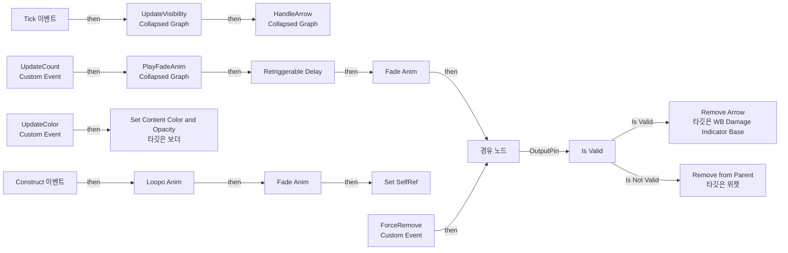
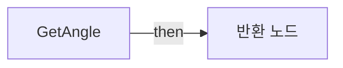
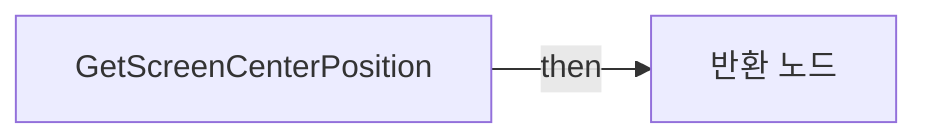
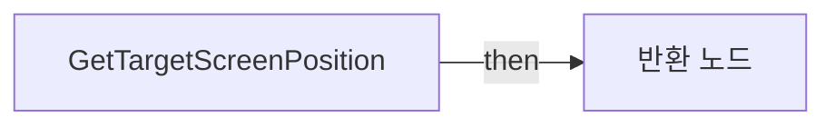
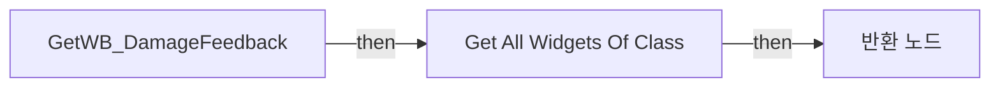

# WB_DamageIndicatorArrow

에셋: `/Game/CompShooterHUD/UI/Content/DamageIndicator/WB_DamageIndicatorArrow`

부모: `/Script/CoreUObject.Class'/Script/UMG.UserWidget'`

수집일: 2026-10-12. MCP에서 읽은 그래프·핀 연결의 자동 전사입니다. 상속된 그래프는 부모 문서를 함께 확인합니다.

정적 루트 참조 도달: 있음. 실행 여부 또는 삭제 가능 여부의 확정이 아닙니다.

컴포넌트 목록은 이 BP가 직접 정의한 SCS만 포함합니다. 부모·네이티브 생성 컴포넌트, 인스턴스 설정은 별도입니다.

## 변수와 기본값

| 이름 | 타입 | CDO 기본값 |
|---|---|---|
| `OwnersCamera` | `CameraComponent` | None |
| `DamageInstigator` | `Actor` | None |
| `FacingValue` | `real` | 0.0 |
| `DeltaTime` | `real` | 0.0 |
| `bUseViewportSensitive` | `bool` | False |
| `SelfRef` | `WB_DamageIndicatorArrow_C` | None |

## 그래프 목록

| 그래프 | 전체 노드 수 |
|---|---|
| EventGraph | 27 |
| GetAngle | 4 |
| GetScreenCenterPosition | 6 |
| GetTargetScreenPosition | 6 |
| GetWB_DamageFeedback | 4 |

## 그래프별 실행 연결

실선은 출력 exec 핀의 실제 연결입니다. 여러 분기는 출력 핀 이름을 표시합니다. 함수 호출·delegate·타이머의 다음 그래프 실행은 이 그림에서 자동으로 이어 붙이지 않습니다.

순수 계산 노드 및 데이터 핀은 아래 목록과 원본 JSON을 확인합니다. 연결되지 않은 이벤트도 표시되므로, 노드가 있다는 이유만으로 실행된다고 판단하면 안 됩니다.

### EventGraph

실행 핀 플로우차트

전체 노드·기본 입력 목록

| 노드 ID | 제목 | 미연결 기본 입력 / 에셋 입력 |
|---|---|---|
| `K2Node_Event_9` | Tick 이벤트 |  |
| `EdGraphNode_Comment_48` | Event Tick |  |
| `K2Node_Composite_7` | HandleArrow Collapsed Graph |  |
| `K2Node_Event_30` | Construct 이벤트 |  |
| `K2Node_MacroInstance_172` | Loopo Anim |  |
| `EdGraphNode_Comment_12` | Event Count |  |
| `K2Node_CallFunction_102` | Retriggerable Delay |  |
| `K2Node_CallFunction_1323` | Remove from Parent 타깃은 위젯 |  |
| `K2Node_Composite_13` | PlayFadeAnim Collapsed Graph |  |
| `K2Node_CallFunction_2126` | Get WB Damage Feedback |  |
| `K2Node_MacroInstance_68` | Is Valid |  |
| `K2Node_CallFunction_2496` | Remove Arrow 타깃은 WB Damage Indicator Base |  |
| `K2Node_Knot_44` | 경유 노드 |  |
| `K2Node_CustomEvent_2` | UpdateCount Custom Event |  |
| `EdGraphNode_Comment_19` | Event Construct |  |
| `K2Node_MacroInstance_688` | Fade Anim | bFadeIn=true |
| `K2Node_MacroInstance_697` | Fade Anim |  |
| `K2Node_CustomEvent_50` | UpdateColor Custom Event |  |
| `K2Node_VariableGet_490` | Get b_Color |  |
| `K2Node_CallFunction_4501` | Set Content Color and Opacity 타깃은 보더 |  |
| `EdGraphNode_Comment_25` | Event Update Color |  |
| `K2Node_Composite_16` | UpdateVisibility Collapsed Graph |  |
| `K2Node_Self_2` | 셀프-레퍼런스 |  |
| `K2Node_VariableSet_29` | Set SelfRef |  |
| `K2Node_VariableGet_152` | Get SelfRef |  |
| `K2Node_CustomEvent_0` | ForceRemove Custom Event |  |
| `K2Node_Knot_126` | 경유 노드 |  |

### GetAngle

실행 핀 플로우차트

전체 노드·기본 입력 목록

| 노드 ID | 제목 | 미연결 기본 입력 / 에셋 입력 |
|---|---|---|
| `K2Node_FunctionEntry_1356` | GetAngle |  |
| `K2Node_FunctionResult_5` | 반환 노드 |  |
| `K2Node_VariableGet_95` | Get OV_Circle |  |
| `K2Node_VariableGet_1869` | Get |  |

### GetScreenCenterPosition

실행 핀 플로우차트

전체 노드·기본 입력 목록

| 노드 ID | 제목 | 미연결 기본 입력 / 에셋 입력 |
|---|---|---|
| `K2Node_FunctionEntry_920` | GetScreenCenterPosition |  |
| `K2Node_CallFunction_4728` | Make Vector 2D |  |
| `K2Node_FunctionResult_3` | 반환 노드 |  |
| `K2Node_CallFunction_7122` | Get Viewport Size |  |
| `K2Node_CallFunction_7125` | float / float | B=2 |
| `K2Node_CallFunction_7124` | float / float | B=2 |

### GetTargetScreenPosition

실행 핀 플로우차트

전체 노드·기본 입력 목록

| 노드 ID | 제목 | 미연결 기본 입력 / 에셋 입력 |
|---|---|---|
| `K2Node_FunctionEntry_1026` | GetTargetScreenPosition |  |
| `K2Node_FunctionResult_4` | 반환 노드 |  |
| `K2Node_CallFunction_4839` | Get Screen Center Position |  |
| `K2Node_CallFunction_5007` | vector2d - vector2d |  |
| `K2Node_CallFunction_5009` | Atan2 (Degrees) |  |
| `K2Node_CommutativeAssociativeBinaryOperator_195` | float * float | B=-1 |

### GetWB_DamageFeedback

실행 핀 플로우차트

전체 노드·기본 입력 목록

| 노드 ID | 제목 | 미연결 기본 입력 / 에셋 입력 |
|---|---|---|
| `K2Node_FunctionEntry_304` | GetWB_DamageFeedback |  |
| `K2Node_CallFunction_2042` | Get All Widgets Of Class | WidgetClass=/Game/CompShooterHUD/UI/Content/DamageIndicator/WB_DamageIndicator_Base.WB_DamageIndicator_Base_C; TopLevelOnly=false |
| `K2Node_GetArrayItem_0` | GET | Dimension 1=0 |
| `K2Node_FunctionResult_1` | 반환 노드 |  |

## 조회 범위의 한계

ObjectIterator로 발견했으나 MCP helper가 반환하지 않은 그래프입니다. delegate signature·컴파일된 중간 그래프·macro·애니메이션 내부 그래프가 섞일 수 있습니다.

- `Construct`: Graph 'Construct' not found in Blueprint.
- `FadeAnim`: Graph 'FadeAnim' not found in Blueprint.
- `ForceRemove`: Graph 'ForceRemove' not found in Blueprint.
- `HandleTempFadeAnim`: Graph 'HandleTempFadeAnim' not found in Blueprint.
- `LoopoAnim`: Graph 'LoopoAnim' not found in Blueprint.
- `Tick`: Graph 'Tick' not found in Blueprint.
- `UpdateColor`: Graph 'UpdateColor' not found in Blueprint.
- `UpdateCount`: Graph 'UpdateCount' not found in Blueprint.

[원본 MCP 스냅샷](../../../../../Evidence/blueprints-281.json)
