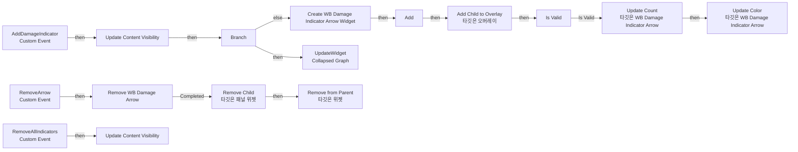
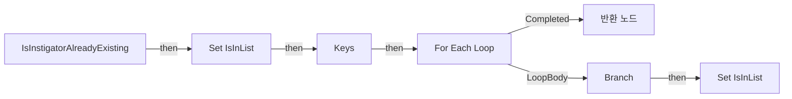

# WB_DamageIndicator_Base

에셋: `/Game/CompShooterHUD/UI/Content/DamageIndicator/WB_DamageIndicator_Base`

부모: `/Script/CoreUObject.Class'/Script/UMG.UserWidget'`

수집일: 2026-10-12. MCP에서 읽은 그래프·핀 연결의 자동 전사입니다. 상속된 그래프는 부모 문서를 함께 확인합니다.

정적 루트 참조 도달: 있음. 실행 여부 또는 삭제 가능 여부의 확정이 아닙니다.

컴포넌트 목록은 이 BP가 직접 정의한 SCS만 포함합니다. 부모·네이티브 생성 컴포넌트, 인스턴스 설정은 별도입니다.

## 변수와 기본값

| 이름 | 타입 | CDO 기본값 |
|---|---|---|
| `AllArrows` | `Actor` | {} |

## 그래프 목록

| 그래프 | 전체 노드 수 |
|---|---|
| EventGraph | 40 |
| IsInstigatorAlreadyExisting | 11 |

## 그래프별 실행 연결

실선은 출력 exec 핀의 실제 연결입니다. 여러 분기는 출력 핀 이름을 표시합니다. 함수 호출·delegate·타이머의 다음 그래프 실행은 이 그림에서 자동으로 이어 붙이지 않습니다.

순수 계산 노드 및 데이터 핀은 아래 목록과 원본 JSON을 확인합니다. 연결되지 않은 이벤트도 표시되므로, 노드가 있다는 이유만으로 실행된다고 판단하면 안 됩니다.

### EventGraph

실행 핀 플로우차트

전체 노드·기본 입력 목록

| 노드 ID | 제목 | 미연결 기본 입력 / 에셋 입력 |
|---|---|---|
| `K2Node_VariableGet_77` | Get OV_Content |  |
| `K2Node_CallFunction_0` | Add Child to Overlay 타깃은 오버레이 |  |
| `K2Node_CreateWidget_0` | Create WB Damage Indicator Arrow Widget | Class=/Game/CompShooterHUD/UI/Content/DamageIndicator/WB_DamageIndicatorArrow.WB_DamageIndicatorArrow_C |
| `K2Node_CustomEvent_0` | AddDamageIndicator Custom Event |  |
| `K2Node_MacroInstance_0` | Is Valid |  |
| `K2Node_VariableGet_39` | Get AllArrows |  |
| `K2Node_CustomEvent_9` | RemoveArrow Custom Event |  |
| `K2Node_MacroInstance_644` | Remove WB Damage Arrow |  |
| `K2Node_VariableGet_415` | Get OV_Content |  |
| `K2Node_CallFunction_326` | Remove Child 타깃은 패널 위젯 | ReturnValue=false |
| `EdGraphNode_Comment_26` | Event Remove Arrow |  |
| `K2Node_CallFunction_429` | Update Count 타깃은 WB Damage Indicator Arrow |  |
| `K2Node_CallFunction_430` | Update Color 타깃은 WB Damage Indicator Arrow |  |
| `K2Node_Knot_54` | 경유 노드 |  |
| `K2Node_Knot_55` | 경유 노드 |  |
| `K2Node_Knot_56` | 경유 노드 |  |
| `K2Node_Knot_57` | 경유 노드 |  |
| `K2Node_Knot_58` | 경유 노드 |  |
| `K2Node_Knot_59` | 경유 노드 |  |
| `K2Node_Knot_60` | 경유 노드 |  |
| `K2Node_Knot_61` | 경유 노드 |  |
| `K2Node_Knot_62` | 경유 노드 |  |
| `K2Node_Knot_63` | 경유 노드 |  |
| `EdGraphNode_Comment_27` | Event Add Damage Feedback |  |
| `K2Node_Knot_69` | 경유 노드 |  |
| `K2Node_Knot_70` | 경유 노드 |  |
| `K2Node_Knot_71` | 경유 노드 |  |
| `K2Node_CallFunction_904` | Is Instigator Already Existing |  |
| `K2Node_IfThenElse_152` | Branch |  |
| `K2Node_Composite_15` | UpdateWidget Collapsed Graph |  |
| `K2Node_CustomEvent_160` | RemoveAllIndicators Custom Event |  |
| `K2Node_MacroInstance_299` | Update Content Visibility | bVisible=true |
| `K2Node_MacroInstance_1710` | Update Content Visibility |  |
| `EdGraphNode_Comment_59` | Event Remove All Feedback |  |
| `K2Node_Knot_110` | 경유 노드 |  |
| `K2Node_Knot_111` | 경유 노드 |  |
| `K2Node_Knot_112` | 경유 노드 |  |
| `K2Node_CallFunction_106` | Remove from Parent 타깃은 위젯 |  |
| `K2Node_Knot_102` | 경유 노드 |  |
| `K2Node_CallFunction_54` | Add |  |

### IsInstigatorAlreadyExisting

실행 핀 플로우차트

전체 노드·기본 입력 목록

| 노드 ID | 제목 | 미연결 기본 입력 / 에셋 입력 |
|---|---|---|
| `K2Node_FunctionEntry_268` | IsInstigatorAlreadyExisting |  |
| `K2Node_VariableGet_39` | Get AllArrows |  |
| `K2Node_FunctionResult_0` | 반환 노드 |  |
| `K2Node_CallFunction_995` | Equal (Object) |  |
| `K2Node_IfThenElse_137` | Branch |  |
| `K2Node_VariableSet_0` | Set IsInList | IsInList=true; Output_Get=false |
| `K2Node_VariableGet_777` | Get IsInList |  |
| `K2Node_Knot_78` | 경유 노드 |  |
| `K2Node_VariableSet_463` | Set IsInList | IsInList=false; Output_Get=false |
| `K2Node_CallFunction_190` | Keys |  |
| `K2Node_MacroInstance_34` | For Each Loop |  |

## 조회 범위의 한계

ObjectIterator로 발견했으나 MCP helper가 반환하지 않은 그래프입니다. delegate signature·컴파일된 중간 그래프·macro·애니메이션 내부 그래프가 섞일 수 있습니다.

- `AddDamageIndicator`: Graph 'AddDamageIndicator' not found in Blueprint.
- `Remove WB_DamageArrow`: Graph 'Remove WB_DamageArrow' not found in Blueprint.
- `RemoveAllIndicators`: Graph 'RemoveAllIndicators' not found in Blueprint.
- `RemoveArrow`: Graph 'RemoveArrow' not found in Blueprint.
- `UpdateContentVisibility`: Graph 'UpdateContentVisibility' not found in Blueprint.

[원본 MCP 스냅샷](../../../../../Evidence/blueprints-281.json)
