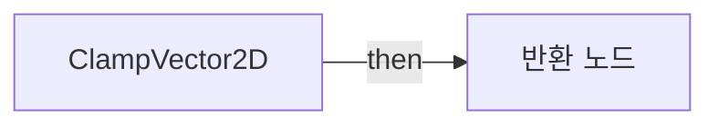
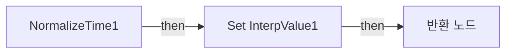
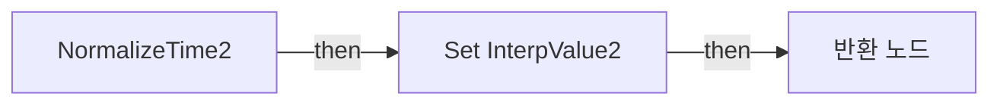

# WB_FX_Damage

에셋: `/Game/CompShooterHUD/UI/Content/Effects/WB_FX_Damage`

부모: `/Script/CoreUObject.Class'/Script/UMG.UserWidget'`

수집일: 2026-10-12. MCP에서 읽은 그래프·핀 연결의 자동 전사입니다. 상속된 그래프는 부모 문서를 함께 확인합니다.

정적 루트 참조 도달: 있음. 실행 여부 또는 삭제 가능 여부의 확정이 아닙니다.

컴포넌트 목록은 이 BP가 직접 정의한 SCS만 포함합니다. 부모·네이티브 생성 컴포넌트, 인스턴스 설정은 별도입니다.

## 변수와 기본값

| 이름 | 타입 | CDO 기본값 |
|---|---|---|
| `DamageColor1` | `LinearColor` | &lt;Struct 'LinearColor' {r: 0.000000, g: 0.000000, b: 0.000000, a: 0.000000}&gt; |
| `DamageColor2` | `LinearColor` | &lt;Struct 'LinearColor' {r: 0.000000, g: 0.000000, b: 0.000000, a: 0.000000}&gt; |
| `bPulsating` | `bool` | False |
| `PulsatingMinMax` | `Vector2D` | &lt;Struct 'Vector2D' {x: 0.000000, y: 0.000000}&gt; |
| `FadeInDuration` | `real` | 0.0 |
| `FadeOutDuration` | `real` | 0.0 |
| `InterpValue1` | `real` | 0.0 |
| `DeltaX` | `real` | 0.0 |
| `bEnabled` | `bool` | False |
| `InterpValue2` | `real` | 0.0 |
| `FadingIn` | `bool` | False |
| `bIsActive` | `bool` | False |

## 그래프 목록

| 그래프 | 전체 노드 수 |
|---|---|
| ClampVector2D | 8 |
| EventGraph | 60 |
| NormalizeTime1 | 16 |
| NormalizeTime2 | 16 |

## 그래프별 실행 연결

실선은 출력 exec 핀의 실제 연결입니다. 여러 분기는 출력 핀 이름을 표시합니다. 함수 호출·delegate·타이머의 다음 그래프 실행은 이 그림에서 자동으로 이어 붙이지 않습니다.

순수 계산 노드 및 데이터 핀은 아래 목록과 원본 JSON을 확인합니다. 연결되지 않은 이벤트도 표시되므로, 노드가 있다는 이유만으로 실행된다고 판단하면 안 됩니다.

### ClampVector2D

실행 핀 플로우차트

전체 노드·기본 입력 목록

| 노드 ID | 제목 | 미연결 기본 입력 / 에셋 입력 |
|---|---|---|
| `K2Node_FunctionEntry_0` | ClampVector2D |  |
| `K2Node_CallFunction_2785` | Make Vector 2D |  |
| `K2Node_CallFunction_7` | Clamp (Float) |  |
| `K2Node_CallFunction_6` | Clamp (Float) |  |
| `K2Node_CallFunction_8` | Break Vector 2D |  |
| `K2Node_Knot_0` | 경유 노드 |  |
| `K2Node_Knot_1` | 경유 노드 |  |
| `K2Node_FunctionResult_0` | 반환 노드 |  |

### EventGraph

```mermaid
flowchart LR
  n0["CreateDamageFX<br/>Custom Event"]
  n1["Set DamageColor1"]
  n2["Set DamageColor2"]
  n3["Set bPulsating"]
  n4["Set PulsatingMinMax"]
  n5["Set FadeInDuration"]
  n6["Set FadeOutDuration"]
  n7["RemoveDamageFX<br/>Custom Event"]
  n8["Tick 이벤트"]
  n9["Set DeltaX"]
  n10["Branch"]
  n11["Set Color and Opacity<br/>타깃은 이미지"]
  n12["Set Color and Opacity<br/>타깃은 이미지"]
  n13["Set bEnabled"]
  n14["Set InterpValue2"]
  n15["Set InterpValue1"]
  n16["Set InterpValue1"]
  n17["Set FadingIn"]
  n18["Branch"]
  n19["Set bEnabled"]
  n20["Set bIsActive"]
  n21["Set Render Opacity<br/>타깃은 위젯"]
  n22["Branch"]
  n23["Delay"]
  n24["Set bEnabled"]
  n25["Set bEnabled"]
  n26["Delay"]
  n27["Reset<br/>Custom Event"]
  n28["Do Once"]
  n29["Reset<br/>타깃은 WB FX Damage"]
  n30["Reset<br/>타깃은 WB FX Damage"]
  n31["Set bIsActive"]
  n32["Branch"]
  n33["Branch"]
  n34["Set bIsActive"]
  n35["Set Render Opacity<br/>타깃은 위젯"]
  n36["경유 노드"]
  n37["경유 노드"]
  n38["HandlePulsationFX<br/>Collapsed Graph"]
  n39["HandleDefaultFX<br/>Collapsed Graph"]
  n0 -->|"then"| n28
  n1 -->|"then"| n2
  n2 -->|"then"| n3
  n3 -->|"then"| n4
  n4 -->|"then"| n5
  n5 -->|"then"| n6
  n6 -->|"then"| n11
  n7 -->|"then"| n32
  n8 -->|"then"| n9
  n9 -->|"then"| n18
  n10 -->|"then"| n38
  n10 -->|"else"| n39
  n11 -->|"then"| n12
  n12 -->|"then"| n21
  n13 -->|"then"| n17
  n14 -->|"then"| n13
  n15 -->|"then"| n14
  n17 -->|"then"| n20
  n18 -->|"then"| n10
  n19 -->|"then"| n16
  n20 -->|"then"| n22
  n21 -->|"then"| n15
  n22 -->|"then"| n29
  n22 -->|"else"| n24
  n23 -->|"then"| n25
  n24 -->|"then"| n23
  n25 -->|"then"| n26
  n26 -->|"then"| n31
  n27 -->|"then"| n28
  n28 -->|"Completed"| n1
  n31 -->|"then"| n30
  n32 -->|"then"| n36
  n32 -->|"else"| n37
  n33 -->|"then"| n34
  n34 -->|"then"| n35
  n36 -->|"OutputPin"| n33
  n37 -->|"OutputPin"| n19
```

실행 핀 플로우차트

전체 노드·기본 입력 목록

| 노드 ID | 제목 | 미연결 기본 입력 / 에셋 입력 |
|---|---|---|
| `K2Node_CustomEvent_0` | CreateDamageFX Custom Event |  |
| `K2Node_VariableSet_0` | Set DamageColor1 |  |
| `K2Node_VariableSet_1` | Set DamageColor2 |  |
| `K2Node_VariableSet_2` | Set bPulsating | Output_Get=false |
| `K2Node_VariableSet_3` | Set PulsatingMinMax |  |
| `K2Node_VariableSet_4` | Set FadeInDuration | Output_Get=0.0 |
| `K2Node_VariableSet_5` | Set FadeOutDuration | Output_Get=0.0 |
| `K2Node_CustomEvent_1` | RemoveDamageFX Custom Event |  |
| `K2Node_Event_3` | Tick 이벤트 |  |
| `K2Node_VariableSet_6` | Set DeltaX | Output_Get=0.0 |
| `K2Node_VariableGet_0` | Get bPulsating |  |
| `K2Node_IfThenElse_0` | Branch |  |
| `K2Node_VariableGet_5` | Get DamageMask1 |  |
| `K2Node_VariableGet_41` | Get DamageMask2 |  |
| `K2Node_CallFunction_6` | Set Color and Opacity 타깃은 이미지 |  |
| `K2Node_CallFunction_5` | Set Color and Opacity 타깃은 이미지 |  |
| `K2Node_VariableGet_7` | Get DamageColor1 |  |
| `K2Node_VariableGet_8` | Get DamageColor2 |  |
| `K2Node_VariableSet_33` | Set bEnabled | bEnabled=true; Output_Get=false |
| `K2Node_VariableSet_13` | Set InterpValue2 | InterpValue2=0.0; Output_Get=0.0 |
| `K2Node_VariableSet_14` | Set InterpValue1 | InterpValue1=0.0; Output_Get=0.0 |
| `K2Node_VariableSet_36` | Set InterpValue1 | InterpValue1=0.0; Output_Get=0.0 |
| `K2Node_VariableSet_15` | Set FadingIn | FadingIn=true; Output_Get=false |
| `K2Node_VariableGet_30` | Get bIsActive |  |
| `K2Node_IfThenElse_12` | Branch |  |
| `K2Node_VariableSet_8` | Set bEnabled | bEnabled=false; Output_Get=false |
| `K2Node_VariableSet_34` | Set bIsActive | bIsActive=true; Output_Get=false |
| `K2Node_VariableGet_22` | Get DamageMask1 |  |
| `K2Node_CallFunction_14` | Set Render Opacity 타깃은 위젯 | InOpacity=0.0 |
| `K2Node_VariableGet_19` | Get DamageMask2 |  |
| `K2Node_VariableGet_34` | Get OV_Content |  |
| `K2Node_VariableGet_35` | Get bPulsating |  |
| `K2Node_IfThenElse_14` | Branch |  |
| `K2Node_VariableGet_37` | Get FadeInDuration |  |
| `K2Node_CallFunction_42` | Delay |  |
| `K2Node_VariableSet_32` | Set bEnabled | bEnabled=true; Output_Get=false |
| `K2Node_VariableSet_30` | Set bEnabled | bEnabled=false; Output_Get=false |
| `K2Node_CallFunction_41` | Delay |  |
| `K2Node_VariableGet_36` | Get FadeOutDuration |  |
| `K2Node_CustomEvent_3` | Reset Custom Event |  |
| `K2Node_MacroInstance_7` | Do Once |  |
| `K2Node_CallFunction_52` | Reset 타깃은 WB FX Damage |  |
| `K2Node_CallFunction_53` | Reset 타깃은 WB FX Damage |  |
| `K2Node_VariableSet_31` | Set bIsActive | bIsActive=false; Output_Get=false |
| `K2Node_IfThenElse_15` | Branch |  |
| `K2Node_VariableGet_51` | Get bIsActive |  |
| `K2Node_IfThenElse_16` | Branch |  |
| `K2Node_VariableSet_37` | Set bIsActive | bIsActive=false; Output_Get=false |
| `K2Node_VariableGet_52` | Get OV_Content |  |
| `K2Node_VariableGet_53` | Get DamageMask1 |  |
| `K2Node_VariableGet_54` | Get DamageMask2 |  |
| `K2Node_CallFunction_54` | Set Render Opacity 타깃은 위젯 | InOpacity=0.0 |
| `K2Node_Knot_6` | 경유 노드 |  |
| `K2Node_Knot_7` | 경유 노드 |  |
| `K2Node_Composite_0` | HandlePulsationFX Collapsed Graph |  |
| `K2Node_Composite_1` | HandleDefaultFX Collapsed Graph |  |
| `EdGraphNode_Comment_0` | Tick |  |
| `EdGraphNode_Comment_1` | Remove Damage FX |  |
| `EdGraphNode_Comment_2` | Create Damage FX |  |
| `K2Node_CallFunction_0` | Clamp Vector 2D | Min=0.0; Max=1.000000 |

### NormalizeTime1

실행 핀 플로우차트

전체 노드·기본 입력 목록

| 노드 ID | 제목 | 미연결 기본 입력 / 에셋 입력 |
|---|---|---|
| `K2Node_FunctionEntry_0` | NormalizeTime1 |  |
| `K2Node_VariableGet_5` | Get DeltaX |  |
| `K2Node_CallFunction_7` | float / float | A=1.000000 |
| `K2Node_Select_35` | 선택 | Option 1=0.010000 |
| `K2Node_Knot_1678` | 경유 노드 |  |
| `K2Node_CallFunction_29146` | float &lt;= float | B=0.0 |
| `K2Node_CommutativeAssociativeBinaryOperator_3` | float * float |  |
| `K2Node_CallFunction_5799` | float &gt; float | B=1.000000 |
| `K2Node_Select_80` | 선택 |  |
| `K2Node_CallFunction_8270` | float / float | A=1.000000 |
| `K2Node_VariableGet_8` | Get InterpValue1 |  |
| `K2Node_CommutativeAssociativeBinaryOperator_4` | float + float |  |
| `K2Node_CallFunction_28047` | float &gt; float | B=1.000000 |
| `K2Node_Select_618` | 선택 | Option 1=1.000000 |
| `K2Node_VariableSet_4` | Set InterpValue1 |  |
| `K2Node_FunctionResult_0` | 반환 노드 |  |

### NormalizeTime2

실행 핀 플로우차트

전체 노드·기본 입력 목록

| 노드 ID | 제목 | 미연결 기본 입력 / 에셋 입력 |
|---|---|---|
| `K2Node_FunctionEntry_0` | NormalizeTime2 |  |
| `K2Node_VariableGet_5` | Get DeltaX |  |
| `K2Node_CallFunction_7` | float / float | A=1.000000 |
| `K2Node_Select_35` | 선택 | Option 1=0.010000 |
| `K2Node_Knot_1678` | 경유 노드 |  |
| `K2Node_CallFunction_29146` | float &lt;= float | B=0.0 |
| `K2Node_CommutativeAssociativeBinaryOperator_3` | float * float |  |
| `K2Node_CallFunction_5799` | float &gt; float | B=1.000000 |
| `K2Node_Select_80` | 선택 |  |
| `K2Node_CallFunction_8270` | float / float | A=1.000000 |
| `K2Node_VariableGet_8` | Get InterpValue2 |  |
| `K2Node_CommutativeAssociativeBinaryOperator_4` | float + float |  |
| `K2Node_CallFunction_28047` | float &gt; float | B=1.000000 |
| `K2Node_Select_618` | 선택 | Option 1=1.000000 |
| `K2Node_VariableSet_4` | Set InterpValue2 |  |
| `K2Node_FunctionResult_0` | 반환 노드 |  |

## 조회 범위의 한계

ObjectIterator로 발견했으나 MCP helper가 반환하지 않은 그래프입니다. delegate signature·컴파일된 중간 그래프·macro·애니메이션 내부 그래프가 섞일 수 있습니다.

- `CreateDamageFX`: Graph 'CreateDamageFX' not found in Blueprint.
- `RemoveDamageFX`: Graph 'RemoveDamageFX' not found in Blueprint.
- `Reset`: Graph 'Reset' not found in Blueprint.
- `Tick`: Graph 'Tick' not found in Blueprint.

[원본 MCP 스냅샷](../../../../../Evidence/blueprints-281.json)
