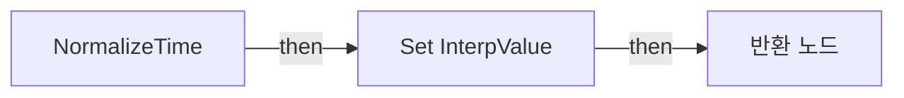

# WB_FX_Highlight

에셋: `/Game/CompShooterHUD/UI/Content/Effects/WB_FX_Highlight`

부모: `/Script/CoreUObject.Class'/Script/UMG.UserWidget'`

수집일: 2026-10-12. MCP에서 읽은 그래프·핀 연결의 자동 전사입니다. 상속된 그래프는 부모 문서를 함께 확인합니다.

정적 루트 참조 도달: 있음. 실행 여부 또는 삭제 가능 여부의 확정이 아닙니다.

컴포넌트 목록은 이 BP가 직접 정의한 SCS만 포함합니다. 부모·네이티브 생성 컴포넌트, 인스턴스 설정은 별도입니다.

## 변수와 기본값

| 이름 | 타입 | CDO 기본값 |
|---|---|---|
| `FadeInDuration` | `real` | 0.0 |
| `FadeOutDuration` | `real` | 0.0 |
| `bEnabled` | `bool` | False |
| `bIsActive` | `bool` | False |
| `DeltaX` | `real` | 0.0 |
| `InterpValue` | `real` | 0.0 |

## 그래프 목록

| 그래프 | 전체 노드 수 |
|---|---|
| EventGraph | 51 |
| NormalizeTime | 16 |

## 그래프별 실행 연결

실선은 출력 exec 핀의 실제 연결입니다. 여러 분기는 출력 핀 이름을 표시합니다. 함수 호출·delegate·타이머의 다음 그래프 실행은 이 그림에서 자동으로 이어 붙이지 않습니다.

순수 계산 노드 및 데이터 핀은 아래 목록과 원본 JSON을 확인합니다. 연결되지 않은 이벤트도 표시되므로, 노드가 있다는 이유만으로 실행된다고 판단하면 안 됩니다.

### EventGraph

```mermaid
flowchart LR
  n0["Set Brush Color<br/>타깃은 보더"]
  n1["CreateHighlightFX<br/>Custom Event"]
  n2["Set Color and Opacity<br/>타깃은 이미지"]
  n3["Set FadeInDuration"]
  n4["Set FadeOutDuration"]
  n5["Set bIsActive"]
  n6["Tick 이벤트"]
  n7["Branch"]
  n8["Do Once"]
  n9["Reset<br/>Custom Event"]
  n10["Delay"]
  n11["Set DeltaX"]
  n12["Normalize Time<br/>타깃은 WB FX Highlight"]
  n13["Set Render Opacity<br/>타깃은 위젯"]
  n14["경유 노드"]
  n15["Normalize Time<br/>타깃은 WB FX Highlight"]
  n16["Set Render Opacity<br/>타깃은 위젯"]
  n17["경유 노드"]
  n18["Set bIsActive"]
  n19["Delay"]
  n20["Reset<br/>타깃은 WB FX Highlight"]
  n21["Set InterpValue"]
  n22["Set InterpValue"]
  n23["RemoveHighlightFX<br/>Custom Event"]
  n24["Branch"]
  n25["Set bEnabled"]
  n26["Set bEnabled"]
  n27["Set bEnabled"]
  n28["Set Render Opacity<br/>타깃은 위젯"]
  n0 -->|"then"| n2
  n1 -->|"then"| n8
  n2 -->|"then"| n21
  n3 -->|"then"| n4
  n4 -->|"then"| n0
  n5 -->|"then"| n10
  n6 -->|"then"| n11
  n7 -->|"then"| n14
  n7 -->|"else"| n17
  n8 -->|"Completed"| n25
  n9 -->|"then"| n8
  n10 -->|"then"| n18
  n11 -->|"then"| n24
  n12 -->|"then"| n13
  n14 -->|"OutputPin"| n12
  n15 -->|"then"| n16
  n17 -->|"OutputPin"| n15
  n18 -->|"then"| n22
  n19 -->|"then"| n20
  n20 -->|"then"| n26
  n21 -->|"then"| n5
  n22 -->|"then"| n19
  n23 -->|"then"| n27
  n24 -->|"then"| n7
  n25 -->|"then"| n3
  n27 -->|"then"| n28
```

실행 핀 플로우차트

전체 노드·기본 입력 목록

| 노드 ID | 제목 | 미연결 기본 입력 / 에셋 입력 |
|---|---|---|
| `K2Node_VariableGet_0` | Get Highlight_Area |  |
| `K2Node_CallFunction_0` | Set Brush Color 타깃은 보더 |  |
| `K2Node_CustomEvent_0` | CreateHighlightFX Custom Event |  |
| `K2Node_VariableGet_1` | Get Highlight_Img |  |
| `K2Node_CallFunction_1` | Set Color and Opacity 타깃은 이미지 |  |
| `K2Node_VariableSet_0` | Set FadeInDuration | Output_Get=0.0 |
| `K2Node_VariableSet_1` | Set FadeOutDuration | Output_Get=0.0 |
| `K2Node_Knot_0` | 경유 노드 |  |
| `K2Node_Knot_1` | 경유 노드 |  |
| `K2Node_Knot_2` | 경유 노드 |  |
| `K2Node_VariableSet_5` | Set bIsActive | bIsActive=true; Output_Get=false |
| `K2Node_Event_4` | Tick 이벤트 |  |
| `K2Node_VariableGet_3` | Get bIsActive |  |
| `K2Node_IfThenElse_0` | Branch |  |
| `K2Node_MacroInstance_0` | Do Once |  |
| `K2Node_CustomEvent_1` | Reset Custom Event |  |
| `K2Node_CallFunction_21` | Delay |  |
| `K2Node_VariableGet_4` | Get FadeInDuration |  |
| `K2Node_VariableSet_3` | Set DeltaX | Output_Get=0.0 |
| `K2Node_VariableGet_11` | Get FadeInDuration |  |
| `K2Node_CallFunction_18` | Normalize Time 타깃은 WB FX Highlight |  |
| `K2Node_CallFunction_19` | Map Range Clamped | InRangeA=0.0; InRangeB=1.000000; OutRangeA=0.0; OutRangeB=1.000000 |
| `K2Node_VariableGet_16` | Get Highlight_Area |  |
| `K2Node_VariableGet_17` | Get Highlight_Img |  |
| `K2Node_CallFunction_26` | Set Render Opacity 타깃은 위젯 |  |
| `K2Node_Knot_4` | 경유 노드 |  |
| `K2Node_VariableGet_6` | Get FadeOutDuration |  |
| `K2Node_CallFunction_15` | Normalize Time 타깃은 WB FX Highlight |  |
| `K2Node_CallFunction_16` | Map Range Clamped | InRangeA=0.0; InRangeB=1.000000; OutRangeA=1.000000; OutRangeB=0.0 |
| `K2Node_VariableGet_9` | Get Highlight_Area |  |
| `K2Node_VariableGet_10` | Get Highlight_Img |  |
| `K2Node_CallFunction_17` | Set Render Opacity 타깃은 위젯 |  |
| `K2Node_Knot_3` | 경유 노드 |  |
| `K2Node_VariableSet_2` | Set bIsActive | bIsActive=false; Output_Get=false |
| `K2Node_CallFunction_3` | Delay |  |
| `K2Node_VariableGet_14` | Get FadeOutDuration |  |
| `K2Node_CallFunction_22` | Reset 타깃은 WB FX Highlight |  |
| `K2Node_VariableSet_7` | Set InterpValue | InterpValue=0.0; Output_Get=0.0 |
| `K2Node_VariableSet_6` | Set InterpValue | InterpValue=0.0; Output_Get=0.0 |
| `K2Node_CustomEvent_2` | RemoveHighlightFX Custom Event |  |
| `K2Node_VariableGet_15` | Get bEnabled |  |
| `K2Node_IfThenElse_1` | Branch |  |
| `K2Node_VariableSet_8` | Set bEnabled | bEnabled=true; Output_Get=false |
| `K2Node_VariableSet_9` | Set bEnabled | bEnabled=false; Output_Get=false |
| `K2Node_VariableSet_10` | Set bEnabled | bEnabled=false; Output_Get=false |
| `K2Node_VariableGet_12` | Get Highlight_Area |  |
| `K2Node_VariableGet_13` | Get Highlight_Img |  |
| `K2Node_CallFunction_20` | Set Render Opacity 타깃은 위젯 | InOpacity=0.0 |
| `EdGraphNode_Comment_4` | Remove Highlight FX |  |
| `EdGraphNode_Comment_5` | Create Highlight FX |  |
| `EdGraphNode_Comment_6` | Calculate Highlight FX |  |

### NormalizeTime

실행 핀 플로우차트

전체 노드·기본 입력 목록

| 노드 ID | 제목 | 미연결 기본 입력 / 에셋 입력 |
|---|---|---|
| `K2Node_FunctionEntry_0` | NormalizeTime |  |
| `K2Node_FunctionResult_0` | 반환 노드 |  |
| `K2Node_VariableGet_5` | Get DeltaX |  |
| `K2Node_CallFunction_7` | float / float | A=1.000000 |
| `K2Node_Select_35` | 선택 | Option 1=0.010000 |
| `K2Node_Knot_1678` | 경유 노드 |  |
| `K2Node_CallFunction_29146` | float &lt;= float | B=0.0 |
| `K2Node_CommutativeAssociativeBinaryOperator_3` | float * float |  |
| `K2Node_CallFunction_5799` | float &gt; float | B=1.000000 |
| `K2Node_Select_80` | 선택 |  |
| `K2Node_CallFunction_8270` | float / float | A=1.000000 |
| `K2Node_VariableGet_8` | Get InterpValue |  |
| `K2Node_CommutativeAssociativeBinaryOperator_4` | float + float |  |
| `K2Node_CallFunction_28047` | float &gt; float | B=1.000000 |
| `K2Node_Select_618` | 선택 | Option 1=1.000000 |
| `K2Node_VariableSet_4` | Set InterpValue |  |

## 조회 범위의 한계

ObjectIterator로 발견했으나 MCP helper가 반환하지 않은 그래프입니다. delegate signature·컴파일된 중간 그래프·macro·애니메이션 내부 그래프가 섞일 수 있습니다.

- `CreateHighlightFX`: Graph 'CreateHighlightFX' not found in Blueprint.
- `RemoveHighlightFX`: Graph 'RemoveHighlightFX' not found in Blueprint.
- `Reset`: Graph 'Reset' not found in Blueprint.
- `Tick`: Graph 'Tick' not found in Blueprint.

[원본 MCP 스냅샷](../../../../../Evidence/blueprints-281.json)
