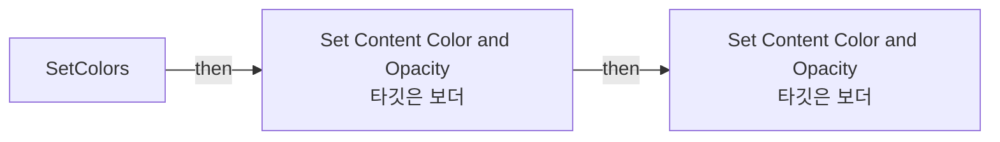

# WB_IconAnim

에셋: `/Game/CompShooterHUD/UI/Content/HealthBar/Animations/WB_IconAnim`

부모: `/Script/CoreUObject.Class'/Script/UMG.UserWidget'`

수집일: 2026-10-12. MCP에서 읽은 그래프·핀 연결의 자동 전사입니다. 상속된 그래프는 부모 문서를 함께 확인합니다.

정적 루트 참조 도달: 있음. 실행 여부 또는 삭제 가능 여부의 확정이 아닙니다.

컴포넌트 목록은 이 BP가 직접 정의한 SCS만 포함합니다. 부모·네이티브 생성 컴포넌트, 인스턴스 설정은 별도입니다.

## 그래프 목록

| 그래프 | 전체 노드 수 |
|---|---|
| EventGraph | 25 |
| SetColors | 8 |

## 그래프별 실행 연결

실선은 출력 exec 핀의 실제 연결입니다. 여러 분기는 출력 핀 이름을 표시합니다. 함수 호출·delegate·타이머의 다음 그래프 실행은 이 그림에서 자동으로 이어 붙이지 않습니다.

순수 계산 노드 및 데이터 핀은 아래 목록과 원본 JSON을 확인합니다. 연결되지 않은 이벤트도 표시되므로, 노드가 있다는 이유만으로 실행된다고 판단하면 안 됩니다.

### EventGraph

```mermaid
flowchart LR
  n0["Set Colors<br/>타깃은 WB Icon Anim"]
  n1["Play Fade Anim"]
  n2["UpdateIconAnim<br/>Custom Event"]
  n3["Set Visibility<br/>타깃은 위젯"]
  n4["Set Visibility<br/>타깃은 위젯"]
  n5["Delay"]
  n6["Get All Widgets Of Class"]
  n7["Remove Icon Anim<br/>타깃은 WB Health Bar"]
  n8["Get All Widgets Of Class"]
  n9["Is Valid"]
  n10["Is Valid"]
  n11["경유 노드"]
  n12["경유 노드"]
  n13["Remove Icon Anim<br/>타깃은 WB Armor Bar"]
  n0 -->|"then"| n1
  n1 -->|"then"| n5
  n2 -->|"then"| n3
  n3 -->|"then"| n0
  n4 -->|"then"| n6
  n5 -->|"then"| n4
  n6 -->|"then"| n10
  n8 -->|"then"| n9
  n9 -->|"Is Valid"| n13
  n10 -->|"Is Valid"| n7
  n10 -->|"Is Not Valid"| n11
  n11 -->|"OutputPin"| n12
  n12 -->|"OutputPin"| n8
```

실행 핀 플로우차트

전체 노드·기본 입력 목록

| 노드 ID | 제목 | 미연결 기본 입력 / 에셋 입력 |
|---|---|---|
| `K2Node_CallFunction_42` | Set Colors 타깃은 WB Icon Anim | ModifyValue=0.5 |
| `K2Node_MacroInstance_398` | Play Fade Anim | PlaybackSpeed=2 |
| `K2Node_CustomEvent_0` | UpdateIconAnim Custom Event |  |
| `K2Node_Knot_120` | 경유 노드 |  |
| `EdGraphNode_Comment_28` | Event Update Icon Anim |  |
| `K2Node_VariableGet_36` | Get OV_Content |  |
| `K2Node_CallFunction_137` | Set Visibility 타깃은 위젯 | InVisibility=HitTestInvisible |
| `K2Node_VariableGet_120` | Get OV_Content |  |
| `K2Node_CallFunction_136` | Set Visibility 타깃은 위젯 | InVisibility=Hidden |
| `K2Node_CallFunction_138` | Delay | Duration=0.5 |
| `K2Node_Knot_121` | 경유 노드 |  |
| `K2Node_CallFunction_40` | Get All Widgets Of Class | WidgetClass=/Game/CompShooterHUD/UI/Content/HealthBar/Content/WB_HealthBar.WB_HealthBar_C; TopLevelOnly=false |
| `K2Node_GetArrayItem_4` | GET | Dimension 1=0 |
| `K2Node_CallFunction_13` | Remove Icon Anim 타깃은 WB Health Bar |  |
| `K2Node_Self_4` | 셀프-레퍼런스 |  |
| `K2Node_CallFunction_12` | Get All Widgets Of Class | WidgetClass=/Game/CompShooterHUD/UI/Content/ArmorBar/Content/WB_ArmorBar.WB_ArmorBar_C; TopLevelOnly=false |
| `K2Node_Self_0` | 셀프-레퍼런스 |  |
| `K2Node_MacroInstance_5` | Is Valid |  |
| `K2Node_MacroInstance_6` | Is Valid |  |
| `K2Node_Knot_4614` | 경유 노드 |  |
| `K2Node_Knot_4615` | 경유 노드 |  |
| `K2Node_Knot_4616` | 경유 노드 |  |
| `K2Node_GetArrayItem_13` | GET | Dimension 1=0 |
| `K2Node_CallFunction_81` | Remove Icon Anim 타깃은 WB Armor Bar |  |
| `K2Node_Knot_4617` | 경유 노드 |  |

### SetColors

실행 핀 플로우차트

전체 노드·기본 입력 목록

| 노드 ID | 제목 | 미연결 기본 입력 / 에셋 입력 |
|---|---|---|
| `K2Node_FunctionEntry_21` | SetColors |  |
| `K2Node_VariableGet_64` | Get b_Color2 |  |
| `K2Node_VariableGet_65` | Get b_Color1 |  |
| `K2Node_MacroInstance_378` | Convert Color |  |
| `K2Node_CallFunction_28` | Set Content Color and Opacity 타깃은 보더 |  |
| `K2Node_CallFunction_27` | Set Content Color and Opacity 타깃은 보더 |  |
| `K2Node_Knot_5` | 경유 노드 |  |
| `K2Node_Knot_118` | 경유 노드 |  |

## 조회 범위의 한계

ObjectIterator로 발견했으나 MCP helper가 반환하지 않은 그래프입니다. delegate signature·컴파일된 중간 그래프·macro·애니메이션 내부 그래프가 섞일 수 있습니다.

- `ConvertColor`: Graph 'ConvertColor' not found in Blueprint.
- `PlayFadeAnim`: Graph 'PlayFadeAnim' not found in Blueprint.
- `UpdateIconAnim`: Graph 'UpdateIconAnim' not found in Blueprint.

[원본 MCP 스냅샷](../../../../../../Evidence/blueprints-316.json)
