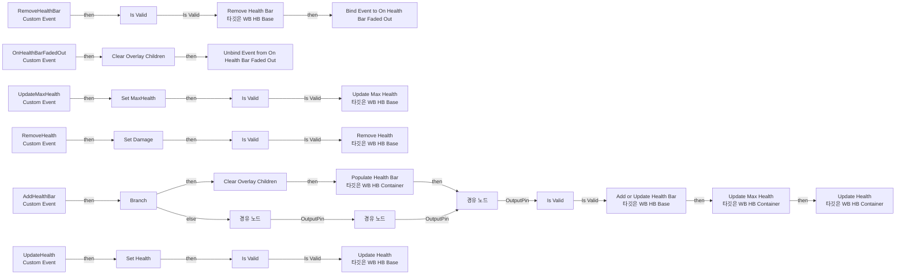
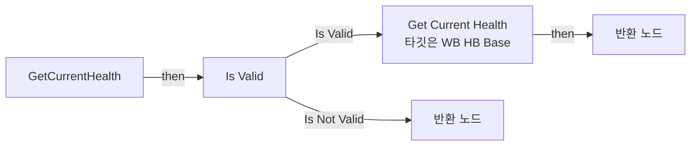
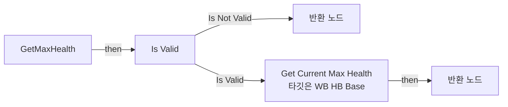
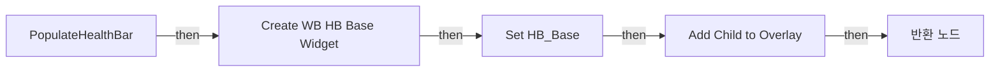

# WB_HB_Container

에셋: `/Game/CompShooterHUD/UI/Content/HealthBar/WB_HB_Container`

부모: `/Script/CoreUObject.Class'/Script/UMG.UserWidget'`

수집일: 2026-10-12. MCP에서 읽은 그래프·핀 연결의 자동 전사입니다. 상속된 그래프는 부모 문서를 함께 확인합니다.

정적 루트 참조 도달: 있음. 실행 여부 또는 삭제 가능 여부의 확정이 아닙니다.

컴포넌트 목록은 이 BP가 직접 정의한 SCS만 포함합니다. 부모·네이티브 생성 컴포넌트, 인스턴스 설정은 별도입니다.

## 변수와 기본값

| 이름 | 타입 | CDO 기본값 |
|---|---|---|
| `HB_Base` | `WB_HB_Base_C` | None |
| `MaxHealth` | `int` | 0 |
| `Health` | `int` | 0 |
| `Damage` | `int` | 0 |

## 그래프 목록

| 그래프 | 전체 노드 수 |
|---|---|
| EventGraph | 57 |
| GetCurrentHealth | 6 |
| GetMaxHealth | 6 |
| PopulateHealthBar | 6 |

## 그래프별 실행 연결

실선은 출력 exec 핀의 실제 연결입니다. 여러 분기는 출력 핀 이름을 표시합니다. 함수 호출·delegate·타이머의 다음 그래프 실행은 이 그림에서 자동으로 이어 붙이지 않습니다.

순수 계산 노드 및 데이터 핀은 아래 목록과 원본 JSON을 확인합니다. 연결되지 않은 이벤트도 표시되므로, 노드가 있다는 이유만으로 실행된다고 판단하면 안 됩니다.

### EventGraph

실행 핀 플로우차트

전체 노드·기본 입력 목록

| 노드 ID | 제목 | 미연결 기본 입력 / 에셋 입력 |
|---|---|---|
| `K2Node_CustomEvent_0` | AddHealthBar Custom Event |  |
| `K2Node_CustomEvent_2` | RemoveHealthBar Custom Event |  |
| `K2Node_MacroInstance_417` | Clear Overlay Children |  |
| `K2Node_MacroInstance_438` | Clear Overlay Children |  |
| `EdGraphNode_Comment_48` | Event Remove HealthBar |  |
| `K2Node_CustomEvent_42` | OnHealthBarFadedOut Custom Event |  |
| `K2Node_VariableGet_43` | Get HB_Base |  |
| `K2Node_MacroInstance_76` | Is Valid |  |
| `K2Node_AddDelegate_0` | Bind Event to On Health Bar Faded Out |  |
| `K2Node_Knot_221` | 경유 노드 |  |
| `K2Node_RemoveDelegate_0` | Unbind Event from On Health Bar Faded Out |  |
| `K2Node_Knot_222` | 경유 노드 |  |
| `K2Node_Knot_223` | 경유 노드 |  |
| `K2Node_CallFunction_240` | Add or Update Health Bar 타깃은 WB HB Base |  |
| `K2Node_CallFunction_268` | Populate Health Bar 타깃은 WB HB Container |  |
| `K2Node_MacroInstance_180` | Is Valid |  |
| `EdGraphNode_Comment_95` | Event Add Health Bar |  |
| `K2Node_VariableGet_148` | Get HB_Base |  |
| `K2Node_MacroInstance_146` | Is Valid |  |
| `K2Node_VariableGet_460` | Get HB_Base |  |
| `K2Node_MacroInstance_135` | Is Valid |  |
| `K2Node_CallFunction_698` | Update Max Health 타깃은 WB HB Base |  |
| `K2Node_CustomEvent_213` | UpdateMaxHealth Custom Event |  |
| `K2Node_CustomEvent_221` | UpdateHealth Custom Event |  |
| `K2Node_Knot_294` | 경유 노드 |  |
| `K2Node_Knot_295` | 경유 노드 |  |
| `K2Node_Knot_296` | 경유 노드 |  |
| `K2Node_Knot_243` | 경유 노드 |  |
| `K2Node_Knot_298` | 경유 노드 |  |
| `K2Node_Knot_299` | 경유 노드 |  |
| `EdGraphNode_Comment_61` | Event Add Health |  |
| `EdGraphNode_Comment_98` | Event Update Max Health |  |
| `K2Node_CallFunction_278` | Remove Health Bar 타깃은 WB HB Base |  |
| `K2Node_Knot_419` | 경유 노드 |  |
| `K2Node_VariableSet_103` | Set MaxHealth |  |
| `K2Node_VariableSet_107` | Set Health |  |
| `K2Node_CallFunction_97` | Update Max Health 타깃은 WB HB Container |  |
| `K2Node_CallFunction_98` | Update Health 타깃은 WB HB Container |  |
| `K2Node_VariableGet_245` | Get Health |  |
| `K2Node_VariableGet_246` | Get MaxHealth |  |
| `K2Node_CustomEvent_53` | RemoveHealth Custom Event |  |
| `EdGraphNode_Comment_97` | Event Remove Health |  |
| `K2Node_VariableSet_359` | Set Damage |  |
| `K2Node_VariableGet_185` | Get HB_Base |  |
| `K2Node_MacroInstance_181` | Is Valid |  |
| `K2Node_Knot_297` | 경유 노드 |  |
| `K2Node_CallFunction_497` | Remove Health 타깃은 WB HB Base |  |
| `K2Node_Knot_646` | 경유 노드 |  |
| `K2Node_Knot_647` | 경유 노드 |  |
| `K2Node_CallFunction_707` | Update Health 타깃은 WB HB Base |  |
| `K2Node_IfThenElse_9` | Branch |  |
| `K2Node_Knot_234` | 경유 노드 |  |
| `K2Node_Knot_235` | 경유 노드 |  |
| `K2Node_Knot_236` | 경유 노드 |  |
| `K2Node_VariableGet_93` | Get HB_Base |  |
| `K2Node_Knot_237` | 경유 노드 |  |
| `K2Node_Composite_52` | OV_Has_No_Children? Collapsed Graph |  |

### GetCurrentHealth

실행 핀 플로우차트

전체 노드·기본 입력 목록

| 노드 ID | 제목 | 미연결 기본 입력 / 에셋 입력 |
|---|---|---|
| `K2Node_FunctionEntry_263` | GetCurrentHealth |  |
| `K2Node_FunctionResult_1` | 반환 노드 |  |
| `K2Node_VariableGet_185` | Get HB_Base |  |
| `K2Node_MacroInstance_181` | Is Valid |  |
| `K2Node_CallFunction_589` | Get Current Health 타깃은 WB HB Base |  |
| `K2Node_FunctionResult_0` | 반환 노드 | CurrentHealth=0 |

### GetMaxHealth

실행 핀 플로우차트

전체 노드·기본 입력 목록

| 노드 ID | 제목 | 미연결 기본 입력 / 에셋 입력 |
|---|---|---|
| `K2Node_FunctionEntry_263` | GetMaxHealth |  |
| `K2Node_FunctionResult_1` | 반환 노드 |  |
| `K2Node_VariableGet_185` | Get HB_Base |  |
| `K2Node_MacroInstance_181` | Is Valid |  |
| `K2Node_FunctionResult_0` | 반환 노드 | CurrentMaxHealth=0 |
| `K2Node_CallFunction_700` | Get Current Max Health 타깃은 WB HB Base |  |

### PopulateHealthBar

실행 핀 플로우차트

전체 노드·기본 입력 목록

| 노드 ID | 제목 | 미연결 기본 입력 / 에셋 입력 |
|---|---|---|
| `K2Node_FunctionEntry_193` | PopulateHealthBar |  |
| `K2Node_CallFunction_0` | Get Owning Player 타깃은 위젯 |  |
| `K2Node_CreateWidget_0` | Create WB HB Base Widget | Class=/Game/CompShooterHUD/UI/Content/HealthBar/WB_HB_Base.WB_HB_Base_C |
| `K2Node_MacroInstance_348` | Add Child to Overlay |  |
| `K2Node_VariableSet_30` | Set HB_Base |  |
| `K2Node_FunctionResult_1` | 반환 노드 |  |

## 조회 범위의 한계

ObjectIterator로 발견했으나 MCP helper가 반환하지 않은 그래프입니다. delegate signature·컴파일된 중간 그래프·macro·애니메이션 내부 그래프가 섞일 수 있습니다.

- `AddChildToOverlay`: Graph 'AddChildToOverlay' not found in Blueprint.
- `AddHealthBar`: Graph 'AddHealthBar' not found in Blueprint.
- `ClearOverlayChildren`: Graph 'ClearOverlayChildren' not found in Blueprint.
- `OnHealthBarFadedOut`: Graph 'OnHealthBarFadedOut' not found in Blueprint.
- `RemoveHealth`: Graph 'RemoveHealth' not found in Blueprint.
- `RemoveHealthBar`: Graph 'RemoveHealthBar' not found in Blueprint.
- `UpdateHealth`: Graph 'UpdateHealth' not found in Blueprint.
- `UpdateMaxHealth`: Graph 'UpdateMaxHealth' not found in Blueprint.

[원본 MCP 스냅샷](../../../../../Evidence/blueprints-316.json)
