# WB_Hitpoint_Box

에셋: `/Game/CompShooterHUD/UI/Content/HitPoints/WB_Hitpoint_Box`

부모: `/Script/CoreUObject.Class'/Script/UMG.UserWidget'`

수집일: 2026-10-12. MCP에서 읽은 그래프·핀 연결의 자동 전사입니다. 상속된 그래프는 부모 문서를 함께 확인합니다.

정적 루트 참조 도달: 있음. 실행 여부 또는 삭제 가능 여부의 확정이 아닙니다.

컴포넌트 목록은 이 BP가 직접 정의한 SCS만 포함합니다. 부모·네이티브 생성 컴포넌트, 인스턴스 설정은 별도입니다.

## 변수와 기본값

| 이름 | 타입 | CDO 기본값 |
|---|---|---|
| `Geometry` | `Geometry` | &lt;Struct 'Geometry' {}&gt; |
| `Parent` | `WB_Hitpoint_Container_C` | None |
| `WorldMarkerScreenLimitation` | `real` | 10.0 |
| `IconSizeLocal` | `Vector2D` | &lt;Struct 'Vector2D' {x: 0.000000, y: 0.000000}&gt; |
| `SmoothVisibilityDivider` | `real` | 1.5 |
| `PositionInterpSpeed` | `real` | 500.0 |
| `PositionY_SwitchTolerance` | `real` | 30.0 |
| `bIsVisible` | `bool` | False |
| `DesktopResolution` | `Vector2D` | &lt;Struct 'Vector2D' {x: 0.000000, y: 0.000000}&gt; |
| `InterpValue` | `real` | 0.0 |
| `TargetLocation` | `Vector` | &lt;Struct 'Vector' {x: 0.000000, y: 0.000000, z: 0.000000}&gt; |
| `InColor` | `LinearColor` | &lt;Struct 'LinearColor' {r: 0.000000, g: 0.000000, b: 0.000000, a: 0.000000}&gt; |
| `InText` | `text` |  |
| `SpecialHitPoint` | `bool` | False |
| `HitPoint` | `OverlaySlot` | None |

## 그래프 목록

| 그래프 | 전체 노드 수 |
|---|---|
| Anim_Fade | 4 |
| B Is Rendered | 5 |
| ClampToScreenLimitation | 16 |
| ConvertScreenPositionToTranslation | 22 |
| EventGraph | 31 |
| FindLookAtRotation2D | 9 |
| FindStartUnfacingScreenTranslation | 14 |
| FindUnfacedScreenTranslation | 40 |
| GetDesktopResolution | 7 |
| GetForwardVector2D | 5 |
| GetLocalSize | 4 |
| GetMarkerLocation | 3 |
| GetMarkerScreenTranslation | 14 |
| GetMaxTranslation | 7 |
| GetMinTranslation | 4 |
| GetResolutionViewportAspectRatio | 6 |
| GetTranslation | 4 |
| GetUnrotatedYaw | 23 |
| IsCameraFacingToObject | 9 |
| IsMarkerNearlyScreenCenter | 12 |
| IsMarkerOnEdges | 11 |
| IsMarkerOnEdgesAspectRatio | 15 |
| IsMarkerOnLowerScreenHalf | 12 |
| IsProjecting | 5 |

## 그래프별 실행 연결

실선은 출력 exec 핀의 실제 연결입니다. 여러 분기는 출력 핀 이름을 표시합니다. 함수 호출·delegate·타이머의 다음 그래프 실행은 이 그림에서 자동으로 이어 붙이지 않습니다.

순수 계산 노드 및 데이터 핀은 아래 목록과 원본 JSON을 확인합니다. 연결되지 않은 이벤트도 표시되므로, 노드가 있다는 이유만으로 실행된다고 판단하면 안 됩니다.

### Anim_Fade

<details>
<summary>실행 핀 플로우차트</summary>

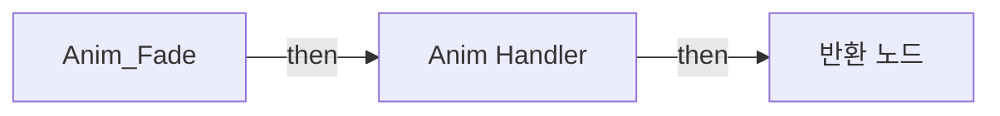

</details>

<details>
<summary>전체 노드·기본 입력 목록</summary>

| 노드 ID | 제목 | 미연결 기본 입력 / 에셋 입력 |
|---|---|---|
| `K2Node_FunctionEntry_0` | Anim_Fade |  |
| `K2Node_VariableGet_7` | Get Fade |  |
| `K2Node_MacroInstance_0` | Anim Handler |  |
| `K2Node_FunctionResult_1` | 반환 노드 |  |

</details>

### B Is Rendered

<details>
<summary>실행 핀 플로우차트</summary>

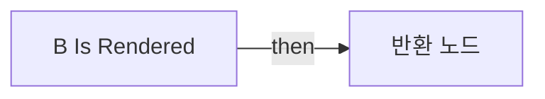

</details>

<details>
<summary>전체 노드·기본 입력 목록</summary>

| 노드 ID | 제목 | 미연결 기본 입력 / 에셋 입력 |
|---|---|---|
| `K2Node_FunctionEntry_0` | B Is Rendered |  |
| `K2Node_FunctionResult_0` | 반환 노드 |  |
| `K2Node_Self_1` | 셀프-레퍼런스 |  |
| `K2Node_CallFunction_31` | Get Render Opacity<br/>타깃은 위젯 |  |
| `K2Node_CallFunction_0` | Not Equal (Float) | B=0.0 |

</details>

### ClampToScreenLimitation

<details>
<summary>실행 핀 플로우차트</summary>

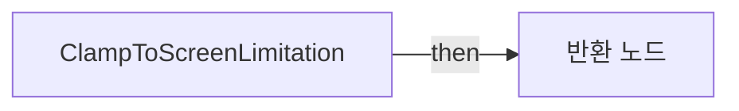

</details>

<details>
<summary>전체 노드·기본 입력 목록</summary>

| 노드 ID | 제목 | 미연결 기본 입력 / 에셋 입력 |
|---|---|---|
| `K2Node_FunctionEntry_0` | ClampToScreenLimitation |  |
| `K2Node_FunctionResult_0` | 반환 노드 |  |
| `K2Node_CallFunction_97` | Clamp (Float) |  |
| `K2Node_CallFunction_94` | Clamp (Float) |  |
| `K2Node_CallFunction_2` | float - float |  |
| `K2Node_CallFunction_1` | float - float |  |
| `K2Node_Knot_2` | 경유 노드 |  |
| `K2Node_Knot_3` | 경유 노드 |  |
| `K2Node_Knot_4` | 경유 노드 |  |
| `K2Node_Knot_9` | 경유 노드 |  |
| `K2Node_CallFunction_3` | Break Vector 2D |  |
| `K2Node_CallFunction_4` | Make Vector 2D |  |
| `K2Node_VariableGet_3` | Get Geometry |  |
| `K2Node_CallFunction_142` | Get Local Size |  |
| `K2Node_CallFunction_0` | vector2d - vector2d |  |
| `K2Node_VariableGet_0` | Get IconSizeLocal |  |

</details>

### ConvertScreenPositionToTranslation

<details>
<summary>실행 핀 플로우차트</summary>

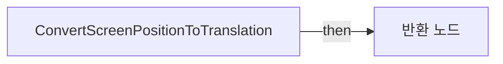

</details>

<details>
<summary>전체 노드·기본 입력 목록</summary>

| 노드 ID | 제목 | 미연결 기본 입력 / 에셋 입력 |
|---|---|---|
| `K2Node_FunctionEntry_0` | ConvertScreenPositionToTranslation |  |
| `K2Node_FunctionResult_0` | 반환 노드 |  |
| `K2Node_CallFunction_84` | Transform Vector Local to Absolute |  |
| `K2Node_CallFunction_93` | Break Vector 2D |  |
| `K2Node_CallFunction_97` | Clamp (Float) |  |
| `K2Node_CallFunction_94` | Clamp (Float) |  |
| `K2Node_CallFunction_98` | Make Vector 2D |  |
| `K2Node_VariableGet_0` | Get Geometry |  |
| `K2Node_CallFunction_3` | Get Local Size |  |
| `K2Node_CallFunction_73` | vector2d - vector2d |  |
| `K2Node_Knot_0` | 경유 노드 |  |
| `K2Node_Knot_1` | 경유 노드 |  |
| `K2Node_CallFunction_2` | float - float |  |
| `K2Node_CallFunction_1` | float - float |  |
| `K2Node_Knot_2` | 경유 노드 |  |
| `K2Node_Knot_3` | 경유 노드 |  |
| `K2Node_Knot_4` | 경유 노드 |  |
| `K2Node_Knot_5` | 경유 노드 |  |
| `K2Node_Knot_6` | 경유 노드 |  |
| `K2Node_Knot_7` | 경유 노드 |  |
| `K2Node_Knot_8` | 경유 노드 |  |
| `K2Node_Knot_9` | 경유 노드 |  |

</details>

### EventGraph

<details>
<summary>실행 핀 플로우차트</summary>

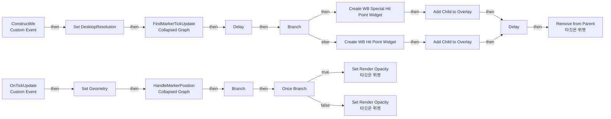

</details>

<details>
<summary>전체 노드·기본 입력 목록</summary>

| 노드 ID | 제목 | 미연결 기본 입력 / 에셋 입력 |
|---|---|---|
| `K2Node_VariableSet_0` | Set Geometry |  |
| `K2Node_CustomEvent_0` | ConstructMe<br/>Custom Event |  |
| `K2Node_CustomEvent_1` | OnTickUpdate<br/>Custom Event |  |
| `EdGraphNode_Comment_8` | Construct |  |
| `EdGraphNode_Comment_1` | On Tick Update |  |
| `K2Node_VariableGet_21` | Get PositionInterpSpeed |  |
| `K2Node_VariableGet_12` | Get PositionY_SwitchTolerance |  |
| `K2Node_Composite_3` | HandleMarkerPosition<br/>Collapsed Graph | Y_Switch_Start_Tolerance=5.000000 |
| `K2Node_CallFunction_0` | Get Desktop Resolution |  |
| `K2Node_VariableSet_1` | Set DesktopResolution |  |
| `K2Node_Composite_0` | FindMarkerTickUpdate<br/>Collapsed Graph |  |
| `K2Node_VariableGet_5` | Get SpecialHitPoint |  |
| `K2Node_IfThenElse_0` | Branch |  |
| `K2Node_CreateWidget_1` | Create WB Hit Point Widget | Class=/Game/CompShooterHUD/UI/Content/HitPoints/WB_HitPoint.WB_HitPoint_C |
| `K2Node_Composite_2` | CollapseGraph<br/>Collapsed Graph |  |
| `K2Node_CallFunction_18` | Add Child to Overlay | InVerticalAlignment=VAlign_Fill; InHorizontalAlignment=HAlign_Fill |
| `K2Node_CallFunction_19` | Delay | Duration=1.100000 |
| `K2Node_CallFunction_20` | Remove from Parent<br/>타깃은 위젯 |  |
| `K2Node_CallFunction_6` | Delay | Duration=0.110000 |
| `K2Node_CallFunction_4` | Is Projecting |  |
| `K2Node_VariableGet_13` | Get OV_Content |  |
| `K2Node_CallFunction_13` | Get Child At<br/>타깃은 패널 위젯 | Index=0 |
| `K2Node_CallFunction_15` | Set Render Opacity<br/>타깃은 위젯 | InOpacity=1.000000 |
| `K2Node_CallFunction_14` | Set Render Opacity<br/>타깃은 위젯 | InOpacity=0.0 |
| `K2Node_MacroInstance_0` | Once Branch |  |
| `K2Node_VariableGet_9` | Get OV_Content |  |
| `K2Node_CallFunction_17` | Has Any Children<br/>타깃은 패널 위젯 |  |
| `K2Node_IfThenElse_3` | Branch |  |
| `K2Node_CreateWidget_0` | Create WB Special Hit Point Widget | Class=/Game/CompShooterHUD/UI/Content/HitPoints/WB_SpecialHitPoint.WB_SpecialHitPoint_C |
| `K2Node_VariableGet_10` | Get OV_Content |  |
| `K2Node_CallFunction_5` | Add Child to Overlay | InVerticalAlignment=VAlign_Fill; InHorizontalAlignment=HAlign_Fill |

</details>

### FindLookAtRotation2D

<details>
<summary>실행 핀 플로우차트</summary>

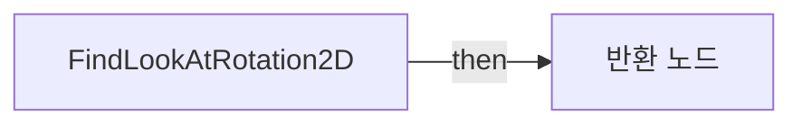

</details>

<details>
<summary>전체 노드·기본 입력 목록</summary>

| 노드 ID | 제목 | 미연결 기본 입력 / 에셋 입력 |
|---|---|---|
| `K2Node_FunctionEntry_0` | FindLookAtRotation2D |  |
| `K2Node_CallFunction_18` | Get Player Camera Manager |  |
| `K2Node_CallFunction_10` | Find Look at Rotation |  |
| `K2Node_CallFunction_11` | Get Rotation X Vector |  |
| `K2Node_CallFunction_13` | To Vector2D (Vector) |  |
| `K2Node_CallFunction_15` | Get Marker Location | ReturnValue=0, 0, 0 |
| `K2Node_CallFunction_17` | Get Camera Location<br/>타깃은 플레이어 카메라 매니저 |  |
| `K2Node_FunctionResult_1` | 반환 노드 |  |
| `K2Node_VariableGet_0` | Get TargetLocation |  |

</details>

### FindStartUnfacingScreenTranslation

<details>
<summary>실행 핀 플로우차트</summary>

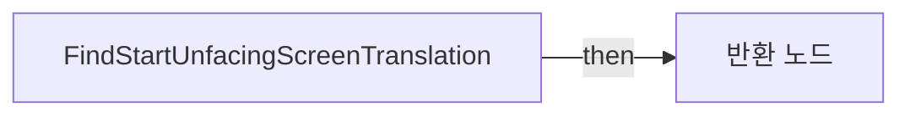

</details>

<details>
<summary>전체 노드·기본 입력 목록</summary>

| 노드 ID | 제목 | 미연결 기본 입력 / 에셋 입력 |
|---|---|---|
| `K2Node_FunctionEntry_0` | FindStartUnfacingScreenTranslation |  |
| `K2Node_FunctionResult_0` | 반환 노드 |  |
| `K2Node_CallFunction_113` | Get Unrotated Yaw | Normalized Z (Yaw)=0.0 |
| `K2Node_Select_7` | 선택 | Option 1=0.0 |
| `K2Node_VariableGet_2` | Get Geometry |  |
| `K2Node_CallFunction_19` | Get Local Size |  |
| `K2Node_CallFunction_88` | vector2d - vector2d | ReturnValue_X=0.0 |
| `K2Node_VariableGet_8` | Get IconSizeLocal |  |
| `K2Node_VariableGet_7` | Get WorldMarkerScreenLimitation |  |
| `K2Node_CallFunction_91` | float - float |  |
| `K2Node_VariableGet_14` | Get RenderTransform |  |
| `K2Node_BreakStruct_0` | Break Widget Transform | Translation_Y=0.0 |
| `K2Node_CallFunction_124` | float &gt; float |  |
| `K2Node_CallFunction_128` | Make Vector 2D |  |

</details>

### FindUnfacedScreenTranslation

<details>
<summary>실행 핀 플로우차트</summary>

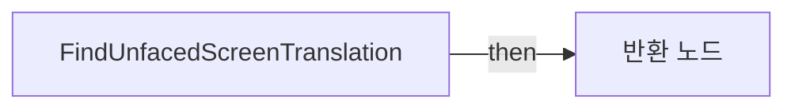

</details>

<details>
<summary>전체 노드·기본 입력 목록</summary>

| 노드 ID | 제목 | 미연결 기본 입력 / 에셋 입력 |
|---|---|---|
| `K2Node_FunctionEntry_0` | FindUnfacedScreenTranslation |  |
| `K2Node_FunctionResult_0` | 반환 노드 |  |
| `K2Node_VariableGet_0` | Get RenderTransform |  |
| `K2Node_BreakStruct_1` | Break Widget Transform | Translation_X=0.0 |
| `K2Node_CallFunction_126` | Get Unrotated Yaw | Normalized Z (Yaw)=0.0 |
| `K2Node_VariableGet_1` | Get Geometry |  |
| `K2Node_CallFunction_0` | Get Local Size |  |
| `K2Node_CallFunction_1` | vector2d - vector2d |  |
| `K2Node_VariableGet_2` | Get IconSizeLocal |  |
| `K2Node_VariableGet_3` | Get WorldMarkerScreenLimitation |  |
| `K2Node_CallFunction_106` | float - float |  |
| `K2Node_CallFunction_105` | Clamp (Float) |  |
| `K2Node_CallFunction_95` | Map Range Clamped | InRangeA=-1.000000; InRangeB=1.000000; OutRangeA=0.0 |
| `K2Node_CallFunction_96` | Make Vector 2D |  |
| `K2Node_Select_3` | 선택 | Option 1=0.0 |
| `K2Node_CallFunction_93` | Clamp (Float) |  |
| `K2Node_CallFunction_119` | float - float |  |
| `K2Node_CallFunction_109` | float &gt; float |  |
| `K2Node_CommutativeAssociativeBinaryOperator_0` | float * float | B=-1.000000 |
| `K2Node_Knot_3` | 경유 노드 |  |
| `K2Node_CallFunction_111` | float &lt; float |  |
| `K2Node_Select_4` | 선택 |  |
| `K2Node_CallFunction_115` | Get Unrotated Yaw | Y (Pitch)=0.0 |
| `K2Node_Knot_4` | 경유 노드 |  |
| `K2Node_Knot_5` | 경유 노드 |  |
| `K2Node_Knot_6` | 경유 노드 |  |
| `K2Node_VariableGet_13` | Get WorldMarkerScreenLimitation |  |
| `K2Node_VariableGet_15` | Get WorldMarkerScreenLimitation |  |
| `K2Node_Knot_7` | 경유 노드 |  |
| `K2Node_Knot_8` | 경유 노드 |  |
| `K2Node_VariableGet_16` | Get WorldMarkerScreenLimitation |  |
| `K2Node_Knot_9` | 경유 노드 |  |
| `K2Node_Knot_10` | 경유 노드 |  |
| `K2Node_Knot_11` | 경유 노드 |  |
| `K2Node_Knot_12` | 경유 노드 |  |
| `K2Node_Knot_13` | 경유 노드 |  |
| `K2Node_Knot_14` | 경유 노드 |  |
| `K2Node_Knot_15` | 경유 노드 |  |
| `K2Node_Knot_20` | 경유 노드 |  |
| `K2Node_Knot_21` | 경유 노드 |  |

</details>

### GetDesktopResolution

<details>
<summary>실행 핀 플로우차트</summary>

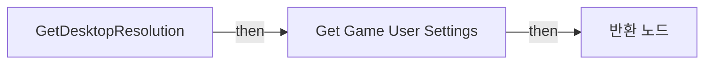

</details>

<details>
<summary>전체 노드·기본 입력 목록</summary>

| 노드 ID | 제목 | 미연결 기본 입력 / 에셋 입력 |
|---|---|---|
| `K2Node_FunctionEntry_0` | GetDesktopResolution |  |
| `K2Node_CallFunction_42` | Get Game User Settings |  |
| `K2Node_CallFunction_43` | Get Desktop Resolution<br/>타깃은 게임 유저 세팅 |  |
| `K2Node_FunctionResult_1` | 반환 노드 |  |
| `K2Node_CallFunction_0` | Make Vector 2D |  |
| `K2Node_CallFunction_4` | To Float (Integer) |  |
| `K2Node_CallFunction_5` | To Float (Integer) |  |

</details>

### GetForwardVector2D

<details>
<summary>실행 핀 플로우차트</summary>

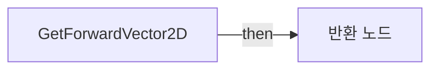

</details>

<details>
<summary>전체 노드·기본 입력 목록</summary>

| 노드 ID | 제목 | 미연결 기본 입력 / 에셋 입력 |
|---|---|---|
| `K2Node_FunctionEntry_0` | GetForwardVector2D |  |
| `K2Node_FunctionResult_0` | 반환 노드 |  |
| `K2Node_CallFunction_3` | Get Actor Forward Vector<br/>타깃은 액터 |  |
| `K2Node_CallFunction_9` | Get Player Camera Manager |  |
| `K2Node_CallFunction_205` | To Vector2D (Vector) |  |

</details>

### GetLocalSize

<details>
<summary>실행 핀 플로우차트</summary>

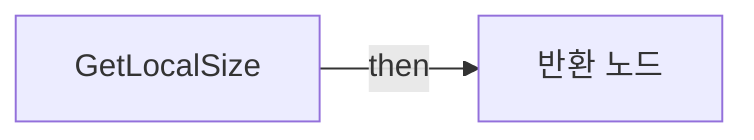

</details>

<details>
<summary>전체 노드·기본 입력 목록</summary>

| 노드 ID | 제목 | 미연결 기본 입력 / 에셋 입력 |
|---|---|---|
| `K2Node_FunctionEntry_0` | GetLocalSize |  |
| `K2Node_FunctionResult_0` | 반환 노드 |  |
| `K2Node_VariableGet_11` | Get Geometry |  |
| `K2Node_CallFunction_117` | Get Local Size |  |

</details>

### GetMarkerLocation

<details>
<summary>실행 핀 플로우차트</summary>

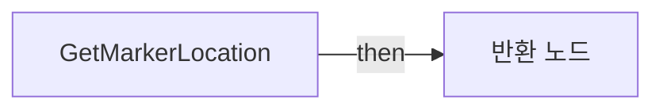

</details>

<details>
<summary>전체 노드·기본 입력 목록</summary>

| 노드 ID | 제목 | 미연결 기본 입력 / 에셋 입력 |
|---|---|---|
| `K2Node_FunctionEntry_0` | GetMarkerLocation |  |
| `K2Node_VariableGet_1` | Get TargetLocation |  |
| `K2Node_FunctionResult_2` | 반환 노드 |  |

</details>

### GetMarkerScreenTranslation

<details>
<summary>실행 핀 플로우차트</summary>

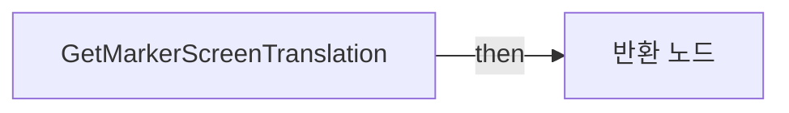

</details>

<details>
<summary>전체 노드·기본 입력 목록</summary>

| 노드 ID | 제목 | 미연결 기본 입력 / 에셋 입력 |
|---|---|---|
| `K2Node_FunctionEntry_0` | GetMarkerScreenTranslation |  |
| `K2Node_FunctionResult_0` | 반환 노드 |  |
| `K2Node_CallFunction_8` | Get Player Controller | PlayerIndex=0 |
| `K2Node_CallFunction_9` | Project World to Screen | bPlayerViewportRelative=false |
| `K2Node_CallFunction_10` | Convert Screen Position to Translation |  |
| `K2Node_CallFunction_11` | Get Marker Location | ReturnValue=0, 0, 0 |
| `K2Node_CallFunction_14` | vector2d / float | B=2.000000 |
| `K2Node_CallFunction_15` | vector2d - vector2d |  |
| `K2Node_Knot_0` | 경유 노드 |  |
| `K2Node_Knot_1` | 경유 노드 |  |
| `K2Node_Knot_5` | 경유 노드 |  |
| `K2Node_Knot_6` | 경유 노드 |  |
| `K2Node_Knot_7` | 경유 노드 |  |
| `K2Node_VariableGet_0` | Get TargetLocation |  |

</details>

### GetMaxTranslation

<details>
<summary>실행 핀 플로우차트</summary>

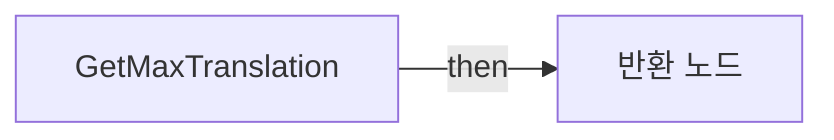

</details>

<details>
<summary>전체 노드·기본 입력 목록</summary>

| 노드 ID | 제목 | 미연결 기본 입력 / 에셋 입력 |
|---|---|---|
| `K2Node_FunctionEntry_0` | GetMaxTranslation |  |
| `K2Node_FunctionResult_0` | 반환 노드 |  |
| `K2Node_CallFunction_118` | vector2d - vector2d |  |
| `K2Node_VariableGet_12` | Get IconSizeLocal |  |
| `K2Node_VariableGet_5` | Get WorldMarkerScreenLimitation |  |
| `K2Node_CallFunction_28` | Get Local Size |  |
| `K2Node_CallFunction_29` | vector2d - float |  |

</details>

### GetMinTranslation

<details>
<summary>실행 핀 플로우차트</summary>

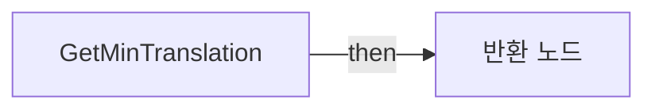

</details>

<details>
<summary>전체 노드·기본 입력 목록</summary>

| 노드 ID | 제목 | 미연결 기본 입력 / 에셋 입력 |
|---|---|---|
| `K2Node_FunctionEntry_0` | GetMinTranslation |  |
| `K2Node_FunctionResult_0` | 반환 노드 |  |
| `K2Node_VariableGet_17` | Get WorldMarkerScreenLimitation |  |
| `K2Node_CallFunction_32` | Make Vector 2D |  |

</details>

### GetResolutionViewportAspectRatio

<details>
<summary>실행 핀 플로우차트</summary>

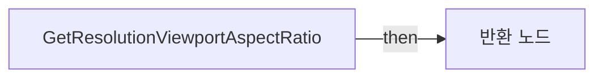

</details>

<details>
<summary>전체 노드·기본 입력 목록</summary>

| 노드 ID | 제목 | 미연결 기본 입력 / 에셋 입력 |
|---|---|---|
| `K2Node_FunctionEntry_0` | GetResolutionViewportAspectRatio |  |
| `K2Node_VariableGet_20` | Get Geometry |  |
| `K2Node_CallFunction_46` | Get Absolute Size |  |
| `K2Node_CallFunction_47` | vector2d / vector2d |  |
| `K2Node_FunctionResult_0` | 반환 노드 |  |
| `K2Node_VariableGet_0` | Get DesktopResolution |  |

</details>

### GetTranslation

<details>
<summary>실행 핀 플로우차트</summary>


</details>

<details>
<summary>전체 노드·기본 입력 목록</summary>

| 노드 ID | 제목 | 미연결 기본 입력 / 에셋 입력 |
|---|---|---|
| `K2Node_FunctionEntry_0` | GetTranslation |  |
| `K2Node_FunctionResult_0` | 반환 노드 |  |
| `K2Node_VariableGet_3` | Get RenderTransform |  |
| `K2Node_BreakStruct_2` | Break Widget Transform |  |

</details>

### GetUnrotatedYaw

<details>
<summary>실행 핀 플로우차트</summary>

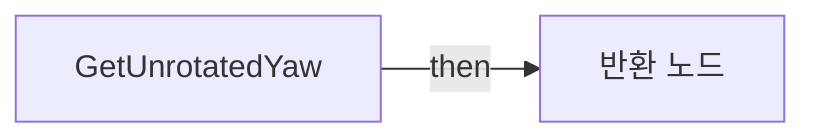

</details>

<details>
<summary>전체 노드·기본 입력 목록</summary>

| 노드 ID | 제목 | 미연결 기본 입력 / 에셋 입력 |
|---|---|---|
| `K2Node_FunctionEntry_0` | GetUnrotatedYaw |  |
| `K2Node_FunctionResult_0` | 반환 노드 |  |
| `K2Node_CallFunction_1` | vector - vector |  |
| `K2Node_CallFunction_2` | Normalize | Tolerance=0.000100 |
| `K2Node_CallFunction_3` | Vector Length |  |
| `K2Node_CallFunction_4` | Unrotate Vector |  |
| `K2Node_CommutativeAssociativeBinaryOperator_0` | vector + vector |  |
| `K2Node_CallFunction_5` | Find Look at Rotation |  |
| `K2Node_CallFunction_6` | vector * float |  |
| `K2Node_CallFunction_7` | Get Marker Location | ReturnValue=0, 0, 0 |
| `K2Node_CallFunction_8` | Get Player Camera Manager | PlayerIndex=0 |
| `K2Node_CallFunction_9` | Get Camera Rotation<br/>타깃은 플레이어 카메라 매니저 |  |
| `K2Node_CallFunction_10` | Get Camera Location<br/>타깃은 플레이어 카메라 매니저 |  |
| `K2Node_CallFunction_11` | Get Camera Location<br/>타깃은 플레이어 카메라 매니저 |  |
| `K2Node_CallFunction_78` | Break Rotator | Roll=0.0 |
| `K2Node_CallFunction_84` | Map Range Clamped | InRangeA=53.000000; InRangeB=180.000000; OutRangeA=1.000000; OutRangeB=0.0 |
| `K2Node_CallFunction_83` | float &lt; float | B=0.0 |
| `K2Node_Select_2` | 선택 |  |
| `K2Node_CallFunction_82` | Map Range Clamped | InRangeA=-180.000000; InRangeB=-53.000000; OutRangeA=0.0; OutRangeB=-1.000000 |
| `K2Node_Knot_3` | 경유 노드 |  |
| `K2Node_Knot_4` | 경유 노드 |  |
| `K2Node_Knot_5` | 경유 노드 |  |
| `K2Node_VariableGet_0` | Get TargetLocation |  |

</details>

### IsCameraFacingToObject

<details>
<summary>실행 핀 플로우차트</summary>

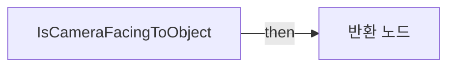

</details>

<details>
<summary>전체 노드·기본 입력 목록</summary>

| 노드 ID | 제목 | 미연결 기본 입력 / 에셋 입력 |
|---|---|---|
| `K2Node_FunctionEntry_0` | IsCameraFacingToObject |  |
| `K2Node_FunctionResult_0` | 반환 노드 |  |
| `K2Node_CallFunction_30` | Find Look at Rotation 2D |  |
| `K2Node_CallFunction_336` | float &gt;= float | B=0.0 |
| `K2Node_CallFunction_308` | float - float | B=0.3 |
| `K2Node_CallFunction_281` | float / float | B=2 |
| `K2Node_CallFunction_207` | Dot Product (2D) |  |
| `K2Node_CallFunction_131` | Get Forward Vector 2D |  |
| `K2Node_Knot_0` | 경유 노드 |  |

</details>

### IsMarkerNearlyScreenCenter

<details>
<summary>실행 핀 플로우차트</summary>

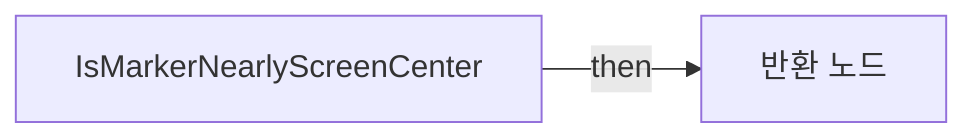

</details>

<details>
<summary>전체 노드·기본 입력 목록</summary>

| 노드 ID | 제목 | 미연결 기본 입력 / 에셋 입력 |
|---|---|---|
| `K2Node_FunctionEntry_0` | IsMarkerNearlyScreenCenter |  |
| `K2Node_FunctionResult_0` | 반환 노드 |  |
| `K2Node_CallFunction_140` | Get Translation |  |
| `K2Node_CallFunction_142` | Get Max Translation |  |
| `K2Node_CallFunction_9` | float / float |  |
| `K2Node_CallFunction_8` | Nearly Equal (Float) |  |
| `K2Node_CallFunction_148` | Nearly Equal (Float) |  |
| `K2Node_CallFunction_13` | float / float | B=2.000000 |
| `K2Node_CallFunction_12` | float / float | B=2.000000 |
| `K2Node_CommutativeAssociativeBinaryOperator_0` | AND Boolean |  |
| `K2Node_CallFunction_14` | float / float |  |
| `K2Node_Select_0` | 선택 |  |

</details>

### IsMarkerOnEdges

<details>
<summary>실행 핀 플로우차트</summary>

```mermaid
flowchart LR
  n0["IsMarkerOnEdges"]
  n1["반환 노드"]
  n0 -->|"then"| n1
```

</details>

<details>
<summary>전체 노드·기본 입력 목록</summary>

| 노드 ID | 제목 | 미연결 기본 입력 / 에셋 입력 |
|---|---|---|
| `K2Node_FunctionEntry_0` | IsMarkerOnEdges |  |
| `K2Node_FunctionResult_0` | 반환 노드 |  |
| `K2Node_CallFunction_140` | Get Translation |  |
| `K2Node_CallFunction_142` | Get Max Translation |  |
| `K2Node_CallFunction_143` | Get Min Translation |  |
| `K2Node_CallFunction_148` | Nearly Equal (Float) |  |
| `K2Node_CallFunction_149` | Nearly Equal (Float) |  |
| `K2Node_CallFunction_147` | Nearly Equal (Float) |  |
| `K2Node_CallFunction_146` | Nearly Equal (Float) |  |
| `K2Node_CommutativeAssociativeBinaryOperator_4` | OR Boolean |  |
| `K2Node_Knot_0` | 경유 노드 |  |

</details>

### IsMarkerOnEdgesAspectRatio

<details>
<summary>실행 핀 플로우차트</summary>

```mermaid
flowchart LR
  n0["IsMarkerOnEdgesAspectRatio"]
  n1["반환 노드"]
  n0 -->|"then"| n1
```

</details>

<details>
<summary>전체 노드·기본 입력 목록</summary>

| 노드 ID | 제목 | 미연결 기본 입력 / 에셋 입력 |
|---|---|---|
| `K2Node_FunctionEntry_0` | IsMarkerOnEdgesAspectRatio |  |
| `K2Node_FunctionResult_0` | 반환 노드 |  |
| `K2Node_CallFunction_140` | Get Translation |  |
| `K2Node_CallFunction_0` | Get Max Translation |  |
| `K2Node_CallFunction_143` | Get Min Translation |  |
| `K2Node_CallFunction_148` | Nearly Equal (Float) |  |
| `K2Node_CallFunction_149` | Nearly Equal (Float) |  |
| `K2Node_CallFunction_147` | Nearly Equal (Float) |  |
| `K2Node_CallFunction_146` | Nearly Equal (Float) |  |
| `K2Node_CommutativeAssociativeBinaryOperator_4` | OR Boolean |  |
| `K2Node_Knot_0` | 경유 노드 |  |
| `K2Node_CallFunction_142` | Get Max Translation |  |
| `K2Node_CallFunction_3` | float / float |  |
| `K2Node_CallFunction_4` | float / float |  |
| `K2Node_CallFunction_2` | float / float |  |

</details>

### IsMarkerOnLowerScreenHalf

<details>
<summary>실행 핀 플로우차트</summary>

```mermaid
flowchart LR
  n0["IsMarkerOnLowerScreenHalf"]
  n1["반환 노드"]
  n0 -->|"then"| n1
```

</details>

<details>
<summary>전체 노드·기본 입력 목록</summary>

| 노드 ID | 제목 | 미연결 기본 입력 / 에셋 입력 |
|---|---|---|
| `K2Node_FunctionEntry_0` | IsMarkerOnLowerScreenHalf |  |
| `K2Node_FunctionResult_0` | 반환 노드 |  |
| `K2Node_CallFunction_1` | Get Translation | Translation_X=0.0 |
| `K2Node_CallFunction_2` | Get Max Translation | ReturnValue_X=0.0 |
| `K2Node_CallFunction_10` | float / float | B=2.000000 |
| `K2Node_CallFunction_11` | float &gt; float |  |
| `K2Node_Select_0` | 선택 |  |
| `K2Node_Knot_0` | 경유 노드 |  |
| `K2Node_Knot_1` | 경유 노드 |  |
| `K2Node_CallFunction_0` | Equal (Float) |  |
| `K2Node_CallFunction_6` | Get Translation | Translation_X=0.0 |
| `K2Node_CallFunction_7` | Get Max Translation | ReturnValue_X=0.0 |

</details>

### IsProjecting

<details>
<summary>실행 핀 플로우차트</summary>

```mermaid
flowchart LR
  n0["IsProjecting"]
  n1["반환 노드"]
  n0 -->|"then"| n1
```

</details>

<details>
<summary>전체 노드·기본 입력 목록</summary>

| 노드 ID | 제목 | 미연결 기본 입력 / 에셋 입력 |
|---|---|---|
| `K2Node_FunctionEntry_0` | IsProjecting |  |
| `K2Node_CallFunction_32` | Project World to Screen | bPlayerViewportRelative=false |
| `K2Node_CallFunction_33` | Get Owning Player<br/>타깃은 위젯 |  |
| `K2Node_CallFunction_34` | Get Marker Location |  |
| `K2Node_FunctionResult_0` | 반환 노드 |  |

</details>

## 조회 범위의 한계

ObjectIterator로 발견했으나 MCP helper가 반환하지 않은 그래프입니다. delegate signature·컴파일된 중간 그래프·macro·애니메이션 내부 그래프가 섞일 수 있습니다.

- `ConstructMe`: Graph 'ConstructMe' not found in Blueprint.
- `OnTickUpdate`: Graph 'OnTickUpdate' not found in Blueprint.

[원본 MCP 스냅샷](../../../../../Evidence/blueprints-281.json)
