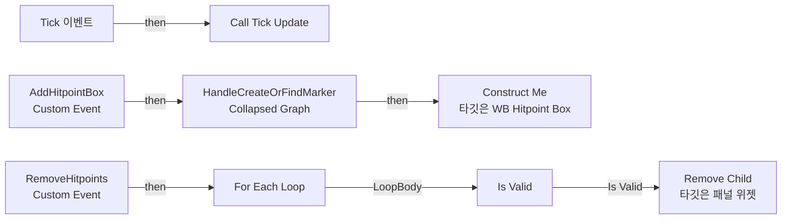
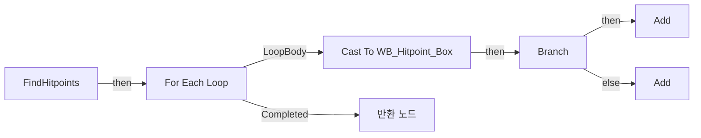

# WB_Hitpoint_Container

에셋: `/Game/CompShooterHUD/UI/Content/HitPoints/WB_Hitpoint_Container`

부모: `/Script/CoreUObject.Class'/Script/UMG.UserWidget'`

수집일: 2026-10-12. MCP에서 읽은 그래프·핀 연결의 자동 전사입니다. 상속된 그래프는 부모 문서를 함께 확인합니다.

정적 루트 참조 도달: 있음. 실행 여부 또는 삭제 가능 여부의 확정이 아닙니다.

컴포넌트 목록은 이 BP가 직접 정의한 SCS만 포함합니다. 부모·네이티브 생성 컴포넌트, 인스턴스 설정은 별도입니다.

## 변수와 기본값

| 이름 | 타입 | CDO 기본값 |
|---|---|---|
| `TickUpdate` | `mcdelegate` | &lt;Delegate 'DelegateBase' &lt;Unbound&gt;&gt; |
| `CurrentHitpointBox` | `WB_Hitpoint_Box_C` | None |

## 그래프 목록

| 그래프 | 전체 노드 수 |
|---|---|
| EventGraph | 14 |
| FindHitpoints | 17 |

## 그래프별 실행 연결

실선은 출력 exec 핀의 실제 연결입니다. 여러 분기는 출력 핀 이름을 표시합니다. 함수 호출·delegate·타이머의 다음 그래프 실행은 이 그림에서 자동으로 이어 붙이지 않습니다.

순수 계산 노드 및 데이터 핀은 아래 목록과 원본 JSON을 확인합니다. 연결되지 않은 이벤트도 표시되므로, 노드가 있다는 이유만으로 실행된다고 판단하면 안 됩니다.

### EventGraph

실행 핀 플로우차트

전체 노드·기본 입력 목록

| 노드 ID | 제목 | 미연결 기본 입력 / 에셋 입력 |
|---|---|---|
| `K2Node_Event_3` | Tick 이벤트 | InDeltaTime=0.0 |
| `K2Node_CustomEvent_0` | AddHitpointBox Custom Event |  |
| `K2Node_CallDelegate_2` | Call Tick Update |  |
| `K2Node_CallFunction_103` | Construct Me 타깃은 WB Hitpoint Box |  |
| `K2Node_Composite_0` | HandleCreateOrFindMarker Collapsed Graph |  |
| `EdGraphNode_Comment_2` | Add Or Update World Marker |  |
| `EdGraphNode_Comment_9` | Tick |  |
| `EdGraphNode_Comment_0` | Remove All World Markers |  |
| `K2Node_CustomEvent_2` | RemoveHitpoints Custom Event |  |
| `K2Node_VariableGet_1` | Get OV_Content |  |
| `K2Node_CallFunction_2` | Find Hitpoints |  |
| `K2Node_CallFunction_3` | Remove Child 타깃은 패널 위젯 | ReturnValue=false |
| `K2Node_MacroInstance_1` | For Each Loop |  |
| `K2Node_MacroInstance_2` | Is Valid |  |

### FindHitpoints

실행 핀 플로우차트

전체 노드·기본 입력 목록

| 노드 ID | 제목 | 미연결 기본 입력 / 에셋 입력 |
|---|---|---|
| `K2Node_FunctionEntry_0` | FindHitpoints |  |
| `K2Node_VariableGet_0` | Get OV_Content |  |
| `K2Node_CallFunction_1` | Get All Children 타깃은 패널 위젯 |  |
| `K2Node_MacroInstance_0` | For Each Loop |  |
| `K2Node_DynamicCast_0` | Cast To WB_Hitpoint_Box |  |
| `K2Node_VariableGet_2` | Get SpecialHitPoint |  |
| `K2Node_PromotableOperator_0` | Equal (Boolean) | B=true |
| `K2Node_IfThenElse_0` | Branch |  |
| `K2Node_VariableGet_1` | Get IsSpecialHitpoint |  |
| `K2Node_VariableGet_3` | Get Samuel_L_Jackson |  |
| `K2Node_CallArrayFunction_0` | Add | ReturnValue=0 |
| `K2Node_VariableGet_4` | Get Samuel_R_Jackson |  |
| `K2Node_CallArrayFunction_1` | Add | ReturnValue=0 |
| `K2Node_VariableGet_5` | Get Samuel_L_Jackson |  |
| `K2Node_Select_0` | 선택 |  |
| `K2Node_VariableGet_6` | Get Samuel_R_Jackson |  |
| `K2Node_FunctionResult_1` | 반환 노드 |  |

## 조회 범위의 한계

ObjectIterator로 발견했으나 MCP helper가 반환하지 않은 그래프입니다. delegate signature·컴파일된 중간 그래프·macro·애니메이션 내부 그래프가 섞일 수 있습니다.

- `AddHitpointBox`: Graph 'AddHitpointBox' not found in Blueprint.
- `RemoveHitpoints`: Graph 'RemoveHitpoints' not found in Blueprint.
- `Tick`: Graph 'Tick' not found in Blueprint.
- `TickUpdate`: Graph 'TickUpdate' not found in Blueprint.

[원본 MCP 스냅샷](../../../../../Evidence/blueprints-281.json)
