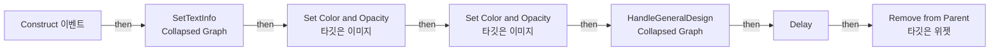
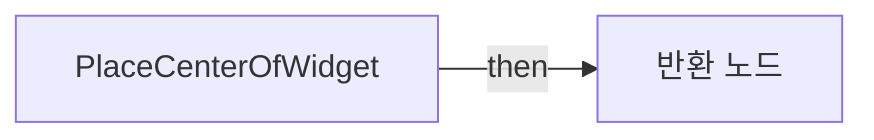

# WB_SpecialHitPoint

에셋: `/Game/CompShooterHUD/UI/Content/HitPoints/WB_SpecialHitPoint`

부모: `/Script/CoreUObject.Class'/Script/UMG.UserWidget'`

수집일: 2026-10-12. MCP에서 읽은 그래프·핀 연결의 자동 전사입니다. 상속된 그래프는 부모 문서를 함께 확인합니다.

정적 루트 참조 도달: 있음. 실행 여부 또는 삭제 가능 여부의 확정이 아닙니다.

컴포넌트 목록은 이 BP가 직접 정의한 SCS만 포함합니다. 부모·네이티브 생성 컴포넌트, 인스턴스 설정은 별도입니다.

## 변수와 기본값

| 이름 | 타입 | CDO 기본값 |
|---|---|---|
| `TargetLocation` | `Vector` | &lt;Struct 'Vector' {x: 0.000000, y: 0.000000, z: 0.000000}&gt; |
| `TextColor` | `SlateColor` | &lt;Struct 'SlateColor' {specified_color: {r: 1.000000, g: 0.000000, b: 1.000000, a: 1.000000}, color_use_rule: UseColor_Specified}&gt; |
| `Text` | `text` |  |

## 그래프 목록

| 그래프 | 전체 노드 수 |
|---|---|
| EventGraph | 15 |
| FindViewportMultiplier | 8 |
| PlaceCenterOfWidget | 10 |

## 그래프별 실행 연결

실선은 출력 exec 핀의 실제 연결입니다. 여러 분기는 출력 핀 이름을 표시합니다. 함수 호출·delegate·타이머의 다음 그래프 실행은 이 그림에서 자동으로 이어 붙이지 않습니다.

순수 계산 노드 및 데이터 핀은 아래 목록과 원본 JSON을 확인합니다. 연결되지 않은 이벤트도 표시되므로, 노드가 있다는 이유만으로 실행된다고 판단하면 안 됩니다.

### EventGraph

실행 핀 플로우차트

전체 노드·기본 입력 목록

| 노드 ID | 제목 | 미연결 기본 입력 / 에셋 입력 |
|---|---|---|
| `K2Node_Event_3` | Construct 이벤트 |  |
| `K2Node_CallFunction_2` | Delay | Duration=1 |
| `K2Node_CallFunction_3` | Remove from Parent 타깃은 위젯 |  |
| `K2Node_Composite_14` | HandleGeneralDesign Collapsed Graph |  |
| `K2Node_VariableGet_1335` | Get TextColor |  |
| `K2Node_VariableGet_937` | Get Text |  |
| `K2Node_Composite_15` | SetTextInfo Collapsed Graph |  |
| `EdGraphNode_Comment_118` | Event Construct |  |
| `K2Node_VariableGet_928` | Get |  |
| `K2Node_VariableGet_583` | Get Img_Soften |  |
| `K2Node_CallFunction_2846` | Set Color and Opacity 타깃은 이미지 |  |
| `K2Node_CommutativeAssociativeBinaryOperator_365` | float * float | B=0.5 |
| `K2Node_VariableGet_35` | Get Img_Particle |  |
| `K2Node_CallFunction_212` | Set Color and Opacity 타깃은 이미지 |  |
| `K2Node_VariableGet_67` | Get |  |

### FindViewportMultiplier

실행 핀 플로우차트

전체 노드·기본 입력 목록

| 노드 ID | 제목 | 미연결 기본 입력 / 에셋 입력 |
|---|---|---|
| `K2Node_FunctionEntry_0` | FindViewportMultiplier |  |
| `K2Node_CallFunction_140` | Get Viewport Size | ReturnValue_Y=0.0 |
| `K2Node_CallFunction_142` | float / float | B=2 |
| `K2Node_CallFunction_238` | float &gt; float | B=1000 |
| `K2Node_Select_9` | 선택 | Option 0=0.7 |
| `K2Node_CallFunction_214` | float &gt; float | B=2000 |
| `K2Node_Select_11` | 선택 | Option 0=0.5; Option 1=0.25 |
| `K2Node_FunctionResult_0` | 반환 노드 |  |

### PlaceCenterOfWidget

실행 핀 플로우차트

전체 노드·기본 입력 목록

| 노드 ID | 제목 | 미연결 기본 입력 / 에셋 입력 |
|---|---|---|
| `K2Node_FunctionEntry_304` | PlaceCenterOfWidget |  |
| `K2Node_FunctionResult_0` | 반환 노드 |  |
| `K2Node_CallFunction_841` | Break Vector 2D |  |
| `K2Node_CallFunction_842` | Make Vector 2D |  |
| `K2Node_CallFunction_844` | float - float |  |
| `K2Node_CallFunction_843` | float - float |  |
| `K2Node_CallFunction_2705` | vector2d / float | B=2 |
| `K2Node_CommutativeAssociativeBinaryOperator_8` | float * float |  |
| `K2Node_Knot_103` | 경유 노드 |  |
| `K2Node_CallFunction_373` | Find Viewport Multiplier |  |

## 조회 범위의 한계

ObjectIterator로 발견했으나 MCP helper가 반환하지 않은 그래프입니다. delegate signature·컴파일된 중간 그래프·macro·애니메이션 내부 그래프가 섞일 수 있습니다.

- `Construct`: Graph 'Construct' not found in Blueprint.
- `ConvertColors`: Graph 'ConvertColors' not found in Blueprint.
- `GetFontMaterial`: Graph 'GetFontMaterial' not found in Blueprint.
- `SetMaterialColor`: Graph 'SetMaterialColor' not found in Blueprint.

[원본 MCP 스냅샷](../../../../../Evidence/blueprints-281.json)
