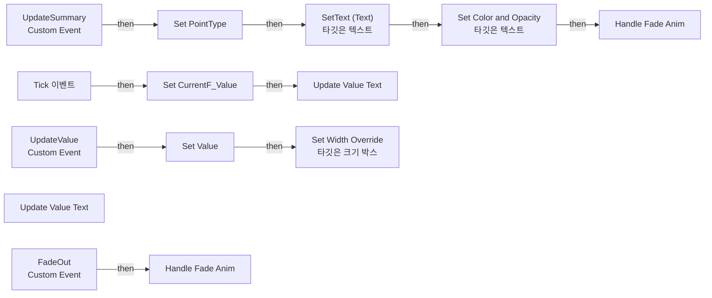

# WB_Summary

에셋: `/Game/CompShooterHUD/UI/Content/IntermediatePoints/Content/WB_Summary`

부모: `/Script/CoreUObject.Class'/Script/UMG.UserWidget'`

수집일: 2026-10-12. MCP에서 읽은 그래프·핀 연결의 자동 전사입니다. 상속된 그래프는 부모 문서를 함께 확인합니다.

정적 루트 참조 도달: 있음. 실행 여부 또는 삭제 가능 여부의 확정이 아닙니다.

컴포넌트 목록은 이 BP가 직접 정의한 SCS만 포함합니다. 부모·네이티브 생성 컴포넌트, 인스턴스 설정은 별도입니다.

## 변수와 기본값

| 이름 | 타입 | CDO 기본값 |
|---|---|---|
| `PointType` | `E_PointTypes` | &lt;E_PointTypes.NONE: 0&gt; |
| `Value` | `int` | 0 |
| `CurrentF_Value` | `real` | 0.0 |

## 그래프 목록

| 그래프 | 전체 노드 수 |
|---|---|
| EventGraph | 27 |

## 그래프별 실행 연결

실선은 출력 exec 핀의 실제 연결입니다. 여러 분기는 출력 핀 이름을 표시합니다. 함수 호출·delegate·타이머의 다음 그래프 실행은 이 그림에서 자동으로 이어 붙이지 않습니다.

순수 계산 노드 및 데이터 핀은 아래 목록과 원본 JSON을 확인합니다. 연결되지 않은 이벤트도 표시되므로, 노드가 있다는 이유만으로 실행된다고 판단하면 안 됩니다.

### EventGraph

실행 핀 플로우차트

전체 노드·기본 입력 목록

| 노드 ID | 제목 | 미연결 기본 입력 / 에셋 입력 |
|---|---|---|
| `K2Node_CustomEvent_0` | UpdateSummary Custom Event |  |
| `K2Node_VariableGet_0` | Get ValueText |  |
| `K2Node_CallFunction_4` | Set Color and Opacity 타깃은 텍스트 | InColorAndOpacity_ColorUseRule=UseColor_Specified |
| `K2Node_VariableGet_1` | Get SummaryText |  |
| `K2Node_CallFunction_5` | SetText (Text) 타깃은 텍스트 |  |
| `K2Node_VariableGet_2005` | Get SummaryText |  |
| `K2Node_CustomEvent_12` | UpdateValue Custom Event |  |
| `EdGraphNode_Comment_321` | Event Update Value |  |
| `K2Node_MacroInstance_234` | Handle Fade Anim | bFadeIn=true |
| `K2Node_VariableSet_853` | Set PointType | Output_Get=NewEnumerator0 |
| `K2Node_VariableSet_909` | Set Value | Output_Get=0 |
| `K2Node_VariableGet_2321` | Get Value |  |
| `K2Node_CommutativeAssociativeBinaryOperator_4` | int + int |  |
| `K2Node_Event_3` | Tick 이벤트 |  |
| `K2Node_MacroInstance_26` | Update Value Text |  |
| `K2Node_MacroInstance_4831` | Update Value Text |  |
| `K2Node_CallFunction_505` | Round |  |
| `K2Node_VariableSet_926` | Set CurrentF_Value |  |
| `K2Node_VariableGet_2356` | Get SB_Value |  |
| `K2Node_CallFunction_690` | Set Width Override 타깃은 크기 박스 |  |
| `K2Node_Composite_1032` | FindWidth Collapsed Graph |  |
| `K2Node_Composite_1034` | FinterpCurrentValue Collapsed Graph |  |
| `EdGraphNode_Comment_352` | Event Tick |  |
| `EdGraphNode_Comment_353` | UpdateSummary |  |
| `K2Node_CustomEvent_241` | FadeOut Custom Event |  |
| `K2Node_MacroInstance_3989` | Handle Fade Anim |  |
| `EdGraphNode_Comment_354` | Event Fade Out |  |

## 조회 범위의 한계

ObjectIterator로 발견했으나 MCP helper가 반환하지 않은 그래프입니다. delegate signature·컴파일된 중간 그래프·macro·애니메이션 내부 그래프가 섞일 수 있습니다.

- `FadeOut`: Graph 'FadeOut' not found in Blueprint.
- `HandleFadeAnim`: Graph 'HandleFadeAnim' not found in Blueprint.
- `Tick`: Graph 'Tick' not found in Blueprint.
- `UpdateSummary`: Graph 'UpdateSummary' not found in Blueprint.
- `UpdateValue`: Graph 'UpdateValue' not found in Blueprint.
- `UpdateValueText`: Graph 'UpdateValueText' not found in Blueprint.

[원본 MCP 스냅샷](../../../../../../Evidence/blueprints-281.json)
