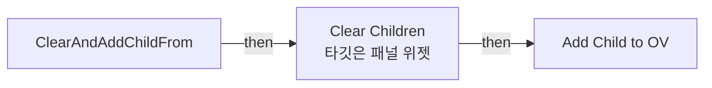
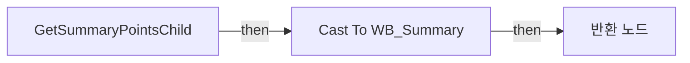
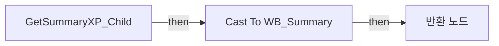
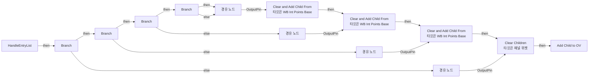

# WB_IntPoints_Base

에셋: `/Game/CompShooterHUD/UI/Content/IntermediatePoints/WB_IntPoints_Base`

부모: `/Script/CoreUObject.Class'/Script/UMG.UserWidget'`

수집일: 2026-10-12. MCP에서 읽은 그래프·핀 연결의 자동 전사입니다. 상속된 그래프는 부모 문서를 함께 확인합니다.

정적 루트 참조 도달: 있음. 실행 여부 또는 삭제 가능 여부의 확정이 아닙니다.

컴포넌트 목록은 이 BP가 직접 정의한 SCS만 포함합니다. 부모·네이티브 생성 컴포넌트, 인스턴스 설정은 별도입니다.

## 변수와 기본값

| 이름 | 타입 | CDO 기본값 |
|---|---|---|
| `PointInfo` | `S_IntPoints` | &lt;Struct 'S_IntPoints' {}&gt; |

## 그래프 목록

| 그래프 | 전체 노드 수 |
|---|---|
| ClearAndAddChildFrom | 5 |
| EventGraph | 66 |
| GetSummaryPointsChild | 5 |
| GetSummaryXP_Child | 5 |
| HandleEntryList | 31 |

## 그래프별 실행 연결

실선은 출력 exec 핀의 실제 연결입니다. 여러 분기는 출력 핀 이름을 표시합니다. 함수 호출·delegate·타이머의 다음 그래프 실행은 이 그림에서 자동으로 이어 붙이지 않습니다.

순수 계산 노드 및 데이터 핀은 아래 목록과 원본 JSON을 확인합니다. 연결되지 않은 이벤트도 표시되므로, 노드가 있다는 이유만으로 실행된다고 판단하면 안 됩니다.

### ClearAndAddChildFrom

실행 핀 플로우차트

전체 노드·기본 입력 목록

| 노드 ID | 제목 | 미연결 기본 입력 / 에셋 입력 |
|---|---|---|
| `K2Node_FunctionEntry_155` | ClearAndAddChildFrom |  |
| `K2Node_CallFunction_258` | Clear Children 타깃은 패널 위젯 |  |
| `K2Node_CallFunction_259` | Get Child At 타깃은 패널 위젯 | Index=0 |
| `K2Node_MacroInstance_3513` | Add Child to OV |  |
| `K2Node_Knot_1452` | 경유 노드 |  |

### EventGraph

```mermaid
flowchart LR
  n0["AddPoint<br/>Custom Event"]
  n1["Is Valid"]
  n2["Update Entry<br/>타깃은 WB Entry"]
  n3["Handle Entry List<br/>타깃은 WB Int Points Base"]
  n4["경유 노드"]
  n5["Remove from Parent<br/>타깃은 위젯"]
  n6["Create Widget"]
  n7["Create Widget"]
  n8["Do Once"]
  n9["Set PointInfo"]
  n10["Cast To WB_Entry"]
  n11["Cast To WB_Summary"]
  n12["Update Summary<br/>타깃은 WB Summary"]
  n13["Update Summary<br/>타깃은 WB Summary"]
  n14["Set Timer by Event"]
  n15["UpdateSummary<br/>Custom Event"]
  n16["Clear Children<br/>타깃은 패널 위젯"]
  n17["Branch"]
  n18["Switch on E_PointTypes"]
  n19["Create Widget"]
  n20["Do Once"]
  n21["Cast To WB_Summary"]
  n22["시퀀스"]
  n23["Clear Children<br/>타깃은 패널 위젯"]
  n24["Clear Children<br/>타깃은 패널 위젯"]
  n25["Update Points Value"]
  n26["Update XPs Value"]
  n27["Update Points Value"]
  n28["Update XPs Value"]
  n29["Add Child to Summary"]
  n30["Add Child to Summary"]
  n31["Do Once"]
  n32["Update Fade Out"]
  n33["Delay"]
  n34["경유 노드"]
  n35["경유 노드"]
  n36["RemoveIntermediatePoints<br/>Custom Event"]
  n37["Clear Children<br/>타깃은 패널 위젯"]
  n0 -->|"then"| n9
  n1 -->|"Is Valid"| n2
  n1 -->|"Is Not Valid"| n5
  n2 -->|"then"| n4
  n3 -->|"then"| n1
  n4 -->|"OutputPin"| n17
  n5 -->|"then"| n4
  n6 -->|"then"| n10
  n7 -->|"then"| n11
  n8 -->|"Completed"| n7
  n9 -->|"then"| n6
  n10 -->|"then"| n3
  n11 -->|"then"| n24
  n12 -->|"then"| n28
  n13 -->|"then"| n27
  n14 -->|"then"| n18
  n15 -->|"then"| n31
  n16 -->|"then"| n22
  n17 -->|"then"| n14
  n18 -->|"NewEnumerator1"| n25
  n18 -->|"NewEnumerator2"| n26
  n19 -->|"then"| n21
  n20 -->|"Completed"| n19
  n21 -->|"then"| n23
  n22 -->|"then_0"| n20
  n22 -->|"then_1"| n8
  n22 -->|"then_2"| n35
  n23 -->|"then"| n29
  n24 -->|"then"| n30
  n25 -->|"then"| n20
  n26 -->|"then"| n8
  n29 -->|"then"| n13
  n30 -->|"then"| n12
  n31 -->|"Completed"| n32
  n32 -->|"then"| n33
  n33 -->|"then"| n16
  n34 -->|"OutputPin"| n31
  n35 -->|"OutputPin"| n34
  n36 -->|"then"| n37
```

실행 핀 플로우차트

전체 노드·기본 입력 목록

| 노드 ID | 제목 | 미연결 기본 입력 / 에셋 입력 |
|---|---|---|
| `K2Node_CustomEvent_0` | AddPoint Custom Event |  |
| `K2Node_MacroInstance_3` | Is Valid |  |
| `K2Node_Knot_1373` | 경유 노드 |  |
| `K2Node_Knot_1374` | 경유 노드 |  |
| `K2Node_Knot_1375` | 경유 노드 |  |
| `K2Node_CallFunction_48` | Update Entry 타깃은 WB Entry |  |
| `K2Node_Knot_1394` | 경유 노드 |  |
| `K2Node_Knot_1395` | 경유 노드 |  |
| `K2Node_Knot_1396` | 경유 노드 |  |
| `K2Node_CallFunction_823` | Handle Entry List 타깃은 WB Int Points Base |  |
| `K2Node_Knot_518` | 경유 노드 |  |
| `K2Node_CallFunction_940` | Remove from Parent 타깃은 위젯 |  |
| `K2Node_MacroInstance_194` | Create Widget | Class=/Game/CompShooterHUD/UI/Content/IntermediatePoints/Content/WB_Entry.WB_Entry_C |
| `K2Node_MacroInstance_417` | Create Widget | Class=/Game/CompShooterHUD/UI/Content/IntermediatePoints/Content/WB_Summary.WB_Summary_C |
| `K2Node_MacroInstance_418` | Do Once |  |
| `K2Node_VariableGet_727` | Get OV_SumPoints |  |
| `K2Node_VariableGet_642` | Get OV_SumXP |  |
| `K2Node_VariableSet_703` | Set PointInfo |  |
| `K2Node_DynamicCast_0` | Cast To WB_Entry |  |
| `K2Node_DynamicCast_55` | Cast To WB_Summary |  |
| `K2Node_CallFunction_1179` | Update Summary 타깃은 WB Summary | PointType=NewEnumerator2 |
| `K2Node_CallFunction_1178` | Update Summary 타깃은 WB Summary | PointType=NewEnumerator1 |
| `K2Node_CallFunction_1228` | Set Timer by Event | bLooping=false; bMaxOncePerFrame=false; InitialStartDelay=0.000000; InitialStartDelayVariance=0.000000 |
| `K2Node_CustomEvent_137` | UpdateSummary Custom Event |  |
| `K2Node_CallFunction_1417` | Make Literal Float |  |
| `K2Node_Knot_1612` | 경유 노드 |  |
| `K2Node_VariableGet_2033` | Get OV_SumPoints |  |
| `K2Node_VariableGet_2034` | Get OV_SumXP |  |
| `K2Node_CallFunction_1445` | Clear Children 타깃은 패널 위젯 |  |
| `K2Node_IfThenElse_204` | Branch |  |
| `K2Node_Composite_1029` | IsNotNonePointType Collapsed Graph |  |
| `K2Node_VariableGet_844` | Get |  |
| `K2Node_SwitchEnum_0` | Switch on E_PointTypes |  |
| `K2Node_MacroInstance_4004` | Create Widget | Class=/Game/CompShooterHUD/UI/Content/IntermediatePoints/Content/WB_Summary.WB_Summary_C |
| `K2Node_MacroInstance_201` | Do Once |  |
| `K2Node_DynamicCast_65` | Cast To WB_Summary |  |
| `K2Node_ExecutionSequence_10` | 시퀀스 |  |
| `K2Node_CallFunction_1715` | Clear Children 타깃은 패널 위젯 |  |
| `K2Node_CallFunction_1716` | Clear Children 타깃은 패널 위젯 |  |
| `K2Node_MacroInstance_744` | Update Points Value |  |
| `K2Node_MacroInstance_745` | Update XPs Value |  |
| `K2Node_MacroInstance_4702` | Update Points Value |  |
| `K2Node_MacroInstance_4709` | Update XPs Value |  |
| `K2Node_MacroInstance_830` | Add Child to Summary | PointType=NewEnumerator1 |
| `K2Node_MacroInstance_5233` | Add Child to Summary | PointType=NewEnumerator2 |
| `K2Node_MacroInstance_883` | Do Once |  |
| `K2Node_MacroInstance_5455` | Update Fade Out |  |
| `K2Node_CallFunction_2899` | Delay | Duration=0.2 |
| `K2Node_Knot_1638` | 경유 노드 |  |
| `K2Node_Knot_1639` | 경유 노드 |  |
| `EdGraphNode_Comment_20` | Event Add Point |  |
| `EdGraphNode_Comment_355` | Handle Summaries |  |
| `K2Node_Knot_1658` | 경유 노드 |  |
| `K2Node_Select_11` | 선택 | Option 1=2 |
| `K2Node_CallFunction_3165` | float &lt;= float | B=0.0 |
| `K2Node_Knot_1613` | 경유 노드 |  |
| `K2Node_Knot_1660` | 경유 노드 |  |
| `K2Node_CustomEvent_5` | RemoveIntermediatePoints Custom Event |  |
| `K2Node_VariableGet_171` | Get OV_E1 |  |
| `K2Node_VariableGet_172` | Get OV_E2 |  |
| `K2Node_VariableGet_173` | Get OV_E3 |  |
| `K2Node_VariableGet_174` | Get OV_SumPoints |  |
| `K2Node_VariableGet_175` | Get OV_E4 |  |
| `K2Node_VariableGet_176` | Get OV_SumXP |  |
| `K2Node_CallFunction_122` | Clear Children 타깃은 패널 위젯 |  |
| `EdGraphNode_Comment_62` | Event Remove Intermediate Points |  |

### GetSummaryPointsChild

실행 핀 플로우차트

전체 노드·기본 입력 목록

| 노드 ID | 제목 | 미연결 기본 입력 / 에셋 입력 |
|---|---|---|
| `K2Node_FunctionEntry_494` | GetSummaryPointsChild |  |
| `K2Node_FunctionResult_2` | 반환 노드 |  |
| `K2Node_VariableGet_728` | Get OV_SumPoints |  |
| `K2Node_DynamicCast_66` | Cast To WB_Summary |  |
| `K2Node_CallFunction_1718` | Get Child At 타깃은 패널 위젯 | Index=0 |

### GetSummaryXP_Child

실행 핀 플로우차트

전체 노드·기본 입력 목록

| 노드 ID | 제목 | 미연결 기본 입력 / 에셋 입력 |
|---|---|---|
| `K2Node_FunctionEntry_520` | GetSummaryXP_Child |  |
| `K2Node_FunctionResult_3` | 반환 노드 |  |
| `K2Node_VariableGet_641` | Get OV_SumXP |  |
| `K2Node_DynamicCast_36` | Cast To WB_Summary |  |
| `K2Node_CallFunction_1714` | Get Child At 타깃은 패널 위젯 | Index=0 |

### HandleEntryList

실행 핀 플로우차트

전체 노드·기본 입력 목록

| 노드 ID | 제목 | 미연결 기본 입력 / 에셋 입력 |
|---|---|---|
| `K2Node_FunctionEntry_201` | HandleEntryList |  |
| `K2Node_VariableGet_40` | Get OV_E1 |  |
| `K2Node_VariableGet_41` | Get OV_E2 |  |
| `K2Node_VariableGet_42` | Get OV_E3 |  |
| `K2Node_VariableGet_43` | Get OV_E4 |  |
| `K2Node_CallFunction_255` | Has Any Children 타깃은 패널 위젯 |  |
| `K2Node_IfThenElse_8` | Branch |  |
| `K2Node_CallFunction_256` | Has Any Children 타깃은 패널 위젯 |  |
| `K2Node_IfThenElse_10` | Branch |  |
| `K2Node_CallFunction_257` | Has Any Children 타깃은 패널 위젯 |  |
| `K2Node_IfThenElse_11` | Branch |  |
| `K2Node_CallFunction_254` | Has Any Children 타깃은 패널 위젯 |  |
| `K2Node_IfThenElse_9` | Branch |  |
| `K2Node_VariableGet_124` | Get OV_E4 |  |
| `K2Node_VariableGet_178` | Get OV_E2 |  |
| `K2Node_VariableGet_179` | Get OV_E3 |  |
| `K2Node_VariableGet_122` | Get OV_E1 |  |
| `K2Node_VariableGet_44` | Get OV_E2 |  |
| `K2Node_CallFunction_653` | Clear and Add Child From 타깃은 WB Int Points Base |  |
| `K2Node_CallFunction_640` | Clear and Add Child From 타깃은 WB Int Points Base |  |
| `K2Node_CallFunction_638` | Clear and Add Child From 타깃은 WB Int Points Base |  |
| `K2Node_VariableGet_1926` | Get OV_E3 |  |
| `K2Node_VariableGet_1927` | Get OV_E1 |  |
| `K2Node_MacroInstance_125` | Add Child to OV |  |
| `K2Node_Knot_1471` | 경유 노드 |  |
| `K2Node_CallFunction_707` | Clear Children 타깃은 패널 위젯 |  |
| `K2Node_Knot_1472` | 경유 노드 |  |
| `K2Node_Knot_1473` | 경유 노드 |  |
| `K2Node_Knot_1474` | 경유 노드 |  |
| `K2Node_Knot_1475` | 경유 노드 |  |
| `K2Node_Knot_1476` | 경유 노드 |  |

## 조회 범위의 한계

ObjectIterator로 발견했으나 MCP helper가 반환하지 않은 그래프입니다. delegate signature·컴파일된 중간 그래프·macro·애니메이션 내부 그래프가 섞일 수 있습니다.

- `AddChildToOV`: Graph 'AddChildToOV' not found in Blueprint.
- `AddChildToSummary`: Graph 'AddChildToSummary' not found in Blueprint.
- `AddPoint`: Graph 'AddPoint' not found in Blueprint.
- `CreateWidget`: Graph 'CreateWidget' not found in Blueprint.
- `RemoveIntermediatePoints`: Graph 'RemoveIntermediatePoints' not found in Blueprint.
- `UpdateFadeOut`: Graph 'UpdateFadeOut' not found in Blueprint.
- `UpdatePointsValue`: Graph 'UpdatePointsValue' not found in Blueprint.
- `UpdateSummary`: Graph 'UpdateSummary' not found in Blueprint.
- `UpdateXPsValue`: Graph 'UpdateXPsValue' not found in Blueprint.

[원본 MCP 스냅샷](../../../../../Evidence/blueprints-281.json)
