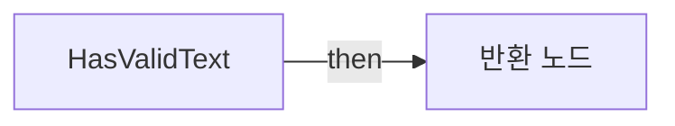

# WB_Message2

에셋: `/Game/CompShooterHUD/UI/Content/Kill_Message/Childs/WB_Message2`

부모: `/Script/CoreUObject.Class'/Script/UMG.UserWidget'`

수집일: 2026-10-12. MCP에서 읽은 그래프·핀 연결의 자동 전사입니다. 상속된 그래프는 부모 문서를 함께 확인합니다.

정적 루트 참조 도달: 있음. 실행 여부 또는 삭제 가능 여부의 확정이 아닙니다.

컴포넌트 목록은 이 BP가 직접 정의한 SCS만 포함합니다. 부모·네이티브 생성 컴포넌트, 인스턴스 설정은 별도입니다.

## 변수와 기본값

| 이름 | 타입 | CDO 기본값 |
|---|---|---|
| `bHasHealth` | `bool` | False |
| `bHasShield` | `bool` | False |
| `bHasArmor` | `bool` | False |

## 그래프 목록

| 그래프 | 전체 노드 수 |
|---|---|
| EventGraph | 28 |
| GetHeadSize | 4 |
| HasValidText | 8 |

## 그래프별 실행 연결

실선은 출력 exec 핀의 실제 연결입니다. 여러 분기는 출력 핀 이름을 표시합니다. 함수 호출·delegate·타이머의 다음 그래프 실행은 이 그림에서 자동으로 이어 붙이지 않습니다.

순수 계산 노드 및 데이터 핀은 아래 목록과 원본 JSON을 확인합니다. 연결되지 않은 이벤트도 표시되므로, 노드가 있다는 이유만으로 실행된다고 판단하면 안 됩니다.

### EventGraph

```mermaid
flowchart LR
  n0["UpdateMessageInfo<br/>Custom Event"]
  n1["Set Head Color and Opacity"]
  n2["Set Child Color and Opacity"]
  n3["Tick 이벤트"]
  n4["Play Fade Anim"]
  n5["Do Once"]
  n6["Delay"]
  n7["Play Fade Anim"]
  n8["Set Texts"]
  n9["경유 노드"]
  n10["경유 노드"]
  n11["UpdateIcon_Text_Visibility<br/>Collapsed Graph"]
  n12["Set Weapon Icon"]
  n13["Remove from Parent<br/>타깃은 위젯"]
  n14["PlayHighlight2Anim<br/>Collapsed Graph"]
  n0 -->|"then"| n5
  n1 -->|"then"| n2
  n2 -->|"then"| n4
  n3 -->|"then"| n11
  n4 -->|"then"| n14
  n5 -->|"Completed"| n8
  n6 -->|"then"| n7
  n7 -->|"then"| n13
  n8 -->|"then"| n12
  n9 -->|"OutputPin"| n10
  n10 -->|"OutputPin"| n5
  n12 -->|"then"| n1
  n13 -->|"then"| n9
  n14 -->|"then"| n6
```

실행 핀 플로우차트

전체 노드·기본 입력 목록

| 노드 ID | 제목 | 미연결 기본 입력 / 에셋 입력 |
|---|---|---|
| `K2Node_CustomEvent_0` | UpdateMessageInfo Custom Event |  |
| `K2Node_MacroInstance_40` | Set Head Color and Opacity |  |
| `K2Node_MacroInstance_949` | Set Child Color and Opacity |  |
| `K2Node_Knot_209` | 경유 노드 |  |
| `K2Node_Event_129` | Tick 이벤트 | InDeltaTime=0.0 |
| `K2Node_MacroInstance_435` | Play Fade Anim | bVisible=true |
| `K2Node_MacroInstance_420` | Do Once |  |
| `K2Node_CallFunction_1690` | Delay |  |
| `K2Node_Knot_499` | 경유 노드 |  |
| `K2Node_Knot_500` | 경유 노드 |  |
| `K2Node_MacroInstance_2712` | Play Fade Anim |  |
| `K2Node_MacroInstance_2948` | Set Texts |  |
| `K2Node_Knot_519` | 경유 노드 |  |
| `K2Node_Knot_520` | 경유 노드 |  |
| `K2Node_Knot_521` | 경유 노드 |  |
| `K2Node_Knot_522` | 경유 노드 |  |
| `K2Node_CallFunction_2205` | float - float | B=0.5 |
| `EdGraphNode_Comment_170` | Event Update Message Info |  |
| `K2Node_Knot_545` | 경유 노드 |  |
| `K2Node_Knot_546` | 경유 노드 |  |
| `K2Node_Composite_75` | UpdateIcon_Text_Visibility Collapsed Graph |  |
| `EdGraphNode_Comment_203` | Event Tick |  |
| `K2Node_MacroInstance_3948` | Set Weapon Icon |  |
| `K2Node_CallFunction_3582` | Remove from Parent 타깃은 위젯 |  |
| `K2Node_Composite_360` | PlayHighlight2Anim Collapsed Graph |  |
| `K2Node_CallFunction_4142` | To Text (Integer) | bAlwaysSign=false; bUseGrouping=true; MinimumIntegralDigits=1; MaximumIntegralDigits=324 |
| `K2Node_CallFunction_4143` | To Text (Integer) | bAlwaysSign=false; bUseGrouping=true; MinimumIntegralDigits=1; MaximumIntegralDigits=324 |
| `K2Node_CallFunction_4144` | To Text (Integer) | bAlwaysSign=false; bUseGrouping=true; MinimumIntegralDigits=1; MaximumIntegralDigits=324 |

### GetHeadSize

실행 핀 플로우차트

전체 노드·기본 입력 목록

| 노드 ID | 제목 | 미연결 기본 입력 / 에셋 입력 |
|---|---|---|
| `K2Node_FunctionEntry_339` | GetHeadSize |  |
| `K2Node_FunctionResult_0` | 반환 노드 |  |
| `K2Node_VariableGet_137` | Get HB_Head |  |
| `K2Node_CallFunction_511` | Get Desired Size 타깃은 위젯 |  |

### HasValidText

실행 핀 플로우차트

전체 노드·기본 입력 목록

| 노드 ID | 제목 | 미연결 기본 입력 / 에셋 입력 |
|---|---|---|
| `K2Node_FunctionEntry_313` | HasValidText |  |
| `K2Node_FunctionResult_0` | 반환 노드 |  |
| `K2Node_CallFunction_1223` | Text Is Empty |  |
| `K2Node_CommutativeAssociativeBinaryOperator_105` | OR Boolean |  |
| `K2Node_Knot_1313` | 경유 노드 |  |
| `K2Node_CallFunction_2226` | Equal Exactly (Text) |  |
| `K2Node_CallFunction_2227` | Make Literal Text |  |
| `K2Node_CallFunction_2610` | NOT Boolean |  |

## 조회 범위의 한계

ObjectIterator로 발견했으나 MCP helper가 반환하지 않은 그래프입니다. delegate signature·컴파일된 중간 그래프·macro·애니메이션 내부 그래프가 섞일 수 있습니다.

- `ConvertColors`: Graph 'ConvertColors' not found in Blueprint.
- `PlayFadeAnim`: Graph 'PlayFadeAnim' not found in Blueprint.
- `PlayHighlightAnim`: Graph 'PlayHighlightAnim' not found in Blueprint.
- `SetBlurSize`: Graph 'SetBlurSize' not found in Blueprint.
- `SetChildColorAndOpacity`: Graph 'SetChildColorAndOpacity' not found in Blueprint.
- `SetHeadColorAndOpacity`: Graph 'SetHeadColorAndOpacity' not found in Blueprint.
- `SetTexts`: Graph 'SetTexts' not found in Blueprint.
- `SetWeaponIcon`: Graph 'SetWeaponIcon' not found in Blueprint.
- `Tick`: Graph 'Tick' not found in Blueprint.
- `UpdateMessageInfo`: Graph 'UpdateMessageInfo' not found in Blueprint.

[원본 MCP 스냅샷](../../../../../../Evidence/blueprints-316.json)
