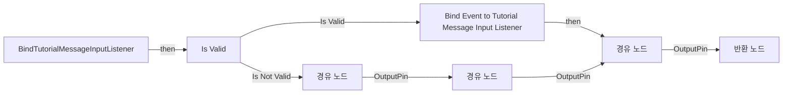
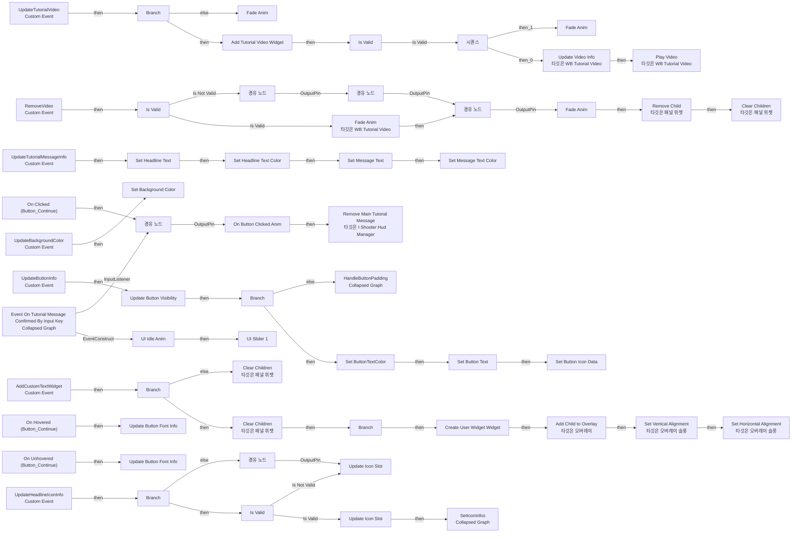
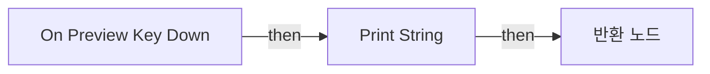

# WB_MainTutorialWindow

에셋: `/Game/CompShooterHUD/UI/Content/MainTutorialMessage/TutorialContent/WB_MainTutorialWindow`

부모: `/Script/CoreUObject.Class'/Script/UMG.UserWidget'`

수집일: 2026-10-12. MCP에서 읽은 그래프·핀 연결의 자동 전사입니다. 상속된 그래프는 부모 문서를 함께 확인합니다.

정적 루트 참조 도달: 있음. 실행 여부 또는 삭제 가능 여부의 확정이 아닙니다.

컴포넌트 목록은 이 BP가 직접 정의한 SCS만 포함합니다. 부모·네이티브 생성 컴포넌트, 인스턴스 설정은 별도입니다.

## 변수와 기본값

| 이름 | 타입 | CDO 기본값 |
|---|---|---|
| `Widget_TutorialVideo` | `WB_TutorialVideo_C` | None |
| `ButtonTextColor` | `LinearColor` | &lt;Struct 'LinearColor' {r: 0.000000, g: 0.000000, b: 0.000000, a: 0.000000}&gt; |

## 그래프 목록

| 그래프 | 전체 노드 수 |
|---|---|
| BindTutorialMessageInputListener | 11 |
| EventGraph | 97 |
| OnPreviewKeyDown | 5 |

## 그래프별 실행 연결

실선은 출력 exec 핀의 실제 연결입니다. 여러 분기는 출력 핀 이름을 표시합니다. 함수 호출·delegate·타이머의 다음 그래프 실행은 이 그림에서 자동으로 이어 붙이지 않습니다.

순수 계산 노드 및 데이터 핀은 아래 목록과 원본 JSON을 확인합니다. 연결되지 않은 이벤트도 표시되므로, 노드가 있다는 이유만으로 실행된다고 판단하면 안 됩니다.

### BindTutorialMessageInputListener

실행 핀 플로우차트

전체 노드·기본 입력 목록

| 노드 ID | 제목 | 미연결 기본 입력 / 에셋 입력 |
|---|---|---|
| `K2Node_FunctionEntry_2321` | BindTutorialMessageInputListener |  |
| `K2Node_CallFunction_5316` | Get Shooter Hud | PlayerIndex=0 |
| `K2Node_MacroInstance_2244` | Is Valid |  |
| `K2Node_AddDelegate_0` | Bind Event to Tutorial Message Input Listener |  |
| `K2Node_Knot_134` | 경유 노드 |  |
| `K2Node_Knot_135` | 경유 노드 |  |
| `K2Node_Knot_3494` | 경유 노드 |  |
| `K2Node_Knot_136` | 경유 노드 |  |
| `K2Node_FunctionResult_0` | 반환 노드 |  |
| `K2Node_Knot_20` | 경유 노드 |  |
| `K2Node_Knot_21` | 경유 노드 |  |

### EventGraph

실행 핀 플로우차트

전체 노드·기본 입력 목록

| 노드 ID | 제목 | 미연결 기본 입력 / 에셋 입력 |
|---|---|---|
| `K2Node_CustomEvent_0` | UpdateTutorialVideo Custom Event |  |
| `K2Node_MacroInstance_75` | Add Tutorial Video Widget |  |
| `K2Node_CustomEvent_3` | RemoveVideo Custom Event |  |
| `K2Node_VariableGet_46` | Get Widget_TutorialVideo |  |
| `K2Node_MacroInstance_11` | Is Valid |  |
| `K2Node_CallFunction_78` | Update Video Info 타깃은 WB Tutorial Video |  |
| `K2Node_Knot_5` | 경유 노드 |  |
| `K2Node_Knot_6` | 경유 노드 |  |
| `K2Node_Knot_7` | 경유 노드 |  |
| `K2Node_Knot_8` | 경유 노드 |  |
| `K2Node_Knot_9` | 경유 노드 |  |
| `K2Node_Knot_10` | 경유 노드 |  |
| `K2Node_Knot_11` | 경유 노드 |  |
| `K2Node_VariableGet_129` | Get Widget_TutorialVideo |  |
| `K2Node_CallFunction_104` | Play Video 타깃은 WB Tutorial Video |  |
| `K2Node_VariableGet_148` | Get Widget_TutorialVideo |  |
| `K2Node_VariableGet_177` | Get OV_TutorialVideo |  |
| `K2Node_CallFunction_134` | Remove Child 타깃은 패널 위젯 | ReturnValue=false |
| `K2Node_Knot_12` | 경유 노드 |  |
| `K2Node_Knot_13` | 경유 노드 |  |
| `EdGraphNode_Comment_5` | Event Update Tutorial Video |  |
| `K2Node_MacroInstance_548` | Fade Anim |  |
| `K2Node_CustomEvent_52` | UpdateHeadlineIconInfo Custom Event |  |
| `K2Node_Composite_0` | SetIconInfos Collapsed Graph |  |
| `K2Node_IfThenElse_55` | Branch |  |
| `EdGraphNode_Comment_2` | Event Update Headline Icon Info |  |
| `K2Node_IfThenElse_82` | Branch |  |
| `K2Node_MacroInstance_453` | Fade Anim | bVisible=true |
| `K2Node_MacroInstance_412` | Fade Anim | bVisible=true |
| `K2Node_CallFunction_1183` | Fade Anim 타깃은 WB Tutorial Video | bVisible=false |
| `K2Node_MacroInstance_469` | Is Valid |  |
| `K2Node_Knot_18` | 경유 노드 |  |
| `K2Node_Knot_19` | 경유 노드 |  |
| `K2Node_Knot_20` | 경유 노드 |  |
| `K2Node_Knot_21` | 경유 노드 |  |
| `K2Node_Knot_22` | 경유 노드 |  |
| `K2Node_Knot_23` | 경유 노드 |  |
| `EdGraphNode_Comment_3` | Event Remove Video |  |
| `K2Node_ExecutionSequence_126` | 시퀀스 |  |
| `K2Node_MacroInstance_987` | Is Valid |  |
| `K2Node_CustomEvent_20` | UpdateTutorialMessageInfo Custom Event |  |
| `K2Node_MacroInstance_140` | Set Headline Text |  |
| `K2Node_MacroInstance_179` | Set Headline Text Color |  |
| `K2Node_Knot_2` | 경유 노드 |  |
| `K2Node_MacroInstance_468` | Set Message Text |  |
| `K2Node_MacroInstance_475` | Set Message Text Color |  |
| `K2Node_Knot_3` | 경유 노드 |  |
| `K2Node_Knot_4` | 경유 노드 |  |
| `EdGraphNode_Comment_1` | Event Update Tutorial Message Info |  |
| `K2Node_MacroInstance_574` | Set Background Color |  |
| `K2Node_CustomEvent_294` | UpdateBackgroundColor Custom Event |  |
| `EdGraphNode_Comment_244` | Event Update BackgroundColor |  |
| `K2Node_CustomEvent_54` | AddCustomTextWidget Custom Event |  |
| `K2Node_CreateWidget_2` | Create User Widget Widget |  |
| `K2Node_VariableGet_192` | Get OV_CustomText |  |
| `K2Node_CallFunction_267` | Add Child to Overlay 타깃은 오버레이 |  |
| `K2Node_CallFunction_268` | Set Vertical Alignment 타깃은 오버레이 슬롯 | InVerticalAlignment=VAlign_Center |
| `K2Node_CallFunction_269` | Set Horizontal Alignment 타깃은 오버레이 슬롯 | InHorizontalAlignment=HAlign_Center |
| `K2Node_VariableGet_66` | Get OV_CustomText |  |
| `K2Node_CallFunction_405` | Clear Children 타깃은 패널 위젯 |  |
| `K2Node_Knot_1` | 경유 노드 |  |
| `K2Node_Knot_334` | 경유 노드 |  |
| `K2Node_IfThenElse_77` | Branch |  |
| `K2Node_CallFunction_303` | Clear Children 타깃은 패널 위젯 |  |
| `EdGraphNode_Comment_109` | Event Add Custom Text Widget |  |
| `K2Node_Knot_458` | 경유 노드 |  |
| `K2Node_CallFunction_460` | Is Valid Class |  |
| `K2Node_IfThenElse_89` | Branch |  |
| `K2Node_ComponentBoundEvent_50` | On Clicked (Button_Continue) |  |
| `K2Node_CustomEvent_446` | UpdateButtonInfo Custom Event |  |
| `K2Node_IfThenElse_429` | Branch |  |
| `K2Node_MacroInstance_902` | Update Button Visibility |  |
| `K2Node_Composite_87` | HandleButtonPadding Collapsed Graph |  |
| `K2Node_MacroInstance_1046` | Set Button Text |  |
| `K2Node_MacroInstance_1117` | Set Button Icon Data |  |
| `K2Node_ComponentBoundEvent_0` | On Hovered (Button_Continue) |  |
| `K2Node_ComponentBoundEvent_1` | On Unhovered (Button_Continue) |  |
| `K2Node_MacroInstance_1665` | Update Button Font Info | In Font Info Font Family=/Game/CompShooterHUD/Fonts/Barlow.Barlow; In Font Info Font=Barlow_ExtraBold |
| `K2Node_MacroInstance_1215` | Update Button Font Info | In Font Info Font Family=/Game/CompShooterHUD/Fonts/Barlow.Barlow; In Font Info Font=Barlow_Medium |
| `EdGraphNode_Comment_831` | On Button Hovered / Unhovered |  |
| `K2Node_CallFunction_4196` | Get Shooter Hud Manager |  |
| `K2Node_CallFunction_4197` | Remove Main Tutorial Message 타깃은 I Shooter Hud Manager |  |
| `EdGraphNode_Comment_4` | On Button Clicked |  |
| `K2Node_VariableSet_577` | Set ButtonTextColor |  |
| `K2Node_VariableGet_2264` | Get ButtonTextColor |  |
| `EdGraphNode_Comment_11` | Event Update Button Info |  |
| `K2Node_Composite_2` | Event On Tutorial Message Confirmed By Input Key Collapsed Graph |  |
| `EdGraphNode_Comment_12` | Event Construct &amp; Input Listener |  |
| `K2Node_Knot_65` | 경유 노드 |  |
| `K2Node_Composite_17` | FindHoveredColor Collapsed Graph |  |
| `K2Node_MacroInstance_272` | On Button Clicked Anim |  |
| `K2Node_MacroInstance_526` | UI Idle Anim |  |
| `K2Node_MacroInstance_756` | UI Slider 1 |  |
| `K2Node_MacroInstance_375` | Update Icon Slot | bVisible=true |
| `K2Node_MacroInstance_327` | Update Icon Slot |  |
| `K2Node_Knot_24` | 경유 노드 |  |
| `K2Node_CallFunction_1395` | Clear Children 타깃은 패널 위젯 |  |

### OnPreviewKeyDown

실행 핀 플로우차트

전체 노드·기본 입력 목록

| 노드 ID | 제목 | 미연결 기본 입력 / 에셋 입력 |
|---|---|---|
| `K2Node_FunctionEntry_0` | On Preview Key Down |  |
| `K2Node_FunctionResult_0` | 반환 노드 |  |
| `K2Node_CallFunction_0` | Get Key |  |
| `K2Node_CallFunction_1` | Print String | InString=Hello; bPrintToScreen=true; bPrintToLog=true; TextColor=(R=0.000000,G=0.660000,B=1.000000,A=1.000000); Duration=2.000000; Key=None |
| `K2Node_CallFunction_2` | Unhandled |  |

## 조회 범위의 한계

ObjectIterator로 발견했으나 MCP helper가 반환하지 않은 그래프입니다. delegate signature·컴파일된 중간 그래프·macro·애니메이션 내부 그래프가 섞일 수 있습니다.

- `AddCustomTextWidget`: Graph 'AddCustomTextWidget' not found in Blueprint.
- `AddTutorialVideoWidget`: Graph 'AddTutorialVideoWidget' not found in Blueprint.
- `BndEvt__Button_Continue_K2Node_ComponentBoundEvent_0_OnButtonHoverEvent__DelegateSignature`: Graph 'BndEvt__Button_Continue_K2Node_ComponentBoundEvent_0_OnButtonHoverEvent__DelegateSignature' not found in Blueprint.
- `BndEvt__Button_Continue_K2Node_ComponentBoundEvent_1_OnButtonHoverEvent__DelegateSignature`: Graph 'BndEvt__Button_Continue_K2Node_ComponentBoundEvent_1_OnButtonHoverEvent__DelegateSignature' not found in Blueprint.
- `BndEvt__Button_Continue_K2Node_ComponentBoundEvent_50_OnButtonClickedEvent__DelegateSignature`: Graph 'BndEvt__Button_Continue_K2Node_ComponentBoundEvent_50_OnButtonClickedEvent__DelegateSignature' not found in Blueprint.
- `Construct`: Graph 'Construct' not found in Blueprint.
- `FadeAnim`: Graph 'FadeAnim' not found in Blueprint.
- `OnButtonClickedAnim`: Graph 'OnButtonClickedAnim' not found in Blueprint.
- `OnTutorialMessageConfirmedByInputKey`: Graph 'OnTutorialMessageConfirmedByInputKey' not found in Blueprint.
- `RemoveVideo`: Graph 'RemoveVideo' not found in Blueprint.
- `SetBackgroundColor`: Graph 'SetBackgroundColor' not found in Blueprint.
- `SetButtonIconData`: Graph 'SetButtonIconData' not found in Blueprint.
- `SetButtonText`: Graph 'SetButtonText' not found in Blueprint.
- `SetHeadlineText`: Graph 'SetHeadlineText' not found in Blueprint.
- `SetHeadlineTextColor`: Graph 'SetHeadlineTextColor' not found in Blueprint.
- `SetMessageText`: Graph 'SetMessageText' not found in Blueprint.
- `SetMessageTextColor`: Graph 'SetMessageTextColor' not found in Blueprint.
- `UI_IdleAnim`: Graph 'UI_IdleAnim' not found in Blueprint.
- `UI_Slider1`: Graph 'UI_Slider1' not found in Blueprint.
- `UpdateBackgroundColor`: Graph 'UpdateBackgroundColor' not found in Blueprint.
- `UpdateButtonFontInfo`: Graph 'UpdateButtonFontInfo' not found in Blueprint.
- `UpdateButtonInfo`: Graph 'UpdateButtonInfo' not found in Blueprint.
- `UpdateButtonVisibility`: Graph 'UpdateButtonVisibility' not found in Blueprint.
- `UpdateHeadlineIconInfo`: Graph 'UpdateHeadlineIconInfo' not found in Blueprint.
- `UpdateIconSlot`: Graph 'UpdateIconSlot' not found in Blueprint.
- `UpdateTutorialMessageInfo`: Graph 'UpdateTutorialMessageInfo' not found in Blueprint.
- `UpdateTutorialVideo`: Graph 'UpdateTutorialVideo' not found in Blueprint.

[원본 MCP 스냅샷](../../../../../../Evidence/blueprints-316.json)
