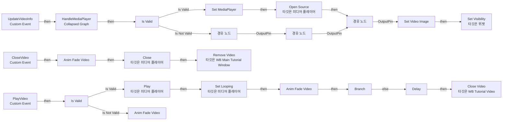
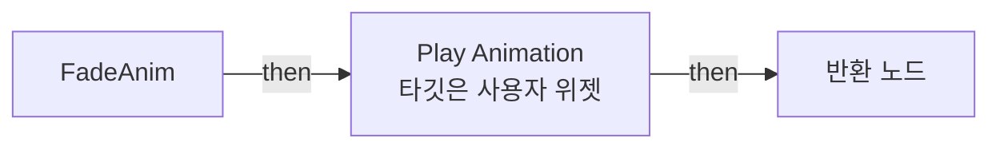
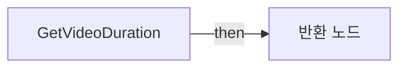

# WB_TutorialVideo

에셋: `/Game/CompShooterHUD/UI/Content/MainTutorialMessage/TutorialContent/WB_TutorialVideo`

부모: `/Script/CoreUObject.Class'/Script/UMG.UserWidget'`

수집일: 2026-10-12. MCP에서 읽은 그래프·핀 연결의 자동 전사입니다. 상속된 그래프는 부모 문서를 함께 확인합니다.

정적 루트 참조 도달: 있음. 실행 여부 또는 삭제 가능 여부의 확정이 아닙니다.

컴포넌트 목록은 이 BP가 직접 정의한 SCS만 포함합니다. 부모·네이티브 생성 컴포넌트, 인스턴스 설정은 별도입니다.

## 변수와 기본값

| 이름 | 타입 | CDO 기본값 |
|---|---|---|
| `MediaPlayer` | `MediaPlayer` | None |

## 그래프 목록

| 그래프 | 전체 노드 수 |
|---|---|
| EventGraph | 42 |
| FadeAnim | 5 |
| GetVideoDuration | 9 |
| GetWB_MainTutorialWindow | 4 |

## 그래프별 실행 연결

실선은 출력 exec 핀의 실제 연결입니다. 여러 분기는 출력 핀 이름을 표시합니다. 함수 호출·delegate·타이머의 다음 그래프 실행은 이 그림에서 자동으로 이어 붙이지 않습니다.

순수 계산 노드 및 데이터 핀은 아래 목록과 원본 JSON을 확인합니다. 연결되지 않은 이벤트도 표시되므로, 노드가 있다는 이유만으로 실행된다고 판단하면 안 됩니다.

### EventGraph

실행 핀 플로우차트

전체 노드·기본 입력 목록

| 노드 ID | 제목 | 미연결 기본 입력 / 에셋 입력 |
|---|---|---|
| `K2Node_CallFunction_12` | Open Source 타깃은 미디어 플레이어 | ReturnValue=false |
| `K2Node_CustomEvent_0` | UpdateVideoInfo Custom Event |  |
| `K2Node_MacroInstance_150` | Set Video Image |  |
| `K2Node_Knot_4` | 경유 노드 |  |
| `K2Node_Knot_5` | 경유 노드 |  |
| `K2Node_CustomEvent_20` | CloseVideo Custom Event |  |
| `K2Node_CallFunction_119` | Close 타깃은 미디어 플레이어 |  |
| `K2Node_VariableSet_116` | Set MediaPlayer |  |
| `K2Node_VariableGet_171` | Get MediaPlayer |  |
| `K2Node_CustomEvent_39` | PlayVideo Custom Event |  |
| `K2Node_VariableGet_175` | Get MediaPlayer |  |
| `K2Node_CallFunction_177` | Play 타깃은 미디어 플레이어 | ReturnValue=false |
| `K2Node_MacroInstance_27` | Anim Fade Video | bVisible=true |
| `K2Node_CallFunction_113` | Get Video Duration |  |
| `K2Node_CallFunction_167` | Delay |  |
| `K2Node_CallFunction_115` | Set Looping 타깃은 미디어 플레이어 | ReturnValue=false |
| `K2Node_Knot_1` | 경유 노드 |  |
| `K2Node_Knot_2` | 경유 노드 |  |
| `K2Node_VariableGet_50` | Get MediaPlayer |  |
| `K2Node_IfThenElse_0` | Branch |  |
| `K2Node_Knot_3` | 경유 노드 |  |
| `K2Node_Knot_24` | 경유 노드 |  |
| `K2Node_CallFunction_162` | float - float | B=0.3 |
| `K2Node_MacroInstance_83` | Anim Fade Video |  |
| `K2Node_CallFunction_213` | Close Video 타깃은 WB Tutorial Video |  |
| `K2Node_CallFunction_334` | Get WB Main Tutorial Window |  |
| `K2Node_CallFunction_375` | Remove Video 타깃은 WB Main Tutorial Window |  |
| `EdGraphNode_Comment_2` | Event Close Video |  |
| `EdGraphNode_Comment_3` | Event Play Video |  |
| `EdGraphNode_Comment_4` | Event Update Video Info |  |
| `K2Node_MacroInstance_122` | Is Valid |  |
| `K2Node_VariableGet_276` | Get Image_Video |  |
| `K2Node_CallFunction_846` | Set Visibility 타깃은 위젯 |  |
| `K2Node_CallFunction_847` | Is Valid |  |
| `K2Node_Select_37` | 선택 | Option 0=Hidden; Option 1=HitTestInvisible |
| `K2Node_Knot_28` | 경유 노드 |  |
| `K2Node_Knot_29` | 경유 노드 |  |
| `K2Node_Knot_30` | 경유 노드 |  |
| `K2Node_Knot_17` | 경유 노드 |  |
| `K2Node_MacroInstance_16` | Is Valid |  |
| `K2Node_MacroInstance_28` | Anim Fade Video | bVisible=true |
| `K2Node_Composite_13` | HandleMediaPlayer Collapsed Graph |  |

### FadeAnim

실행 핀 플로우차트

전체 노드·기본 입력 목록

| 노드 ID | 제목 | 미연결 기본 입력 / 에셋 입력 |
|---|---|---|
| `K2Node_FunctionEntry_190` | FadeAnim |  |
| `K2Node_VariableGet_179` | Get FadeVideo |  |
| `K2Node_CallFunction_234` | Play Animation 타깃은 사용자 위젯 | StartAtTime=0.000000; NumLoopsToPlay=1; PlaybackSpeed=1.000000; bRestoreState=false |
| `K2Node_Select_0` | 선택 | Option 0=Reverse; Option 1=Forward |
| `K2Node_FunctionResult_0` | 반환 노드 |  |

### GetVideoDuration

실행 핀 플로우차트

전체 노드·기본 입력 목록

| 노드 ID | 제목 | 미연결 기본 입력 / 에셋 입력 |
|---|---|---|
| `K2Node_FunctionEntry_15` | GetVideoDuration |  |
| `K2Node_CallFunction_36` | Get Duration 타깃은 미디어 플레이어 | ReturnValue_Days=0; ReturnValue_Hours=0 |
| `K2Node_CallFunction_46` | int * float | B=60 |
| `K2Node_CommutativeAssociativeBinaryOperator_0` | float + float |  |
| `K2Node_CommutativeAssociativeBinaryOperator_1` | Append | B=. |
| `K2Node_CallFunction_3059` | To String (Integer) |  |
| `K2Node_CallFunction_3060` | To String (Integer) |  |
| `K2Node_CallFunction_3061` | String To Float |  |
| `K2Node_FunctionResult_0` | 반환 노드 |  |

### GetWB_MainTutorialWindow

실행 핀 플로우차트

전체 노드·기본 입력 목록

| 노드 ID | 제목 | 미연결 기본 입력 / 에셋 입력 |
|---|---|---|
| `K2Node_FunctionEntry_131` | GetWB_MainTutorialWindow |  |
| `K2Node_CallFunction_264` | Get All Widgets Of Class | WidgetClass=/Game/CompShooterHUD/UI/Content/MainTutorialMessage/TutorialContent/WB_MainTutorialWindow.WB_MainTutorialWindow_C; TopLevelOnly=false |
| `K2Node_GetArrayItem_0` | GET | Dimension 1=0 |
| `K2Node_FunctionResult_1` | 반환 노드 |  |

## 조회 범위의 한계

ObjectIterator로 발견했으나 MCP helper가 반환하지 않은 그래프입니다. delegate signature·컴파일된 중간 그래프·macro·애니메이션 내부 그래프가 섞일 수 있습니다.

- `AnimFadeVideo`: Graph 'AnimFadeVideo' not found in Blueprint.
- `CloseVideo`: Graph 'CloseVideo' not found in Blueprint.
- `PlayVideo`: Graph 'PlayVideo' not found in Blueprint.
- `SetVideoImage`: Graph 'SetVideoImage' not found in Blueprint.
- `UpdateVideoInfo`: Graph 'UpdateVideoInfo' not found in Blueprint.

[원본 MCP 스냅샷](../../../../../../Evidence/blueprints-316.json)
