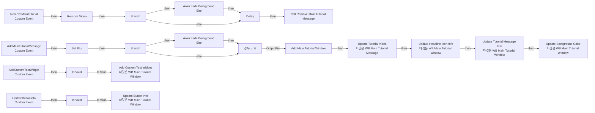
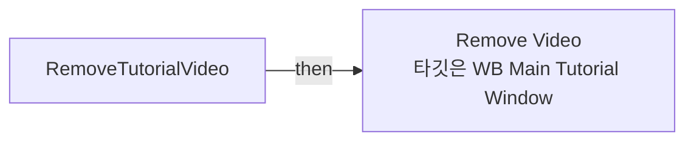
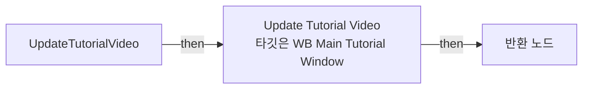

# WB_MainTutorialMessage

에셋: `/Game/CompShooterHUD/UI/Content/MainTutorialMessage/WB_MainTutorialMessage`

부모: `/Script/CoreUObject.Class'/Script/UMG.UserWidget'`

수집일: 2026-10-12. MCP에서 읽은 그래프·핀 연결의 자동 전사입니다. 상속된 그래프는 부모 문서를 함께 확인합니다.

정적 루트 참조 도달: 있음. 실행 여부 또는 삭제 가능 여부의 확정이 아닙니다.

컴포넌트 목록은 이 BP가 직접 정의한 SCS만 포함합니다. 부모·네이티브 생성 컴포넌트, 인스턴스 설정은 별도입니다.

## 변수와 기본값

| 이름 | 타입 | CDO 기본값 |
|---|---|---|
| `RemoveMainTutorialMessage` | `mcdelegate` | &lt;Delegate 'DelegateBase' &lt;Unbound&gt;&gt; |
| `MainTutorialWindow` | `WB_MainTutorialWindow_C` | None |
| `Blur` | `bool` | False |

## 그래프 목록

| 그래프 | 전체 노드 수 |
|---|---|
| EventGraph | 47 |
| RemoveTutorialVideo | 3 |
| UpdateTutorialVideo | 4 |

## 그래프별 실행 연결

실선은 출력 exec 핀의 실제 연결입니다. 여러 분기는 출력 핀 이름을 표시합니다. 함수 호출·delegate·타이머의 다음 그래프 실행은 이 그림에서 자동으로 이어 붙이지 않습니다.

순수 계산 노드 및 데이터 핀은 아래 목록과 원본 JSON을 확인합니다. 연결되지 않은 이벤트도 표시되므로, 노드가 있다는 이유만으로 실행된다고 판단하면 안 됩니다.

### EventGraph

실행 핀 플로우차트

전체 노드·기본 입력 목록

| 노드 ID | 제목 | 미연결 기본 입력 / 에셋 입력 |
|---|---|---|
| `K2Node_CustomEvent_0` | AddMainTutorialMessage Custom Event |  |
| `K2Node_MacroInstance_25` | Anim Fade Background Blur | bVisible=true |
| `K2Node_IfThenElse_0` | Branch |  |
| `K2Node_CallDelegate_3` | Call Remove Main Tutorial Message |  |
| `K2Node_CustomEvent_27` | RemoveMainTutorial Custom Event |  |
| `K2Node_CallFunction_46` | Delay | Duration=0.3 |
| `EdGraphNode_Comment_18` | Event Remove Main Tutorial |  |
| `K2Node_MacroInstance_65` | Anim Fade Background Blur |  |
| `EdGraphNode_Comment_6` | Event AddMainTutorialMessage |  |
| `K2Node_Knot_0` | 경유 노드 |  |
| `K2Node_MacroInstance_332` | Add Main Tutorial Window |  |
| `K2Node_VariableSet_207` | Set Blur |  |
| `K2Node_VariableGet_286` | Get Blur |  |
| `K2Node_IfThenElse_64` | Branch |  |
| `K2Node_MacroInstance_452` | Remove Video |  |
| `K2Node_CallFunction_331` | Update Tutorial Video 타깃은 WB Main Tutorial Message | bLooping=true |
| `K2Node_BreakStruct_36` | Break S Tutorial Video Info |  |
| `K2Node_Knot_31` | 경유 노드 |  |
| `K2Node_VariableGet_71` | Get MainTutorialWindow |  |
| `K2Node_CallFunction_143` | Update Headline Icon Info 타깃은 WB Main Tutorial Window |  |
| `K2Node_Knot_7` | 경유 노드 |  |
| `K2Node_Knot_8` | 경유 노드 |  |
| `K2Node_Knot_9` | 경유 노드 |  |
| `K2Node_Knot_10` | 경유 노드 |  |
| `K2Node_Knot_24` | 경유 노드 |  |
| `K2Node_VariableGet_84` | Get MainTutorialWindow |  |
| `K2Node_CallFunction_148` | Update Tutorial Message Info 타깃은 WB Main Tutorial Window |  |
| `K2Node_Knot_5` | 경유 노드 |  |
| `K2Node_Knot_6` | 경유 노드 |  |
| `K2Node_VariableGet_659` | Get MainTutorialWindow |  |
| `K2Node_CallFunction_170` | Update Background Color 타깃은 WB Main Tutorial Window |  |
| `K2Node_Knot_158` | 경유 노드 |  |
| `K2Node_Knot_159` | 경유 노드 |  |
| `K2Node_VariableGet_193` | Get MainTutorialWindow |  |
| `K2Node_MacroInstance_63` | Is Valid |  |
| `K2Node_CallFunction_45` | Add Custom Text Widget 타깃은 WB Main Tutorial Window |  |
| `K2Node_CustomEvent_5` | AddCustomTextWidget Custom Event |  |
| `K2Node_Knot_186` | 경유 노드 |  |
| `K2Node_Knot_185` | 경유 노드 |  |
| `EdGraphNode_Comment_2` | Event Add Custom Text Widget |  |
| `K2Node_VariableGet_104` | Get MainTutorialWindow |  |
| `K2Node_Knot_4` | 경유 노드 |  |
| `K2Node_MacroInstance_10` | Is Valid |  |
| `K2Node_Knot_3` | 경유 노드 |  |
| `K2Node_CallFunction_350` | Update Button Info 타깃은 WB Main Tutorial Window |  |
| `K2Node_CustomEvent_54` | UpdateButtonInfo Custom Event |  |
| `EdGraphNode_Comment_5` | Event Update Button Info |  |

### RemoveTutorialVideo

실행 핀 플로우차트

전체 노드·기본 입력 목록

| 노드 ID | 제목 | 미연결 기본 입력 / 에셋 입력 |
|---|---|---|
| `K2Node_FunctionEntry_36` | RemoveTutorialVideo |  |
| `K2Node_VariableGet_187` | Get MainTutorialWindow |  |
| `K2Node_CallFunction_68` | Remove Video 타깃은 WB Main Tutorial Window |  |

### UpdateTutorialVideo

실행 핀 플로우차트

전체 노드·기본 입력 목록

| 노드 ID | 제목 | 미연결 기본 입력 / 에셋 입력 |
|---|---|---|
| `K2Node_FunctionEntry_36` | UpdateTutorialVideo |  |
| `K2Node_CallFunction_40` | Update Tutorial Video 타깃은 WB Main Tutorial Window |  |
| `K2Node_VariableGet_263` | Get MainTutorialWindow |  |
| `K2Node_FunctionResult_0` | 반환 노드 |  |

## 조회 범위의 한계

ObjectIterator로 발견했으나 MCP helper가 반환하지 않은 그래프입니다. delegate signature·컴파일된 중간 그래프·macro·애니메이션 내부 그래프가 섞일 수 있습니다.

- `AddCustomTextWidget`: Graph 'AddCustomTextWidget' not found in Blueprint.
- `AddMainTutorialMessage`: Graph 'AddMainTutorialMessage' not found in Blueprint.
- `AddMainTutorialWindow`: Graph 'AddMainTutorialWindow' not found in Blueprint.
- `AnimFadeBackgroundBlur`: Graph 'AnimFadeBackgroundBlur' not found in Blueprint.
- `RemoveMainTutorial`: Graph 'RemoveMainTutorial' not found in Blueprint.
- `RemoveMainTutorialMessage`: Graph 'RemoveMainTutorialMessage' not found in Blueprint.
- `RemoveVideo`: Graph 'RemoveVideo' not found in Blueprint.
- `UpdateButtonInfo`: Graph 'UpdateButtonInfo' not found in Blueprint.

[원본 MCP 스냅샷](../../../../../Evidence/blueprints-316.json)
