# WB_Medals_Base

에셋: `/Game/CompShooterHUD/UI/Content/Medals/WB_Medals_Base`

부모: `/Script/CoreUObject.Class'/Script/UMG.UserWidget'`

수집일: 2026-10-12. MCP에서 읽은 그래프·핀 연결의 자동 전사입니다. 상속된 그래프는 부모 문서를 함께 확인합니다.

정적 루트 참조 도달: 있음. 실행 여부 또는 삭제 가능 여부의 확정이 아닙니다.

컴포넌트 목록은 이 BP가 직접 정의한 SCS만 포함합니다. 부모·네이티브 생성 컴포넌트, 인스턴스 설정은 별도입니다.

## 변수와 기본값

| 이름 | 타입 | CDO 기본값 |
|---|---|---|
| `DisplayTime` | `real` | 0.0 |
| `Timer` | `TimerHandle` | &lt;Struct 'TimerHandle' {}&gt; |

## 그래프 목록

| 그래프 | 전체 노드 수 |
|---|---|
| EventGraph | 45 |

## 그래프별 실행 연결

실선은 출력 exec 핀의 실제 연결입니다. 여러 분기는 출력 핀 이름을 표시합니다. 함수 호출·delegate·타이머의 다음 그래프 실행은 이 그림에서 자동으로 이어 붙이지 않습니다.

순수 계산 노드 및 데이터 핀은 아래 목록과 원본 JSON을 확인합니다. 연결되지 않은 이벤트도 표시되므로, 노드가 있다는 이유만으로 실행된다고 판단하면 안 됩니다.

### EventGraph

```mermaid
flowchart LR
  n0["Update Medal Visibility"]
  n1["Update Highlight Visibility"]
  n2["AddMedal<br/>Custom Event"]
  n3["Is Valid"]
  n4["RemoveMedals<br/>Custom Event"]
  n5["Update Medal Content<br/>타깃은 WB Medal Content"]
  n6["Update Medal Visibility"]
  n7["Update Highlight Visibility"]
  n8["Fade Anim"]
  n9["Is Valid"]
  n10["Play Highlight<br/>타깃은 WB Medal Highlight"]
  n11["Delay"]
  n12["Set DisplayTime"]
  n13["경유 노드"]
  n14["경유 노드"]
  n15["경유 노드"]
  n16["Update Medal Visibility"]
  n17["Update Highlight Visibility"]
  n18["Update Medal Visibility"]
  n19["Update Highlight Visibility"]
  n20["Retriggerable Delay"]
  n21["Set Timer by Event"]
  n22["Set Timer"]
  n23["RemoveContent<br/>Custom Event"]
  n24["HandleTimer<br/>Collapsed Graph"]
  n25["Unpause Timer by Handle"]
  n26["Fade Anim"]
  n27["OnAnimationFinished_Event_0<br/>Custom Event"]
  n28["Set Content Color and Opacity<br/>타깃은 보더"]
  n29["Set Color and Opacity<br/>타깃은 이미지"]
  n30["Bind to Animation Finished<br/>타깃은 사용자 위젯"]
  n31["Unbind from Animation Finished<br/>타깃은 사용자 위젯"]
  n0 -->|"then"| n9
  n1 -->|"then"| n20
  n2 -->|"then"| n28
  n3 -->|"Is Valid"| n5
  n4 -->|"then"| n19
  n5 -->|"then"| n8
  n6 -->|"then"| n31
  n7 -->|"then"| n6
  n8 -->|"then"| n0
  n9 -->|"Is Valid"| n10
  n9 -->|"Is Not Valid"| n14
  n10 -->|"then"| n1
  n12 -->|"then"| n3
  n13 -->|"OutputPin"| n21
  n14 -->|"OutputPin"| n15
  n15 -->|"OutputPin"| n13
  n16 -->|"then"| n12
  n17 -->|"then"| n16
  n19 -->|"then"| n18
  n20 -->|"then"| n13
  n21 -->|"then"| n22
  n22 -->|"then"| n25
  n23 -->|"then"| n26
  n24 -->|"then"| n17
  n26 -->|"then"| n30
  n27 -->|"then"| n7
  n28 -->|"then"| n29
  n29 -->|"then"| n24
```

실행 핀 플로우차트

전체 노드·기본 입력 목록

| 노드 ID | 제목 | 미연결 기본 입력 / 에셋 입력 |
|---|---|---|
| `K2Node_MacroInstance_110` | Update Medal Visibility | bVisible=true |
| `K2Node_MacroInstance_111` | Update Highlight Visibility | bVisible=true |
| `K2Node_CustomEvent_0` | AddMedal Custom Event |  |
| `K2Node_MacroInstance_108` | Is Valid |  |
| `K2Node_CustomEvent_21` | RemoveMedals Custom Event |  |
| `EdGraphNode_Comment_115` | Event Remove Medals |  |
| `K2Node_VariableGet_45` | Get WB_MedalContent |  |
| `K2Node_CallFunction_23` | Update Medal Content 타깃은 WB Medal Content |  |
| `K2Node_Knot_128` | 경유 노드 |  |
| `EdGraphNode_Comment_35` | Event Add Medal |  |
| `K2Node_MacroInstance_295` | Update Medal Visibility |  |
| `K2Node_MacroInstance_296` | Update Highlight Visibility |  |
| `K2Node_MacroInstance_1183` | Fade Anim | bFadeIn=true; PlaybackSpeed=1 |
| `K2Node_VariableGet_92` | Get WB_Medal_Highlight |  |
| `K2Node_MacroInstance_196` | Is Valid |  |
| `K2Node_CallFunction_310` | Play Highlight 타깃은 WB Medal Highlight |  |
| `K2Node_Knot_236` | 경유 노드 |  |
| `K2Node_CallFunction_369` | Delay | Duration=1 |
| `K2Node_VariableSet_108` | Set DisplayTime | Output_Get=0.0 |
| `K2Node_VariableGet_172` | Get DisplayTime |  |
| `K2Node_Knot_258` | 경유 노드 |  |
| `K2Node_Knot_259` | 경유 노드 |  |
| `K2Node_Knot_260` | 경유 노드 |  |
| `K2Node_MacroInstance_317` | Update Medal Visibility | bVisible=true |
| `K2Node_MacroInstance_318` | Update Highlight Visibility | bVisible=true |
| `K2Node_MacroInstance_1544` | Update Medal Visibility |  |
| `K2Node_MacroInstance_1556` | Update Highlight Visibility |  |
| `K2Node_CallFunction_988` | Retriggerable Delay | Duration=1 |
| `K2Node_CallFunction_1190` | Set Timer by Event | bLooping=false; bMaxOncePerFrame=false; InitialStartDelay=0.000000; InitialStartDelayVariance=0.000000 |
| `K2Node_VariableSet_456` | Set Timer |  |
| `K2Node_CustomEvent_214` | RemoveContent Custom Event |  |
| `K2Node_Composite_162` | HandleTimer Collapsed Graph |  |
| `K2Node_CallFunction_1549` | Unpause Timer by Handle |  |
| `K2Node_MacroInstance_253` | Fade Anim | PlaybackSpeed=5 |
| `K2Node_VariableGet_734` | Get Fade |  |
| `K2Node_CustomEvent_302` | OnAnimationFinished_Event_0 Custom Event |  |
| `K2Node_Knot_844` | 경유 노드 |  |
| `K2Node_Knot_845` | 경유 노드 |  |
| `K2Node_Knot_846` | 경유 노드 |  |
| `K2Node_VariableGet_760` | Get bHighlightColor |  |
| `K2Node_CallFunction_1938` | Set Content Color and Opacity 타깃은 보더 |  |
| `K2Node_VariableGet_1000` | Get ShineImage |  |
| `K2Node_CallFunction_2057` | Set Color and Opacity 타깃은 이미지 |  |
| `K2Node_CallFunction_0` | Bind to Animation Finished 타깃은 사용자 위젯 |  |
| `K2Node_CallFunction_1` | Unbind from Animation Finished 타깃은 사용자 위젯 |  |

## 조회 범위의 한계

ObjectIterator로 발견했으나 MCP helper가 반환하지 않은 그래프입니다. delegate signature·컴파일된 중간 그래프·macro·애니메이션 내부 그래프가 섞일 수 있습니다.

- `AddMedal`: Graph 'AddMedal' not found in Blueprint.
- `FadeAnim`: Graph 'FadeAnim' not found in Blueprint.
- `IsTimerValid`: Graph 'IsTimerValid' not found in Blueprint.
- `OnAnimationFinished_Event_0`: Graph 'OnAnimationFinished_Event_0' not found in Blueprint.
- `RemoveContent`: Graph 'RemoveContent' not found in Blueprint.
- `RemoveMedals`: Graph 'RemoveMedals' not found in Blueprint.
- `UpdateHighlight_Visibility`: Graph 'UpdateHighlight_Visibility' not found in Blueprint.
- `UpdateMedalVisibility`: Graph 'UpdateMedalVisibility' not found in Blueprint.

[원본 MCP 스냅샷](../../../../../Evidence/blueprints-281.json)
