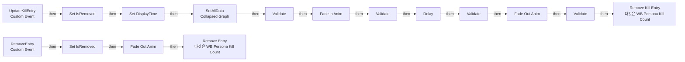
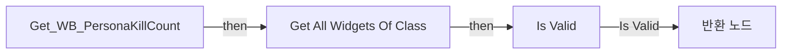

# WB_KillCountEntry

에셋: `/Game/CompShooterHUD/UI/Content/PersonaKillCount/WB_KillCountEntry`

부모: `/Script/CoreUObject.Class'/Script/UMG.UserWidget'`

수집일: 2026-10-12. MCP에서 읽은 그래프·핀 연결의 자동 전사입니다. 상속된 그래프는 부모 문서를 함께 확인합니다.

정적 루트 참조 도달: 있음. 실행 여부 또는 삭제 가능 여부의 확정이 아닙니다.

컴포넌트 목록은 이 BP가 직접 정의한 SCS만 포함합니다. 부모·네이티브 생성 컴포넌트, 인스턴스 설정은 별도입니다.

## 변수와 기본값

| 이름 | 타입 | CDO 기본값 |
|---|---|---|
| `DisplayTime` | `real` | 0.0 |
| `InstigatorName` | `text` |  |
| `CauserIcon` | `Object` | None |
| `DamagedName` | `text` |  |
| `IsRemoved` | `bool` | False |

## 그래프 목록

| 그래프 | 전체 노드 수 |
|---|---|
| EventGraph | 24 |
| Get_WB_PersonaKillCount | 6 |

## 그래프별 실행 연결

실선은 출력 exec 핀의 실제 연결입니다. 여러 분기는 출력 핀 이름을 표시합니다. 함수 호출·delegate·타이머의 다음 그래프 실행은 이 그림에서 자동으로 이어 붙이지 않습니다.

순수 계산 노드 및 데이터 핀은 아래 목록과 원본 JSON을 확인합니다. 연결되지 않은 이벤트도 표시되므로, 노드가 있다는 이유만으로 실행된다고 판단하면 안 됩니다.

### EventGraph

실행 핀 플로우차트

전체 노드·기본 입력 목록

| 노드 ID | 제목 | 미연결 기본 입력 / 에셋 입력 |
|---|---|---|
| `K2Node_CustomEvent_0` | UpdateKillEntry Custom Event |  |
| `K2Node_CallFunction_61` | Get WB Persona Kill Count |  |
| `K2Node_CallFunction_67` | Remove Kill Entry 타깃은 WB Persona Kill Count |  |
| `K2Node_Self_0` | 셀프-레퍼런스 |  |
| `K2Node_CallFunction_100` | Delay |  |
| `K2Node_Composite_2` | SetAllData Collapsed Graph |  |
| `K2Node_VariableSet_212` | Set DisplayTime | Output_Get=0.0 |
| `K2Node_VariableGet_275` | Get DisplayTime |  |
| `K2Node_MacroInstance_546` | Fade in Anim |  |
| `K2Node_MacroInstance_18` | Fade Out Anim |  |
| `K2Node_CallFunction_1758` | float - float | B=0.5 |
| `EdGraphNode_Comment_3` | Event Update Kill Entry |  |
| `K2Node_CustomEvent_3` | RemoveEntry Custom Event |  |
| `K2Node_MacroInstance_553` | Fade Out Anim |  |
| `K2Node_CallFunction_58` | Get WB Persona Kill Count |  |
| `K2Node_CallFunction_86` | Remove Entry 타깃은 WB Persona Kill Count |  |
| `K2Node_Self_7` | 셀프-레퍼런스 |  |
| `EdGraphNode_Comment_5` | Event Remove Entry |  |
| `K2Node_VariableSet_463` | Set IsRemoved | IsRemoved=true; Output_Get=false |
| `K2Node_VariableSet_464` | Set IsRemoved | IsRemoved=false; Output_Get=false |
| `K2Node_MacroInstance_116` | Validate |  |
| `K2Node_MacroInstance_125` | Validate |  |
| `K2Node_MacroInstance_135` | Validate |  |
| `K2Node_MacroInstance_293` | Validate |  |

### Get_WB_PersonaKillCount

실행 핀 플로우차트

전체 노드·기본 입력 목록

| 노드 ID | 제목 | 미연결 기본 입력 / 에셋 입력 |
|---|---|---|
| `K2Node_FunctionEntry_38` | Get_WB_PersonaKillCount |  |
| `K2Node_FunctionResult_0` | 반환 노드 |  |
| `K2Node_CallFunction_20` | Get All Widgets Of Class | WidgetClass=/Game/CompShooterHUD/UI/Content/PersonaKillCount/WB_PersonaKillCount.WB_PersonaKillCount_C; TopLevelOnly=false |
| `K2Node_GetArrayItem_0` | GET | Dimension 1=0 |
| `K2Node_MacroInstance_0` | Is Valid |  |
| `K2Node_Knot_6` | 경유 노드 |  |

## 조회 범위의 한계

ObjectIterator로 발견했으나 MCP helper가 반환하지 않은 그래프입니다. delegate signature·컴파일된 중간 그래프·macro·애니메이션 내부 그래프가 섞일 수 있습니다.

- `FadeInAnim`: Graph 'FadeInAnim' not found in Blueprint.
- `FadeOutAnim`: Graph 'FadeOutAnim' not found in Blueprint.
- `RemoveEntry`: Graph 'RemoveEntry' not found in Blueprint.
- `SetIcon`: Graph 'SetIcon' not found in Blueprint.
- `UpdateDamagedColor`: Graph 'UpdateDamagedColor' not found in Blueprint.
- `UpdateIconColor`: Graph 'UpdateIconColor' not found in Blueprint.
- `UpdateInstigatorColor`: Graph 'UpdateInstigatorColor' not found in Blueprint.
- `UpdateKillEntry`: Graph 'UpdateKillEntry' not found in Blueprint.
- `Validate`: Graph 'Validate' not found in Blueprint.

[원본 MCP 스냅샷](../../../../../Evidence/blueprints-281.json)
