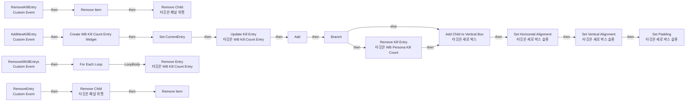
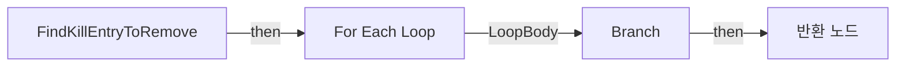

# WB_PersonaKillCount

에셋: `/Game/CompShooterHUD/UI/Content/PersonaKillCount/WB_PersonaKillCount`

부모: `/Script/CoreUObject.Class'/Script/UMG.UserWidget'`

수집일: 2026-10-12. MCP에서 읽은 그래프·핀 연결의 자동 전사입니다. 상속된 그래프는 부모 문서를 함께 확인합니다.

정적 루트 참조 도달: 있음. 실행 여부 또는 삭제 가능 여부의 확정이 아닙니다.

컴포넌트 목록은 이 BP가 직접 정의한 SCS만 포함합니다. 부모·네이티브 생성 컴포넌트, 인스턴스 설정은 별도입니다.

## 변수와 기본값

| 이름 | 타입 | CDO 기본값 |
|---|---|---|
| `AllEntries` | `WB_KillCountEntry_C` | [] |
| `CurrentEntry` | `WB_KillCountEntry_C` | None |

## 그래프 목록

| 그래프 | 전체 노드 수 |
|---|---|
| EventGraph | 64 |
| FindKillEntryToRemove | 7 |

## 그래프별 실행 연결

실선은 출력 exec 핀의 실제 연결입니다. 여러 분기는 출력 핀 이름을 표시합니다. 함수 호출·delegate·타이머의 다음 그래프 실행은 이 그림에서 자동으로 이어 붙이지 않습니다.

순수 계산 노드 및 데이터 핀은 아래 목록과 원본 JSON을 확인합니다. 연결되지 않은 이벤트도 표시되므로, 노드가 있다는 이유만으로 실행된다고 판단하면 안 됩니다.

### EventGraph

실행 핀 플로우차트

전체 노드·기본 입력 목록

| 노드 ID | 제목 | 미연결 기본 입력 / 에셋 입력 |
|---|---|---|
| `K2Node_CustomEvent_0` | AddNewKillEntry Custom Event |  |
| `K2Node_CreateWidget_0` | Create WB Kill Count Entry Widget | Class=/Game/CompShooterHUD/UI/Content/PersonaKillCount/WB_KillCountEntry.WB_KillCountEntry_C |
| `K2Node_VariableGet_108` | Get VB_Entrys |  |
| `K2Node_CallFunction_56` | Add Child to Vertical Box 타깃은 세로 박스 |  |
| `K2Node_VariableGet_345` | Get AllEntries |  |
| `K2Node_CallArrayFunction_0` | Add | ReturnValue=0 |
| `K2Node_Knot_1` | 경유 노드 |  |
| `K2Node_Knot_2` | 경유 노드 |  |
| `K2Node_CallFunction_85` | Set Padding 타깃은 세로 박스 슬롯 | InPadding_Left=0.000000; InPadding_Right=0.000000; InPadding_Bottom=0.000000 |
| `K2Node_CallFunction_91` | Set Horizontal Alignment 타깃은 세로 박스 슬롯 | InHorizontalAlignment=HAlign_Fill |
| `K2Node_CallFunction_98` | Set Vertical Alignment 타깃은 세로 박스 슬롯 | InVerticalAlignment=VAlign_Fill |
| `K2Node_VariableGet_111` | Get AllEntries |  |
| `K2Node_CallArrayFunction_12` | Last Index |  |
| `K2Node_CallFunction_163` | Equal (Integer) | B=0 |
| `K2Node_Select_0` | 선택 | Option 0=-24; Option 1=0.0 |
| `K2Node_CallFunction_270` | Update Kill Entry 타깃은 WB Kill Count Entry |  |
| `K2Node_Knot_3` | 경유 노드 |  |
| `K2Node_Knot_4` | 경유 노드 |  |
| `K2Node_Knot_5` | 경유 노드 |  |
| `EdGraphNode_Comment_22` | Event Add New Kill Entry |  |
| `K2Node_CustomEvent_96` | RemoveKillEntry Custom Event |  |
| `EdGraphNode_Comment_1` | Event Remove Kill Entry |  |
| `K2Node_CallFunction_620` | Find Kill Entry to Remove |  |
| `K2Node_VariableGet_54` | Get AllEntries |  |
| `K2Node_CallArrayFunction_158` | Remove Item | ReturnValue=false |
| `K2Node_VariableGet_55` | Get VB_Entrys |  |
| `K2Node_CallFunction_788` | Remove Child 타깃은 패널 위젯 | ReturnValue=false |
| `K2Node_Knot_8` | 경유 노드 |  |
| `K2Node_Knot_9` | 경유 노드 |  |
| `K2Node_Knot_10` | 경유 노드 |  |
| `K2Node_CallArrayFunction_203` | Length |  |
| `K2Node_CallFunction_906` | int - int | B=1 |
| `K2Node_CallFunction_935` | integer &gt;= integer | B=5 |
| `K2Node_IfThenElse_11` | Branch |  |
| `K2Node_Knot_11` | 경유 노드 |  |
| `K2Node_CallFunction_1027` | Remove Kill Entry 타깃은 WB Persona Kill Count |  |
| `K2Node_VariableGet_308` | Get AllEntries |  |
| `K2Node_GetArrayItem_0` | GET | Dimension 1=0 |
| `K2Node_Knot_17` | 경유 노드 |  |
| `K2Node_Knot_18` | 경유 노드 |  |
| `K2Node_Knot_19` | 경유 노드 |  |
| `K2Node_Knot_20` | 경유 노드 |  |
| `K2Node_Knot_21` | 경유 노드 |  |
| `K2Node_Knot_22` | 경유 노드 |  |
| `K2Node_Knot_24` | 경유 노드 |  |
| `K2Node_Knot_25` | 경유 노드 |  |
| `K2Node_Knot_26` | 경유 노드 |  |
| `K2Node_Knot_27` | 경유 노드 |  |
| `K2Node_Knot_28` | 경유 노드 |  |
| `K2Node_Knot_29` | 경유 노드 |  |
| `K2Node_VariableSet_286` | Set CurrentEntry |  |
| `K2Node_CustomEvent_7` | RemoveAllKillEntrys Custom Event |  |
| `K2Node_VariableGet_133` | Get AllEntries |  |
| `K2Node_MacroInstance_0` | For Each Loop |  |
| `K2Node_VariableGet_172` | Get VB_Entrys |  |
| `K2Node_CallFunction_134` | Remove Child 타깃은 패널 위젯 | ReturnValue=false |
| `EdGraphNode_Comment_42` | Event Remove All Kill Entrys |  |
| `K2Node_CustomEvent_35` | RemoveEntry Custom Event |  |
| `K2Node_CallFunction_253` | Remove Entry 타깃은 WB Kill Count Entry |  |
| `K2Node_VariableGet_166` | Get AllEntries |  |
| `K2Node_CallArrayFunction_96` | Remove Item | ReturnValue=false |
| `K2Node_Knot_359` | 경유 노드 |  |
| `K2Node_Knot_360` | 경유 노드 |  |
| `EdGraphNode_Comment_3` | Finally Remove the Entries from the lists 
 (After playing fade out animations in WB_KillCountEntry) |  |

### FindKillEntryToRemove

실행 핀 플로우차트

전체 노드·기본 입력 목록

| 노드 ID | 제목 | 미연결 기본 입력 / 에셋 입력 |
|---|---|---|
| `K2Node_FunctionEntry_347` | FindKillEntryToRemove |  |
| `K2Node_FunctionResult_0` | 반환 노드 |  |
| `K2Node_VariableGet_160` | Get AllEntries |  |
| `K2Node_MacroInstance_1` | For Each Loop |  |
| `K2Node_CallFunction_580` | Equal (Object) |  |
| `K2Node_IfThenElse_0` | Branch |  |
| `K2Node_Knot_7` | 경유 노드 |  |

## 조회 범위의 한계

ObjectIterator로 발견했으나 MCP helper가 반환하지 않은 그래프입니다. delegate signature·컴파일된 중간 그래프·macro·애니메이션 내부 그래프가 섞일 수 있습니다.

- `AddNewKillEntry`: Graph 'AddNewKillEntry' not found in Blueprint.
- `RemoveAllKillEntrys`: Graph 'RemoveAllKillEntrys' not found in Blueprint.
- `RemoveEntry`: Graph 'RemoveEntry' not found in Blueprint.
- `RemoveKillEntry`: Graph 'RemoveKillEntry' not found in Blueprint.

[원본 MCP 스냅샷](../../../../../Evidence/blueprints-281.json)
