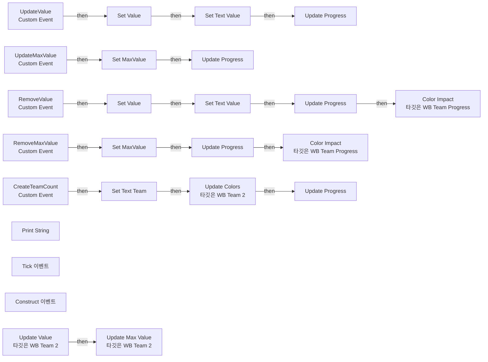
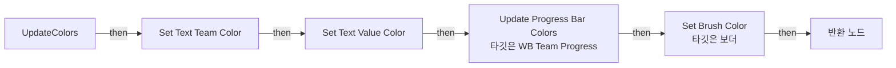

# WB_Team2

에셋: `/Game/CompShooterHUD/UI/Content/TeamKillCount/Content/WB_Team2`

부모: `/Script/CoreUObject.Class'/Script/UMG.UserWidget'`

수집일: 2026-10-12. MCP에서 읽은 그래프·핀 연결의 자동 전사입니다. 상속된 그래프는 부모 문서를 함께 확인합니다.

정적 루트 참조 도달: 있음. 실행 여부 또는 삭제 가능 여부의 확정이 아닙니다.

컴포넌트 목록은 이 BP가 직접 정의한 SCS만 포함합니다. 부모·네이티브 생성 컴포넌트, 인스턴스 설정은 별도입니다.

## 변수와 기본값

| 이름 | 타입 | CDO 기본값 |
|---|---|---|
| `Value` | `int` | 0 |
| `MaxValue` | `int` | 0 |

## 그래프 목록

| 그래프 | 전체 노드 수 |
|---|---|
| EventGraph | 51 |
| UpdateColors | 14 |

## 그래프별 실행 연결

실선은 출력 exec 핀의 실제 연결입니다. 여러 분기는 출력 핀 이름을 표시합니다. 함수 호출·delegate·타이머의 다음 그래프 실행은 이 그림에서 자동으로 이어 붙이지 않습니다.

순수 계산 노드 및 데이터 핀은 아래 목록과 원본 JSON을 확인합니다. 연결되지 않은 이벤트도 표시되므로, 노드가 있다는 이유만으로 실행된다고 판단하면 안 됩니다.

### EventGraph

실행 핀 플로우차트

전체 노드·기본 입력 목록

| 노드 ID | 제목 | 미연결 기본 입력 / 에셋 입력 |
|---|---|---|
| `K2Node_VariableGet_572` | Get WB_TeamProgress |  |
| `K2Node_CallFunction_898` | Color Impact 타깃은 WB Team Progress | Duration=0.25 |
| `K2Node_MacroInstance_2031` | Set Text Team |  |
| `K2Node_MacroInstance_77` | Set Text Value |  |
| `K2Node_CustomEvent_0` | CreateTeamCount Custom Event |  |
| `K2Node_CustomEvent_8` | UpdateValue Custom Event |  |
| `K2Node_CustomEvent_11` | UpdateMaxValue Custom Event |  |
| `K2Node_VariableSet_71` | Set Value |  |
| `K2Node_VariableSet_70` | Set MaxValue | Output_Get=0 |
| `K2Node_Composite_83` | FindValue Collapsed Graph |  |
| `K2Node_Composite_84` | FindMaxValue Collapsed Graph |  |
| `K2Node_CallFunction_269` | To Text (Integer) | bAlwaysSign=false; bUseGrouping=false; MinimumIntegralDigits=1; MaximumIntegralDigits=324 |
| `K2Node_MacroInstance_483` | Update Progress |  |
| `K2Node_MacroInstance_283` | Update Progress |  |
| `K2Node_CustomEvent_131` | RemoveValue Custom Event |  |
| `K2Node_CustomEvent_139` | RemoveMaxValue Custom Event |  |
| `K2Node_VariableSet_125` | Set MaxValue | Output_Get=0 |
| `K2Node_MacroInstance_2674` | Update Progress |  |
| `K2Node_VariableSet_120` | Set Value |  |
| `K2Node_MacroInstance_245` | Update Progress |  |
| `K2Node_Composite_89` | FindRemoveValue Collapsed Graph |  |
| `K2Node_Composite_90` | FindRemoveMaxValue Collapsed Graph |  |
| `EdGraphNode_Comment_162` | Event Remove Max Value |  |
| `EdGraphNode_Comment_163` | Event Remove Value |  |
| `EdGraphNode_Comment_164` | Event Update Max Value |  |
| `EdGraphNode_Comment_165` | Event Update Value |  |
| `K2Node_VariableGet_73` | Get WB_TeamProgress |  |
| `K2Node_CallFunction_0` | Color Impact 타깃은 WB Team Progress | Duration=0.25 |
| `K2Node_MacroInstance_284` | Update Progress |  |
| `EdGraphNode_Comment_172` | Event Create Team Count |  |
| `K2Node_Knot_621` | 경유 노드 |  |
| `K2Node_Knot_622` | 경유 노드 |  |
| `K2Node_Knot_623` | 경유 노드 |  |
| `K2Node_Knot_624` | 경유 노드 |  |
| `K2Node_CallFunction_1350` | Update Colors 타깃은 WB Team 2 |  |
| `K2Node_MacroInstance_2099` | Set Text Value |  |
| `K2Node_CallFunction_5011` | To Text (Integer) | bAlwaysSign=false; bUseGrouping=false; MinimumIntegralDigits=1; MaximumIntegralDigits=324 |
| `K2Node_CallFunction_531` | Print String | bPrintToScreen=true; bPrintToLog=false; TextColor=(R=1.000000,G=0.983262,B=0.000000,A=1.000000); Duration=0.001; Key=None |
| `K2Node_Event_7` | Tick 이벤트 | InDeltaTime=0.0 |
| `K2Node_CommutativeAssociativeBinaryOperator_36` | Append | A=TEAM2 VALUE: ; C=      TEAM2 MAX VALUE:  |
| `K2Node_VariableGet_303` | Get Value |  |
| `K2Node_CallFunction_573` | To String (Integer) |  |
| `K2Node_VariableGet_2465` | Get MaxValue |  |
| `K2Node_CallFunction_11942` | To String (Integer) |  |
| `K2Node_Event_14` | Construct 이벤트 |  |
| `K2Node_VariableGet_2518` | Get Value |  |
| `K2Node_VariableGet_2519` | Get MaxValue |  |
| `K2Node_CallFunction_708` | Update Value 타깃은 WB Team 2 | UpdateType=NewEnumerator0 |
| `K2Node_CallFunction_709` | Update Max Value 타깃은 WB Team 2 | UpdateType=NewEnumerator0 |
| `EdGraphNode_Comment_763` | Event Construct |  |
| `EdGraphNode_Comment_764` | Debug Action |  |

### UpdateColors

실행 핀 플로우차트

전체 노드·기본 입력 목록

| 노드 ID | 제목 | 미연결 기본 입력 / 에셋 입력 |
|---|---|---|
| `K2Node_FunctionEntry_674` | UpdateColors |  |
| `K2Node_VariableGet_389` | Get WB_TeamProgress |  |
| `K2Node_CallFunction_79` | Update Progress Bar Colors 타깃은 WB Team Progress |  |
| `K2Node_MacroInstance_2188` | Set Text Team Color |  |
| `K2Node_MacroInstance_2193` | Set Text Value Color |  |
| `K2Node_Knot_599` | 경유 노드 |  |
| `K2Node_Knot_646` | 경유 노드 |  |
| `K2Node_Knot_647` | 경유 노드 |  |
| `K2Node_Knot_648` | 경유 노드 |  |
| `K2Node_VariableGet_585` | Get b_Background |  |
| `K2Node_Knot_983` | 경유 노드 |  |
| `K2Node_Knot_984` | 경유 노드 |  |
| `K2Node_CallFunction_1801` | Set Brush Color 타깃은 보더 |  |
| `K2Node_FunctionResult_1` | 반환 노드 |  |

## 조회 범위의 한계

ObjectIterator로 발견했으나 MCP helper가 반환하지 않은 그래프입니다. delegate signature·컴파일된 중간 그래프·macro·애니메이션 내부 그래프가 섞일 수 있습니다.

- `Construct`: Graph 'Construct' not found in Blueprint.
- `CreateTeamCount`: Graph 'CreateTeamCount' not found in Blueprint.
- `RemoveMaxValue`: Graph 'RemoveMaxValue' not found in Blueprint.
- `RemoveValue`: Graph 'RemoveValue' not found in Blueprint.
- `SetTextTeam`: Graph 'SetTextTeam' not found in Blueprint.
- `SetTextTeamColor`: Graph 'SetTextTeamColor' not found in Blueprint.
- `SetTextValue`: Graph 'SetTextValue' not found in Blueprint.
- `SetTextValueColor`: Graph 'SetTextValueColor' not found in Blueprint.
- `Tick`: Graph 'Tick' not found in Blueprint.
- `UpdateMaxValue`: Graph 'UpdateMaxValue' not found in Blueprint.
- `UpdateProgress`: Graph 'UpdateProgress' not found in Blueprint.
- `UpdateValue`: Graph 'UpdateValue' not found in Blueprint.

[원본 MCP 스냅샷](../../../../../../Evidence/blueprints-316.json)
