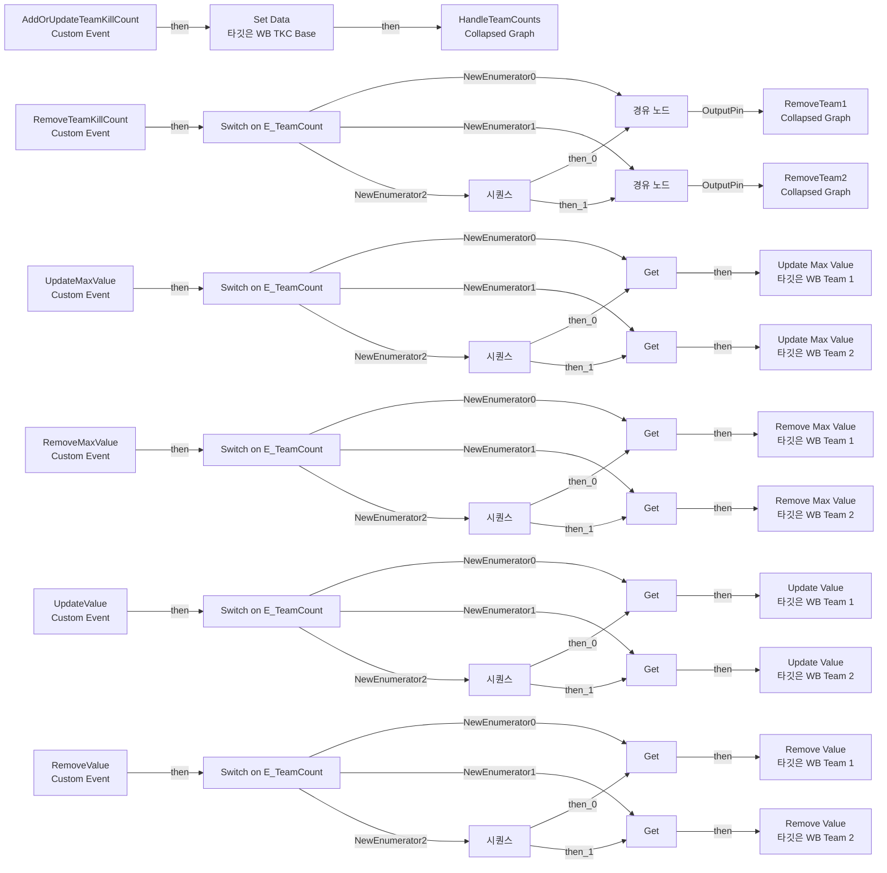
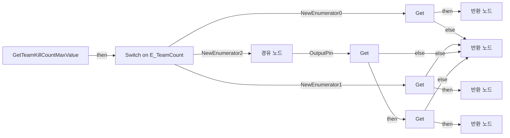
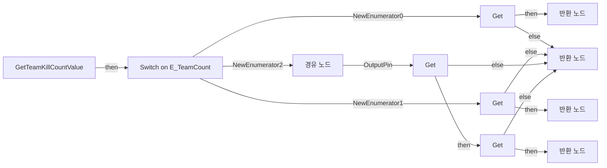
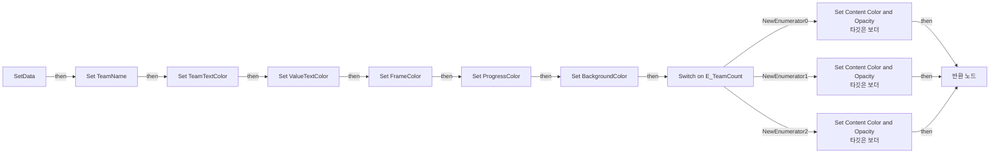

# WB_TKC_Base

에셋: `/Game/CompShooterHUD/UI/Content/TeamKillCount/WB_TKC_Base`

부모: `/Script/CoreUObject.Class'/Script/UMG.UserWidget'`

수집일: 2026-10-12. MCP에서 읽은 그래프·핀 연결의 자동 전사입니다. 상속된 그래프는 부모 문서를 함께 확인합니다.

정적 루트 참조 도달: 있음. 실행 여부 또는 삭제 가능 여부의 확정이 아닙니다.

컴포넌트 목록은 이 BP가 직접 정의한 SCS만 포함합니다. 부모·네이티브 생성 컴포넌트, 인스턴스 설정은 별도입니다.

## 변수와 기본값

| 이름 | 타입 | CDO 기본값 |
|---|---|---|
| `WB_Team1` | `WB_Team1_C` | None |
| `TeamName` | `text` |  |
| `TeamTextColor` | `LinearColor` | &lt;Struct 'LinearColor' {r: 0.000000, g: 0.000000, b: 0.000000, a: 0.000000}&gt; |
| `ValueTextColor` | `LinearColor` | &lt;Struct 'LinearColor' {r: 0.000000, g: 0.000000, b: 0.000000, a: 0.000000}&gt; |
| `FrameColor` | `LinearColor` | &lt;Struct 'LinearColor' {r: 0.000000, g: 0.000000, b: 0.000000, a: 0.000000}&gt; |
| `ProgressColor` | `LinearColor` | &lt;Struct 'LinearColor' {r: 0.000000, g: 0.000000, b: 0.000000, a: 0.000000}&gt; |
| `BackgroundColor` | `LinearColor` | &lt;Struct 'LinearColor' {r: 0.000000, g: 0.000000, b: 0.000000, a: 0.000000}&gt; |
| `WB_Team2` | `WB_Team2_C` | None |

## 그래프 목록

| 그래프 | 전체 노드 수 |
|---|---|
| EventGraph | 44 |
| GetTeamKillCountMaxValue | 16 |
| GetTeamKillCountValue | 16 |
| SetData | 23 |

## 그래프별 실행 연결

실선은 출력 exec 핀의 실제 연결입니다. 여러 분기는 출력 핀 이름을 표시합니다. 함수 호출·delegate·타이머의 다음 그래프 실행은 이 그림에서 자동으로 이어 붙이지 않습니다.

순수 계산 노드 및 데이터 핀은 아래 목록과 원본 JSON을 확인합니다. 연결되지 않은 이벤트도 표시되므로, 노드가 있다는 이유만으로 실행된다고 판단하면 안 됩니다.

### EventGraph

실행 핀 플로우차트

전체 노드·기본 입력 목록

| 노드 ID | 제목 | 미연결 기본 입력 / 에셋 입력 |
|---|---|---|
| `K2Node_CustomEvent_0` | AddOrUpdateTeamKillCount Custom Event |  |
| `K2Node_CallFunction_339` | Set Data 타깃은 WB TKC Base |  |
| `K2Node_CustomEvent_131` | RemoveTeamKillCount Custom Event |  |
| `K2Node_SwitchEnum_132` | Switch on E_TeamCount |  |
| `K2Node_Knot_554` | 경유 노드 |  |
| `K2Node_ExecutionSequence_154` | 시퀀스 |  |
| `K2Node_Knot_1071` | 경유 노드 |  |
| `EdGraphNode_Comment_303` | Event Remove Team Kill Count |  |
| `K2Node_Composite_147` | RemoveTeam2 Collapsed Graph |  |
| `K2Node_Composite_148` | RemoveTeam1 Collapsed Graph |  |
| `K2Node_Composite_157` | HandleTeamCounts Collapsed Graph |  |
| `EdGraphNode_Comment_360` | Event Add Or Update Team Kill Count |  |
| `K2Node_VariableGet_4485` | Get |  |
| `K2Node_VariableGet_4486` | Get |  |
| `K2Node_CallFunction_5117` | Update Max Value 타깃은 WB Team 1 |  |
| `K2Node_CallFunction_5118` | Remove Max Value 타깃은 WB Team 1 |  |
| `K2Node_CallFunction_5119` | Update Max Value 타깃은 WB Team 2 |  |
| `K2Node_CallFunction_5120` | Remove Max Value 타깃은 WB Team 2 |  |
| `K2Node_VariableGet_4487` | Get |  |
| `K2Node_VariableGet_4488` | Get |  |
| `K2Node_VariableGet_4489` | Get |  |
| `K2Node_VariableGet_4490` | Get |  |
| `K2Node_CallFunction_5121` | Update Value 타깃은 WB Team 1 |  |
| `K2Node_CallFunction_5122` | Update Value 타깃은 WB Team 2 |  |
| `K2Node_VariableGet_4484` | Get |  |
| `K2Node_VariableGet_996` | Get |  |
| `K2Node_CallFunction_5123` | Remove Value 타깃은 WB Team 1 |  |
| `K2Node_CallFunction_5124` | Remove Value 타깃은 WB Team 2 |  |
| `K2Node_CustomEvent_431` | UpdateMaxValue Custom Event |  |
| `K2Node_SwitchEnum_415` | Switch on E_TeamCount |  |
| `K2Node_ExecutionSequence_722` | 시퀀스 |  |
| `K2Node_CustomEvent_499` | RemoveMaxValue Custom Event |  |
| `K2Node_SwitchEnum_480` | Switch on E_TeamCount |  |
| `K2Node_ExecutionSequence_829` | 시퀀스 |  |
| `K2Node_CustomEvent_492` | UpdateValue Custom Event |  |
| `K2Node_SwitchEnum_474` | Switch on E_TeamCount |  |
| `K2Node_ExecutionSequence_822` | 시퀀스 |  |
| `K2Node_CustomEvent_465` | RemoveValue Custom Event |  |
| `K2Node_SwitchEnum_448` | Switch on E_TeamCount |  |
| `K2Node_ExecutionSequence_784` | 시퀀스 |  |
| `EdGraphNode_Comment_392` | Event Update Max Value |  |
| `EdGraphNode_Comment_393` | Event Remove Max Value |  |
| `EdGraphNode_Comment_394` | Event Update Value |  |
| `EdGraphNode_Comment_395` | Event Remove Value |  |

### GetTeamKillCountMaxValue

실행 핀 플로우차트

전체 노드·기본 입력 목록

| 노드 ID | 제목 | 미연결 기본 입력 / 에셋 입력 |
|---|---|---|
| `K2Node_FunctionEntry_91` | GetTeamKillCountMaxValue |  |
| `K2Node_FunctionResult_3` | 반환 노드 |  |
| `K2Node_VariableGet_670` | Get |  |
| `K2Node_VariableGet_671` | Get |  |
| `K2Node_SwitchEnum_79` | Switch on E_TeamCount |  |
| `K2Node_FunctionResult_0` | 반환 노드 |  |
| `K2Node_FunctionResult_1` | 반환 노드 |  |
| `K2Node_Knot_332` | 경유 노드 |  |
| `K2Node_VariableGet_299` | Get |  |
| `K2Node_VariableGet_300` | Get |  |
| `K2Node_CommutativeAssociativeBinaryOperator_0` | int + int |  |
| `K2Node_FunctionResult_2` | 반환 노드 | TeamKillCountMaxValue=0 |
| `K2Node_VariableGet_883` | Get MaxValue |  |
| `K2Node_VariableGet_884` | Get MaxValue |  |
| `K2Node_VariableGet_881` | Get MaxValue |  |
| `K2Node_VariableGet_882` | Get MaxValue |  |

### GetTeamKillCountValue

실행 핀 플로우차트

전체 노드·기본 입력 목록

| 노드 ID | 제목 | 미연결 기본 입력 / 에셋 입력 |
|---|---|---|
| `K2Node_FunctionEntry_91` | GetTeamKillCountValue |  |
| `K2Node_FunctionResult_3` | 반환 노드 |  |
| `K2Node_VariableGet_670` | Get |  |
| `K2Node_VariableGet_671` | Get |  |
| `K2Node_VariableGet_672` | Get Value |  |
| `K2Node_SwitchEnum_79` | Switch on E_TeamCount |  |
| `K2Node_FunctionResult_0` | 반환 노드 |  |
| `K2Node_FunctionResult_1` | 반환 노드 |  |
| `K2Node_VariableGet_673` | Get Value |  |
| `K2Node_Knot_332` | 경유 노드 |  |
| `K2Node_VariableGet_299` | Get |  |
| `K2Node_VariableGet_300` | Get |  |
| `K2Node_VariableGet_521` | Get Value |  |
| `K2Node_VariableGet_582` | Get Value |  |
| `K2Node_CommutativeAssociativeBinaryOperator_0` | int + int |  |
| `K2Node_FunctionResult_2` | 반환 노드 | TeamKillCountValue=0 |

### SetData

실행 핀 플로우차트

전체 노드·기본 입력 목록

| 노드 ID | 제목 | 미연결 기본 입력 / 에셋 입력 |
|---|---|---|
| `K2Node_FunctionEntry_102` | SetData |  |
| `K2Node_VariableSet_298` | Set TeamName |  |
| `K2Node_VariableSet_299` | Set TeamTextColor |  |
| `K2Node_VariableSet_300` | Set ValueTextColor |  |
| `K2Node_VariableSet_301` | Set FrameColor |  |
| `K2Node_VariableSet_302` | Set ProgressColor |  |
| `K2Node_Knot_783` | 경유 노드 |  |
| `K2Node_Knot_784` | 경유 노드 |  |
| `K2Node_Knot_785` | 경유 노드 |  |
| `K2Node_Knot_786` | 경유 노드 |  |
| `K2Node_FunctionResult_0` | 반환 노드 |  |
| `K2Node_VariableSet_477` | Set BackgroundColor |  |
| `K2Node_Knot_1006` | 경유 노드 |  |
| `K2Node_VariableGet_2952` | Get b_Anim1Color |  |
| `K2Node_VariableGet_742` | Get ProgressColor |  |
| `K2Node_CallFunction_3340` | Set Content Color and Opacity 타깃은 보더 |  |
| `K2Node_VariableGet_2953` | Get b_Anim2Color |  |
| `K2Node_VariableGet_728` | Get b_Anim1Color |  |
| `K2Node_VariableGet_881` | Get b_Anim2Color |  |
| `K2Node_Knot_1156` | 경유 노드 |  |
| `K2Node_SwitchEnum_269` | Switch on E_TeamCount |  |
| `K2Node_CallFunction_3341` | Set Content Color and Opacity 타깃은 보더 |  |
| `K2Node_CallFunction_2302` | Set Content Color and Opacity 타깃은 보더 |  |

## 조회 범위의 한계

ObjectIterator로 발견했으나 MCP helper가 반환하지 않은 그래프입니다. delegate signature·컴파일된 중간 그래프·macro·애니메이션 내부 그래프가 섞일 수 있습니다.

- `AddOrUpdateTeamKillCount`: Graph 'AddOrUpdateTeamKillCount' not found in Blueprint.
- `CreateTeam1`: Graph 'CreateTeam1' not found in Blueprint.
- `CreateTeam2`: Graph 'CreateTeam2' not found in Blueprint.
- `PlayFadeAnim1`: Graph 'PlayFadeAnim1' not found in Blueprint.
- `PlayFadeAnim2`: Graph 'PlayFadeAnim2' not found in Blueprint.
- `RemoveMaxValue`: Graph 'RemoveMaxValue' not found in Blueprint.
- `RemoveTeamKillCount`: Graph 'RemoveTeamKillCount' not found in Blueprint.
- `RemoveValue`: Graph 'RemoveValue' not found in Blueprint.
- `Team1Visibility`: Graph 'Team1Visibility' not found in Blueprint.
- `Team2Visibility`: Graph 'Team2Visibility' not found in Blueprint.
- `TimedFadeAnim1`: Graph 'TimedFadeAnim1' not found in Blueprint.
- `TimedFadeAnim2`: Graph 'TimedFadeAnim2' not found in Blueprint.
- `UpdateMaxValue`: Graph 'UpdateMaxValue' not found in Blueprint.
- `UpdateValue`: Graph 'UpdateValue' not found in Blueprint.

[원본 MCP 스냅샷](../../../../../Evidence/blueprints-316.json)
