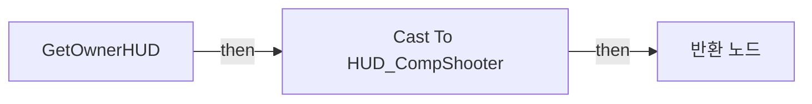
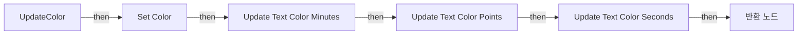

# WB_Timer

에셋: `/Game/CompShooterHUD/UI/Content/Timer/WB_Timer`

부모: `/Script/CoreUObject.Class'/Script/UMG.UserWidget'`

수집일: 2026-10-12. MCP에서 읽은 그래프·핀 연결의 자동 전사입니다. 상속된 그래프는 부모 문서를 함께 확인합니다.

정적 루트 참조 도달: 있음. 실행 여부 또는 삭제 가능 여부의 확정이 아닙니다.

컴포넌트 목록은 이 BP가 직접 정의한 SCS만 포함합니다. 부모·네이티브 생성 컴포넌트, 인스턴스 설정은 별도입니다.

## 변수와 기본값

| 이름 | 타입 | CDO 기본값 |
|---|---|---|
| `ETimerMode` | `E_TimerMode` | &lt;E_TimerMode.COUNT_DOWN: 0&gt; |
| `TimerHandle` | `TimerHandle` | &lt;Struct 'TimerHandle' {}&gt; |
| `Minutes` | `int` | 0 |
| `Seconds` | `int` | 0 |
| `Overall_Minutes` | `int` | 0 |
| `Overall_Seconds` | `int` | 0 |
| `HasExtraTime` | `bool` | False |
| `ExtraSeconds` | `int` | 0 |
| `Color` | `LinearColor` | &lt;Struct 'LinearColor' {r: 0.000000, g: 0.000000, b: 0.000000, a: 0.000000}&gt; |

## 그래프 목록

| 그래프 | 전체 노드 수 |
|---|---|
| EventGraph | 98 |
| GetOwnerHUD | 5 |
| UpdateColor | 10 |

## 그래프별 실행 연결

실선은 출력 exec 핀의 실제 연결입니다. 여러 분기는 출력 핀 이름을 표시합니다. 함수 호출·delegate·타이머의 다음 그래프 실행은 이 그림에서 자동으로 이어 붙이지 않습니다.

순수 계산 노드 및 데이터 핀은 아래 목록과 원본 JSON을 확인합니다. 연결되지 않은 이벤트도 표시되므로, 노드가 있다는 이유만으로 실행된다고 판단하면 안 됩니다.

### EventGraph

```mermaid
flowchart LR
  n0["StartTimer<br/>Custom Event"]
  n1["Set Timer by Event"]
  n2["Set TimerHandle"]
  n3["Count<br/>Custom Event"]
  n4["CreateTimer<br/>Custom Event"]
  n5["UpdateTimeData<br/>Collapsed Graph"]
  n6["Update Color<br/>타깃은 WB Timer"]
  n7["Update PB<br/>타깃은 WB Timer Progress Bar"]
  n8["Switch on E_TimerMode"]
  n9["OnTimerFinished<br/>Custom Event"]
  n10["Call On Timer Completed"]
  n11["Pause Timer by Handle"]
  n12["Unpause Timer by Handle"]
  n13["HandleCountdown<br/>Collapsed Graph"]
  n14["HandleCountUp<br/>Collapsed Graph"]
  n15["AddExtraTime<br/>Custom Event"]
  n16["Handle Extra Time"]
  n17["UpdateExtraTimeVisibility<br/>Custom Event"]
  n18["경유 노드"]
  n19["경유 노드"]
  n20["Do Once"]
  n21["Pause Timer by Handle"]
  n22["Update Extra Time Visibility<br/>타깃은 WB Timer"]
  n23["Update Extra Time Visibility<br/>타깃은 WB Timer"]
  n24["Branch"]
  n25["Unpause Timer by Handle"]
  n26["Set Timer by Event"]
  n27["FinishExtraTime<br/>Custom Event"]
  n28["Set HasExtraTime"]
  n29["Set HasExtraTime"]
  n30["Branch"]
  n31["Remove Progress Bar<br/>타깃은 WB Timer Progress Bar"]
  n32["경유 노드"]
  n33["경유 노드"]
  n34["Update Text Extra Time"]
  n35["Update Text Extra Time"]
  n36["Handle Extra Time Anim"]
  n37["Handle Extra Time Anim"]
  n38["Update Timer Opacity"]
  n39["Update Timer Opacity"]
  n40["Update Highlight Anim"]
  n41["PauseTimer<br/>Custom Event"]
  n42["Branch"]
  n43["Pause Timer by Handle"]
  n44["Branch"]
  n45["Unpause Timer by Handle"]
  n46["RemoveTimer<br/>Custom Event"]
  n47["Branch"]
  n48["Clear and Invalidate Timer by Handle"]
  n49["경유 노드"]
  n50["경유 노드"]
  n51["경유 노드"]
  n52["Update Content Visibility"]
  n53["Update Highlight Anim"]
  n54["Update Content Visibility"]
  n55["Remove Timer<br/>타깃은 WB Timer"]
  n56["Delay"]
  n57["Update Highlight Anim"]
  n58["Set Color and Opacity<br/>타깃은 텍스트"]
  n0 -->|"then"| n1
  n1 -->|"then"| n2
  n2 -->|"then"| n12
  n3 -->|"then"| n16
  n4 -->|"then"| n5
  n5 -->|"then"| n6
  n6 -->|"then"| n52
  n8 -->|"NewEnumerator0"| n13
  n8 -->|"NewEnumerator1"| n14
  n9 -->|"then"| n11
  n10 -->|"then"| n55
  n11 -->|"then"| n10
  n15 -->|"then"| n20
  n16 -->|"then"| n8
  n17 -->|"then"| n30
  n18 -->|"OutputPin"| n19
  n19 -->|"OutputPin"| n20
  n20 -->|"Completed"| n35
  n21 -->|"then"| n28
  n22 -->|"then"| n58
  n23 -->|"then"| n39
  n24 -->|"then"| n21
  n26 -->|"then"| n25
  n27 -->|"then"| n34
  n28 -->|"then"| n23
  n29 -->|"then"| n36
  n30 -->|"then"| n32
  n30 -->|"else"| n33
  n32 -->|"OutputPin"| n7
  n33 -->|"OutputPin"| n31
  n34 -->|"then"| n24
  n35 -->|"then"| n29
  n36 -->|"then"| n40
  n37 -->|"then"| n18
  n38 -->|"then"| n22
  n39 -->|"then"| n37
  n40 -->|"then"| n38
  n41 -->|"then"| n42
  n42 -->|"then"| n44
  n44 -->|"then"| n43
  n44 -->|"else"| n45
  n46 -->|"then"| n47
  n47 -->|"then"| n48
  n47 -->|"else"| n50
  n48 -->|"then"| n49
  n49 -->|"OutputPin"| n57
  n50 -->|"OutputPin"| n51
  n51 -->|"OutputPin"| n49
  n52 -->|"then"| n53
  n56 -->|"then"| n54
  n57 -->|"then"| n56
  n58 -->|"then"| n26
```

실행 핀 플로우차트

전체 노드·기본 입력 목록

| 노드 ID | 제목 | 미연결 기본 입력 / 에셋 입력 |
|---|---|---|
| `K2Node_CustomEvent_0` | StartTimer Custom Event |  |
| `K2Node_CallFunction_35` | Set Timer by Event | Time=1; bLooping=true; bMaxOncePerFrame=false; InitialStartDelay=0.000000; InitialStartDelayVariance=0.000000 |
| `K2Node_VariableSet_508` | Set TimerHandle |  |
| `K2Node_CreateDelegate_0` | 이벤트 생성 |  |
| `K2Node_CustomEvent_36` | Count Custom Event |  |
| `K2Node_CustomEvent_157` | CreateTimer Custom Event |  |
| `K2Node_Composite_278` | UpdateTimeData Collapsed Graph |  |
| `K2Node_CallFunction_857` | Update Color 타깃은 WB Timer |  |
| `K2Node_Knot_1282` | 경유 노드 |  |
| `K2Node_VariableGet_374` | Get WB_Timer_ProgressBar |  |
| `K2Node_CallFunction_602` | Update PB 타깃은 WB Timer Progress Bar | ProgressType=NewEnumerator0; Value=0.0; ProgressBarType=NewEnumerator2 |
| `K2Node_VariableGet_432` | Get ETimerMode |  |
| `K2Node_SwitchEnum_51` | Switch on E_TimerMode |  |
| `K2Node_CustomEvent_188` | OnTimerFinished Custom Event |  |
| `K2Node_CallFunction_5695` | Get Owner HUD |  |
| `K2Node_CallDelegate_19` | Call On Timer Completed |  |
| `K2Node_VariableGet_610` | Get TimerHandle |  |
| `K2Node_CallFunction_2003` | Pause Timer by Handle |  |
| `K2Node_CallFunction_2004` | Unpause Timer by Handle |  |
| `K2Node_Composite_92` | HandleCountdown Collapsed Graph |  |
| `K2Node_Composite_93` | HandleCountUp Collapsed Graph |  |
| `EdGraphNode_Comment_157` | Event Count |  |
| `EdGraphNode_Comment_158` | Event Start Timer |  |
| `EdGraphNode_Comment_159` | Event Create Timer |  |
| `EdGraphNode_Comment_160` | Event On Timer Finished |  |
| `K2Node_CustomEvent_461` | AddExtraTime Custom Event |  |
| `K2Node_MacroInstance_2919` | Handle Extra Time |  |
| `K2Node_CustomEvent_689` | UpdateExtraTimeVisibility Custom Event |  |
| `K2Node_Knot_929` | 경유 노드 |  |
| `K2Node_Knot_928` | 경유 노드 |  |
| `K2Node_Knot_927` | 경유 노드 |  |
| `K2Node_Knot_926` | 경유 노드 |  |
| `K2Node_MacroInstance_1268` | Do Once |  |
| `K2Node_CallFunction_7098` | Pause Timer by Handle |  |
| `K2Node_CallFunction_7096` | Update Extra Time Visibility 타깃은 WB Timer | bVisible=true |
| `K2Node_CallFunction_7097` | Update Extra Time Visibility 타깃은 WB Timer | bVisible=false |
| `K2Node_IfThenElse_414` | Branch |  |
| `K2Node_CallFunction_6860` | integer &lt; integer | B=0 |
| `K2Node_CallFunction_6859` | Unpause Timer by Handle |  |
| `K2Node_CallFunction_6857` | int - int | B=1 |
| `K2Node_VariableGet_1218` | Get ExtraSeconds |  |
| `K2Node_CallFunction_5884` | Set Timer by Event | Time=1; bLooping=true; bMaxOncePerFrame=false; InitialStartDelay=0.000000; InitialStartDelayVariance=0.000000 |
| `K2Node_CustomEvent_562` | FinishExtraTime Custom Event |  |
| `K2Node_VariableSet_700` | Set HasExtraTime | HasExtraTime=false; Output_Get=false |
| `K2Node_VariableSet_1224` | Set HasExtraTime | HasExtraTime=true; Output_Get=false |
| `K2Node_VariableGet_1323` | Get ExtraSeconds |  |
| `K2Node_CallFunction_5937` | To Float (Integer) |  |
| `K2Node_IfThenElse_526` | Branch |  |
| `K2Node_CallFunction_7777` | Remove Progress Bar 타깃은 WB Timer Progress Bar |  |
| `K2Node_Knot_967` | 경유 노드 |  |
| `K2Node_Knot_968` | 경유 노드 |  |
| `K2Node_Knot_996` | 경유 노드 |  |
| `K2Node_Knot_997` | 경유 노드 |  |
| `K2Node_Knot_998` | 경유 노드 |  |
| `K2Node_Knot_999` | 경유 노드 |  |
| `K2Node_MacroInstance_1621` | Update Text Extra Time |  |
| `K2Node_MacroInstance_4188` | Update Text Extra Time |  |
| `K2Node_MacroInstance_2033` | Handle Extra Time Anim | bVisible=true |
| `K2Node_MacroInstance_4811` | Handle Extra Time Anim |  |
| `K2Node_MacroInstance_2430` | Update Timer Opacity | Opacity=0.5 |
| `K2Node_MacroInstance_5343` | Update Timer Opacity | Opacity=1 |
| `K2Node_MacroInstance_5894` | Update Highlight Anim |  |
| `K2Node_Knot_1356` | 경유 노드 |  |
| `EdGraphNode_Comment_291` | Event Add Extra Time |  |
| `K2Node_CustomEvent_1745` | PauseTimer Custom Event |  |
| `K2Node_VariableGet_7188` | Get TimerHandle |  |
| `K2Node_CallFunction_18025` | Is Valid Timer Handle |  |
| `K2Node_IfThenElse_1727` | Branch |  |
| `K2Node_VariableGet_2033` | Get TimerHandle |  |
| `K2Node_CallFunction_17777` | Pause Timer by Handle |  |
| `K2Node_IfThenElse_1680` | Branch |  |
| `K2Node_CallFunction_17816` | Unpause Timer by Handle |  |
| `EdGraphNode_Comment_292` | Event Pause Timer |  |
| `K2Node_CustomEvent_1778` | RemoveTimer Custom Event |  |
| `K2Node_VariableGet_7093` | Get TimerHandle |  |
| `K2Node_CallFunction_17776` | Is Valid Timer Handle |  |
| `K2Node_IfThenElse_1679` | Branch |  |
| `K2Node_CallFunction_18027` | Clear and Invalidate Timer by Handle |  |
| `K2Node_Knot_1411` | 경유 노드 |  |
| `K2Node_Knot_1412` | 경유 노드 |  |
| `K2Node_Knot_1413` | 경유 노드 |  |
| `K2Node_Knot_1414` | 경유 노드 |  |
| `K2Node_MacroInstance_3892` | Update Content Visibility | bVisible=true |
| `K2Node_MacroInstance_7364` | Update Highlight Anim |  |
| `K2Node_MacroInstance_7256` | Update Content Visibility |  |
| `EdGraphNode_Comment_306` | Event Remove Timer |  |
| `K2Node_VariableGet_2328` | Get Color |  |
| `K2Node_CallFunction_22033` | Remove Timer 타깃은 WB Timer |  |
| `K2Node_VariableGet_2331` | Get Color |  |
| `K2Node_CallFunction_21748` | Delay | Duration=0.25 |
| `K2Node_MacroInstance_7968` | Update Highlight Anim |  |
| `K2Node_Knot_1546` | 경유 노드 |  |
| `K2Node_Knot_1547` | 경유 노드 |  |
| `K2Node_VariableGet_2622` | Get Text_ExtraPlus |  |
| `K2Node_VariableGet_2623` | Get Text_ExtraTime |  |
| `K2Node_CallFunction_23474` | Set Color and Opacity 타깃은 텍스트 | InColorAndOpacity_ColorUseRule=UseColor_Specified |
| `K2Node_Knot_1697` | 경유 노드 |  |
| `K2Node_Knot_1698` | 경유 노드 |  |

### GetOwnerHUD

실행 핀 플로우차트

전체 노드·기본 입력 목록

| 노드 ID | 제목 | 미연결 기본 입력 / 에셋 입력 |
|---|---|---|
| `K2Node_FunctionEntry_566` | GetOwnerHUD |  |
| `K2Node_FunctionResult_0` | 반환 노드 |  |
| `K2Node_CallFunction_1916` | Get Owning Player 타깃은 위젯 |  |
| `K2Node_CallFunction_1917` | Get HUD 타깃은 플레이어 컨트롤러 |  |
| `K2Node_DynamicCast_0` | Cast To HUD_CompShooter |  |

### UpdateColor

실행 핀 플로우차트

전체 노드·기본 입력 목록

| 노드 ID | 제목 | 미연결 기본 입력 / 에셋 입력 |
|---|---|---|
| `K2Node_FunctionEntry_255` | UpdateColor |  |
| `K2Node_MacroInstance_2570` | Update Text Color Minutes |  |
| `K2Node_MacroInstance_2686` | Update Text Color Points |  |
| `K2Node_MacroInstance_2693` | Update Text Color Seconds |  |
| `K2Node_FunctionResult_0` | 반환 노드 |  |
| `K2Node_Knot_1189` | 경유 노드 |  |
| `K2Node_Knot_1190` | 경유 노드 |  |
| `K2Node_Knot_1191` | 경유 노드 |  |
| `K2Node_Knot_1192` | 경유 노드 |  |
| `K2Node_VariableSet_1258` | Set Color |  |

## 조회 범위의 한계

ObjectIterator로 발견했으나 MCP helper가 반환하지 않은 그래프입니다. delegate signature·컴파일된 중간 그래프·macro·애니메이션 내부 그래프가 섞일 수 있습니다.

- `AddExtraTime`: Graph 'AddExtraTime' not found in Blueprint.
- `Count`: Graph 'Count' not found in Blueprint.
- `CreateTimer`: Graph 'CreateTimer' not found in Blueprint.
- `ExtraTimeVisibility`: Graph 'ExtraTimeVisibility' not found in Blueprint.
- `FinishExtraTime`: Graph 'FinishExtraTime' not found in Blueprint.
- `HandleExtraTime`: Graph 'HandleExtraTime' not found in Blueprint.
- `HandleExtraTimeAnim`: Graph 'HandleExtraTimeAnim' not found in Blueprint.
- `OnTimerFinished`: Graph 'OnTimerFinished' not found in Blueprint.
- `PauseTimer`: Graph 'PauseTimer' not found in Blueprint.
- `RemoveTimer`: Graph 'RemoveTimer' not found in Blueprint.
- `StartTimer`: Graph 'StartTimer' not found in Blueprint.
- `UpdateContentVisibility`: Graph 'UpdateContentVisibility' not found in Blueprint.
- `UpdateExtraTimeVisibility`: Graph 'UpdateExtraTimeVisibility' not found in Blueprint.
- `UpdateHighlightAnim`: Graph 'UpdateHighlightAnim' not found in Blueprint.
- `UpdateTextColor_Minutes`: Graph 'UpdateTextColor_Minutes' not found in Blueprint.
- `UpdateTextColor_Points`: Graph 'UpdateTextColor_Points' not found in Blueprint.
- `UpdateTextColor_Seconds`: Graph 'UpdateTextColor_Seconds' not found in Blueprint.
- `UpdateText_ExtraTime`: Graph 'UpdateText_ExtraTime' not found in Blueprint.
- `UpdateText_Minutes`: Graph 'UpdateText_Minutes' not found in Blueprint.
- `UpdateText_Seconds`: Graph 'UpdateText_Seconds' not found in Blueprint.
- `UpdateTimerOpacity`: Graph 'UpdateTimerOpacity' not found in Blueprint.
- `UpdateTimerVisibility`: Graph 'UpdateTimerVisibility' not found in Blueprint.

[원본 MCP 스냅샷](../../../../../Evidence/blueprints-316.json)
