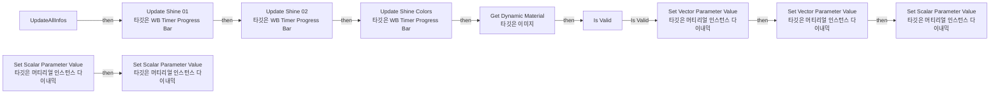
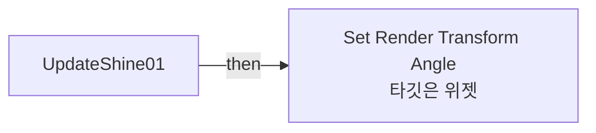
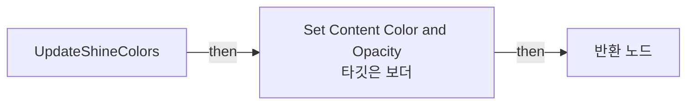

# WB_Timer_ProgressBar

에셋: `/Game/CompShooterHUD/UI/Content/Timer/WB_Timer_ProgressBar`

부모: `/Script/CoreUObject.Class'/Script/UMG.UserWidget'`

수집일: 2026-10-12. MCP에서 읽은 그래프·핀 연결의 자동 전사입니다. 상속된 그래프는 부모 문서를 함께 확인합니다.

정적 루트 참조 도달: 있음. 실행 여부 또는 삭제 가능 여부의 확정이 아닙니다.

컴포넌트 목록은 이 BP가 직접 정의한 SCS만 포함합니다. 부모·네이티브 생성 컴포넌트, 인스턴스 설정은 별도입니다.

## 변수와 기본값

| 이름 | 타입 | CDO 기본값 |
|---|---|---|
| `ProgressTime` | `real` | 0.0 |
| `Timesteps_Time` | `real` | 0.0010000000474974513 |
| `LiveProgress` | `real` | 0.0 |
| `Opacity` | `real` | 1.0 |
| `FillColor` | `LinearColor` | &lt;Struct 'LinearColor' {r: 0.000000, g: 0.167567, b: 1.000000, a: 1.000000}&gt; |
| `EmptyColor` | `LinearColor` | &lt;Struct 'LinearColor' {r: 1.000000, g: 1.000000, b: 1.000000, a: 0.250000}&gt; |
| `CurrentValue` | `real` | 0.0 |

## 그래프 목록

| 그래프 | 전체 노드 수 |
|---|---|
| EventGraph | 62 |
| GetOwnerHUD | 5 |
| UpdateAllInfos | 21 |
| UpdateShine01 | 4 |
| UpdateShine02 | 4 |
| UpdateShineColors | 6 |

## 그래프별 실행 연결

실선은 출력 exec 핀의 실제 연결입니다. 여러 분기는 출력 핀 이름을 표시합니다. 함수 호출·delegate·타이머의 다음 그래프 실행은 이 그림에서 자동으로 이어 붙이지 않습니다.

순수 계산 노드 및 데이터 핀은 아래 목록과 원본 JSON을 확인합니다. 연결되지 않은 이벤트도 표시되므로, 노드가 있다는 이유만으로 실행된다고 판단하면 안 됩니다.

### EventGraph

```mermaid
flowchart LR
  n0["Set Timer by Event"]
  n1["UpdateTimedProgress<br/>Custom Event"]
  n2["Delay"]
  n3["Unpause Timer by Handle"]
  n4["Pause Timer by Handle"]
  n5["UpdateProgress<br/>Collapsed Graph"]
  n6["Set Opacity"]
  n7["Update Content Opacity"]
  n8["Set Timer by Event"]
  n9["FadeOut<br/>Custom Event"]
  n10["Set Opacity"]
  n11["Update Content Opacity"]
  n12["Unpause Timer by Handle"]
  n13["Pause Timer by Handle"]
  n14["Update Visibility"]
  n15["Update Visibility"]
  n16["Do Once"]
  n17["경유 노드"]
  n18["경유 노드"]
  n19["SetData<br/>Collapsed Graph"]
  n20["Set Opacity"]
  n21["Update Content Opacity"]
  n22["Update All Infos<br/>타깃은 WB Timer Progress Bar"]
  n23["Update Visibility"]
  n24["Update Visibility"]
  n25["Fade Anim"]
  n26["Delay"]
  n27["Fade Anim"]
  n28["FadeOutContent<br/>Collapsed Graph"]
  n29["Do Once"]
  n30["Fade Anim"]
  n31["Delay"]
  n32["Update Visibility"]
  n33["Branch"]
  n34["Set CurrentValue"]
  n35["경유 노드"]
  n36["HandleSizeSteps<br/>Collapsed Graph"]
  n37["경유 노드"]
  n38["Update_PB<br/>Custom Event"]
  n39["Remove_ProgressBar<br/>Custom Event"]
  n40["경유 노드"]
  n41["Set LiveProgress"]
  n0 -->|"then"| n3
  n1 -->|"then"| n6
  n2 -->|"then"| n8
  n3 -->|"then"| n2
  n4 -->|"then"| n14
  n6 -->|"then"| n7
  n7 -->|"then"| n5
  n8 -->|"then"| n12
  n9 -->|"then"| n10
  n10 -->|"then"| n11
  n12 -->|"then"| n25
  n13 -->|"then"| n4
  n14 -->|"then"| n40
  n15 -->|"then"| n41
  n16 -->|"Completed"| n15
  n17 -->|"OutputPin"| n16
  n18 -->|"OutputPin"| n17
  n19 -->|"TimedProgress"| n16
  n19 -->|"UpdateProgress"| n37
  n20 -->|"then"| n21
  n21 -->|"then"| n22
  n22 -->|"then"| n29
  n23 -->|"then"| n20
  n25 -->|"then"| n26
  n26 -->|"then"| n13
  n27 -->|"then"| n28
  n28 -->|"then"| n24
  n29 -->|"Completed"| n30
  n30 -->|"then"| n31
  n31 -->|"then"| n32
  n32 -->|"then"| n34
  n33 -->|"then"| n35
  n33 -->|"else"| n23
  n35 -->|"OutputPin"| n29
  n36 -->|"then"| n19
  n37 -->|"OutputPin"| n33
  n38 -->|"then"| n36
  n39 -->|"then"| n27
  n40 -->|"OutputPin"| n18
  n41 -->|"then"| n0
```

실행 핀 플로우차트

전체 노드·기본 입력 목록

| 노드 ID | 제목 | 미연결 기본 입력 / 에셋 입력 |
|---|---|---|
| `K2Node_CallFunction_4859` | Set Timer by Event | bLooping=true; bMaxOncePerFrame=false; InitialStartDelay=0.000000; InitialStartDelayVariance=0.000000 |
| `K2Node_CustomEvent_0` | UpdateTimedProgress Custom Event |  |
| `K2Node_CallFunction_5030` | Delay |  |
| `K2Node_VariableGet_98` | Get ProgressTime |  |
| `K2Node_CallFunction_804` | Unpause Timer by Handle |  |
| `K2Node_VariableGet_1042` | Get Timesteps_Time |  |
| `K2Node_CallFunction_5031` | Pause Timer by Handle |  |
| `K2Node_MacroInstance_588` | Interp by Time | Target=1; InterpTime=0.15 |
| `K2Node_Composite_77` | UpdateProgress Collapsed Graph |  |
| `K2Node_VariableSet_835` | Set Opacity |  |
| `K2Node_VariableGet_1802` | Get Opacity |  |
| `K2Node_MacroInstance_589` | Update Content Opacity |  |
| `K2Node_CallFunction_644` | Set Timer by Event | bLooping=true; bMaxOncePerFrame=false; InitialStartDelay=0.000000; InitialStartDelayVariance=0.000000 |
| `K2Node_VariableGet_172` | Get Timesteps_Time |  |
| `K2Node_CustomEvent_153` | FadeOut Custom Event |  |
| `K2Node_MacroInstance_869` | Interp by Time | InterpTime=0.2 |
| `K2Node_VariableGet_2358` | Get Opacity |  |
| `K2Node_VariableSet_1040` | Set Opacity |  |
| `K2Node_MacroInstance_870` | Update Content Opacity |  |
| `K2Node_CallFunction_4909` | Unpause Timer by Handle |  |
| `K2Node_CallFunction_918` | Pause Timer by Handle |  |
| `K2Node_MacroInstance_1083` | Update Visibility |  |
| `K2Node_MacroInstance_626` | Update Visibility | bVisible=true |
| `K2Node_MacroInstance_332` | Do Once |  |
| `K2Node_Knot_193` | 경유 노드 |  |
| `K2Node_Knot_194` | 경유 노드 |  |
| `K2Node_Composite_92` | SetData Collapsed Graph |  |
| `K2Node_VariableGet_2740` | Get CurrentValue |  |
| `K2Node_VariableGet_1053` | Get Opacity |  |
| `K2Node_VariableSet_495` | Set Opacity |  |
| `K2Node_MacroInstance_217` | Update Content Opacity |  |
| `K2Node_CallFunction_2509` | float / float | A=1; B=0.15 |
| `K2Node_CallFunction_1732` | FInterp to Constant | Target=1 |
| `K2Node_CallFunction_6333` | Get World Delta Seconds |  |
| `K2Node_CallFunction_2829` | Update All Infos 타깃은 WB Timer Progress Bar |  |
| `K2Node_VariableGet_850` | Get FillColor |  |
| `K2Node_VariableGet_863` | Get EmptyColor |  |
| `K2Node_MacroInstance_674` | Update Visibility | bVisible=true |
| `K2Node_MacroInstance_3563` | Update Visibility |  |
| `K2Node_MacroInstance_1082` | Fade Anim |  |
| `K2Node_CallFunction_7795` | Delay | Duration=0.2 |
| `K2Node_MacroInstance_4304` | Fade Anim |  |
| `K2Node_Composite_99` | FadeOutContent Collapsed Graph |  |
| `EdGraphNode_Comment_97` | Event Remove Progress Bar |  |
| `K2Node_MacroInstance_1081` | Do Once |  |
| `K2Node_MacroInstance_842` | Fade Anim |  |
| `K2Node_CallFunction_7124` | Delay | Duration=0.2 |
| `K2Node_MacroInstance_324` | Update Visibility |  |
| `K2Node_VariableGet_1145` | Get CurrentValue |  |
| `K2Node_CallFunction_7782` | float &gt;= float | B=1 |
| `K2Node_IfThenElse_43` | Branch |  |
| `K2Node_VariableSet_1375` | Set CurrentValue | CurrentValue=0.0; Output_Get=0.0 |
| `K2Node_Knot_266` | 경유 노드 |  |
| `K2Node_Composite_132` | HandleSizeSteps Collapsed Graph |  |
| `EdGraphNode_Comment_105` | Timed Progress |  |
| `EdGraphNode_Comment_106` | Updating Progress |  |
| `K2Node_Knot_276` | 경유 노드 |  |
| `EdGraphNode_Comment_107` | Event Update Progress Bar |  |
| `K2Node_CustomEvent_1` | Update_PB Custom Event |  |
| `K2Node_CustomEvent_50` | Remove_ProgressBar Custom Event |  |
| `K2Node_Knot_557` | 경유 노드 |  |
| `K2Node_VariableSet_504` | Set LiveProgress | LiveProgress=0.0; Output_Get=0.0 |

### GetOwnerHUD

실행 핀 플로우차트

전체 노드·기본 입력 목록

| 노드 ID | 제목 | 미연결 기본 입력 / 에셋 입력 |
|---|---|---|
| `K2Node_FunctionEntry_3575` | GetOwnerHUD |  |
| `K2Node_FunctionResult_4` | 반환 노드 |  |
| `K2Node_CallFunction_5636` | Get Owning Player 타깃은 위젯 |  |
| `K2Node_CallFunction_5637` | Get HUD 타깃은 플레이어 컨트롤러 |  |
| `K2Node_DynamicCast_0` | Cast To HUD_CompShooter |  |

### UpdateAllInfos

실행 핀 플로우차트

전체 노드·기본 입력 목록

| 노드 ID | 제목 | 미연결 기본 입력 / 에셋 입력 |
|---|---|---|
| `K2Node_FunctionEntry_1774` | UpdateAllInfos |  |
| `K2Node_CallFunction_4` | Set Scalar Parameter Value 타깃은 머티리얼 인스턴스 다이내믹 | ParameterName=Percent |
| `K2Node_CallFunction_3` | Set Vector Parameter Value 타깃은 머티리얼 인스턴스 다이내믹 | ParameterName=EmptyColor |
| `K2Node_CallFunction_2` | Set Vector Parameter Value 타깃은 머티리얼 인스턴스 다이내믹 | ParameterName=FillColor |
| `K2Node_MacroInstance_0` | Is Valid |  |
| `K2Node_CallFunction_1139` | Update Shine 02 타깃은 WB Timer Progress Bar |  |
| `K2Node_CallFunction_1280` | Update Shine 01 타깃은 WB Timer Progress Bar |  |
| `K2Node_VariableGet_728` | Get CircleImg |  |
| `K2Node_CallFunction_3173` | Get Dynamic Material 타깃은 이미지 |  |
| `K2Node_Knot_171` | 경유 노드 |  |
| `K2Node_Knot_172` | 경유 노드 |  |
| `K2Node_Knot_173` | 경유 노드 |  |
| `K2Node_Knot_174` | 경유 노드 |  |
| `K2Node_Knot_175` | 경유 노드 |  |
| `K2Node_Knot_176` | 경유 노드 |  |
| `K2Node_Knot_177` | 경유 노드 |  |
| `K2Node_Knot_178` | 경유 노드 |  |
| `K2Node_CallFunction_3598` | Update Shine Colors 타깃은 WB Timer Progress Bar |  |
| `K2Node_Knot_179` | 경유 노드 |  |
| `K2Node_CallFunction_5` | Set Scalar Parameter Value 타깃은 머티리얼 인스턴스 다이내믹 | ParameterName=Size; Value=0.0 |
| `K2Node_CallFunction_1` | Set Scalar Parameter Value 타깃은 머티리얼 인스턴스 다이내믹 | ParameterName=Steps; Value=0.0 |

### UpdateShine01

실행 핀 플로우차트

전체 노드·기본 입력 목록

| 노드 ID | 제목 | 미연결 기본 입력 / 에셋 입력 |
|---|---|---|
| `K2Node_FunctionEntry_846` | UpdateShine01 |  |
| `K2Node_CallFunction_620` | Map Range Clamped | InRangeA=0.1; InRangeB=1; OutRangeA=-180; OutRangeB=150 |
| `K2Node_VariableGet_533` | Get B_Shine1_Rotation |  |
| `K2Node_CallFunction_1020` | Set Render Transform Angle 타깃은 위젯 |  |

### UpdateShine02

실행 핀 플로우차트

전체 노드·기본 입력 목록

| 노드 ID | 제목 | 미연결 기본 입력 / 에셋 입력 |
|---|---|---|
| `K2Node_FunctionEntry_778` | UpdateShine02 |  |
| `K2Node_CallFunction_459` | Map Range Clamped | InRangeA=0.0; InRangeB=1; OutRangeA=-180; OutRangeB=180 |
| `K2Node_VariableGet_517` | Get B_Shine2_Rotation |  |
| `K2Node_CallFunction_978` | Set Render Transform Angle 타깃은 위젯 |  |

### UpdateShineColors

실행 핀 플로우차트

전체 노드·기본 입력 목록

| 노드 ID | 제목 | 미연결 기본 입력 / 에셋 입력 |
|---|---|---|
| `K2Node_FunctionEntry_2159` | UpdateShineColors |  |
| `K2Node_VariableGet_755` | Get B_Shine1_Rotation |  |
| `K2Node_VariableGet_756` | Get B_Shine2_Rotation |  |
| `K2Node_CallFunction_3459` | Set Content Color and Opacity 타깃은 보더 |  |
| `K2Node_FunctionResult_3` | 반환 노드 |  |
| `K2Node_VariableGet_1206` | Get b_StaticCircle |  |

## 조회 범위의 한계

ObjectIterator로 발견했으나 MCP helper가 반환하지 않은 그래프입니다. delegate signature·컴파일된 중간 그래프·macro·애니메이션 내부 그래프가 섞일 수 있습니다.

- `FadeAnim`: Graph 'FadeAnim' not found in Blueprint.
- `FadeOut`: Graph 'FadeOut' not found in Blueprint.
- `InterpByTime`: Graph 'InterpByTime' not found in Blueprint.
- `RemoveFadeOut`: Graph 'RemoveFadeOut' not found in Blueprint.
- `Remove_ProgressBar`: Graph 'Remove_ProgressBar' not found in Blueprint.
- `UpdateContentOpacity`: Graph 'UpdateContentOpacity' not found in Blueprint.
- `UpdateTimedProgress`: Graph 'UpdateTimedProgress' not found in Blueprint.
- `UpdateVisibility`: Graph 'UpdateVisibility' not found in Blueprint.
- `Update_PB`: Graph 'Update_PB' not found in Blueprint.

[원본 MCP 스냅샷](../../../../../Evidence/blueprints-351.json)
