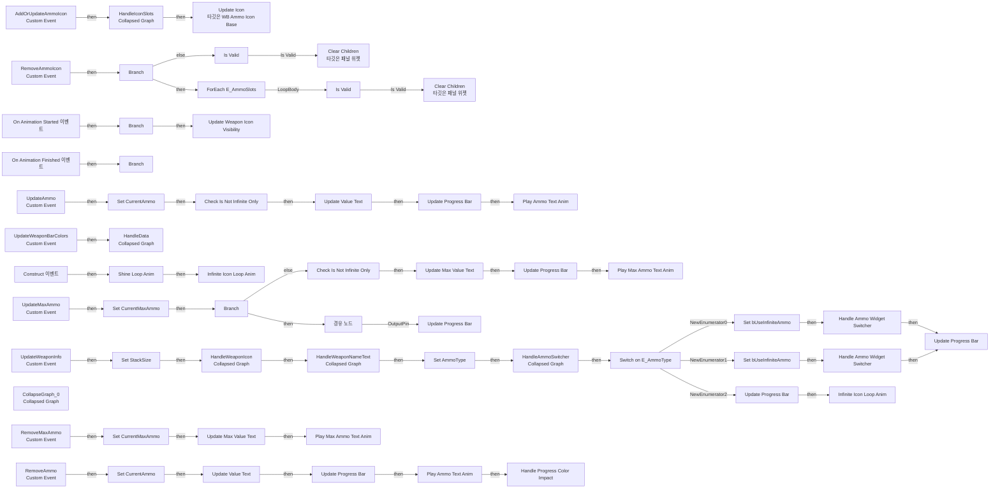
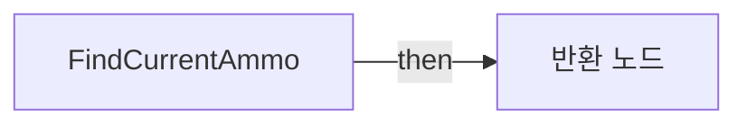
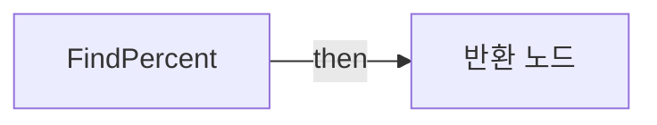

# WB_WeaponBar

에셋: `/Game/CompShooterHUD/UI/Content/WeaponBar/Content/WB_WeaponBar`

부모: `/Script/CoreUObject.Class'/Script/UMG.UserWidget'`

수집일: 2026-10-12. MCP에서 읽은 그래프·핀 연결의 자동 전사입니다. 상속된 그래프는 부모 문서를 함께 확인합니다.

정적 루트 참조 도달: 있음. 실행 여부 또는 삭제 가능 여부의 확정이 아닙니다.

컴포넌트 목록은 이 BP가 직접 정의한 SCS만 포함합니다. 부모·네이티브 생성 컴포넌트, 인스턴스 설정은 별도입니다.

## 변수와 기본값

| 이름 | 타입 | CDO 기본값 |
|---|---|---|
| `WeaponName` | `string` |  |
| `WeaponTextVisible` | `bool` | False |
| `CurrentAmmo` | `int` | 0 |
| `CurrentMaxAmmo` | `int` | 0 |
| `StackSize` | `int` | 0 |
| `bUseInfiniteAmmo` | `bool` | False |
| `AmmoType` | `E_AmmoType` | &lt;E_AmmoType.AMMO_BY_MAX_AMMO: 0&gt; |
| `ImpactColor` | `LinearColor` | &lt;Struct 'LinearColor' {r: 1.000000, g: 0.000000, b: 0.000000, a: 1.000000}&gt; |

## 그래프 목록

| 그래프 | 전체 노드 수 |
|---|---|
| EventGraph | 115 |
| FindCurrentAmmo | 14 |
| FindPercent | 7 |

## 그래프별 실행 연결

실선은 출력 exec 핀의 실제 연결입니다. 여러 분기는 출력 핀 이름을 표시합니다. 함수 호출·delegate·타이머의 다음 그래프 실행은 이 그림에서 자동으로 이어 붙이지 않습니다.

순수 계산 노드 및 데이터 핀은 아래 목록과 원본 JSON을 확인합니다. 연결되지 않은 이벤트도 표시되므로, 노드가 있다는 이유만으로 실행된다고 판단하면 안 됩니다.

### EventGraph

실행 핀 플로우차트

전체 노드·기본 입력 목록

| 노드 ID | 제목 | 미연결 기본 입력 / 에셋 입력 |
|---|---|---|
| `K2Node_CustomEvent_0` | AddOrUpdateAmmoIcon Custom Event |  |
| `K2Node_CallFunction_72` | Update Icon 타깃은 WB Ammo Icon Base |  |
| `EdGraphNode_Comment_43` | Event Add Ammo Icon |  |
| `K2Node_ForEachElementInEnum_0` | ForEach E_AmmoSlots |  |
| `K2Node_CustomEvent_112` | RemoveAmmoIcon Custom Event |  |
| `K2Node_MacroInstance_213` | Find Right Slot |  |
| `K2Node_CallFunction_2011` | Clear Children 타깃은 패널 위젯 |  |
| `EdGraphNode_Comment_44` | Event Remove Ammo Icon |  |
| `K2Node_MacroInstance_2` | Find Right Slot |  |
| `K2Node_CallFunction_1580` | Clear Children 타깃은 패널 위젯 |  |
| `K2Node_IfThenElse_113` | Branch |  |
| `K2Node_MacroInstance_232` | Is Valid |  |
| `K2Node_Knot_190` | 경유 노드 |  |
| `K2Node_MacroInstance_225` | Is Valid |  |
| `K2Node_Knot_191` | 경유 노드 |  |
| `K2Node_Composite_44` | HandleIconSlots Collapsed Graph |  |
| `K2Node_CustomEvent_33` | UpdateWeaponBarColors Custom Event |  |
| `K2Node_Event_0` | On Animation Started 이벤트 |  |
| `K2Node_Event_1` | On Animation Finished 이벤트 |  |
| `K2Node_VariableGet_610` | Get WeaponFadeAnim |  |
| `K2Node_CallFunction_990` | Equal (Object) |  |
| `K2Node_IfThenElse_183` | Branch |  |
| `K2Node_MacroInstance_499` | Update Weapon Icon Visibility | bVisible=true |
| `EdGraphNode_Comment_116` | Event On Animation Started |  |
| `EdGraphNode_Comment_28` | Event On Animation Started |  |
| `K2Node_VariableGet_232` | Get WeaponFadeAnim |  |
| `K2Node_CallFunction_777` | Equal (Object) |  |
| `K2Node_IfThenElse_142` | Branch |  |
| `K2Node_Event_49` | Construct 이벤트 |  |
| `K2Node_MacroInstance_1362` | Shine Loop Anim | PlaybackSpeed=1 |
| `K2Node_CustomEvent_789` | UpdateAmmo Custom Event |  |
| `K2Node_MacroInstance_1242` | Update Value Text |  |
| `K2Node_CallFunction_2652` | To Text (Integer) | bAlwaysSign=false; bUseGrouping=false; MinimumIntegralDigits=1; MaximumIntegralDigits=324 |
| `K2Node_Composite_47` | HandleData Collapsed Graph |  |
| `K2Node_MacroInstance_1240` | Play Ammo Text Anim | PlaybackSpeed=3 |
| `K2Node_VariableSet_321` | Set CurrentAmmo |  |
| `K2Node_CallFunction_2353` | Find Current Ammo | Value=0; ReturnValue=0 |
| `K2Node_MacroInstance_1241` | Update Progress Bar |  |
| `K2Node_CallFunction_2651` | Find Percent |  |
| `K2Node_Knot_149` | 경유 노드 |  |
| `EdGraphNode_Comment_223` | Event Update Ammo |  |
| `EdGraphNode_Comment_224` | Event Update Max Ammo |  |
| `K2Node_CustomEvent_488` | UpdateMaxAmmo Custom Event |  |
| `K2Node_VariableSet_289` | Set CurrentMaxAmmo | Output_Get=0 |
| `K2Node_MacroInstance_4576` | Update Progress Bar |  |
| `K2Node_CallFunction_11909` | Find Percent |  |
| `K2Node_VariableGet_7338` | Get CurrentAmmo |  |
| `K2Node_MacroInstance_1030` | Update Max Value Text |  |
| `K2Node_CallFunction_2114` | To Text (Integer) | bAlwaysSign=false; bUseGrouping=false; MinimumIntegralDigits=1; MaximumIntegralDigits=324 |
| `K2Node_VariableGet_2029` | Get StackSize |  |
| `K2Node_MacroInstance_1031` | Play Max Ammo Text Anim | PlaybackSpeed=3 |
| `K2Node_IfThenElse_1721` | Branch |  |
| `K2Node_VariableGet_7339` | Get StackSize |  |
| `K2Node_CallFunction_16358` | Find Percent |  |
| `K2Node_VariableGet_10122` | Get CurrentAmmo |  |
| `K2Node_VariableGet_10123` | Get StackSize |  |
| `K2Node_MacroInstance_6379` | Update Progress Bar |  |
| `K2Node_MacroInstance_3906` | Infinite Icon Loop Anim | PlaybackSpeed=1 |
| `K2Node_Knot_155` | 경유 노드 |  |
| `K2Node_CustomEvent_1355` | UpdateWeaponInfo Custom Event |  |
| `K2Node_VariableGet_1422` | Get bUseInfiniteAmmo |  |
| `K2Node_VariableSet_1270` | Set bUseInfiniteAmmo | bUseInfiniteAmmo=true |
| `K2Node_Composite_45` | HandleWeaponIcon Collapsed Graph |  |
| `K2Node_Knot_137` | 경유 노드 |  |
| `K2Node_Composite_46` | HandleWeaponNameText Collapsed Graph |  |
| `K2Node_SwitchEnum_0` | Switch on E_AmmoType |  |
| `K2Node_Knot_311` | 경유 노드 |  |
| `K2Node_VariableSet_962` | Set bUseInfiniteAmmo | bUseInfiniteAmmo=false |
| `K2Node_MacroInstance_6302` | Handle Ammo Widget Switcher |  |
| `K2Node_MacroInstance_3551` | Handle Ammo Widget Switcher |  |
| `K2Node_MacroInstance_5034` | Infinite Icon Loop Anim | PlaybackSpeed=1 |
| `K2Node_CallFunction_7455` | Find Percent |  |
| `K2Node_VariableGet_904` | Get CurrentAmmo |  |
| `K2Node_VariableGet_1226` | Get StackSize |  |
| `K2Node_MacroInstance_6406` | Update Progress Bar |  |
| `K2Node_MacroInstance_2393` | Update Progress Bar | InPercent=1 |
| `K2Node_VariableSet_1185` | Set AmmoType |  |
| `K2Node_MacroInstance_5188` | Check Is Not Infinite Only |  |
| `K2Node_MacroInstance_6804` | Check Is Not Infinite Only |  |
| `K2Node_Composite_62` | HandleAmmoSwitcher Collapsed Graph |  |
| `EdGraphNode_Comment_71` | Event Update Weapon Info |  |
| `EdGraphNode_Comment_2035` | Event Update Weapon Bar Colors |  |
| `K2Node_Composite_63` | CollapseGraph_0 Collapsed Graph |  |
| `EdGraphNode_Comment_72` | Event Construct |  |
| `K2Node_VariableSet_1378` | Set StackSize | Output_Get=0 |
| `K2Node_CustomEvent_92` | RemoveAmmo Custom Event |  |
| `K2Node_CustomEvent_106` | RemoveMaxAmmo Custom Event |  |
| `EdGraphNode_Comment_856` | Event Remove Ammo |  |
| `EdGraphNode_Comment_29` | Event Remove Max Ammo |  |
| `K2Node_VariableGet_1588` | Get CurrentMaxAmmo |  |
| `K2Node_Composite_298` | FindMaxAmmo Collapsed Graph |  |
| `K2Node_VariableSet_660` | Set CurrentMaxAmmo |  |
| `K2Node_VariableGet_1510` | Get CurrentMaxAmmo |  |
| `K2Node_CallFunction_2113` | int - int |  |
| `K2Node_MacroInstance_2749` | Update Max Value Text |  |
| `K2Node_CallFunction_4349` | To Text (Integer) | bAlwaysSign=false; bUseGrouping=false; MinimumIntegralDigits=1; MaximumIntegralDigits=324 |
| `K2Node_MacroInstance_3141` | Play Max Ammo Text Anim | PlaybackSpeed=2 |
| `K2Node_VariableSet_583` | Set CurrentAmmo |  |
| `K2Node_CallFunction_6871` | Find Current Ammo | Value=0; ReturnValue=0 |
| `K2Node_VariableGet_993` | Get CurrentAmmo |  |
| `K2Node_CallFunction_2354` | int - int |  |
| `K2Node_MacroInstance_1894` | Play Ammo Text Anim | PlaybackSpeed=3 |
| `K2Node_CallFunction_7890` | Find Percent |  |
| `K2Node_VariableGet_1048` | Get StackSize |  |
| `K2Node_MacroInstance_3069` | Update Progress Bar |  |
| `K2Node_MacroInstance_1690` | Update Value Text |  |
| `K2Node_CallFunction_8753` | To Text (Integer) | bAlwaysSign=false; bUseGrouping=false; MinimumIntegralDigits=1; MaximumIntegralDigits=324 |
| `K2Node_VariableGet_2220` | Get CurrentAmmo |  |
| `K2Node_Composite_17` | FindAmmo Collapsed Graph |  |
| `K2Node_CallFunction_574` | integer &lt;= integer | B=0 |
| `K2Node_Select_80` | 선택 | Option 1=0 |
| `K2Node_CallFunction_228` | integer &lt;= integer | B=0 |
| `K2Node_Select_14` | 선택 | Option 1=0 |
| `K2Node_MacroInstance_1250` | Handle Progress Color Impact | Duration=0.25 |
| `K2Node_VariableGet_705` | Get ImpactColor |  |

### FindCurrentAmmo

실행 핀 플로우차트

전체 노드·기본 입력 목록

| 노드 ID | 제목 | 미연결 기본 입력 / 에셋 입력 |
|---|---|---|
| `K2Node_FunctionEntry_2185` | FindCurrentAmmo |  |
| `K2Node_FunctionResult_1` | 반환 노드 |  |
| `K2Node_VariableGet_1082` | Get CurrentMaxAmmo |  |
| `K2Node_CallFunction_308` | integer &gt;= integer |  |
| `K2Node_Select_0` | 선택 |  |
| `K2Node_Knot_1305` | 경유 노드 |  |
| `K2Node_CallFunction_711` | Make Literal Int |  |
| `K2Node_CallFunction_712` | Make Literal Int |  |
| `K2Node_CallFunction_228` | integer &lt;= integer | B=0 |
| `K2Node_Select_14` | 선택 | Option 1=0 |
| `K2Node_Knot_864` | 경유 노드 |  |
| `K2Node_Knot_957` | 경유 노드 |  |
| `K2Node_VariableGet_1293` | Get bUseInfiniteAmmo |  |
| `K2Node_Select_1919` | 선택 |  |

### FindPercent

실행 핀 플로우차트

전체 노드·기본 입력 목록

| 노드 ID | 제목 | 미연결 기본 입력 / 에셋 입력 |
|---|---|---|
| `K2Node_FunctionEntry_2039` | FindPercent |  |
| `K2Node_CallFunction_1324` | To Float (Integer) |  |
| `K2Node_CallFunction_1325` | float / float | B=100 |
| `K2Node_CallFunction_1326` | To Float (Integer) |  |
| `K2Node_CallFunction_322` | float / float | B=100 |
| `K2Node_CallFunction_1368` | Map Range Clamped | InRangeA=0.0; OutRangeA=0.0; OutRangeB=1 |
| `K2Node_FunctionResult_0` | 반환 노드 |  |

## 조회 범위의 한계

ObjectIterator로 발견했으나 MCP helper가 반환하지 않은 그래프입니다. delegate signature·컴파일된 중간 그래프·macro·애니메이션 내부 그래프가 섞일 수 있습니다.

- `AddOrUpdateAmmoIcon`: Graph 'AddOrUpdateAmmoIcon' not found in Blueprint.
- `CheckIsNotInfiniteOnly`: Graph 'CheckIsNotInfiniteOnly' not found in Blueprint.
- `Construct`: Graph 'Construct' not found in Blueprint.
- `FadeWeaponAnim`: Graph 'FadeWeaponAnim' not found in Blueprint.
- `FadeWeaponNameAnim`: Graph 'FadeWeaponNameAnim' not found in Blueprint.
- `FindRightSlot`: Graph 'FindRightSlot' not found in Blueprint.
- `HandleAmmoWidgetSwitcher`: Graph 'HandleAmmoWidgetSwitcher' not found in Blueprint.
- `HandleProgressColorImpact`: Graph 'HandleProgressColorImpact' not found in Blueprint.
- `InfiniteIconLoopAnim`: Graph 'InfiniteIconLoopAnim' not found in Blueprint.
- `OnAnimationFinished`: Graph 'OnAnimationFinished' not found in Blueprint.
- `OnAnimationStarted`: Graph 'OnAnimationStarted' not found in Blueprint.
- `PlayAmmoTextAnim`: Graph 'PlayAmmoTextAnim' not found in Blueprint.
- `PlayMaxAmmoTextAnim`: Graph 'PlayMaxAmmoTextAnim' not found in Blueprint.
- `RemoveAmmo`: Graph 'RemoveAmmo' not found in Blueprint.
- `RemoveAmmoIcon`: Graph 'RemoveAmmoIcon' not found in Blueprint.
- `RemoveMaxAmmo`: Graph 'RemoveMaxAmmo' not found in Blueprint.
- `SetWeaponIcon`: Graph 'SetWeaponIcon' not found in Blueprint.
- `ShineLoopAnim`: Graph 'ShineLoopAnim' not found in Blueprint.
- `UpdateAmmo`: Graph 'UpdateAmmo' not found in Blueprint.
- `UpdateMaxAmmo`: Graph 'UpdateMaxAmmo' not found in Blueprint.
- `UpdateMaxValueText`: Graph 'UpdateMaxValueText' not found in Blueprint.
- `UpdateProgressBar`: Graph 'UpdateProgressBar' not found in Blueprint.
- `UpdateValueText`: Graph 'UpdateValueText' not found in Blueprint.
- `UpdateWeaponBarColors`: Graph 'UpdateWeaponBarColors' not found in Blueprint.
- `UpdateWeaponIconVisibility`: Graph 'UpdateWeaponIconVisibility' not found in Blueprint.
- `UpdateWeaponInfo`: Graph 'UpdateWeaponInfo' not found in Blueprint.

[원본 MCP 스냅샷](../../../../../../Evidence/blueprints-316.json)
