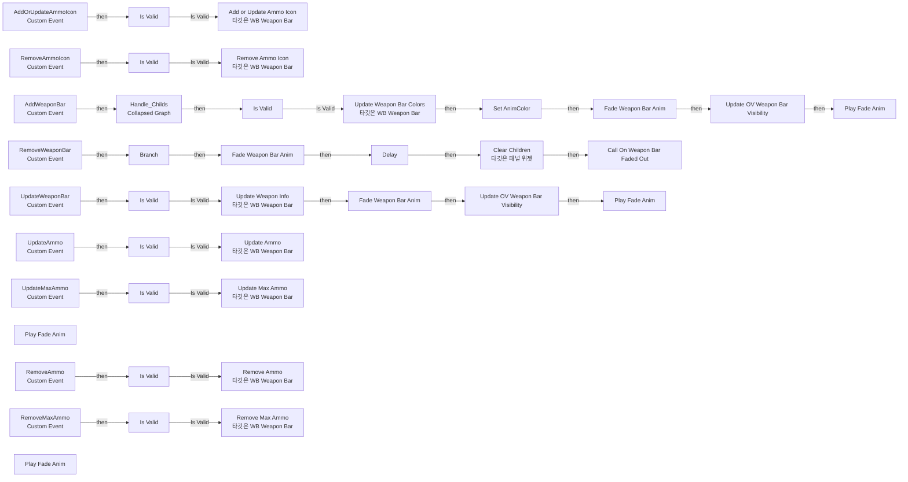
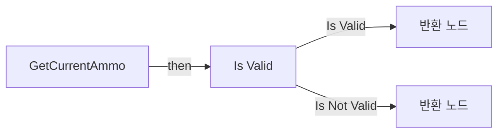
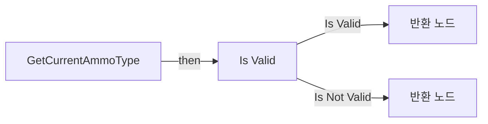
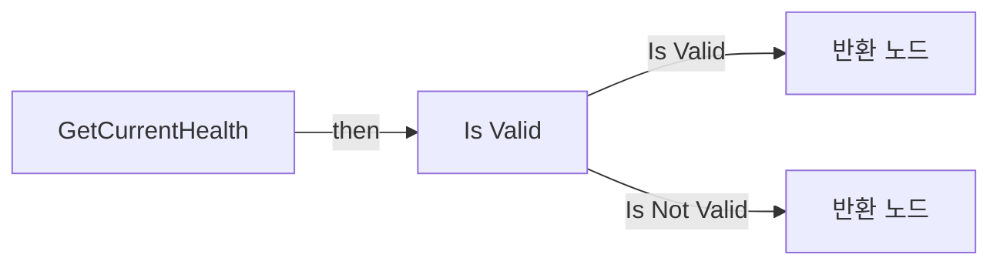
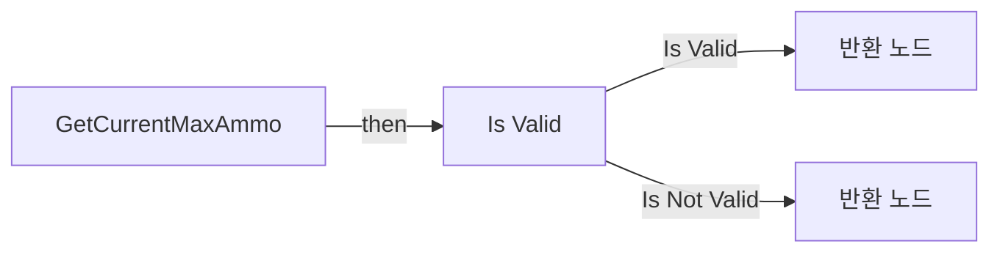
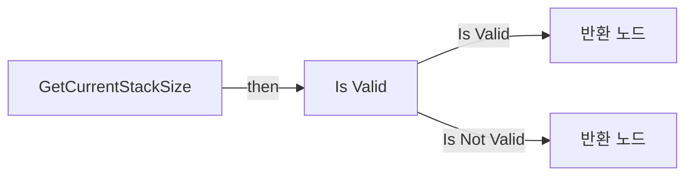
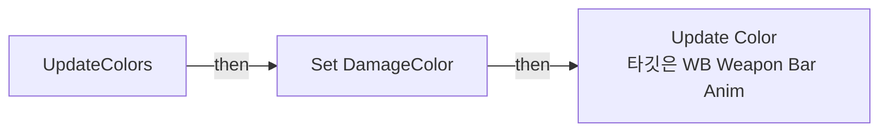
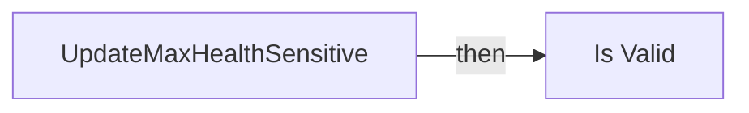

# WB_WeaponBar_Base

에셋: `/Game/CompShooterHUD/UI/Content/WeaponBar/WB_WeaponBar_Base`

부모: `/Script/CoreUObject.Class'/Script/UMG.UserWidget'`

수집일: 2026-10-12. MCP에서 읽은 그래프·핀 연결의 자동 전사입니다. 상속된 그래프는 부모 문서를 함께 확인합니다.

정적 루트 참조 도달: 있음. 실행 여부 또는 삭제 가능 여부의 확정이 아닙니다.

컴포넌트 목록은 이 BP가 직접 정의한 SCS만 포함합니다. 부모·네이티브 생성 컴포넌트, 인스턴스 설정은 별도입니다.

## 변수와 기본값

| 이름 | 타입 | CDO 기본값 |
|---|---|---|
| `OnWeaponBarFadedOut` | `mcdelegate` | &lt;Delegate 'DelegateBase' &lt;Unbound&gt;&gt; |
| `WB_WeaponBar` | `WB_WeaponBar_C` | None |
| `WB_WeaponBarAnim` | `WB_WeaponBarAnim_C` | None |
| `DamageColor` | `LinearColor` | &lt;Struct 'LinearColor' {r: 0.000000, g: 0.000000, b: 0.000000, a: 0.000000}&gt; |
| `AnimColor` | `LinearColor` | &lt;Struct 'LinearColor' {r: 0.000000, g: 0.000000, b: 0.000000, a: 0.000000}&gt; |

## 그래프 목록

| 그래프 | 전체 노드 수 |
|---|---|
| EventGraph | 113 |
| GetCurrentAmmo | 7 |
| GetCurrentAmmoType | 7 |
| GetCurrentHealth | 5 |
| GetCurrentMaxAmmo | 7 |
| GetCurrentMaxHealth | 5 |
| GetCurrentStackSize | 6 |
| UpdateColors | 5 |
| UpdateMaxHealthSensitive | 6 |

## 그래프별 실행 연결

실선은 출력 exec 핀의 실제 연결입니다. 여러 분기는 출력 핀 이름을 표시합니다. 함수 호출·delegate·타이머의 다음 그래프 실행은 이 그림에서 자동으로 이어 붙이지 않습니다.

순수 계산 노드 및 데이터 핀은 아래 목록과 원본 JSON을 확인합니다. 연결되지 않은 이벤트도 표시되므로, 노드가 있다는 이유만으로 실행된다고 판단하면 안 됩니다.

### EventGraph

실행 핀 플로우차트

전체 노드·기본 입력 목록

| 노드 ID | 제목 | 미연결 기본 입력 / 에셋 입력 |
|---|---|---|
| `EdGraphNode_Comment_163` | Event Add Weapon Bar |  |
| `EdGraphNode_Comment_9` | Event Remove Weapon Bar |  |
| `K2Node_CustomEvent_59` | AddWeaponBar Custom Event |  |
| `K2Node_CustomEvent_69` | RemoveWeaponBar Custom Event |  |
| `K2Node_Composite_298` | Handle_Childs Collapsed Graph |  |
| `K2Node_MacroInstance_52` | Fade Weapon Bar Anim | bVisible=true |
| `K2Node_MacroInstance_53` | Update OV Weapon Bar Visibility | bVisible=true |
| `EdGraphNode_Comment_28` | Handle Anim |  |
| `K2Node_MacroInstance_28` | Is Valid |  |
| `K2Node_VariableGet_124` | Get WB_WeaponBar |  |
| `K2Node_CallFunction_301` | Add or Update Ammo Icon 타깃은 WB Weapon Bar |  |
| `K2Node_Knot_16` | 경유 노드 |  |
| `K2Node_MacroInstance_697` | Is Valid |  |
| `K2Node_VariableGet_929` | Get WB_WeaponBar |  |
| `K2Node_Knot_192` | 경유 노드 |  |
| `K2Node_CallFunction_306` | Remove Ammo Icon 타깃은 WB Weapon Bar |  |
| `K2Node_CustomEvent_10` | RemoveAmmoIcon Custom Event |  |
| `K2Node_CustomEvent_22` | AddOrUpdateAmmoIcon Custom Event |  |
| `K2Node_Knot_193` | 경유 노드 |  |
| `K2Node_Knot_194` | 경유 노드 |  |
| `K2Node_Knot_195` | 경유 노드 |  |
| `K2Node_Knot_196` | 경유 노드 |  |
| `K2Node_Knot_197` | 경유 노드 |  |
| `K2Node_Knot_198` | 경유 노드 |  |
| `EdGraphNode_Comment_45` | Event Add Or Update Ammo Icon |  |
| `K2Node_Knot_199` | 경유 노드 |  |
| `K2Node_Knot_200` | 경유 노드 |  |
| `K2Node_Knot_201` | 경유 노드 |  |
| `K2Node_Knot_202` | 경유 노드 |  |
| `EdGraphNode_Comment_46` | Event Remove Ammo Icon |  |
| `K2Node_CustomEvent_8` | UpdateWeaponBar Custom Event |  |
| `EdGraphNode_Comment_164` | Event Update Weapon Bar |  |
| `K2Node_VariableGet_276` | Get WB_WeaponBar |  |
| `K2Node_MacroInstance_1592` | Fade Weapon Bar Anim | bVisible=true |
| `K2Node_MacroInstance_1545` | Update OV Weapon Bar Visibility | bVisible=true |
| `K2Node_CallFunction_788` | Update Weapon Info 타깃은 WB Weapon Bar |  |
| `K2Node_MacroInstance_132` | Is Valid |  |
| `K2Node_Knot_313` | 경유 노드 |  |
| `K2Node_Knot_314` | 경유 노드 |  |
| `K2Node_Knot_315` | 경유 노드 |  |
| `K2Node_Knot_316` | 경유 노드 |  |
| `K2Node_Knot_317` | 경유 노드 |  |
| `K2Node_Knot_318` | 경유 노드 |  |
| `K2Node_Knot_319` | 경유 노드 |  |
| `K2Node_VariableGet_403` | Get WB_WeaponBar |  |
| `K2Node_MacroInstance_308` | Is Valid |  |
| `K2Node_CallFunction_897` | Update Weapon Bar Colors 타깃은 WB Weapon Bar |  |
| `K2Node_Knot_320` | 경유 노드 |  |
| `K2Node_Knot_321` | 경유 노드 |  |
| `K2Node_Knot_322` | 경유 노드 |  |
| `K2Node_Knot_323` | 경유 노드 |  |
| `K2Node_Knot_324` | 경유 노드 |  |
| `K2Node_Knot_325` | 경유 노드 |  |
| `K2Node_Knot_326` | 경유 노드 |  |
| `K2Node_Knot_327` | 경유 노드 |  |
| `K2Node_Knot_328` | 경유 노드 |  |
| `K2Node_MacroInstance_5779` | Fade Weapon Bar Anim |  |
| `K2Node_CallFunction_1038` | Delay | Duration=0.25 |
| `K2Node_VariableGet_358` | Get OV_WeaponBar |  |
| `K2Node_CallFunction_1039` | Clear Children 타깃은 패널 위젯 |  |
| `K2Node_VariableGet_1776` | Get OV_WeaponBar |  |
| `K2Node_CallFunction_1082` | Has Any Children 타깃은 패널 위젯 |  |
| `K2Node_IfThenElse_174` | Branch |  |
| `K2Node_CallDelegate_237` | Call On Weapon Bar Faded Out |  |
| `K2Node_VariableGet_361` | Get WB_WeaponBar |  |
| `K2Node_MacroInstance_433` | Is Valid |  |
| `EdGraphNode_Comment_288` | Event Update Max Ammo |  |
| `EdGraphNode_Comment_289` | Event Update Ammo |  |
| `K2Node_CustomEvent_149` | UpdateAmmo Custom Event |  |
| `K2Node_VariableGet_1683` | Get WB_WeaponBar |  |
| `K2Node_MacroInstance_54` | Is Valid |  |
| `K2Node_CustomEvent_137` | UpdateMaxAmmo Custom Event |  |
| `K2Node_CallFunction_1390` | Update Ammo 타깃은 WB Weapon Bar |  |
| `K2Node_Knot_395` | 경유 노드 |  |
| `K2Node_Knot_396` | 경유 노드 |  |
| `K2Node_Knot_397` | 경유 노드 |  |
| `K2Node_CallFunction_1449` | Update Max Ammo 타깃은 WB Weapon Bar |  |
| `K2Node_Knot_398` | 경유 노드 |  |
| `K2Node_Knot_401` | 경유 노드 |  |
| `K2Node_Knot_402` | 경유 노드 |  |
| `K2Node_Knot_403` | 경유 노드 |  |
| `K2Node_Knot_404` | 경유 노드 |  |
| `K2Node_MacroInstance_38` | Play Fade Anim |  |
| `K2Node_Knot_1007` | 경유 노드 |  |
| `K2Node_Knot_1008` | 경유 노드 |  |
| `K2Node_Knot_1009` | 경유 노드 |  |
| `K2Node_Knot_1010` | 경유 노드 |  |
| `K2Node_VariableGet_398` | Get WB_WeaponBar |  |
| `K2Node_MacroInstance_494` | Is Valid |  |
| `K2Node_CustomEvent_217` | RemoveAmmo Custom Event |  |
| `K2Node_CustomEvent_233` | RemoveMaxAmmo Custom Event |  |
| `K2Node_VariableGet_420` | Get WB_WeaponBar |  |
| `K2Node_MacroInstance_337` | Is Valid |  |
| `EdGraphNode_Comment_21` | Event Remove Max Ammo |  |
| `EdGraphNode_Comment_64` | Event Remove Ammo |  |
| `K2Node_CallFunction_903` | Remove Ammo 타깃은 WB Weapon Bar |  |
| `K2Node_Knot_1543` | 경유 노드 |  |
| `K2Node_Knot_1544` | 경유 노드 |  |
| `K2Node_CallFunction_922` | Remove Max Ammo 타깃은 WB Weapon Bar |  |
| `K2Node_Knot_1545` | 경유 노드 |  |
| `K2Node_Knot_1546` | 경유 노드 |  |
| `K2Node_MacroInstance_175` | Play Fade Anim |  |
| `K2Node_MacroInstance_477` | Play Fade Anim |  |
| `K2Node_VariableSet_134` | Set AnimColor |  |
| `K2Node_Knot_180` | 경유 노드 |  |
| `K2Node_Knot_226` | 경유 노드 |  |
| `K2Node_Knot_227` | 경유 노드 |  |
| `K2Node_Knot_228` | 경유 노드 |  |
| `K2Node_Knot_229` | 경유 노드 |  |
| `K2Node_Knot_230` | 경유 노드 |  |
| `K2Node_MacroInstance_6397` | Play Fade Anim |  |
| `K2Node_Knot_333` | 경유 노드 |  |
| `K2Node_Knot_334` | 경유 노드 |  |

### GetCurrentAmmo

실행 핀 플로우차트

전체 노드·기본 입력 목록

| 노드 ID | 제목 | 미연결 기본 입력 / 에셋 입력 |
|---|---|---|
| `K2Node_FunctionEntry_24` | GetCurrentAmmo |  |
| `K2Node_VariableGet_276` | Get WB_WeaponBar |  |
| `K2Node_MacroInstance_132` | Is Valid |  |
| `K2Node_Knot_313` | 경유 노드 |  |
| `K2Node_VariableGet_58` | Get CurrentAmmo |  |
| `K2Node_FunctionResult_0` | 반환 노드 |  |
| `K2Node_FunctionResult_3` | 반환 노드 | CurrentAmmo=0 |

### GetCurrentAmmoType

실행 핀 플로우차트

전체 노드·기본 입력 목록

| 노드 ID | 제목 | 미연결 기본 입력 / 에셋 입력 |
|---|---|---|
| `K2Node_FunctionEntry_24` | GetCurrentAmmoType |  |
| `K2Node_VariableGet_276` | Get WB_WeaponBar |  |
| `K2Node_MacroInstance_132` | Is Valid |  |
| `K2Node_Knot_313` | 경유 노드 |  |
| `K2Node_FunctionResult_1` | 반환 노드 |  |
| `K2Node_FunctionResult_0` | 반환 노드 | AmmoType=NewEnumerator0 |
| `K2Node_VariableGet_253` | Get AmmoType |  |

### GetCurrentHealth

실행 핀 플로우차트

전체 노드·기본 입력 목록

| 노드 ID | 제목 | 미연결 기본 입력 / 에셋 입력 |
|---|---|---|
| `K2Node_FunctionEntry_663` | GetCurrentHealth |  |
| `K2Node_FunctionResult_1` | 반환 노드 | CurrentHealth=0 |
| `K2Node_VariableGet_478` | Get WB_WeaponBar |  |
| `K2Node_MacroInstance_44` | Is Valid |  |
| `K2Node_FunctionResult_0` | 반환 노드 | CurrentHealth=0 |

### GetCurrentMaxAmmo

실행 핀 플로우차트

전체 노드·기본 입력 목록

| 노드 ID | 제목 | 미연결 기본 입력 / 에셋 입력 |
|---|---|---|
| `K2Node_FunctionEntry_24` | GetCurrentMaxAmmo |  |
| `K2Node_VariableGet_276` | Get WB_WeaponBar |  |
| `K2Node_MacroInstance_132` | Is Valid |  |
| `K2Node_Knot_313` | 경유 노드 |  |
| `K2Node_FunctionResult_0` | 반환 노드 |  |
| `K2Node_VariableGet_114` | Get CurrentMaxAmmo |  |
| `K2Node_FunctionResult_2` | 반환 노드 | CurrentMaxAmmo=0 |

### GetCurrentMaxHealth

실행 핀 플로우차트

전체 노드·기본 입력 목록

| 노드 ID | 제목 | 미연결 기본 입력 / 에셋 입력 |
|---|---|---|
| `K2Node_FunctionEntry_817` | GetCurrentMaxHealth |  |
| `K2Node_MacroInstance_44` | Is Valid |  |
| `K2Node_VariableGet_478` | Get WB_WeaponBar |  |
| `K2Node_FunctionResult_2` | 반환 노드 | CurrentMaxHealth=0 |
| `K2Node_FunctionResult_0` | 반환 노드 | CurrentMaxHealth=0 |

### GetCurrentStackSize

실행 핀 플로우차트

전체 노드·기본 입력 목록

| 노드 ID | 제목 | 미연결 기본 입력 / 에셋 입력 |
|---|---|---|
| `K2Node_FunctionEntry_24` | GetCurrentStackSize |  |
| `K2Node_VariableGet_276` | Get WB_WeaponBar |  |
| `K2Node_MacroInstance_132` | Is Valid |  |
| `K2Node_FunctionResult_1` | 반환 노드 |  |
| `K2Node_VariableGet_153` | Get StackSize |  |
| `K2Node_FunctionResult_0` | 반환 노드 | StackSize=0 |

### UpdateColors

실행 핀 플로우차트

전체 노드·기본 입력 목록

| 노드 ID | 제목 | 미연결 기본 입력 / 에셋 입력 |
|---|---|---|
| `K2Node_FunctionEntry_827` | UpdateColors |  |
| `K2Node_VariableGet_303` | Get WB_WeaponBar |  |
| `K2Node_VariableGet_384` | Get WB_WeaponBarAnim |  |
| `K2Node_VariableSet_716` | Set DamageColor |  |
| `K2Node_CallFunction_2310` | Update Color 타깃은 WB Weapon Bar Anim |  |

### UpdateMaxHealthSensitive

실행 핀 플로우차트

전체 노드·기본 입력 목록

| 노드 ID | 제목 | 미연결 기본 입력 / 에셋 입력 |
|---|---|---|
| `K2Node_FunctionEntry_890` | UpdateMaxHealthSensitive |  |
| `K2Node_VariableGet_478` | Get WB_WeaponBar |  |
| `K2Node_MacroInstance_44` | Is Valid |  |
| `K2Node_Knot_1322` | 경유 노드 |  |
| `K2Node_Knot_1323` | 경유 노드 |  |
| `K2Node_Knot_1324` | 경유 노드 |  |

## 조회 범위의 한계

ObjectIterator로 발견했으나 MCP helper가 반환하지 않은 그래프입니다. delegate signature·컴파일된 중간 그래프·macro·애니메이션 내부 그래프가 섞일 수 있습니다.

- `AddOrUpdateAmmoIcon`: Graph 'AddOrUpdateAmmoIcon' not found in Blueprint.
- `AddWeaponAnimToOverlay`: Graph 'AddWeaponAnimToOverlay' not found in Blueprint.
- `AddWeaponBar`: Graph 'AddWeaponBar' not found in Blueprint.
- `AddWeaponBarToOverlay`: Graph 'AddWeaponBarToOverlay' not found in Blueprint.
- `FadeWeaponBarAnim`: Graph 'FadeWeaponBarAnim' not found in Blueprint.
- `OV_WeaponAnim_HasNoChildren?`: Graph 'OV_WeaponAnim_HasNoChildren?' not found in Blueprint.
- `OV_WeaponBar_HasNoChildren?`: Graph 'OV_WeaponBar_HasNoChildren?' not found in Blueprint.
- `OnWeaponBarFadedOut`: Graph 'OnWeaponBarFadedOut' not found in Blueprint.
- `PlayFadeAnim`: Graph 'PlayFadeAnim' not found in Blueprint.
- `PlayHealthFadeAnim`: Graph 'PlayHealthFadeAnim' not found in Blueprint.
- `RemoveAmmo`: Graph 'RemoveAmmo' not found in Blueprint.
- `RemoveAmmoIcon`: Graph 'RemoveAmmoIcon' not found in Blueprint.
- `RemoveMaxAmmo`: Graph 'RemoveMaxAmmo' not found in Blueprint.
- `RemoveWeaponBar`: Graph 'RemoveWeaponBar' not found in Blueprint.
- `UpdateAmmo`: Graph 'UpdateAmmo' not found in Blueprint.
- `UpdateMaxAmmo`: Graph 'UpdateMaxAmmo' not found in Blueprint.
- `UpdateOV_WeaponBar_Visibility`: Graph 'UpdateOV_WeaponBar_Visibility' not found in Blueprint.
- `UpdateWeaponBar`: Graph 'UpdateWeaponBar' not found in Blueprint.

[원본 MCP 스냅샷](../../../../../Evidence/blueprints-316.json)
