# WB_Base_Icon

에셋: `/Game/CompShooterHUD/UI/Icons/WB_Base_Icon`

부모: `/Script/CoreUObject.Class'/Script/UMG.UserWidget'`

수집일: 2026-10-12. MCP에서 읽은 그래프·핀 연결의 자동 전사입니다. 상속된 그래프는 부모 문서를 함께 확인합니다.

정적 루트 참조 도달: 있음. 실행 여부 또는 삭제 가능 여부의 확정이 아닙니다.

컴포넌트 목록은 이 BP가 직접 정의한 SCS만 포함합니다. 부모·네이티브 생성 컴포넌트, 인스턴스 설정은 별도입니다.

## 변수와 기본값

| 이름 | 타입 | CDO 기본값 |
|---|---|---|
| `Icon` | `Object` | /Game/CompShooterHUD/Textures/Icons/Generic_Icons/64x64/T_ExclamationMark_64x64.T_ExclamationMark_64x64 |
| `bBaseColor` | `bool` | True |
| `BaseColor` | `LinearColor` | &lt;Struct 'LinearColor' {r: 0.245000, g: 0.245000, b: 0.245000, a: 1.000000}&gt; |
| `bBaseMask` | `bool` | True |
| `BaseMaskColor` | `LinearColor` | &lt;Struct 'LinearColor' {r: 0.000000, g: 0.000000, b: 0.000000, a: 1.000000}&gt; |
| `bOutline1` | `bool` | True |
| `Outline1_Color` | `LinearColor` | &lt;Struct 'LinearColor' {r: 1.000000, g: 1.000000, b: 1.000000, a: 1.000000}&gt; |
| `bContour` | `bool` | True |
| `Contour_Color` | `LinearColor` | &lt;Struct 'LinearColor' {r: 1.000000, g: 1.000000, b: 1.000000, a: 1.000000}&gt; |
| `bGlassMask` | `bool` | True |
| `GlassMask_Color` | `LinearColor` | &lt;Struct 'LinearColor' {r: 1.000000, g: 1.000000, b: 1.000000, a: 0.700000}&gt; |
| `GlassMask Types` | `E_MaskTypes` | &lt;E_MaskTypes.GLASS_MASK1: 0&gt; |
| `IconColor` | `LinearColor` | &lt;Struct 'LinearColor' {r: 1.000000, g: 1.000000, b: 1.000000, a: 1.000000}&gt; |
| `IconScale` | `real` | 1.0 |
| `Overall_Angle` | `real` | 0.0 |
| `IconBaseTypes` | `E_IconTypes` | &lt;E_IconTypes.SQUARE: 0&gt; |
| `IconBaseSize` | `E_IconSizes` | &lt;E_IconSizes.64_X_64: 0&gt; |
| `Custom_BaseIcon` | `Texture2D` | None |
| `Custom_Mask1` | `Texture2D` | None |
| `Custom_Mask2` | `Texture2D` | None |
| `Custom_Outline1` | `Texture2D` | None |
| `Custom_Outline2` | `Texture2D` | None |
| `Icon_Translation_X` | `real` | 0.0 |
| `Icon_Translation_Y` | `real` | 0.0 |
| `bUseIconText` | `bool` | False |
| `IconText` | `text` | ! |
| `IconText_Transform` | `WidgetTransform` | &lt;Struct 'WidgetTransform' {translation: {x: 0.000000, y: 0.000000}, scale: {x: 1.000000, y: 1.000000}, shear: {x: 0.000000, y: 0.000000}, angle: 0.000000}&gt; |
| `IconText_Color` | `SlateColor` | &lt;Struct 'SlateColor' {specified_color: {r: 1.000000, g: 1.000000, b: 1.000000, a: 1.000000}, color_use_rule: UseColor_Specified}&gt; |
| `IconTextFont` | `SlateFontInfo` | &lt;Struct 'SlateFontInfo' {font_object: "/Script/Engine.Font'/Engine/EngineFonts/Roboto.Roboto'", font_material: None, outline_settings: {outline_size: 0, mitered_corners: False, separate_fill_alpha: False, apply_outline_to_drop_shadows: True, outline_material: None, outline_color: {r: 0.000000, g: 0.000000, b: 0.000000, a: 1.000000}}, typeface_font_name: "Regular", size: 20.000000, letter_spacing: 0, skew_amount: 0.000000, force_monospaced: False, material_is_stencil: False, monospaced_width: 1.000000}&gt; |
| `Highlight_Anim?` | `bool` | False |
| `HighlightAnimColor` | `LinearColor` | &lt;Struct 'LinearColor' {r: 1.000000, g: 1.000000, b: 1.000000, a: 1.000000}&gt; |

## 그래프 목록

| 그래프 | 전체 노드 수 |
|---|---|
| EventGraph | 80 |

## 그래프별 실행 연결

실선은 출력 exec 핀의 실제 연결입니다. 여러 분기는 출력 핀 이름을 표시합니다. 함수 호출·delegate·타이머의 다음 그래프 실행은 이 그림에서 자동으로 이어 붙이지 않습니다.

순수 계산 노드 및 데이터 핀은 아래 목록과 원본 JSON을 확인합니다. 연결되지 않은 이벤트도 표시되므로, 노드가 있다는 이유만으로 실행된다고 판단하면 안 됩니다.

### EventGraph

```mermaid
flowchart LR
  n0["Pre Construct 이벤트"]
  n1["Set Icon"]
  n2["Set Icon Color"]
  n3["Set Base Color"]
  n4["Set Mask 1"]
  n5["Set Outline 1"]
  n6["Set Outline 2"]
  n7["Set Glass Mask"]
  n8["Set Overall Angle"]
  n9["Set Icon Scale"]
  n10["Set Base Icon Data"]
  n11["Delay"]
  n12["Set Icon Translation"]
  n13["Branch"]
  n14["SetText (Text)<br/>타깃은 텍스트"]
  n15["Set Visibility<br/>타깃은 위젯"]
  n16["Set Visibility<br/>타깃은 위젯"]
  n17["Set Render Transform<br/>타깃은 위젯"]
  n18["Set Color and Opacity<br/>타깃은 텍스트"]
  n19["Set Font<br/>타깃은 텍스트"]
  n20["Is Valid"]
  n21["Update<br/>Custom Event"]
  n22["경유 노드"]
  n23["Branch"]
  n24["Set Visibility<br/>타깃은 위젯"]
  n25["Play Animation<br/>타깃은 사용자 위젯"]
  n26["Set Shine Brush"]
  n27["Construct 이벤트"]
  n28["Set Color and Opacity<br/>타깃은 이미지"]
  n29["시퀀스"]
  n30["경유 노드"]
  n0 -->|"then"| n22
  n1 -->|"then"| n2
  n2 -->|"then"| n9
  n3 -->|"then"| n4
  n4 -->|"then"| n5
  n5 -->|"then"| n6
  n6 -->|"then"| n7
  n7 -->|"then"| n8
  n8 -->|"then"| n12
  n9 -->|"then"| n28
  n10 -->|"then"| n11
  n11 -->|"then"| n1
  n12 -->|"then"| n20
  n13 -->|"then"| n15
  n13 -->|"else"| n16
  n14 -->|"then"| n17
  n15 -->|"then"| n14
  n17 -->|"then"| n18
  n18 -->|"then"| n19
  n20 -->|"Is Valid"| n13
  n21 -->|"then"| n29
  n22 -->|"OutputPin"| n10
  n23 -->|"then"| n26
  n24 -->|"then"| n23
  n26 -->|"then"| n25
  n27 -->|"then"| n30
  n28 -->|"then"| n3
  n29 -->|"then_0"| n22
  n29 -->|"then_1"| n30
  n30 -->|"OutputPin"| n24
```

실행 핀 플로우차트

전체 노드·기본 입력 목록

| 노드 ID | 제목 | 미연결 기본 입력 / 에셋 입력 |
|---|---|---|
| `K2Node_Event_4` | Pre Construct 이벤트 | IsDesignTime=false |
| `K2Node_VariableGet_36` | Get Icon |  |
| `K2Node_MacroInstance_120` | Set Icon |  |
| `K2Node_VariableGet_60` | Get bBaseColor |  |
| `K2Node_VariableGet_77` | Get BaseColor |  |
| `K2Node_VariableGet_106` | Get bBaseMask |  |
| `K2Node_VariableGet_117` | Get BaseMaskColor |  |
| `K2Node_VariableGet_141` | Get bOutline1 |  |
| `K2Node_VariableGet_154` | Get Outline1_Color |  |
| `K2Node_VariableGet_169` | Get bContour |  |
| `K2Node_VariableGet_198` | Get Contour_Color |  |
| `K2Node_VariableGet_215` | Get bGlassMask |  |
| `K2Node_VariableGet_232` | Get GlassMask_Color |  |
| `K2Node_VariableGet_233` | Get GlassMask Types |  |
| `K2Node_VariableGet_270` | Get IconColor |  |
| `K2Node_MacroInstance_176` | Set Icon Color |  |
| `K2Node_MacroInstance_181` | Set Base Color |  |
| `K2Node_MacroInstance_188` | Set Mask 1 |  |
| `K2Node_MacroInstance_197` | Set Outline 1 |  |
| `K2Node_MacroInstance_228` | Set Outline 2 |  |
| `K2Node_MacroInstance_277` | Set Glass Mask |  |
| `EdGraphNode_Comment_1` | Pre Construct |  |
| `K2Node_VariableGet_330` | Get IconScale |  |
| `K2Node_VariableGet_407` | Get Overall_Angle |  |
| `K2Node_MacroInstance_551` | Set Overall Angle |  |
| `K2Node_MacroInstance_576` | Set Icon Scale |  |
| `K2Node_MacroInstance_1411` | Set Base Icon Data |  |
| `K2Node_CallFunction_112` | Delay | Duration=0.05 |
| `K2Node_VariableGet_966` | Get Icon_Translation_X |  |
| `K2Node_VariableGet_967` | Get Icon_Translation_Y |  |
| `K2Node_MacroInstance_2250` | Set Icon Translation |  |
| `K2Node_VariableGet_1074` | Get bUseIconText |  |
| `K2Node_IfThenElse_58` | Branch |  |
| `K2Node_VariableGet_1111` | Get IconText |  |
| `K2Node_VariableGet_2476` | Get Text_IconText |  |
| `K2Node_CallFunction_622` | SetText (Text) 타깃은 텍스트 |  |
| `K2Node_VariableGet_3765` | Get Text_IconText |  |
| `K2Node_CallFunction_624` | Set Visibility 타깃은 위젯 | InVisibility=HitTestInvisible |
| `K2Node_CallFunction_623` | Set Visibility 타깃은 위젯 | InVisibility=Hidden |
| `K2Node_VariableGet_2690` | Get Text_IconText |  |
| `K2Node_CallFunction_663` | Set Render Transform 타깃은 위젯 |  |
| `K2Node_VariableGet_1202` | Get IconText_Transform |  |
| `K2Node_VariableGet_2392` | Get Text_IconText |  |
| `K2Node_CallFunction_747` | Set Color and Opacity 타깃은 텍스트 |  |
| `K2Node_VariableGet_1242` | Get IconText_Color |  |
| `EdGraphNode_Comment_6` | Use Icon Text |  |
| `K2Node_VariableGet_1243` | Get Text_IconText |  |
| `K2Node_CallFunction_1014` | Set Font 타깃은 텍스트 |  |
| `K2Node_VariableGet_1279` | Get IconTextFont |  |
| `K2Node_Knot_108` | 경유 노드 |  |
| `K2Node_VariableGet_1112` | Get Text_IconText |  |
| `K2Node_MacroInstance_1622` | Is Valid |  |
| `K2Node_CustomEvent_0` | Update Custom Event |  |
| `K2Node_Knot_1` | 경유 노드 |  |
| `K2Node_VariableGet_0` | Get Highlight_Anim? |  |
| `K2Node_IfThenElse_39` | Branch |  |
| `K2Node_VariableGet_924` | Get IconBaseTypes |  |
| `K2Node_Select_107` | 선택 | Option 0=Hidden; Option 1=HitTestInvisible |
| `K2Node_Knot_83` | 경유 노드 |  |
| `K2Node_VariableGet_101` | Get Img_Shine |  |
| `K2Node_CallFunction_347` | Set Visibility 타깃은 위젯 |  |
| `K2Node_CallFunction_348` | Play Animation 타깃은 사용자 위젯 | StartAtTime=0.000000; NumLoopsToPlay=0; PlayMode=Forward; PlaybackSpeed=1.000000; bRestoreState=false |
| `K2Node_Select_110` | 선택 |  |
| `K2Node_VariableGet_201` | Get ShineAnim_Hexagon |  |
| `K2Node_VariableGet_202` | Get ShineAnim_Ellipse |  |
| `K2Node_VariableGet_203` | Get ShineAnim_Square45 |  |
| `K2Node_VariableGet_204` | Get ShineAnim_Square |  |
| `K2Node_VariableGet_58` | Get IconBaseTypes |  |
| `K2Node_EnumInequality_0` | 같지 않음(열거형) | B=NewEnumerator4 |
| `K2Node_CommutativeAssociativeBinaryOperator_0` | AND Boolean |  |
| `K2Node_VariableGet_864` | Get IconBaseTypes |  |
| `K2Node_MacroInstance_494` | Set Shine Brush |  |
| `K2Node_Select_150` | 선택 | NewEnumerator0=/Game/CompShooterHUD/Materials/IconMasks/Shine/M_Shine_Square_Inst.M_Shine_Square_Inst; NewEnumerator1=/Game/CompShooterHUD/Materials/IconMasks/Shine/M_Shine_Square45_Inst.M_Shine_Square45_Inst; NewEnumerator2=/Game/CompShooterHUD/Materials/IconMasks/Shine/M_Shine_Ellipse_Inst.M_Shine_Ellipse_Inst; NewEnumerator3=/Game/CompShooterHUD/Materials/IconMasks/Shine/M_Shine_Hexagon_Inst.M_Shine_Hexagon_Inst |
| `K2Node_Event_38` | Construct 이벤트 |  |
| `EdGraphNode_Comment_110` | Event Construct |  |
| `K2Node_VariableGet_500` | Get Img_Shine |  |
| `K2Node_CallFunction_925` | Set Color and Opacity 타깃은 이미지 |  |
| `K2Node_VariableGet_543` | Get HighlightAnimColor |  |
| `K2Node_ExecutionSequence_5` | 시퀀스 |  |
| `K2Node_Knot_22` | 경유 노드 |  |

## 조회 범위의 한계

ObjectIterator로 발견했으나 MCP helper가 반환하지 않은 그래프입니다. delegate signature·컴파일된 중간 그래프·macro·애니메이션 내부 그래프가 섞일 수 있습니다.

- `Construct`: Graph 'Construct' not found in Blueprint.
- `PreConstruct`: Graph 'PreConstruct' not found in Blueprint.
- `SetBaseColor`: Graph 'SetBaseColor' not found in Blueprint.
- `SetBaseIconData`: Graph 'SetBaseIconData' not found in Blueprint.
- `SetBrush`: Graph 'SetBrush' not found in Blueprint.
- `SetGlassMask`: Graph 'SetGlassMask' not found in Blueprint.
- `SetIcon`: Graph 'SetIcon' not found in Blueprint.
- `SetIconColor`: Graph 'SetIconColor' not found in Blueprint.
- `SetIconScale`: Graph 'SetIconScale' not found in Blueprint.
- `SetIconTranslation`: Graph 'SetIconTranslation' not found in Blueprint.
- `SetMask1`: Graph 'SetMask1' not found in Blueprint.
- `SetOutline1`: Graph 'SetOutline1' not found in Blueprint.
- `SetOutline2`: Graph 'SetOutline2' not found in Blueprint.
- `SetOverallAngle`: Graph 'SetOverallAngle' not found in Blueprint.
- `SetShineBrush`: Graph 'SetShineBrush' not found in Blueprint.
- `Update`: Graph 'Update' not found in Blueprint.

[원본 MCP 스냅샷](../../../../Evidence/blueprints-316.json)
