# WB_ShooterHUD

에셋: `/Game/CompShooterHUD/UI/WB_ShooterHUD`

부모: `/Script/CoreUObject.Class'/Script/UMG.UserWidget'`

수집일: 2026-10-12. MCP에서 읽은 그래프·핀 연결의 자동 전사입니다. 상속된 그래프는 부모 문서를 함께 확인합니다.

정적 루트 참조 도달: 있음. 실행 여부 또는 삭제 가능 여부의 확정이 아닙니다.

컴포넌트 목록은 이 BP가 직접 정의한 SCS만 포함합니다. 부모·네이티브 생성 컴포넌트, 인스턴스 설정은 별도입니다.

## 그래프 목록

| 그래프 | 전체 노드 수 |
|---|---|
| AddAchievement | 4 |
| AddArmorBar | 5 |
| AddExtraTime | 4 |
| AddHealthBar | 5 |
| AddIntermediatePoint | 4 |
| AddKillMessage1 | 4 |
| AddKillMessage2 | 4 |
| AddMedal | 4 |
| AddNewKillEntry | 4 |
| AddOrUpdateActionSlot | 4 |
| AddOrUpdateAmmoIcon | 11 |
| AddOrUpdateTeamKillCount | 4 |
| AddWeaponBar | 4 |
| CreateTimer | 4 |
| EventGraph | 0 |
| GetCurrentAmmo | 6 |
| GetCurrentAmmoType | 6 |
| GetCurrentArmor | 7 |
| GetCurrentHealth | 7 |
| GetCurrentMaxAmmo | 6 |
| GetCurrentMaxArmor | 7 |
| GetCurrentMaxHealth | 7 |
| GetCurrentStackSize | 6 |
| GetTeamKillCountMaxValue | 6 |
| GetTeamKillCountValue | 6 |
| GetTime | 7 |
| PauseTimer | 4 |
| RemoveAchievement | 5 |
| RemoveActionSlot | 6 |
| RemoveAllActionSlots | 4 |
| RemoveAllDamageIndicator | 4 |
| RemoveAmmo | 5 |
| RemoveAmmoIcon | 9 |
| RemoveArmor | 7 |
| RemoveArmorBar | 6 |
| RemoveColorImpact | 3 |
| RemoveDamageFX | 3 |
| RemoveHealth | 7 |
| RemoveHealthBar | 5 |
| RemoveIntermediatePoints | 4 |
| RemoveKillEntrys | 3 |
| RemoveKillMessages | 4 |
| RemoveMaxAmmo | 7 |
| RemoveMaxValue | 4 |
| RemoveMedal | 4 |
| RemoveTeamKillCount | 4 |
| RemoveTimer | 4 |
| RemoveValue | 4 |
| RemoveWeaponBar | 5 |
| SlotImpact | 6 |
| StartTimer | 4 |
| UpdateAmmo | 5 |
| UpdateArmor | 7 |
| UpdateColorImpact | 3 |
| UpdateDamageFX | 3 |
| UpdateDamageFeedback | 4 |
| UpdateDamageIndicator | 3 |
| UpdateHealth | 7 |
| UpdateMaxAmmo | 9 |
| UpdateMaxArmor | 7 |
| UpdateMaxHealth | 7 |
| UpdateMaxValue | 4 |
| UpdateValue | 4 |
| UpdateWeaponBar | 5 |

## 그래프별 실행 연결

실선은 출력 exec 핀의 실제 연결입니다. 여러 분기는 출력 핀 이름을 표시합니다. 함수 호출·delegate·타이머의 다음 그래프 실행은 이 그림에서 자동으로 이어 붙이지 않습니다.

순수 계산 노드 및 데이터 핀은 아래 목록과 원본 JSON을 확인합니다. 연결되지 않은 이벤트도 표시되므로, 노드가 있다는 이유만으로 실행된다고 판단하면 안 됩니다.

### AddAchievement

<details>
<summary>실행 핀 플로우차트</summary>

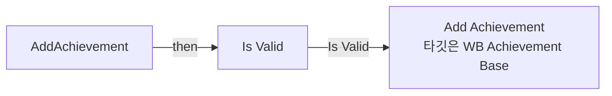

</details>

<details>
<summary>전체 노드·기본 입력 목록</summary>

| 노드 ID | 제목 | 미연결 기본 입력 / 에셋 입력 |
|---|---|---|
| `K2Node_FunctionEntry_0` | AddAchievement |  |
| `K2Node_VariableGet_388` | Get WB_Achievement_Base |  |
| `K2Node_MacroInstance_0` | Is Valid |  |
| `K2Node_CallFunction_0` | Add Achievement<br/>타깃은 WB Achievement Base |  |

</details>

### AddArmorBar

<details>
<summary>실행 핀 플로우차트</summary>

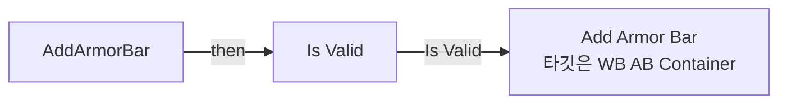

</details>

<details>
<summary>전체 노드·기본 입력 목록</summary>

| 노드 ID | 제목 | 미연결 기본 입력 / 에셋 입력 |
|---|---|---|
| `K2Node_FunctionEntry_0` | AddArmorBar |  |
| `K2Node_VariableGet_379` | Get WB_AB_Container |  |
| `K2Node_Knot_361` | 경유 노드 |  |
| `K2Node_MacroInstance_0` | Is Valid |  |
| `K2Node_CallFunction_0` | Add Armor Bar<br/>타깃은 WB AB Container |  |

</details>

### AddExtraTime

<details>
<summary>실행 핀 플로우차트</summary>

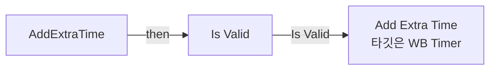

</details>

<details>
<summary>전체 노드·기본 입력 목록</summary>

| 노드 ID | 제목 | 미연결 기본 입력 / 에셋 입력 |
|---|---|---|
| `K2Node_FunctionEntry_0` | AddExtraTime |  |
| `K2Node_VariableGet_2422` | Get WB_Timer |  |
| `K2Node_MacroInstance_0` | Is Valid |  |
| `K2Node_CallFunction_0` | Add Extra Time<br/>타깃은 WB Timer |  |

</details>

### AddHealthBar

<details>
<summary>실행 핀 플로우차트</summary>

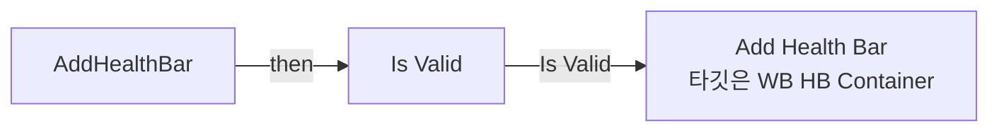

</details>

<details>
<summary>전체 노드·기본 입력 목록</summary>

| 노드 ID | 제목 | 미연결 기본 입력 / 에셋 입력 |
|---|---|---|
| `K2Node_FunctionEntry_0` | AddHealthBar |  |
| `K2Node_VariableGet_379` | Get WB_HB_Container |  |
| `K2Node_CallFunction_0` | Add Health Bar<br/>타깃은 WB HB Container |  |
| `K2Node_MacroInstance_0` | Is Valid |  |
| `K2Node_Knot_361` | 경유 노드 |  |

</details>

### AddIntermediatePoint

<details>
<summary>실행 핀 플로우차트</summary>

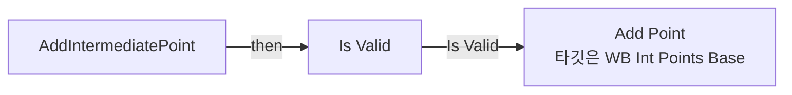

</details>

<details>
<summary>전체 노드·기본 입력 목록</summary>

| 노드 ID | 제목 | 미연결 기본 입력 / 에셋 입력 |
|---|---|---|
| `K2Node_FunctionEntry_0` | AddIntermediatePoint |  |
| `K2Node_VariableGet_1672` | Get WB_IntPoints_Base |  |
| `K2Node_MacroInstance_0` | Is Valid |  |
| `K2Node_CallFunction_0` | Add Point<br/>타깃은 WB Int Points Base |  |

</details>

### AddKillMessage1

<details>
<summary>실행 핀 플로우차트</summary>


</details>

<details>
<summary>전체 노드·기본 입력 목록</summary>

| 노드 ID | 제목 | 미연결 기본 입력 / 에셋 입력 |
|---|---|---|
| `K2Node_FunctionEntry_0` | AddKillMessage1 |  |
| `K2Node_VariableGet_882` | Get WB_KillMessage |  |
| `K2Node_MacroInstance_0` | Is Valid |  |
| `K2Node_CallFunction_2` | Add Kill Message 1<br/>타깃은 WB Kill Message |  |

</details>

### AddKillMessage2

<details>
<summary>실행 핀 플로우차트</summary>

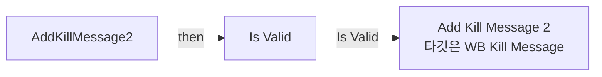

</details>

<details>
<summary>전체 노드·기본 입력 목록</summary>

| 노드 ID | 제목 | 미연결 기본 입력 / 에셋 입력 |
|---|---|---|
| `K2Node_FunctionEntry_0` | AddKillMessage2 |  |
| `K2Node_VariableGet_141` | Get WB_KillMessage |  |
| `K2Node_MacroInstance_0` | Is Valid |  |
| `K2Node_CallFunction_0` | Add Kill Message 2<br/>타깃은 WB Kill Message |  |

</details>

### AddMedal

<details>
<summary>실행 핀 플로우차트</summary>

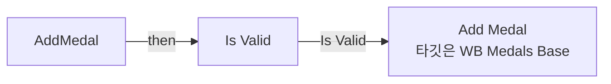

</details>

<details>
<summary>전체 노드·기본 입력 목록</summary>

| 노드 ID | 제목 | 미연결 기본 입력 / 에셋 입력 |
|---|---|---|
| `K2Node_FunctionEntry_0` | AddMedal |  |
| `K2Node_VariableGet_226` | Get WB_Medals_Base |  |
| `K2Node_MacroInstance_0` | Is Valid |  |
| `K2Node_CallFunction_0` | Add Medal<br/>타깃은 WB Medals Base |  |

</details>

### AddNewKillEntry

<details>
<summary>실행 핀 플로우차트</summary>

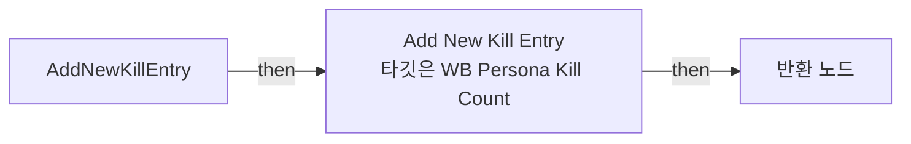

</details>

<details>
<summary>전체 노드·기본 입력 목록</summary>

| 노드 ID | 제목 | 미연결 기본 입력 / 에셋 입력 |
|---|---|---|
| `K2Node_FunctionEntry_1` | AddNewKillEntry |  |
| `K2Node_VariableGet_56` | Get WB_PersonaKillCount |  |
| `K2Node_CallFunction_0` | Add New Kill Entry<br/>타깃은 WB Persona Kill Count |  |
| `K2Node_FunctionResult_0` | 반환 노드 |  |

</details>

### AddOrUpdateActionSlot

<details>
<summary>실행 핀 플로우차트</summary>

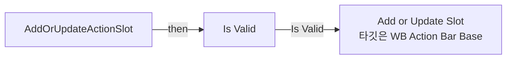

</details>

<details>
<summary>전체 노드·기본 입력 목록</summary>

| 노드 ID | 제목 | 미연결 기본 입력 / 에셋 입력 |
|---|---|---|
| `K2Node_FunctionEntry_0` | AddOrUpdateActionSlot |  |
| `K2Node_MacroInstance_0` | Is Valid |  |
| `K2Node_VariableGet_136` | Get WB_ActionBar_Base |  |
| `K2Node_CallFunction_0` | Add or Update Slot<br/>타깃은 WB Action Bar Base |  |

</details>

### AddOrUpdateAmmoIcon

<details>
<summary>실행 핀 플로우차트</summary>

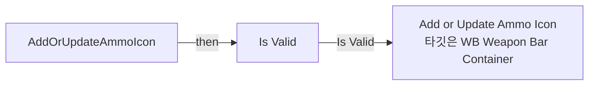

</details>

<details>
<summary>전체 노드·기본 입력 목록</summary>

| 노드 ID | 제목 | 미연결 기본 입력 / 에셋 입력 |
|---|---|---|
| `K2Node_FunctionEntry_0` | AddOrUpdateAmmoIcon |  |
| `K2Node_VariableGet_362` | Get WB_WeaponBar_Container_625 |  |
| `K2Node_MacroInstance_0` | Is Valid |  |
| `K2Node_Knot_193` | 경유 노드 |  |
| `K2Node_Knot_194` | 경유 노드 |  |
| `K2Node_Knot_195` | 경유 노드 |  |
| `K2Node_Knot_196` | 경유 노드 |  |
| `K2Node_Knot_197` | 경유 노드 |  |
| `K2Node_Knot_198` | 경유 노드 |  |
| `K2Node_CallFunction_1` | Add or Update Ammo Icon<br/>타깃은 WB Weapon Bar Container |  |
| `K2Node_Knot_231` | 경유 노드 |  |

</details>

### AddOrUpdateTeamKillCount

<details>
<summary>실행 핀 플로우차트</summary>

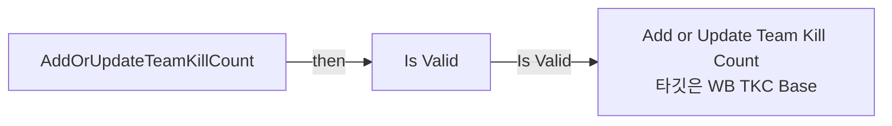

</details>

<details>
<summary>전체 노드·기본 입력 목록</summary>

| 노드 ID | 제목 | 미연결 기본 입력 / 에셋 입력 |
|---|---|---|
| `K2Node_FunctionEntry_0` | AddOrUpdateTeamKillCount |  |
| `K2Node_VariableGet_1120` | Get WB_TKC_Base |  |
| `K2Node_MacroInstance_0` | Is Valid |  |
| `K2Node_CallFunction_1` | Add or Update Team Kill Count<br/>타깃은 WB TKC Base |  |

</details>

### AddWeaponBar

<details>
<summary>실행 핀 플로우차트</summary>

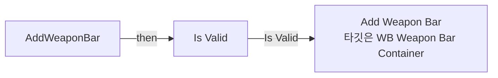

</details>

<details>
<summary>전체 노드·기본 입력 목록</summary>

| 노드 ID | 제목 | 미연결 기본 입력 / 에셋 입력 |
|---|---|---|
| `K2Node_FunctionEntry_0` | AddWeaponBar |  |
| `K2Node_VariableGet_362` | Get WB_WeaponBar_Container_625 |  |
| `K2Node_MacroInstance_0` | Is Valid |  |
| `K2Node_CallFunction_0` | Add Weapon Bar<br/>타깃은 WB Weapon Bar Container |  |

</details>

### CreateTimer

<details>
<summary>실행 핀 플로우차트</summary>

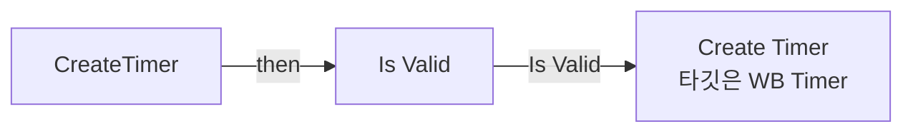

</details>

<details>
<summary>전체 노드·기본 입력 목록</summary>

| 노드 ID | 제목 | 미연결 기본 입력 / 에셋 입력 |
|---|---|---|
| `K2Node_FunctionEntry_0` | CreateTimer |  |
| `K2Node_VariableGet_2422` | Get WB_Timer |  |
| `K2Node_MacroInstance_0` | Is Valid |  |
| `K2Node_CallFunction_4` | Create Timer<br/>타깃은 WB Timer |  |

</details>

### EventGraph

<details>
<summary>전체 노드·기본 입력 목록</summary>

| 노드 ID | 제목 | 미연결 기본 입력 / 에셋 입력 |
|---|---|---|

</details>

### GetCurrentAmmo

<details>
<summary>실행 핀 플로우차트</summary>

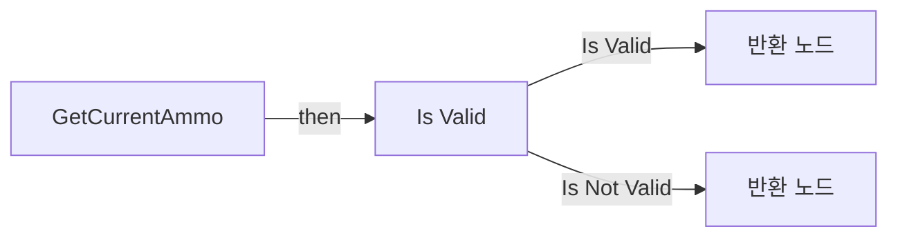

</details>

<details>
<summary>전체 노드·기본 입력 목록</summary>

| 노드 ID | 제목 | 미연결 기본 입력 / 에셋 입력 |
|---|---|---|
| `K2Node_FunctionEntry_0` | GetCurrentAmmo |  |
| `K2Node_VariableGet_362` | Get WB_WeaponBar_Container_625 |  |
| `K2Node_MacroInstance_0` | Is Valid |  |
| `K2Node_FunctionResult_0` | 반환 노드 |  |
| `K2Node_CallFunction_0` | Get Ammo<br/>타깃은 WB Weapon Bar Container |  |
| `K2Node_FunctionResult_4` | 반환 노드 | Ammo=0 |

</details>

### GetCurrentAmmoType

<details>
<summary>실행 핀 플로우차트</summary>

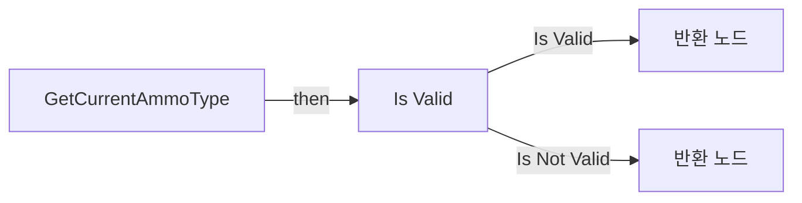

</details>

<details>
<summary>전체 노드·기본 입력 목록</summary>

| 노드 ID | 제목 | 미연결 기본 입력 / 에셋 입력 |
|---|---|---|
| `K2Node_FunctionEntry_0` | GetCurrentAmmoType |  |
| `K2Node_VariableGet_362` | Get WB_WeaponBar_Container_625 |  |
| `K2Node_MacroInstance_0` | Is Valid |  |
| `K2Node_FunctionResult_0` | 반환 노드 |  |
| `K2Node_CallFunction_3` | Get Ammo Type<br/>타깃은 WB Weapon Bar Container |  |
| `K2Node_FunctionResult_1` | 반환 노드 | AmmoType=NewEnumerator0 |

</details>

### GetCurrentArmor

<details>
<summary>실행 핀 플로우차트</summary>


</details>

<details>
<summary>전체 노드·기본 입력 목록</summary>

| 노드 ID | 제목 | 미연결 기본 입력 / 에셋 입력 |
|---|---|---|
| `K2Node_FunctionEntry_2` | GetCurrentArmor |  |
| `K2Node_VariableGet_379` | Get WB_AB_Container |  |
| `K2Node_Knot_361` | 경유 노드 |  |
| `K2Node_Knot_1422` | 경유 노드 |  |
| `K2Node_MacroInstance_0` | Is Valid |  |
| `K2Node_CallFunction_5` | Get Current Armor<br/>타깃은 WB AB Container |  |
| `K2Node_FunctionResult_0` | 반환 노드 |  |

</details>

### GetCurrentHealth

<details>
<summary>실행 핀 플로우차트</summary>

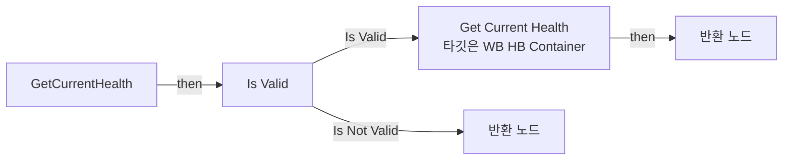

</details>

<details>
<summary>전체 노드·기본 입력 목록</summary>

| 노드 ID | 제목 | 미연결 기본 입력 / 에셋 입력 |
|---|---|---|
| `K2Node_FunctionEntry_0` | GetCurrentHealth |  |
| `K2Node_VariableGet_379` | Get WB_HB_Container |  |
| `K2Node_Knot_361` | 경유 노드 |  |
| `K2Node_MacroInstance_0` | Is Valid |  |
| `K2Node_FunctionResult_1` | 반환 노드 |  |
| `K2Node_CallFunction_4` | Get Current Health<br/>타깃은 WB HB Container |  |
| `K2Node_FunctionResult_0` | 반환 노드 | CurrentHealth=0 |

</details>

### GetCurrentMaxAmmo

<details>
<summary>실행 핀 플로우차트</summary>

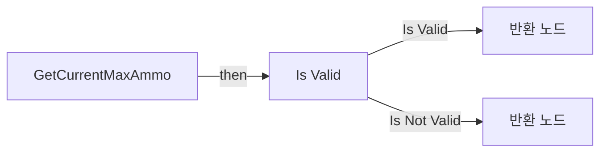

</details>

<details>
<summary>전체 노드·기본 입력 목록</summary>

| 노드 ID | 제목 | 미연결 기본 입력 / 에셋 입력 |
|---|---|---|
| `K2Node_FunctionEntry_0` | GetCurrentMaxAmmo |  |
| `K2Node_VariableGet_362` | Get WB_WeaponBar_Container_625 |  |
| `K2Node_MacroInstance_0` | Is Valid |  |
| `K2Node_FunctionResult_0` | 반환 노드 |  |
| `K2Node_CallFunction_1` | Get Max Ammo<br/>타깃은 WB Weapon Bar Container |  |
| `K2Node_FunctionResult_3` | 반환 노드 | CurrentMaxAmmo=0 |

</details>

### GetCurrentMaxArmor

<details>
<summary>실행 핀 플로우차트</summary>


</details>

<details>
<summary>전체 노드·기본 입력 목록</summary>

| 노드 ID | 제목 | 미연결 기본 입력 / 에셋 입력 |
|---|---|---|
| `K2Node_FunctionEntry_2` | GetCurrentMaxArmor |  |
| `K2Node_VariableGet_379` | Get WB_AB_Container |  |
| `K2Node_Knot_361` | 경유 노드 |  |
| `K2Node_Knot_1422` | 경유 노드 |  |
| `K2Node_MacroInstance_0` | Is Valid |  |
| `K2Node_CallFunction_6` | Get Current Max Armor<br/>타깃은 WB AB Container |  |
| `K2Node_FunctionResult_1` | 반환 노드 |  |

</details>

### GetCurrentMaxHealth

<details>
<summary>실행 핀 플로우차트</summary>

```mermaid
flowchart LR
  n0["GetCurrentMaxHealth"]
  n1["Is Valid"]
  n2["반환 노드"]
  n3["반환 노드"]
  n4["Get Max Health<br/>타깃은 WB HB Container"]
  n0 -->|"then"| n1
  n1 -->|"Is Valid"| n4
  n1 -->|"Is Not Valid"| n3
  n4 -->|"then"| n2
```

</details>

<details>
<summary>전체 노드·기본 입력 목록</summary>

| 노드 ID | 제목 | 미연결 기본 입력 / 에셋 입력 |
|---|---|---|
| `K2Node_FunctionEntry_0` | GetCurrentMaxHealth |  |
| `K2Node_VariableGet_379` | Get WB_HB_Container |  |
| `K2Node_Knot_361` | 경유 노드 |  |
| `K2Node_MacroInstance_0` | Is Valid |  |
| `K2Node_FunctionResult_1` | 반환 노드 |  |
| `K2Node_FunctionResult_0` | 반환 노드 | CurrentMaxHealth=0 |
| `K2Node_CallFunction_5` | Get Max Health<br/>타깃은 WB HB Container |  |

</details>

### GetCurrentStackSize

<details>
<summary>실행 핀 플로우차트</summary>

```mermaid
flowchart LR
  n0["GetCurrentStackSize"]
  n1["Is Valid"]
  n2["반환 노드"]
  n3["반환 노드"]
  n0 -->|"then"| n1
  n1 -->|"Is Valid"| n2
  n1 -->|"Is Not Valid"| n3
```

</details>

<details>
<summary>전체 노드·기본 입력 목록</summary>

| 노드 ID | 제목 | 미연결 기본 입력 / 에셋 입력 |
|---|---|---|
| `K2Node_FunctionEntry_0` | GetCurrentStackSize |  |
| `K2Node_VariableGet_362` | Get WB_WeaponBar_Container_625 |  |
| `K2Node_MacroInstance_0` | Is Valid |  |
| `K2Node_FunctionResult_0` | 반환 노드 |  |
| `K2Node_CallFunction_2` | Get Stack Size<br/>타깃은 WB Weapon Bar Container |  |
| `K2Node_FunctionResult_2` | 반환 노드 | StackSize=0 |

</details>

### GetTeamKillCountMaxValue

<details>
<summary>실행 핀 플로우차트</summary>

```mermaid
flowchart LR
  n0["GetTeamKillCountMaxValue"]
  n1["Is Valid"]
  n2["반환 노드"]
  n3["반환 노드"]
  n0 -->|"then"| n1
  n1 -->|"Is Valid"| n2
  n1 -->|"Is Not Valid"| n3
```

</details>

<details>
<summary>전체 노드·기본 입력 목록</summary>

| 노드 ID | 제목 | 미연결 기본 입력 / 에셋 입력 |
|---|---|---|
| `K2Node_FunctionEntry_0` | GetTeamKillCountMaxValue |  |
| `K2Node_VariableGet_1120` | Get WB_TKC_Base |  |
| `K2Node_MacroInstance_0` | Is Valid |  |
| `K2Node_FunctionResult_1` | 반환 노드 |  |
| `K2Node_FunctionResult_0` | 반환 노드 | TeamKillCountMaxValue=0 |
| `K2Node_CallFunction_1` | Get Team Kill Count Max Value<br/>타깃은 WB TKC Base |  |

</details>

### GetTeamKillCountValue

<details>
<summary>실행 핀 플로우차트</summary>

```mermaid
flowchart LR
  n0["GetTeamKillCountValue"]
  n1["Is Valid"]
  n2["반환 노드"]
  n3["반환 노드"]
  n0 -->|"then"| n1
  n1 -->|"Is Valid"| n2
  n1 -->|"Is Not Valid"| n3
```

</details>

<details>
<summary>전체 노드·기본 입력 목록</summary>

| 노드 ID | 제목 | 미연결 기본 입력 / 에셋 입력 |
|---|---|---|
| `K2Node_FunctionEntry_0` | GetTeamKillCountValue |  |
| `K2Node_VariableGet_1120` | Get WB_TKC_Base |  |
| `K2Node_MacroInstance_0` | Is Valid |  |
| `K2Node_CallFunction_0` | Get Team Kill Count Value<br/>타깃은 WB TKC Base |  |
| `K2Node_FunctionResult_1` | 반환 노드 |  |
| `K2Node_FunctionResult_0` | 반환 노드 | TeamKillCountValue=0 |

</details>

### GetTime

<details>
<summary>실행 핀 플로우차트</summary>

```mermaid
flowchart LR
  n0["GetTime"]
  n1["Is Valid"]
  n2["반환 노드"]
  n3["반환 노드"]
  n0 -->|"then"| n1
  n1 -->|"Is Valid"| n2
  n1 -->|"Is Not Valid"| n3
```

</details>

<details>
<summary>전체 노드·기본 입력 목록</summary>

| 노드 ID | 제목 | 미연결 기본 입력 / 에셋 입력 |
|---|---|---|
| `K2Node_FunctionEntry_1` | GetTime |  |
| `K2Node_VariableGet_2422` | Get WB_Timer |  |
| `K2Node_MacroInstance_0` | Is Valid |  |
| `K2Node_VariableGet_0` | Get Minutes |  |
| `K2Node_VariableGet_1` | Get Seconds |  |
| `K2Node_FunctionResult_1` | 반환 노드 |  |
| `K2Node_FunctionResult_2` | 반환 노드 | Minutes=0; Seconds=0 |

</details>

### PauseTimer

<details>
<summary>실행 핀 플로우차트</summary>

```mermaid
flowchart LR
  n0["PauseTimer"]
  n1["Is Valid"]
  n2["Pause Timer<br/>타깃은 WB Timer"]
  n0 -->|"then"| n1
  n1 -->|"Is Valid"| n2
```

</details>

<details>
<summary>전체 노드·기본 입력 목록</summary>

| 노드 ID | 제목 | 미연결 기본 입력 / 에셋 입력 |
|---|---|---|
| `K2Node_FunctionEntry_0` | PauseTimer |  |
| `K2Node_VariableGet_2422` | Get WB_Timer |  |
| `K2Node_MacroInstance_0` | Is Valid |  |
| `K2Node_CallFunction_2` | Pause Timer<br/>타깃은 WB Timer |  |

</details>

### RemoveAchievement

<details>
<summary>실행 핀 플로우차트</summary>

```mermaid
flowchart LR
  n0["RemoveAchievement"]
  n1["Is Valid"]
  n2["Remove Achievement<br/>타깃은 WB Achievement Base"]
  n0 -->|"then"| n1
  n1 -->|"Is Valid"| n2
```

</details>

<details>
<summary>전체 노드·기본 입력 목록</summary>

| 노드 ID | 제목 | 미연결 기본 입력 / 에셋 입력 |
|---|---|---|
| `K2Node_FunctionEntry_1` | RemoveAchievement |  |
| `K2Node_VariableGet_388` | Get WB_Achievement_Base |  |
| `K2Node_MacroInstance_0` | Is Valid |  |
| `K2Node_CallFunction_1` | Remove Achievement<br/>타깃은 WB Achievement Base |  |
| `K2Node_Knot_1030` | 경유 노드 |  |

</details>

### RemoveActionSlot

<details>
<summary>실행 핀 플로우차트</summary>

```mermaid
flowchart LR
  n0["RemoveActionSlot"]
  n1["Is Valid"]
  n2["Remove Slot<br/>타깃은 WB Action Bar Base"]
  n0 -->|"then"| n1
  n1 -->|"Is Valid"| n2
```

</details>

<details>
<summary>전체 노드·기본 입력 목록</summary>

| 노드 ID | 제목 | 미연결 기본 입력 / 에셋 입력 |
|---|---|---|
| `K2Node_FunctionEntry_0` | RemoveActionSlot |  |
| `K2Node_VariableGet_136` | Get WB_ActionBar_Base |  |
| `K2Node_MacroInstance_0` | Is Valid |  |
| `K2Node_CallFunction_1` | Remove Slot<br/>타깃은 WB Action Bar Base |  |
| `K2Node_Knot_131` | 경유 노드 |  |
| `K2Node_Knot_132` | 경유 노드 |  |

</details>

### RemoveAllActionSlots

<details>
<summary>실행 핀 플로우차트</summary>

```mermaid
flowchart LR
  n0["RemoveAllActionSlots"]
  n1["Is Valid"]
  n2["Remove All Slots<br/>타깃은 WB Action Bar Base"]
  n0 -->|"then"| n1
  n1 -->|"Is Valid"| n2
```

</details>

<details>
<summary>전체 노드·기본 입력 목록</summary>

| 노드 ID | 제목 | 미연결 기본 입력 / 에셋 입력 |
|---|---|---|
| `K2Node_FunctionEntry_0` | RemoveAllActionSlots |  |
| `K2Node_VariableGet_136` | Get WB_ActionBar_Base |  |
| `K2Node_MacroInstance_0` | Is Valid |  |
| `K2Node_CallFunction_0` | Remove All Slots<br/>타깃은 WB Action Bar Base |  |

</details>

### RemoveAllDamageIndicator

<details>
<summary>실행 핀 플로우차트</summary>

```mermaid
flowchart LR
  n0["RemoveAllDamageIndicator"]
  n1["Remove All Indicators<br/>타깃은 WB Damage Indicator Base"]
  n2["반환 노드"]
  n0 -->|"then"| n1
  n1 -->|"then"| n2
```

</details>

<details>
<summary>전체 노드·기본 입력 목록</summary>

| 노드 ID | 제목 | 미연결 기본 입력 / 에셋 입력 |
|---|---|---|
| `K2Node_FunctionEntry_0` | RemoveAllDamageIndicator |  |
| `K2Node_VariableGet_1192` | Get WB_DamageIndicator_Base |  |
| `K2Node_CallFunction_0` | Remove All Indicators<br/>타깃은 WB Damage Indicator Base |  |
| `K2Node_FunctionResult_0` | 반환 노드 |  |

</details>

### RemoveAmmo

<details>
<summary>실행 핀 플로우차트</summary>

```mermaid
flowchart LR
  n0["RemoveAmmo"]
  n1["Is Valid"]
  n2["Remove Ammo<br/>타깃은 WB Weapon Bar Container"]
  n0 -->|"then"| n1
  n1 -->|"Is Valid"| n2
```

</details>

<details>
<summary>전체 노드·기본 입력 목록</summary>

| 노드 ID | 제목 | 미연결 기본 입력 / 에셋 입력 |
|---|---|---|
| `K2Node_FunctionEntry_0` | RemoveAmmo |  |
| `K2Node_VariableGet_362` | Get WB_WeaponBar_Container_625 |  |
| `K2Node_MacroInstance_0` | Is Valid |  |
| `K2Node_Knot_454` | 경유 노드 |  |
| `K2Node_CallFunction_4` | Remove Ammo<br/>타깃은 WB Weapon Bar Container |  |

</details>

### RemoveAmmoIcon

<details>
<summary>실행 핀 플로우차트</summary>

```mermaid
flowchart LR
  n0["RemoveAmmoIcon"]
  n1["Is Valid"]
  n2["Remove Ammo Icon<br/>타깃은 WB Weapon Bar Container"]
  n0 -->|"then"| n1
  n1 -->|"Is Valid"| n2
```

</details>

<details>
<summary>전체 노드·기본 입력 목록</summary>

| 노드 ID | 제목 | 미연결 기본 입력 / 에셋 입력 |
|---|---|---|
| `K2Node_FunctionEntry_1` | RemoveAmmoIcon |  |
| `K2Node_VariableGet_362` | Get WB_WeaponBar_Container_625 |  |
| `K2Node_MacroInstance_0` | Is Valid |  |
| `K2Node_Knot_231` | 경유 노드 |  |
| `K2Node_CallFunction_2` | Remove Ammo Icon<br/>타깃은 WB Weapon Bar Container |  |
| `K2Node_Knot_257` | 경유 노드 |  |
| `K2Node_Knot_258` | 경유 노드 |  |
| `K2Node_Knot_259` | 경유 노드 |  |
| `K2Node_Knot_260` | 경유 노드 |  |

</details>

### RemoveArmor

<details>
<summary>실행 핀 플로우차트</summary>

```mermaid
flowchart LR
  n0["RemoveArmor"]
  n1["Is Valid"]
  n2["Remove Armor<br/>타깃은 WB AB Container"]
  n0 -->|"then"| n1
  n1 -->|"Is Valid"| n2
```

</details>

<details>
<summary>전체 노드·기본 입력 목록</summary>

| 노드 ID | 제목 | 미연결 기본 입력 / 에셋 입력 |
|---|---|---|
| `K2Node_FunctionEntry_2` | RemoveArmor |  |
| `K2Node_VariableGet_379` | Get WB_AB_Container |  |
| `K2Node_Knot_361` | 경유 노드 |  |
| `K2Node_Knot_1422` | 경유 노드 |  |
| `K2Node_MacroInstance_0` | Is Valid |  |
| `K2Node_CallFunction_4` | Remove Armor<br/>타깃은 WB AB Container |  |
| `K2Node_Knot_1654` | 경유 노드 |  |

</details>

### RemoveArmorBar

<details>
<summary>실행 핀 플로우차트</summary>

```mermaid
flowchart LR
  n0["RemoveArmorBar"]
  n1["Is Valid"]
  n2["Remove Armor Bar<br/>타깃은 WB AB Container"]
  n0 -->|"then"| n1
  n1 -->|"Is Valid"| n2
```

</details>

<details>
<summary>전체 노드·기본 입력 목록</summary>

| 노드 ID | 제목 | 미연결 기본 입력 / 에셋 입력 |
|---|---|---|
| `K2Node_FunctionEntry_1` | RemoveArmorBar |  |
| `K2Node_VariableGet_379` | Get WB_AB_Container |  |
| `K2Node_Knot_361` | 경유 노드 |  |
| `K2Node_MacroInstance_0` | Is Valid |  |
| `K2Node_CallFunction_1` | Remove Armor Bar<br/>타깃은 WB AB Container |  |
| `K2Node_Knot_1422` | 경유 노드 |  |

</details>

### RemoveColorImpact

<details>
<summary>실행 핀 플로우차트</summary>

```mermaid
flowchart LR
  n0["RemoveColorImpact"]
  n1["Get"]
  n2["Remove Highlight FX<br/>타깃은 WB FX Highlight"]
  n0 -->|"then"| n1
  n1 -->|"then"| n2
```

</details>

<details>
<summary>전체 노드·기본 입력 목록</summary>

| 노드 ID | 제목 | 미연결 기본 입력 / 에셋 입력 |
|---|---|---|
| `K2Node_FunctionEntry_0` | RemoveColorImpact |  |
| `K2Node_VariableGet_1` | Get |  |
| `K2Node_CallFunction_52` | Remove Highlight FX<br/>타깃은 WB FX Highlight |  |

</details>

### RemoveDamageFX

<details>
<summary>실행 핀 플로우차트</summary>

```mermaid
flowchart LR
  n0["RemoveDamageFX"]
  n1["Get"]
  n2["Remove Damage FX<br/>타깃은 WB FX Damage"]
  n0 -->|"then"| n1
  n1 -->|"then"| n2
```

</details>

<details>
<summary>전체 노드·기본 입력 목록</summary>

| 노드 ID | 제목 | 미연결 기본 입력 / 에셋 입력 |
|---|---|---|
| `K2Node_FunctionEntry_0` | RemoveDamageFX |  |
| `K2Node_VariableGet_48` | Get |  |
| `K2Node_CallFunction_54` | Remove Damage FX<br/>타깃은 WB FX Damage |  |

</details>

### RemoveHealth

<details>
<summary>실행 핀 플로우차트</summary>

```mermaid
flowchart LR
  n0["RemoveHealth"]
  n1["Is Valid"]
  n2["Remove Health<br/>타깃은 WB HB Container"]
  n0 -->|"then"| n1
  n1 -->|"Is Valid"| n2
```

</details>

<details>
<summary>전체 노드·기본 입력 목록</summary>

| 노드 ID | 제목 | 미연결 기본 입력 / 에셋 입력 |
|---|---|---|
| `K2Node_FunctionEntry_0` | RemoveHealth |  |
| `K2Node_VariableGet_379` | Get WB_HB_Container |  |
| `K2Node_Knot_361` | 경유 노드 |  |
| `K2Node_MacroInstance_0` | Is Valid |  |
| `K2Node_Knot_380` | 경유 노드 |  |
| `K2Node_Knot_381` | 경유 노드 |  |
| `K2Node_CallFunction_0` | Remove Health<br/>타깃은 WB HB Container |  |

</details>

### RemoveHealthBar

<details>
<summary>실행 핀 플로우차트</summary>

```mermaid
flowchart LR
  n0["RemoveHealthBar"]
  n1["Is Valid"]
  n2["Remove Health Bar<br/>타깃은 WB HB Container"]
  n0 -->|"then"| n1
  n1 -->|"Is Valid"| n2
```

</details>

<details>
<summary>전체 노드·기본 입력 목록</summary>

| 노드 ID | 제목 | 미연결 기본 입력 / 에셋 입력 |
|---|---|---|
| `K2Node_FunctionEntry_0` | RemoveHealthBar |  |
| `K2Node_VariableGet_379` | Get WB_HB_Container |  |
| `K2Node_Knot_361` | 경유 노드 |  |
| `K2Node_MacroInstance_0` | Is Valid |  |
| `K2Node_CallFunction_1` | Remove Health Bar<br/>타깃은 WB HB Container |  |

</details>

### RemoveIntermediatePoints

<details>
<summary>실행 핀 플로우차트</summary>

```mermaid
flowchart LR
  n0["RemoveIntermediatePoints"]
  n1["Is Valid"]
  n2["Remove Intermediate Points<br/>타깃은 WB Int Points Base"]
  n0 -->|"then"| n1
  n1 -->|"Is Valid"| n2
```

</details>

<details>
<summary>전체 노드·기본 입력 목록</summary>

| 노드 ID | 제목 | 미연결 기본 입력 / 에셋 입력 |
|---|---|---|
| `K2Node_FunctionEntry_0` | RemoveIntermediatePoints |  |
| `K2Node_VariableGet_1672` | Get WB_IntPoints_Base |  |
| `K2Node_MacroInstance_0` | Is Valid |  |
| `K2Node_CallFunction_0` | Remove Intermediate Points<br/>타깃은 WB Int Points Base |  |

</details>

### RemoveKillEntrys

<details>
<summary>실행 핀 플로우차트</summary>

```mermaid
flowchart LR
  n0["RemoveKillEntrys"]
  n1["Remove All Kill Entrys<br/>타깃은 WB Persona Kill Count"]
  n0 -->|"then"| n1
```

</details>

<details>
<summary>전체 노드·기본 입력 목록</summary>

| 노드 ID | 제목 | 미연결 기본 입력 / 에셋 입력 |
|---|---|---|
| `K2Node_FunctionEntry_0` | RemoveKillEntrys |  |
| `K2Node_VariableGet_56` | Get WB_PersonaKillCount |  |
| `K2Node_CallFunction_0` | Remove All Kill Entrys<br/>타깃은 WB Persona Kill Count |  |

</details>

### RemoveKillMessages

<details>
<summary>실행 핀 플로우차트</summary>

```mermaid
flowchart LR
  n0["RemoveKillMessages"]
  n1["Is Valid"]
  n2["Remove Kill Messages<br/>타깃은 WB Kill Message"]
  n0 -->|"then"| n1
  n1 -->|"Is Valid"| n2
```

</details>

<details>
<summary>전체 노드·기본 입력 목록</summary>

| 노드 ID | 제목 | 미연결 기본 입력 / 에셋 입력 |
|---|---|---|
| `K2Node_FunctionEntry_0` | RemoveKillMessages |  |
| `K2Node_VariableGet_882` | Get WB_KillMessage |  |
| `K2Node_MacroInstance_0` | Is Valid |  |
| `K2Node_CallFunction_1` | Remove Kill Messages<br/>타깃은 WB Kill Message |  |

</details>

### RemoveMaxAmmo

<details>
<summary>실행 핀 플로우차트</summary>

```mermaid
flowchart LR
  n0["RemoveMaxAmmo"]
  n1["Is Valid"]
  n2["Remove Max Ammo<br/>타깃은 WB Weapon Bar Container"]
  n0 -->|"then"| n1
  n1 -->|"Is Valid"| n2
```

</details>

<details>
<summary>전체 노드·기본 입력 목록</summary>

| 노드 ID | 제목 | 미연결 기본 입력 / 에셋 입력 |
|---|---|---|
| `K2Node_FunctionEntry_0` | RemoveMaxAmmo |  |
| `K2Node_VariableGet_362` | Get WB_WeaponBar_Container_625 |  |
| `K2Node_MacroInstance_0` | Is Valid |  |
| `K2Node_Knot_476` | 경유 노드 |  |
| `K2Node_Knot_477` | 경유 노드 |  |
| `K2Node_Knot_478` | 경유 노드 |  |
| `K2Node_CallFunction_5` | Remove Max Ammo<br/>타깃은 WB Weapon Bar Container |  |

</details>

### RemoveMaxValue

<details>
<summary>실행 핀 플로우차트</summary>

```mermaid
flowchart LR
  n0["RemoveMaxValue"]
  n1["Is Valid"]
  n2["Remove Max Value<br/>타깃은 WB TKC Base"]
  n0 -->|"then"| n1
  n1 -->|"Is Valid"| n2
```

</details>

<details>
<summary>전체 노드·기본 입력 목록</summary>

| 노드 ID | 제목 | 미연결 기본 입력 / 에셋 입력 |
|---|---|---|
| `K2Node_FunctionEntry_1` | RemoveMaxValue |  |
| `K2Node_VariableGet_1120` | Get WB_TKC_Base |  |
| `K2Node_MacroInstance_0` | Is Valid |  |
| `K2Node_CallFunction_4` | Remove Max Value<br/>타깃은 WB TKC Base |  |

</details>

### RemoveMedal

<details>
<summary>실행 핀 플로우차트</summary>

```mermaid
flowchart LR
  n0["RemoveMedal"]
  n1["Is Valid"]
  n2["Remove Medals<br/>타깃은 WB Medals Base"]
  n0 -->|"then"| n1
  n1 -->|"Is Valid"| n2
```

</details>

<details>
<summary>전체 노드·기본 입력 목록</summary>

| 노드 ID | 제목 | 미연결 기본 입력 / 에셋 입력 |
|---|---|---|
| `K2Node_FunctionEntry_1` | RemoveMedal |  |
| `K2Node_VariableGet_226` | Get WB_Medals_Base |  |
| `K2Node_MacroInstance_0` | Is Valid |  |
| `K2Node_CallFunction_1` | Remove Medals<br/>타깃은 WB Medals Base |  |

</details>

### RemoveTeamKillCount

<details>
<summary>실행 핀 플로우차트</summary>

```mermaid
flowchart LR
  n0["RemoveTeamKillCount"]
  n1["Is Valid"]
  n2["Remove Team Kill Count<br/>타깃은 WB TKC Base"]
  n0 -->|"then"| n1
  n1 -->|"Is Valid"| n2
```

</details>

<details>
<summary>전체 노드·기본 입력 목록</summary>

| 노드 ID | 제목 | 미연결 기본 입력 / 에셋 입력 |
|---|---|---|
| `K2Node_FunctionEntry_1` | RemoveTeamKillCount |  |
| `K2Node_VariableGet_1120` | Get WB_TKC_Base |  |
| `K2Node_MacroInstance_0` | Is Valid |  |
| `K2Node_CallFunction_2` | Remove Team Kill Count<br/>타깃은 WB TKC Base |  |

</details>

### RemoveTimer

<details>
<summary>실행 핀 플로우차트</summary>

```mermaid
flowchart LR
  n0["RemoveTimer"]
  n1["Is Valid"]
  n2["Remove Timer<br/>타깃은 WB Timer"]
  n0 -->|"then"| n1
  n1 -->|"Is Valid"| n2
```

</details>

<details>
<summary>전체 노드·기본 입력 목록</summary>

| 노드 ID | 제목 | 미연결 기본 입력 / 에셋 입력 |
|---|---|---|
| `K2Node_FunctionEntry_0` | RemoveTimer |  |
| `K2Node_VariableGet_2422` | Get WB_Timer |  |
| `K2Node_MacroInstance_0` | Is Valid |  |
| `K2Node_CallFunction_1` | Remove Timer<br/>타깃은 WB Timer |  |

</details>

### RemoveValue

<details>
<summary>실행 핀 플로우차트</summary>

```mermaid
flowchart LR
  n0["RemoveValue"]
  n1["Is Valid"]
  n2["Remove Value<br/>타깃은 WB TKC Base"]
  n0 -->|"then"| n1
  n1 -->|"Is Valid"| n2
```

</details>

<details>
<summary>전체 노드·기본 입력 목록</summary>

| 노드 ID | 제목 | 미연결 기본 입력 / 에셋 입력 |
|---|---|---|
| `K2Node_FunctionEntry_1` | RemoveValue |  |
| `K2Node_VariableGet_1120` | Get WB_TKC_Base |  |
| `K2Node_MacroInstance_0` | Is Valid |  |
| `K2Node_CallFunction_6` | Remove Value<br/>타깃은 WB TKC Base |  |

</details>

### RemoveWeaponBar

<details>
<summary>실행 핀 플로우차트</summary>

```mermaid
flowchart LR
  n0["RemoveWeaponBar"]
  n1["Is Valid"]
  n2["Remove Weapon Bar<br/>타깃은 WB Weapon Bar Container"]
  n0 -->|"then"| n1
  n1 -->|"Is Valid"| n2
```

</details>

<details>
<summary>전체 노드·기본 입력 목록</summary>

| 노드 ID | 제목 | 미연결 기본 입력 / 에셋 입력 |
|---|---|---|
| `K2Node_FunctionEntry_0` | RemoveWeaponBar |  |
| `K2Node_VariableGet_362` | Get WB_WeaponBar_Container_625 |  |
| `K2Node_MacroInstance_0` | Is Valid |  |
| `K2Node_CallFunction_1` | Remove Weapon Bar<br/>타깃은 WB Weapon Bar Container |  |
| `K2Node_Knot_503` | 경유 노드 |  |

</details>

### SlotImpact

<details>
<summary>실행 핀 플로우차트</summary>

```mermaid
flowchart LR
  n0["SlotImpact"]
  n1["Is Valid"]
  n2["Slot Impact<br/>타깃은 WB Action Bar Base"]
  n0 -->|"then"| n1
  n1 -->|"Is Valid"| n2
```

</details>

<details>
<summary>전체 노드·기본 입력 목록</summary>

| 노드 ID | 제목 | 미연결 기본 입력 / 에셋 입력 |
|---|---|---|
| `K2Node_FunctionEntry_0` | SlotImpact |  |
| `K2Node_VariableGet_136` | Get WB_ActionBar_Base |  |
| `K2Node_MacroInstance_0` | Is Valid |  |
| `K2Node_CallFunction_1` | Slot Impact<br/>타깃은 WB Action Bar Base |  |
| `K2Node_Knot_1057` | 경유 노드 |  |
| `K2Node_Knot_1079` | 경유 노드 |  |

</details>

### StartTimer

<details>
<summary>실행 핀 플로우차트</summary>

```mermaid
flowchart LR
  n0["StartTimer"]
  n1["Is Valid"]
  n2["Start Timer<br/>타깃은 WB Timer"]
  n0 -->|"then"| n1
  n1 -->|"Is Valid"| n2
```

</details>

<details>
<summary>전체 노드·기본 입력 목록</summary>

| 노드 ID | 제목 | 미연결 기본 입력 / 에셋 입력 |
|---|---|---|
| `K2Node_FunctionEntry_0` | StartTimer |  |
| `K2Node_VariableGet_2422` | Get WB_Timer |  |
| `K2Node_MacroInstance_0` | Is Valid |  |
| `K2Node_CallFunction_3` | Start Timer<br/>타깃은 WB Timer |  |

</details>

### UpdateAmmo

<details>
<summary>실행 핀 플로우차트</summary>

```mermaid
flowchart LR
  n0["UpdateAmmo"]
  n1["Is Valid"]
  n2["Update Ammo<br/>타깃은 WB Weapon Bar Container"]
  n0 -->|"then"| n1
  n1 -->|"Is Valid"| n2
```

</details>

<details>
<summary>전체 노드·기본 입력 목록</summary>

| 노드 ID | 제목 | 미연결 기본 입력 / 에셋 입력 |
|---|---|---|
| `K2Node_FunctionEntry_0` | UpdateAmmo |  |
| `K2Node_VariableGet_362` | Get WB_WeaponBar_Container_625 |  |
| `K2Node_MacroInstance_0` | Is Valid |  |
| `K2Node_CallFunction_2` | Update Ammo<br/>타깃은 WB Weapon Bar Container |  |
| `K2Node_Knot_454` | 경유 노드 |  |

</details>

### UpdateArmor

<details>
<summary>실행 핀 플로우차트</summary>

```mermaid
flowchart LR
  n0["UpdateArmor"]
  n1["Is Valid"]
  n2["Update Armor<br/>타깃은 WB AB Container"]
  n0 -->|"then"| n1
  n1 -->|"Is Valid"| n2
```

</details>

<details>
<summary>전체 노드·기본 입력 목록</summary>

| 노드 ID | 제목 | 미연결 기본 입력 / 에셋 입력 |
|---|---|---|
| `K2Node_FunctionEntry_2` | UpdateArmor |  |
| `K2Node_VariableGet_379` | Get WB_AB_Container |  |
| `K2Node_Knot_361` | 경유 노드 |  |
| `K2Node_Knot_1422` | 경유 노드 |  |
| `K2Node_MacroInstance_0` | Is Valid |  |
| `K2Node_CallFunction_2` | Update Armor<br/>타깃은 WB AB Container |  |
| `K2Node_Knot_1614` | 경유 노드 |  |

</details>

### UpdateColorImpact

<details>
<summary>실행 핀 플로우차트</summary>

```mermaid
flowchart LR
  n0["UpdateColorImpact"]
  n1["Get"]
  n2["Create Highlight FX<br/>타깃은 WB FX Highlight"]
  n0 -->|"then"| n1
  n1 -->|"then"| n2
```

</details>

<details>
<summary>전체 노드·기본 입력 목록</summary>

| 노드 ID | 제목 | 미연결 기본 입력 / 에셋 입력 |
|---|---|---|
| `K2Node_FunctionEntry_0` | UpdateColorImpact |  |
| `K2Node_VariableGet_51` | Get |  |
| `K2Node_CallFunction_49` | Create Highlight FX<br/>타깃은 WB FX Highlight |  |

</details>

### UpdateDamageFX

<details>
<summary>실행 핀 플로우차트</summary>

```mermaid
flowchart LR
  n0["UpdateDamageFX"]
  n1["Get"]
  n2["Create Damage FX<br/>타깃은 WB FX Damage"]
  n0 -->|"then"| n1
  n1 -->|"then"| n2
```

</details>

<details>
<summary>전체 노드·기본 입력 목록</summary>

| 노드 ID | 제목 | 미연결 기본 입력 / 에셋 입력 |
|---|---|---|
| `K2Node_FunctionEntry_0` | UpdateDamageFX |  |
| `K2Node_VariableGet_53` | Get |  |
| `K2Node_CallFunction_51` | Create Damage FX<br/>타깃은 WB FX Damage |  |

</details>

### UpdateDamageFeedback

<details>
<summary>실행 핀 플로우차트</summary>

```mermaid
flowchart LR
  n0["UpdateDamageFeedback"]
  n1["Is Valid"]
  n2["Update Widget<br/>타깃은 WB Damage Feedback"]
  n0 -->|"then"| n1
  n1 -->|"Is Valid"| n2
```

</details>

<details>
<summary>전체 노드·기본 입력 목록</summary>

| 노드 ID | 제목 | 미연결 기본 입력 / 에셋 입력 |
|---|---|---|
| `K2Node_FunctionEntry_0` | UpdateDamageFeedback |  |
| `K2Node_VariableGet_765` | Get WB_DamageFeedback |  |
| `K2Node_MacroInstance_0` | Is Valid |  |
| `K2Node_CallFunction_0` | Update Widget<br/>타깃은 WB Damage Feedback |  |

</details>

### UpdateDamageIndicator

<details>
<summary>실행 핀 플로우차트</summary>

```mermaid
flowchart LR
  n0["UpdateDamageIndicator"]
  n1["Add Damage Indicator<br/>타깃은 WB Damage Indicator Base"]
  n0 -->|"then"| n1
```

</details>

<details>
<summary>전체 노드·기본 입력 목록</summary>

| 노드 ID | 제목 | 미연결 기본 입력 / 에셋 입력 |
|---|---|---|
| `K2Node_FunctionEntry_0` | UpdateDamageIndicator |  |
| `K2Node_VariableGet_115` | Get WB_DamageIndicator_Base |  |
| `K2Node_CallFunction_1` | Add Damage Indicator<br/>타깃은 WB Damage Indicator Base |  |

</details>

### UpdateHealth

<details>
<summary>실행 핀 플로우차트</summary>

```mermaid
flowchart LR
  n0["UpdateHealth"]
  n1["Is Valid"]
  n2["Update Health<br/>타깃은 WB HB Container"]
  n0 -->|"then"| n1
  n1 -->|"Is Valid"| n2
```

</details>

<details>
<summary>전체 노드·기본 입력 목록</summary>

| 노드 ID | 제목 | 미연결 기본 입력 / 에셋 입력 |
|---|---|---|
| `K2Node_FunctionEntry_0` | UpdateHealth |  |
| `K2Node_VariableGet_379` | Get WB_HB_Container |  |
| `K2Node_Knot_361` | 경유 노드 |  |
| `K2Node_MacroInstance_0` | Is Valid |  |
| `K2Node_CallFunction_2` | Update Health<br/>타깃은 WB HB Container |  |
| `K2Node_Knot_380` | 경유 노드 |  |
| `K2Node_Knot_381` | 경유 노드 |  |

</details>

### UpdateMaxAmmo

<details>
<summary>실행 핀 플로우차트</summary>

```mermaid
flowchart LR
  n0["UpdateMaxAmmo"]
  n1["Is Valid"]
  n2["Update Max Ammo<br/>타깃은 WB Weapon Bar Container"]
  n0 -->|"then"| n1
  n1 -->|"Is Valid"| n2
```

</details>

<details>
<summary>전체 노드·기본 입력 목록</summary>

| 노드 ID | 제목 | 미연결 기본 입력 / 에셋 입력 |
|---|---|---|
| `K2Node_FunctionEntry_0` | UpdateMaxAmmo |  |
| `K2Node_VariableGet_362` | Get WB_WeaponBar_Container_625 |  |
| `K2Node_MacroInstance_0` | Is Valid |  |
| `K2Node_Knot_476` | 경유 노드 |  |
| `K2Node_CallFunction_3` | Update Max Ammo<br/>타깃은 WB Weapon Bar Container |  |
| `K2Node_Knot_477` | 경유 노드 |  |
| `K2Node_Knot_478` | 경유 노드 |  |
| `K2Node_Knot_1036` | 경유 노드 |  |
| `K2Node_Knot_1037` | 경유 노드 |  |

</details>

### UpdateMaxArmor

<details>
<summary>실행 핀 플로우차트</summary>

```mermaid
flowchart LR
  n0["UpdateMaxArmor"]
  n1["Is Valid"]
  n2["Update Max Armor<br/>타깃은 WB AB Container"]
  n0 -->|"then"| n1
  n1 -->|"Is Valid"| n2
```

</details>

<details>
<summary>전체 노드·기본 입력 목록</summary>

| 노드 ID | 제목 | 미연결 기본 입력 / 에셋 입력 |
|---|---|---|
| `K2Node_FunctionEntry_2` | UpdateMaxArmor |  |
| `K2Node_VariableGet_379` | Get WB_AB_Container |  |
| `K2Node_Knot_361` | 경유 노드 |  |
| `K2Node_Knot_1422` | 경유 노드 |  |
| `K2Node_MacroInstance_0` | Is Valid |  |
| `K2Node_CallFunction_3` | Update Max Armor<br/>타깃은 WB AB Container |  |
| `K2Node_Knot_1615` | 경유 노드 |  |

</details>

### UpdateMaxHealth

<details>
<summary>실행 핀 플로우차트</summary>

```mermaid
flowchart LR
  n0["UpdateMaxHealth"]
  n1["Is Valid"]
  n2["Update Max Health<br/>타깃은 WB HB Container"]
  n0 -->|"then"| n1
  n1 -->|"Is Valid"| n2
```

</details>

<details>
<summary>전체 노드·기본 입력 목록</summary>

| 노드 ID | 제목 | 미연결 기본 입력 / 에셋 입력 |
|---|---|---|
| `K2Node_FunctionEntry_0` | UpdateMaxHealth |  |
| `K2Node_VariableGet_379` | Get WB_HB_Container |  |
| `K2Node_Knot_361` | 경유 노드 |  |
| `K2Node_MacroInstance_0` | Is Valid |  |
| `K2Node_Knot_380` | 경유 노드 |  |
| `K2Node_Knot_381` | 경유 노드 |  |
| `K2Node_CallFunction_3` | Update Max Health<br/>타깃은 WB HB Container |  |

</details>

### UpdateMaxValue

<details>
<summary>실행 핀 플로우차트</summary>

```mermaid
flowchart LR
  n0["UpdateMaxValue"]
  n1["Is Valid"]
  n2["Update Max Value<br/>타깃은 WB TKC Base"]
  n0 -->|"then"| n1
  n1 -->|"Is Valid"| n2
```

</details>

<details>
<summary>전체 노드·기본 입력 목록</summary>

| 노드 ID | 제목 | 미연결 기본 입력 / 에셋 입력 |
|---|---|---|
| `K2Node_FunctionEntry_1` | UpdateMaxValue |  |
| `K2Node_VariableGet_1120` | Get WB_TKC_Base |  |
| `K2Node_MacroInstance_0` | Is Valid |  |
| `K2Node_CallFunction_3` | Update Max Value<br/>타깃은 WB TKC Base |  |

</details>

### UpdateValue

<details>
<summary>실행 핀 플로우차트</summary>

```mermaid
flowchart LR
  n0["UpdateValue"]
  n1["Is Valid"]
  n2["Update Value<br/>타깃은 WB TKC Base"]
  n0 -->|"then"| n1
  n1 -->|"Is Valid"| n2
```

</details>

<details>
<summary>전체 노드·기본 입력 목록</summary>

| 노드 ID | 제목 | 미연결 기본 입력 / 에셋 입력 |
|---|---|---|
| `K2Node_FunctionEntry_1` | UpdateValue |  |
| `K2Node_VariableGet_1120` | Get WB_TKC_Base |  |
| `K2Node_MacroInstance_0` | Is Valid |  |
| `K2Node_CallFunction_5` | Update Value<br/>타깃은 WB TKC Base |  |

</details>

### UpdateWeaponBar

<details>
<summary>실행 핀 플로우차트</summary>

```mermaid
flowchart LR
  n0["UpdateWeaponBar"]
  n1["Is Valid"]
  n2["Update Weapon Bar<br/>타깃은 WB Weapon Bar Container"]
  n0 -->|"then"| n1
  n1 -->|"Is Valid"| n2
```

</details>

<details>
<summary>전체 노드·기본 입력 목록</summary>

| 노드 ID | 제목 | 미연결 기본 입력 / 에셋 입력 |
|---|---|---|
| `K2Node_FunctionEntry_0` | UpdateWeaponBar |  |
| `K2Node_VariableGet_362` | Get WB_WeaponBar_Container_625 |  |
| `K2Node_MacroInstance_0` | Is Valid |  |
| `K2Node_CallFunction_1` | Update Weapon Bar<br/>타깃은 WB Weapon Bar Container |  |
| `K2Node_Knot_432` | 경유 노드 |  |

</details>


[원본 MCP 스냅샷](../../../Evidence/blueprints-351.json)
