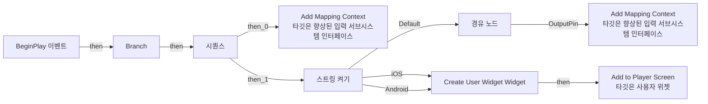
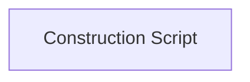

# BP_FirstPersonPlayerController

에셋: `/Game/FirstPerson/Blueprints/BP_FirstPersonPlayerController`

부모: `/Script/CoreUObject.Class'/Script/Engine.PlayerController'`

수집일: 2026-10-12. MCP에서 읽은 그래프·핀 연결의 자동 전사입니다. 상속된 그래프는 부모 문서를 함께 확인합니다.

정적 루트 참조 도달: 있음. 실행 여부 또는 삭제 가능 여부의 확정이 아닙니다.

컴포넌트 목록은 이 BP가 직접 정의한 SCS만 포함합니다. 부모·네이티브 생성 컴포넌트, 인스턴스 설정은 별도입니다.

## 변수와 기본값

| 이름 | 타입 | CDO 기본값 |
|---|---|---|
| `Touch Controls Widget Class` | `UserWidget` | /Game/Input/Touch/UI_TouchSimple.UI_TouchSimple_C |

## 그래프 목록

| 그래프 | 전체 노드 수 |
|---|---|
| EventGraph | 20 |
| UserConstructionScript | 1 |

## 그래프별 실행 연결

실선은 출력 exec 핀의 실제 연결입니다. 여러 분기는 출력 핀 이름을 표시합니다. 함수 호출·delegate·타이머의 다음 그래프 실행은 이 그림에서 자동으로 이어 붙이지 않습니다.

순수 계산 노드 및 데이터 핀은 아래 목록과 원본 JSON을 확인합니다. 연결되지 않은 이벤트도 표시되므로, 노드가 있다는 이유만으로 실행된다고 판단하면 안 됩니다.

### EventGraph

실행 핀 플로우차트

전체 노드·기본 입력 목록

| 노드 ID | 제목 | 미연결 기본 입력 / 에셋 입력 |
|---|---|---|
| `K2Node_Event_0` | BeginPlay 이벤트 |  |
| `K2Node_CallFunction_5` | Add Mapping Context 타깃은 향상된 입력 서브시스템 인터페이스 | MappingContext=/Game/Input/IMC_Default.IMC_Default; Priority=0; Options=(bIgnoreAllPressedKeysUntilRelease=True,bForceImmediately=False,bNotifyUserSettings=False) |
| `K2Node_GetSubsystem_0` | 향상된 입력 로컬 플레이어 서브시스템 |  |
| `K2Node_ExecutionSequence_0` | 시퀀스 |  |
| `K2Node_CallFunction_1` | Is Local Player Controller 타깃은 컨트롤러 |  |
| `K2Node_IfThenElse_0` | Branch |  |
| `K2Node_CreateWidget_0` | Create User Widget Widget |  |
| `K2Node_CallFunction_2` | Add to Player Screen 타깃은 사용자 위젯 | ZOrder=0; ReturnValue=false |
| `K2Node_CallFunction_15` | Add Mapping Context 타깃은 향상된 입력 서브시스템 인터페이스 | MappingContext=/Game/Input/IMC_MouseLook.IMC_MouseLook; Priority=0; Options=(bIgnoreAllPressedKeysUntilRelease=True,bForceImmediately=False,bNotifyUserSettings=False) |
| `K2Node_GetSubsystem_2` | 향상된 입력 로컬 플레이어 서브시스템 |  |
| `EdGraphNode_Comment_1` | Only add input mappings and touch UI to local players |  |
| `EdGraphNode_Comment_2` | Add regular input mappings |  |
| `EdGraphNode_Comment_3` | Skip mouse look on mobile controls because they interfere with each other. |  |
| `EdGraphNode_Comment_4` | Add touch input controls through a widget |  |
| `EdGraphNode_Comment_5` | Initialize player input |  |
| `K2Node_Knot_2` | 경유 노드 |  |
| `K2Node_VariableGet_2` | Get Touch Controls Widget Class |  |
| `K2Node_CallFunction_0` | Get Platform Name |  |
| `K2Node_SwitchString_0` | 스트링 켜기 |  |
| `K2Node_Self_0` | 셀프-레퍼런스 |  |

### UserConstructionScript

실행 핀 플로우차트

전체 노드·기본 입력 목록

| 노드 ID | 제목 | 미연결 기본 입력 / 에셋 입력 |
|---|---|---|
| `K2Node_FunctionEntry_0` | Construction Script |  |

## 조회 범위의 한계

ObjectIterator로 발견했으나 MCP helper가 반환하지 않은 그래프입니다. delegate signature·컴파일된 중간 그래프·macro·애니메이션 내부 그래프가 섞일 수 있습니다.

- `ExecuteUbergraph_BP_FirstPersonPlayerController`: Graph 'ExecuteUbergraph_BP_FirstPersonPlayerController' not found in Blueprint.
- `ReceiveBeginPlay`: Graph 'ReceiveBeginPlay' not found in Blueprint.
- `UserConstructionScript_MERGED`: Graph 'UserConstructionScript_MERGED' not found in Blueprint.

[원본 MCP 스냅샷](../../../Evidence/blueprints-351.json)
