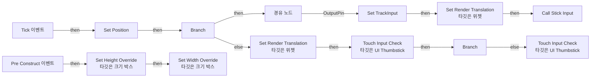
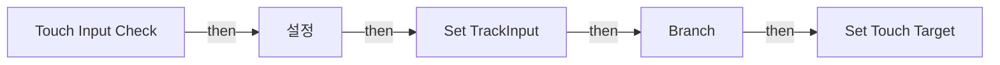

# UI_Thumbstick

에셋: `/Game/Input/Touch/UI_Thumbstick`

부모: `/Script/CoreUObject.Class'/Script/UMG.UserWidget'`

수집일: 2026-10-12. MCP에서 읽은 그래프·핀 연결의 자동 전사입니다. 상속된 그래프는 부모 문서를 함께 확인합니다.

정적 루트 참조 도달: 있음. 실행 여부 또는 삭제 가능 여부의 확정이 아닙니다.

컴포넌트 목록은 이 BP가 직접 정의한 SCS만 포함합니다. 부모·네이티브 생성 컴포넌트, 인스턴스 설정은 별도입니다.

## 변수와 기본값

| 이름 | 타입 | CDO 기본값 |
|---|---|---|
| `TrackInput` | `bool` | False |
| `Initial Touch Location` | `Vector2D` | &lt;Struct 'Vector2D' {x: 0.000000, y: 0.000000}&gt; |
| `Position` | `Vector2D` | &lt;Struct 'Vector2D' {x: 150.000000, y: 930.000000}&gt; |
| `Stick Input` | `mcdelegate` | &lt;Delegate 'DelegateBase' &lt;Unbound&gt;&gt; |
| `Thumbstick Size` | `Vector2D` | &lt;Struct 'Vector2D' {x: 200.000000, y: 200.000000}&gt; |
| `Invert X` | `bool` | False |
| `Invert Y` | `bool` | False |
| `Scale Output` | `real` | 1.0 |
| `Touch Target` | `ETouchIndex` | &lt;TouchIndex.TOUCH1: 0&gt; |

## 그래프 목록

| 그래프 | 전체 노드 수 |
|---|---|
| EventGraph | 60 |
| Touch Input Check | 13 |

## 그래프별 실행 연결

실선은 출력 exec 핀의 실제 연결입니다. 여러 분기는 출력 핀 이름을 표시합니다. 함수 호출·delegate·타이머의 다음 그래프 실행은 이 그림에서 자동으로 이어 붙이지 않습니다.

순수 계산 노드 및 데이터 핀은 아래 목록과 원본 JSON을 확인합니다. 연결되지 않은 이벤트도 표시되므로, 노드가 있다는 이유만으로 실행된다고 판단하면 안 됩니다.

### EventGraph

실행 핀 플로우차트

전체 노드·기본 입력 목록

| 노드 ID | 제목 | 미연결 기본 입력 / 에셋 입력 |
|---|---|---|
| `K2Node_Event_2` | Tick 이벤트 | InDeltaTime=0.0 |
| `K2Node_Event_3` | Pre Construct 이벤트 | IsDesignTime=false |
| `K2Node_IfThenElse_3` | Branch |  |
| `K2Node_VariableGet_23` | Get TrackInput |  |
| `K2Node_CallFunction_2` | Get Input Touch State 타깃은 플레이어 컨트롤러 |  |
| `K2Node_CallFunction_5` | Get Player Controller | PlayerIndex=0 |
| `K2Node_VariableGet_1` | Get |  |
| `K2Node_PromotableOperator_1` | float - float |  |
| `K2Node_PromotableOperator_0` | float - float |  |
| `K2Node_CallFunction_48` | Set Render Translation 타깃은 위젯 |  |
| `K2Node_VariableSet_3` | Set TrackInput | Output_Get=false |
| `K2Node_CallDelegate_0` | Call Stick Input |  |
| `K2Node_PromotableOperator_9` | float / float |  |
| `K2Node_PromotableOperator_8` | float / float |  |
| `K2Node_CallFunction_35` | Clamp (Float) |  |
| `K2Node_CallFunction_34` | Clamp (Float) |  |
| `K2Node_VariableGet_9` | Get |  |
| `K2Node_PromotableOperator_11` | float / float | B=2.000000 |
| `K2Node_PromotableOperator_10` | float / float | B=2.000000 |
| `K2Node_PromotableOperator_13` | float * float | B=-1.000000 |
| `K2Node_PromotableOperator_12` | float * float | B=-1.000000 |
| `K2Node_PromotableOperator_14` | float * float | B=-1.000000 |
| `K2Node_CallFunction_75` | Set Render Translation 타깃은 위젯 | Translation_X=0.0; Translation_Y=0.0 |
| `K2Node_VariableGet_15` | Get |  |
| `K2Node_VariableGet_19` | Get Invert X |  |
| `K2Node_CallFunction_56` | Select Float |  |
| `K2Node_PromotableOperator_21` | float * float | B=-1.000000 |
| `K2Node_VariableGet_18` | Get Invert Y |  |
| `K2Node_CallFunction_55` | Select Float |  |
| `K2Node_VariableGet_20` | Get Scale Output |  |
| `K2Node_PromotableOperator_23` | float * float |  |
| `K2Node_PromotableOperator_22` | float * float |  |
| `K2Node_Knot_0` | 경유 노드 |  |
| `K2Node_CallFunction_58` | Select Float | B=0.0 |
| `K2Node_CallFunction_57` | Select Float | B=0.0 |
| `K2Node_VariableGet_21` | Get Container |  |
| `K2Node_CallFunction_59` | Set Height Override 타깃은 크기 박스 |  |
| `K2Node_CallFunction_60` | Set Width Override 타깃은 크기 박스 |  |
| `K2Node_CallFunction_67` | Touch Input Check 타깃은 UI Thumbstick | FingerIndex=Touch1 |
| `K2Node_CallFunction_66` | Touch Input Check 타깃은 UI Thumbstick | FingerIndex=Touch2 |
| `K2Node_VariableGet_22` | Get Touch Target |  |
| `K2Node_IfThenElse_1` | Branch |  |
| `K2Node_VariableGet_6` | Get TrackInput |  |
| `K2Node_VariableGet_25` | Get Stick |  |
| `K2Node_VariableGet_26` | Get Stick |  |
| `K2Node_CallFunction_126` | Local to Viewport |  |
| `K2Node_VariableGet_31` | Get Thumbstick Size |  |
| `K2Node_VariableSet_6` | Set Position |  |
| `K2Node_PromotableOperator_56` | vector2d * vector2d |  |
| `K2Node_CallFunction_129` | Get Viewport Scale |  |
| `K2Node_PromotableOperator_57` | vector2d / vector2d | B=(X=2.000000,Y=2.000000) |
| `K2Node_VariableGet_0` | Get TrackInput |  |
| `EdGraphNode_Comment_0` | Zero input if input stops being detected |  |
| `EdGraphNode_Comment_1` | Scale Input By Exposed Value |  |
| `EdGraphNode_Comment_2` | Invert inputs by exposed Bool |  |
| `EdGraphNode_Comment_3` | Modify Input |  |
| `EdGraphNode_Comment_4` | Normalize Inputs |  |
| `EdGraphNode_Comment_5` | Compare Stored Initial touch location to current touch location. Limit to Thumbstick size. |  |
| `EdGraphNode_Comment_6` | Wait for input |  |
| `EdGraphNode_Comment_7` | Store Position of Thumbstick on screen. |  |

### Touch Input Check

실행 핀 플로우차트

전체 노드·기본 입력 목록

| 노드 ID | 제목 | 미연결 기본 입력 / 에셋 입력 |
|---|---|---|
| `K2Node_FunctionEntry_0` | Touch Input Check |  |
| `K2Node_VariableSet_0` | Set TrackInput |  |
| `K2Node_VariableSet_2` | 설정 |  |
| `K2Node_CallFunction_63` | Get Player Controller | PlayerIndex=0 |
| `K2Node_CommutativeAssociativeBinaryOperator_1` | AND Boolean |  |
| `K2Node_VariableGet_10` | Get Position |  |
| `K2Node_CallFunction_45` | Distance 2D |  |
| `K2Node_VariableGet_12` | Get |  |
| `K2Node_CommutativeAssociativeBinaryOperator_2` | Max (Float) |  |
| `K2Node_PromotableOperator_19` | float &lt;= float |  |
| `K2Node_CallFunction_65` | Get Input Touch State 타깃은 플레이어 컨트롤러 |  |
| `K2Node_VariableSet_1` | Set Touch Target | Output_Get=Touch1 |
| `K2Node_IfThenElse_0` | Branch |  |

## 조회 범위의 한계

ObjectIterator로 발견했으나 MCP helper가 반환하지 않은 그래프입니다. delegate signature·컴파일된 중간 그래프·macro·애니메이션 내부 그래프가 섞일 수 있습니다.

- `ExecuteUbergraph_UI_Thumbstick`: Graph 'ExecuteUbergraph_UI_Thumbstick' not found in Blueprint.
- `PreConstruct`: Graph 'PreConstruct' not found in Blueprint.
- `Stick Input`: Graph 'Stick Input' not found in Blueprint.
- `Stick Input_MERGED`: Graph 'Stick Input_MERGED' not found in Blueprint.
- `Tick`: Graph 'Tick' not found in Blueprint.
- `Touch Input Check_MERGED`: Graph 'Touch Input Check_MERGED' not found in Blueprint.

[원본 MCP 스냅샷](../../../Evidence/blueprints-351.json)
