# BP_QuakeAIController2

에셋: `/Game/QuakeLike_1_0/AI/AIC/BP_QuakeAIController2`

부모: `/Script/CoreUObject.Class'/Script/ShootingArena.QuakeTargetSelectionAIController'`

수집일: 2026-10-12. MCP에서 읽은 그래프·핀 연결의 자동 전사입니다. 상속된 그래프는 부모 문서를 함께 확인합니다.

정적 루트 참조 도달: 있음. 실행 여부 또는 삭제 가능 여부의 확정이 아닙니다.

컴포넌트 목록은 이 BP가 직접 정의한 SCS만 포함합니다. 부모·네이티브 생성 컴포넌트, 인스턴스 설정은 별도입니다.

## 직접 정의한 컴포넌트

| 이름 | 클래스 | 부모 컴포넌트 |
|---|---|---|
| `AIPerception` | `AIPerceptionComponent` | `` |
| `BPC_PointsTourist` | `BPC_PointsTourist_C` | `` |
| `BPC_RespawnHelper` | `BPC_RespawnHelper_C` | `` |
| `BPC_AIDataCache` | `BPC_AIDataCache_C` | `` |
| `BPC_AIWeaponSelection` | `BPC_AIWeaponSelection_C` | `` |
| `BPC_GoalWeightCalculator` | `BPC_GoalWeightCalculator_C` | `` |
| `BPC_VariousScore` | `BPC_VariousScore_C` | `` |
| `BPC_VirtualInputAIMovement` | `BPC_VirtualInputAIMovement_C` | `` |
| `BPC_DeathCountTracker` | `BPC_DeathCountTracker_C` | `` |

## 변수와 기본값

| 이름 | 타입 | CDO 기본값 |
|---|---|---|
| `STG` | `Actor` | None |
| `LTG` | `Actor` | None |
| `MyCharacter` | `BP_ShooterBase_C` | None |
| `CachedSpawners` | `BP_ItemSpawnPoint_C` | [] |
| `OnAIStateChanged` | `mcdelegate` | &lt;Delegate 'DelegateBase' &lt;Unbound&gt;&gt; |
| `LTG Setting Timer` | `TimerHandle` | &lt;Struct 'TimerHandle' {}&gt; |
| `CurrentTarget` | `ST_TargetInfo` | &lt;Struct 'ST_TargetInfo' {}&gt; |
| `Target Lost Timer` | `TimerHandle` | &lt;Struct 'TimerHandle' {}&gt; |
| `Chase Point Timer` | `TimerHandle` | &lt;Struct 'TimerHandle' {}&gt; |
| `CharacteristicRowNameOverride` | `name` | None |
| `DA_Aggression` | `AggressionDataAssetBase` | /Game/QuakeLike_1_0/Data/AI/Aggression/DA_DefaultAggression.DA_DefaultAggression |
| `TravelTimeLimit` | `real` | 5.0 |
| `Chase Points` | `Vector` | [] |

## 그래프 목록

| 그래프 | 전체 노드 수 |
|---|---|
| Can Arrive In Time | 9 |
| Clear Target Lost Timer | 7 |
| Debug | 4 |
| Debug_Chase Points | 4 |
| Debug_LTG | 8 |
| Debug_Perceived | 12 |
| Debug_STGtLine | 25 |
| EventGraph | 143 |
| Filtering STG | 29 |
| Forget Enemy Last Location | 4 |
| Get Aggression Goal Weight | 11 |
| Get Aggression Score | 15 |
| Get Attacker Pawn | 18 |
| Get Best Goal | 27 |
| Get Goal Weight | 69 |
| Get Height Score | 9 |
| Get SelfPreservation Goal Weight | 17 |
| Get Survive Score | 6 |
| Get Weapon Score | 16 |
| Is Shorter Then LTG | 34 |
| Pop Chase Point | 13 |
| Push Chase Point | 13 |
| Set Current Target | 65 |
| Set LTG | 18 |
| Set LTG Timer | 10 |
| Set STG | 11 |
| SetupCharacteristic | 2 |
| Start Target Lost Timer | 10 |
| Target Lost | 4 |
| UserConstructionScript | 1 |

## 그래프별 실행 연결

실선은 출력 exec 핀의 실제 연결입니다. 여러 분기는 출력 핀 이름을 표시합니다. 함수 호출·delegate·타이머의 다음 그래프 실행은 이 그림에서 자동으로 이어 붙이지 않습니다.

순수 계산 노드 및 데이터 핀은 아래 목록과 원본 JSON을 확인합니다. 연결되지 않은 이벤트도 표시되므로, 노드가 있다는 이유만으로 실행된다고 판단하면 안 됩니다.

### Can Arrive In Time

<details>
<summary>실행 핀 플로우차트</summary>

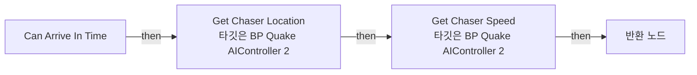

</details>

<details>
<summary>전체 노드·기본 입력 목록</summary>

| 노드 ID | 제목 | 미연결 기본 입력 / 에셋 입력 |
|---|---|---|
| `K2Node_FunctionEntry_0` | Can Arrive In Time |  |
| `K2Node_FunctionResult_0` | 반환 노드 |  |
| `K2Node_CallFunction_0` | Get Chaser Location<br/>타깃은 BP Quake AIController 2 |  |
| `K2Node_CallFunction_1` | Get Actor Location<br/>타깃은 액터 |  |
| `K2Node_CallFunction_2` | Distance (Vector) |  |
| `K2Node_CallFunction_3` | Get Chaser Speed<br/>타깃은 BP Quake AIController 2 |  |
| `K2Node_CallFunction_4` | Safe Divide |  |
| `K2Node_PromotableOperator_1` | float &lt;= float |  |
| `K2Node_VariableGet_2` | Get TravelTimeLimit |  |

</details>

### Clear Target Lost Timer

<details>
<summary>실행 핀 플로우차트</summary>

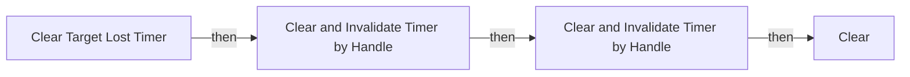

</details>

<details>
<summary>전체 노드·기본 입력 목록</summary>

| 노드 ID | 제목 | 미연결 기본 입력 / 에셋 입력 |
|---|---|---|
| `K2Node_FunctionEntry_0` | Clear Target Lost Timer |  |
| `K2Node_VariableGet_4` | Get Target Lost Timer |  |
| `K2Node_CallFunction_18` | Clear and Invalidate Timer by Handle |  |
| `K2Node_VariableGet_0` | Get Chase Point Timer |  |
| `K2Node_CallFunction_0` | Clear and Invalidate Timer by Handle |  |
| `K2Node_VariableGet_1` | Get Chase Points |  |
| `K2Node_CallArrayFunction_0` | Clear |  |

</details>

### Debug

<details>
<summary>실행 핀 플로우차트</summary>

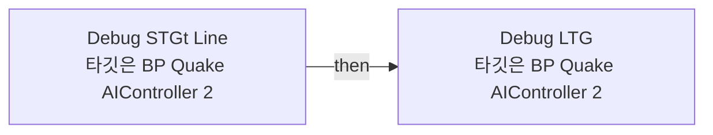

</details>

<details>
<summary>전체 노드·기본 입력 목록</summary>

| 노드 ID | 제목 | 미연결 기본 입력 / 에셋 입력 |
|---|---|---|
| `K2Node_CallFunction_0` | Debug STGt Line<br/>타깃은 BP Quake AIController 2 |  |
| `K2Node_VariableGet_2` | Get AIPerception |  |
| `K2Node_CallFunction_6` | Get Currently Perceived Actors<br/>타깃은 AI 인지 컴포넌트 |  |
| `K2Node_CallFunction_7` | Debug LTG<br/>타깃은 BP Quake AIController 2 |  |

</details>

### Debug_Chase Points

<details>
<summary>실행 핀 플로우차트</summary>

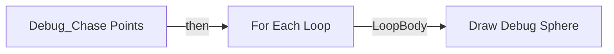

</details>

<details>
<summary>전체 노드·기본 입력 목록</summary>

| 노드 ID | 제목 | 미연결 기본 입력 / 에셋 입력 |
|---|---|---|
| `K2Node_FunctionEntry_0` | Debug_Chase Points |  |
| `K2Node_VariableGet_0` | Get Chase Points |  |
| `K2Node_MacroInstance_0` | For Each Loop |  |
| `K2Node_CallFunction_0` | Draw Debug Sphere | Radius=100.000000; Segments=12; LineColor=(R=0.052278,G=0.000000,B=1.000000,A=1.000000); Duration=0.000000; Thickness=10.000000 |

</details>

### Debug_LTG

<details>
<summary>실행 핀 플로우차트</summary>

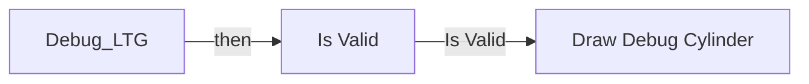

</details>

<details>
<summary>전체 노드·기본 입력 목록</summary>

| 노드 ID | 제목 | 미연결 기본 입력 / 에셋 입력 |
|---|---|---|
| `K2Node_FunctionEntry_0` | Debug_LTG |  |
| `K2Node_VariableGet_0` | Get LTG |  |
| `K2Node_MacroInstance_0` | Is Valid |  |
| `K2Node_CallFunction_0` | Draw Debug Cylinder | Radius=100.000000; Segments=12; LineColor=(R=1.000000,G=1.000000,B=1.000000,A=1.000000); Duration=0.000000; Thickness=0.000000 |
| `K2Node_Knot_0` | 경유 노드 |  |
| `K2Node_CallFunction_1` | Get Actor Location<br/>타깃은 액터 |  |
| `K2Node_Knot_1` | 경유 노드 |  |
| `K2Node_PromotableOperator_0` | vector + vector | B=0.000000,0.000000,100.000000 |

</details>

### Debug_Perceived

<details>
<summary>실행 핀 플로우차트</summary>

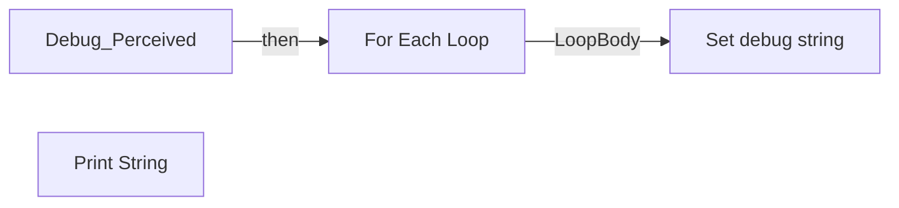

</details>

<details>
<summary>전체 노드·기본 입력 목록</summary>

| 노드 ID | 제목 | 미연결 기본 입력 / 에셋 입력 |
|---|---|---|
| `K2Node_FunctionEntry_0` | Debug_Perceived |  |
| `K2Node_MacroInstance_0` | For Each Loop |  |
| `K2Node_CallFunction_0` | Get Display Name |  |
| `K2Node_VariableGet_1` | Get debug string |  |
| `K2Node_CommutativeAssociativeBinaryOperator_0` | Append | B= \|  |
| `K2Node_VariableSet_0` | Set debug string |  |
| `K2Node_CallFunction_2` | Print String | bPrintToScreen=true; bPrintToLog=true; TextColor=(R=0.000000,G=0.660000,B=1.000000,A=1.000000); Duration=2.000000 |
| `K2Node_VariableGet_8` | Get debug string |  |
| `K2Node_CallFunction_3` | Make Print Key | string=Perceived |
| `K2Node_Self_0` | 셀프-레퍼런스 |  |
| `K2Node_VariableGet_0` | Get AIPerception |  |
| `K2Node_CallFunction_4` | Get Currently Perceived Actors<br/>타깃은 AI 인지 컴포넌트 |  |

</details>

### Debug_STGtLine

<details>
<summary>실행 핀 플로우차트</summary>

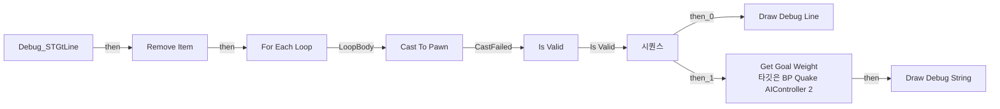

</details>

<details>
<summary>전체 노드·기본 입력 목록</summary>

| 노드 ID | 제목 | 미연결 기본 입력 / 에셋 입력 |
|---|---|---|
| `K2Node_FunctionEntry_0` | Debug_STGtLine |  |
| `K2Node_CallFunction_0` | Draw Debug Line | Duration=0.000000; Thickness=0.000000 |
| `K2Node_MacroInstance_0` | For Each Loop |  |
| `K2Node_VariableGet_4` | Get myCharacter |  |
| `K2Node_CallFunction_6` | Get Actor Location<br/>타깃은 액터 |  |
| `K2Node_CallFunction_7` | Get Actor Location<br/>타깃은 액터 |  |
| `K2Node_Knot_0` | 경유 노드 |  |
| `K2Node_Knot_4` | 경유 노드 |  |
| `K2Node_MacroInstance_3` | Is Valid |  |
| `K2Node_ExecutionSequence_0` | 시퀀스 |  |
| `K2Node_VariableGet_2` | Get myCharacter |  |
| `K2Node_CallFunction_2` | Get Actor Location<br/>타깃은 액터 |  |
| `K2Node_CallFunction_3` | Get Actor Location<br/>타깃은 액터 |  |
| `K2Node_PromotableOperator_0` | vector + vector |  |
| `K2Node_PromotableOperator_1` | vector / vector | B=2.000000 |
| `K2Node_CallFunction_1` | Draw Debug String | TextColor=(R=1.000000,G=1.000000,B=1.000000,A=1.000000); Duration=0.000000 |
| `K2Node_CallFunction_5` | To Text (Float) | RoundingMode=HalfToEven; bAlwaysSign=false; bUseGrouping=true; MinimumIntegralDigits=1; MaximumIntegralDigits=324; MinimumFractionalDigits=0; MaximumFractionalDigits=1 |
| `K2Node_CallFunction_13` | To String (Text) |  |
| `K2Node_Knot_9` | 경유 노드 |  |
| `K2Node_Knot_1` | 경유 노드 |  |
| `K2Node_CallArrayFunction_0` | Remove Item | ReturnValue=false |
| `K2Node_CallFunction_8` | Get Goal Weight<br/>타깃은 BP Quake AIController 2 |  |
| `K2Node_VariableGet_7` | Get LTG |  |
| `K2Node_Knot_3` | 경유 노드 |  |
| `K2Node_DynamicCast_2` | Cast To Pawn |  |

</details>

### EventGraph

<details>
<summary>실행 핀 플로우차트</summary>

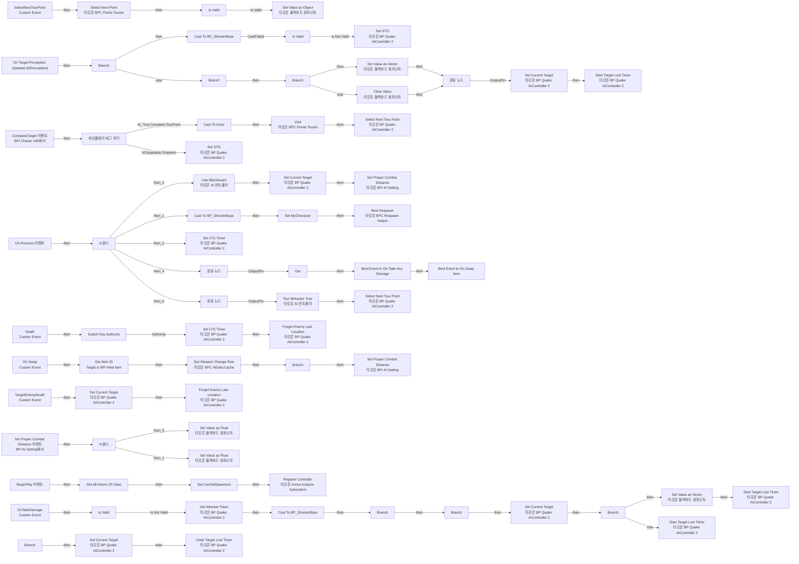

</details>

<details>
<summary>전체 노드·기본 입력 목록</summary>

| 노드 ID | 제목 | 미연결 기본 입력 / 에셋 입력 |
|---|---|---|
| `K2Node_ComponentBoundEvent_2` | On Target Perception Updated (AIPerception) |  |
| `K2Node_IfThenElse_1` | Branch |  |
| `K2Node_VariableGet_16` | Get STG |  |
| `K2Node_MacroInstance_3` | Is Valid |  |
| `K2Node_Event_3` | On Possess 이벤트 |  |
| `K2Node_VariableSet_1` | Set MyCharacter |  |
| `K2Node_DynamicCast_3` | Cast To BP_ShooterBase |  |
| `K2Node_CustomEvent_0` | SelectNextTourPoint<br/>Custom Event |  |
| `K2Node_VariableGet_5` | Get BPC_PointsTourist |  |
| `K2Node_CallFunction_8` | Select Next Point<br/>타깃은 BPC Points Tourist |  |
| `K2Node_VariableGet_6` | Get MyCharacter |  |
| `K2Node_CallFunction_16` | Set Value as Object<br/>타깃은 블랙보드 컴포넌트 |  |
| `K2Node_CallFunction_40` | Make Literal Name | Value=TourPoint |
| `K2Node_CallFunction_47` | Get Blackboard |  |
| `K2Node_Knot_6` | 경유 노드 |  |
| `K2Node_Knot_14` | 경유 노드 |  |
| `K2Node_MacroInstance_2` | Is Valid |  |
| `K2Node_Event_6` | CompleteTarget 이벤트<br/>BPI Chaser Info에서 |  |
| `GameplayTagsK2Node_SwitchGameplayTag_1` | 게임플레이 태그 켜기 |  |
| `K2Node_CallFunction_12` | Select Next Tour Point<br/>타깃은 BP Quake AIController 2 |  |
| `K2Node_CallFunction_31` | Run Behavior Tree<br/>타깃은 AI 컨트롤러 | BTAsset=/Game/QuakeLike_1_0/AI/AIC/BT_QuakeTree.BT_QuakeTree; ReturnValue=false |
| `K2Node_ExecutionSequence_1` | 시퀀스 |  |
| `K2Node_Knot_4` | 경유 노드 |  |
| `K2Node_CustomEvent_2` | Death<br/>Custom Event |  |
| `K2Node_MacroInstance_5` | Switch Has Authority |  |
| `K2Node_Event_9` | BeginPlay 이벤트 |  |
| `K2Node_VariableGet_12` | Get BPC_PointsTourist |  |
| `K2Node_CallFunction_30` | Visit<br/>타깃은 BPC Points Tourist |  |
| `K2Node_CallFunction_43` | Get Blackboard |  |
| `K2Node_CallFunction_15` | Make Literal Name | Value=TourPoint |
| `K2Node_CallFunction_34` | Get Value as Object<br/>타깃은 블랙보드 컴포넌트 |  |
| `K2Node_DynamicCast_1` | Cast To Actor |  |
| `K2Node_VariableGet_13` | Get myCharacter |  |
| `K2Node_CallFunction_2` | Set STG<br/>타깃은 BP Quake AIController 2 |  |
| `K2Node_CallFunction_36` | Get All Actors Of Class | ActorClass=/Game/QuakeLike_1_0/Spawner/SpawnPoint/BP_ItemSpawnPoint.BP_ItemSpawnPoint_C |
| `K2Node_VariableSet_6` | Set CachedSpawners |  |
| `K2Node_CallFunction_32` | Set LTG Timer<br/>타깃은 BP Quake AIController 2 | is Set=true |
| `K2Node_CallFunction_33` | Set LTG Timer<br/>타깃은 BP Quake AIController 2 | is Set=false |
| `K2Node_DynamicCast_2` | Cast To BP_ShooterBase |  |
| `K2Node_Knot_3` | 경유 노드 |  |
| `K2Node_Knot_8` | 경유 노드 |  |
| `K2Node_CustomEvent_1` | TargetEnemyDeath<br/>Custom Event |  |
| `K2Node_VariableGet_0` | Get BPC_Life |  |
| `K2Node_CallFunction_13` | Is Death<br/>타깃은 BPC Life |  |
| `K2Node_CallFunction_6` | NOT Boolean |  |
| `K2Node_IfThenElse_2` | Branch |  |
| `K2Node_VariableGet_10` | Get BPC_RespawnHelper |  |
| `K2Node_CallFunction_44` | Bind Respawn<br/>타깃은 BPC Respawn Helper | Respawn Time=5.000000 |
| `K2Node_Knot_20` | 경유 노드 |  |
| `K2Node_Self_0` | 셀프-레퍼런스 |  |
| `K2Node_Knot_1` | 경유 노드 |  |
| `K2Node_VariableGet_3` | Get |  |
| `K2Node_AddDelegate_0` | Bind Event to On Take Any Damage |  |
| `K2Node_CreateDelegate_0` | 이벤트 생성 |  |
| `K2Node_CustomEvent_4` | OnTakeDamage<br/>Custom Event |  |
| `K2Node_Knot_7` | 경유 노드 |  |
| `K2Node_Knot_15` | 경유 노드 |  |
| `K2Node_Knot_16` | 경유 노드 |  |
| `K2Node_PromotableOperator_1` | Equal (Object) |  |
| `K2Node_IfThenElse_0` | Branch |  |
| `K2Node_CallFunction_4` | Set Value as Vector<br/>타깃은 블랙보드 컴포넌트 |  |
| `K2Node_CallFunction_7` | Make Literal Name | Value=EnemyLastLocation |
| `K2Node_CallFunction_29` | Get Blackboard |  |
| `K2Node_Knot_21` | 경유 노드 |  |
| `K2Node_CallFunction_51` | Set STG<br/>타깃은 BP Quake AIController 2 |  |
| `K2Node_CallFunction_21` | Select Next Tour Point<br/>타깃은 BP Quake AIController 2 |  |
| `K2Node_CallFunction_5` | Project Point to Navigation | QueryExtent=50.000000,50.000000,1000.000000 |
| `K2Node_IfThenElse_7` | Branch |  |
| `K2Node_Knot_32` | 경유 노드 |  |
| `K2Node_Knot_33` | 경유 노드 |  |
| `K2Node_CallFunction_42` | Clear Value<br/>타깃은 블랙보드 컴포넌트 |  |
| `K2Node_Knot_35` | 경유 노드 |  |
| `K2Node_Knot_36` | 경유 노드 |  |
| `K2Node_Knot_37` | 경유 노드 |  |
| `K2Node_Knot_0` | 경유 노드 |  |
| `K2Node_CallFunction_0` | Use Blackboard<br/>타깃은 AI 컨트롤러 | BlackboardAsset=/Game/QuakeLike_1_0/AI/AIC/BB_QuakeBoard.BB_QuakeBoard; ReturnValue=false |
| `K2Node_CallFunction_20` | Set Current Target<br/>타깃은 BP Quake AIController 2 | New_IsVisible_9_088BE2B34DEEA07B7F676798FB0F66D2=true |
| `K2Node_CallFunction_14` | Set Current Target<br/>타깃은 BP Quake AIController 2 | New_IsVisible_9_088BE2B34DEEA07B7F676798FB0F66D2=False; New_VisibleSince_13_86DF842F4B3B526EBA18AD9C4C205926=0.000000 |
| `K2Node_CallFunction_11` | Set Current Target<br/>타깃은 BP Quake AIController 2 | New_IsVisible_9_088BE2B34DEEA07B7F676798FB0F66D2=False; New_VisibleSince_13_86DF842F4B3B526EBA18AD9C4C205926=0.000000 |
| `K2Node_VariableGet_2` | Get |  |
| `K2Node_CallFunction_10` | Set Current Target<br/>타깃은 BP Quake AIController 2 | New_IsVisible_9_088BE2B34DEEA07B7F676798FB0F66D2=False; New_VisibleSince_13_86DF842F4B3B526EBA18AD9C4C205926=0.000000 |
| `K2Node_VariableGet_17` | Get |  |
| `K2Node_CallFunction_23` | Start Target Lost Timer<br/>타깃은 BP Quake AIController 2 | Chase Point Loop Time=1.000000 |
| `K2Node_CallFunction_26` | Forget Enemy Last Location<br/>타깃은 BP Quake AIController 2 |  |
| `K2Node_CallFunction_25` | Forget Enemy Last Location<br/>타깃은 BP Quake AIController 2 |  |
| `K2Node_CallFunction_1` | Get Time Seconds |  |
| `K2Node_Event_1` | Set Proper Combat Distance 이벤트<br/>BPI AI Setting에서 |  |
| `K2Node_Knot_5` | 경유 노드 |  |
| `K2Node_PromotableOperator_0` | float + float | B=100.000000 |
| `K2Node_PromotableOperator_2` | float - float | B=100.000000 |
| `K2Node_CallFunction_19` | Get Blackboard |  |
| `K2Node_CallFunction_22` | Set Value as Float<br/>타깃은 블랙보드 컴포넌트 |  |
| `K2Node_CallFunction_24` | Set Value as Float<br/>타깃은 블랙보드 컴포넌트 |  |
| `K2Node_ExecutionSequence_0` | 시퀀스 |  |
| `K2Node_CallFunction_27` | Make Literal Name | Value=Max Proper Combat Distance |
| `K2Node_CallFunction_28` | Make Literal Name | Value=Min Proper Combat Distance |
| `K2Node_Knot_10` | 경유 노드 |  |
| `K2Node_Knot_11` | 경유 노드 |  |
| `K2Node_CallFunction_35` | Set Proper Combat Distance<br/>타깃은 BPI AI Setting | Proper Distance=900.000000 |
| `K2Node_VariableGet_8` | Get MyCharacter |  |
| `K2Node_VariableGet_9` | Get BPC_Inventory |  |
| `K2Node_AddDelegate_1` | Bind Event to On Swap Item |  |
| `K2Node_CustomEvent_3` | On Swap<br/>Custom Event |  |
| `K2Node_CreateDelegate_1` | 이벤트 생성 |  |
| `K2Node_CallFunction_41` | Get Tag Name |  |
| `K2Node_CallFunction_3` | Get Weapon Change Row<br/>타깃은 BPC AIData Cache |  |
| `K2Node_VariableGet_11` | Get BPC_AIDataCache |  |
| `K2Node_BreakStruct_4` | Break Curve |  |
| `K2Node_CallFunction_9` | Get Peak Key from Runtime Float Curve | OutPeakValue=0.0; ReturnValue=false |
| `K2Node_CallFunction_46` | Set Proper Combat Distance<br/>타깃은 BPI AI Setting |  |
| `K2Node_Message_1` | Get Item ID<br/>Target is BPI Held Item |  |
| `K2Node_IfThenElse_3` | Branch |  |
| `K2Node_VariableGet_18` | Get DA_Aggression |  |
| `K2Node_VariableGet_19` | Get ChaseMaxTime |  |
| `K2Node_GetSubsystem_0` | Arena Analyze Subsystem |  |
| `K2Node_CallFunction_18` | Register Controller<br/>타깃은 Arena Analyze Subsystem |  |
| `K2Node_Self_1` | 셀프-레퍼런스 |  |
| `K2Node_MacroInstance_0` | Is Valid |  |
| `K2Node_DynamicCast_5` | Cast To BP_ShooterBase |  |
| `K2Node_CallFunction_53` | Get Controlled Pawn<br/>타깃은 컨트롤러 |  |
| `K2Node_CallFunction_54` | Not Equal (Object) |  |
| `K2Node_IfThenElse_4` | Branch |  |
| `K2Node_VariableGet_15` | Get BPC_Life |  |
| `K2Node_CallFunction_55` | Is Death<br/>타깃은 BPC Life |  |
| `K2Node_IfThenElse_5` | Branch |  |
| `K2Node_CallFunction_56` | Set Current Target<br/>타깃은 BP Quake AIController 2 | New_IsVisible_9_088BE2B34DEEA07B7F676798FB0F66D2=False; New_VisibleSince_13_86DF842F4B3B526EBA18AD9C4C205926=0.000000 |
| `K2Node_CallFunction_57` | Get Actor Location<br/>타깃은 액터 |  |
| `K2Node_CallFunction_58` | Project Point to Navigation | QueryExtent=50.0,50.0,1000.0 |
| `K2Node_IfThenElse_6` | Branch |  |
| `K2Node_CallFunction_59` | Set Value as Vector<br/>타깃은 블랙보드 컴포넌트 |  |
| `K2Node_CallFunction_60` | Make Literal Name | Value=EnemyLastLocation |
| `K2Node_CallFunction_61` | Start Target Lost Timer<br/>타깃은 BP Quake AIController 2 | Chase Point Loop Time=1.000000 |
| `K2Node_CallFunction_62` | Start Target Lost Timer<br/>타깃은 BP Quake AIController 2 | Chase Point Loop Time=1.000000 |
| `K2Node_VariableGet_7` | Get |  |
| `K2Node_VariableGet_1` | Get DA_Aggression |  |
| `K2Node_VariableGet_14` | Get ChaseMaxTime |  |
| `K2Node_CallFunction_17` | Get Blackboard |  |
| `K2Node_CallFunction_38` | Get Attacker Pawn<br/>타깃은 BP Quake AIController 2 |  |
| `K2Node_Knot_2` | 경유 노드 |  |
| `K2Node_Knot_9` | 경유 노드 |  |
| `K2Node_CallFunction_39` | NOT Boolean |  |
| `K2Node_Knot_12` | 경유 노드 |  |
| `K2Node_CallFunction_48` | Clear Target Lost Timer<br/>타깃은 BP Quake AIController 2 |  |

</details>

### Filtering STG

<details>
<summary>실행 핀 플로우차트</summary>

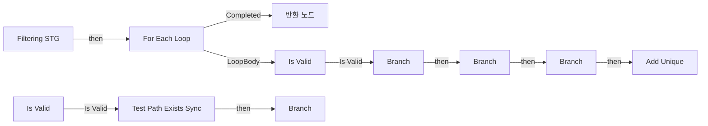

</details>

<details>
<summary>전체 노드·기본 입력 목록</summary>

| 노드 ID | 제목 | 미연결 기본 입력 / 에셋 입력 |
|---|---|---|
| `K2Node_FunctionEntry_0` | Filtering STG |  |
| `K2Node_FunctionResult_0` | 반환 노드 |  |
| `K2Node_MacroInstance_0` | For Each Loop |  |
| `K2Node_MacroInstance_1` | Is Valid |  |
| `K2Node_Knot_0` | 경유 노드 |  |
| `K2Node_Knot_1` | 경유 노드 |  |
| `K2Node_VariableGet_10` | Get Filtered Goals |  |
| `K2Node_CallFunction_0` | Test Path Exists Sync |  |
| `K2Node_EnumEquality_0` | Equal (Enum) | B=PathExists |
| `K2Node_IfThenElse_2` | Branch |  |
| `K2Node_Knot_3` | 경유 노드 |  |
| `K2Node_CallFunction_1` | Get Actor Location<br/>타깃은 액터 |  |
| `K2Node_CallFunction_2` | Get Controlled Pawn<br/>타깃은 컨트롤러 |  |
| `K2Node_MacroInstance_2` | Is Valid |  |
| `K2Node_Knot_6` | 경유 노드 |  |
| `K2Node_CallFunction_3` | Get Actor Location<br/>타깃은 액터 |  |
| `K2Node_IfThenElse_0` | Branch |  |
| `K2Node_Knot_5` | 경유 노드 |  |
| `K2Node_CallFunction_7` | Is Shorter Then LTG |  |
| `K2Node_IfThenElse_3` | Branch |  |
| `K2Node_CallFunction_8` | Can Arrive in Time |  |
| `K2Node_Knot_2` | 경유 노드 |  |
| `K2Node_Knot_4` | 경유 노드 |  |
| `K2Node_VariableGet_2` | Get Filtered Goals |  |
| `K2Node_CallArrayFunction_0` | Add Unique | ReturnValue=0 |
| `EdGraphNode_Comment_1` | 1단계: 연결된 Path가 맞는가? --&gt; 이제는 Path Link 상으로만 연결되어 있을 수도 있을듯 |  |
| `EdGraphNode_Comment_2` | 2단계: 도달 시간 체크 (Link 시스템 추가에 따라 리팩토링 대상) |  |
| `K2Node_IfThenElse_1` | Branch |  |
| `K2Node_Knot_7` | 경유 노드 |  |

</details>

### Forget Enemy Last Location

<details>
<summary>실행 핀 플로우차트</summary>

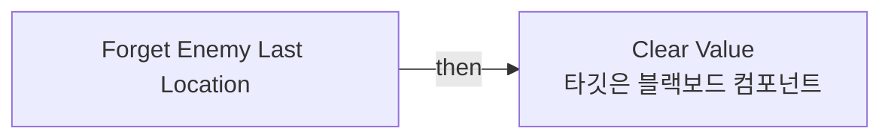

</details>

<details>
<summary>전체 노드·기본 입력 목록</summary>

| 노드 ID | 제목 | 미연결 기본 입력 / 에셋 입력 |
|---|---|---|
| `K2Node_FunctionEntry_0` | Forget Enemy Last Location |  |
| `K2Node_CallFunction_19` | Make Literal Name | Value=EnemyLastLocation |
| `K2Node_CallFunction_22` | Get Blackboard |  |
| `K2Node_CallFunction_24` | Clear Value<br/>타깃은 블랙보드 컴포넌트 |  |

</details>

### Get Aggression Goal Weight

<details>
<summary>실행 핀 플로우차트</summary>

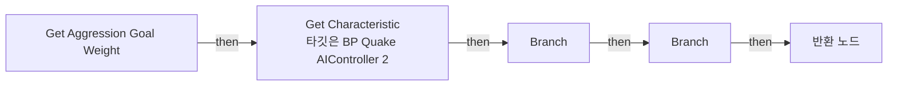

</details>

<details>
<summary>전체 노드·기본 입력 목록</summary>

| 노드 ID | 제목 | 미연결 기본 입력 / 에셋 입력 |
|---|---|---|
| `K2Node_FunctionEntry_0` | Get Aggression Goal Weight |  |
| `K2Node_FunctionResult_0` | 반환 노드 |  |
| `K2Node_IfThenElse_4` | Branch |  |
| `K2Node_Knot_0` | 경유 노드 |  |
| `K2Node_Knot_1` | 경유 노드 |  |
| `K2Node_CallFunction_0` | Get Characteristic<br/>타깃은 BP Quake AIController 2 |  |
| `K2Node_VariableGet_0` | Get BPC_AIDataCache |  |
| `K2Node_CallFunction_1` | Get Item Weight Row<br/>타깃은 BPC AIData Cache |  |
| `K2Node_CallFunction_2` | Calc Fuzzy Weight<br/>타깃은 BPC Goal Weight Calculator |  |
| `K2Node_VariableGet_1` | Get BPC_GoalWeightCalculator |  |
| `K2Node_IfThenElse_1` | Branch |  |

</details>

### Get Aggression Score

<details>
<summary>실행 핀 플로우차트</summary>

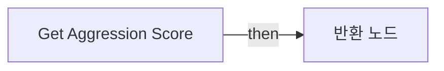

</details>

<details>
<summary>전체 노드·기본 입력 목록</summary>

| 노드 ID | 제목 | 미연결 기본 입력 / 에셋 입력 |
|---|---|---|
| `K2Node_FunctionEntry_0` | Get Aggression Score |  |
| `K2Node_CallFunction_8` | Get Height Score |  |
| `K2Node_CallFunction_9` | Get Survive Score |  |
| `K2Node_CallFunction_11` | Get Weapon Score |  |
| `K2Node_PromotableOperator_9` | float * float |  |
| `K2Node_PromotableOperator_10` | float * float |  |
| `K2Node_PromotableOperator_8` | float * float |  |
| `K2Node_PromotableOperator_11` | float + float |  |
| `K2Node_FunctionResult_0` | 반환 노드 |  |
| `K2Node_VariableGet_0` | Get DA_Aggression |  |
| `K2Node_VariableGet_1` | Get HeightWeight |  |
| `K2Node_VariableGet_2` | Get DA_Aggression |  |
| `K2Node_VariableGet_3` | Get SurvivalWeight |  |
| `K2Node_VariableGet_4` | Get DA_Aggression |  |
| `K2Node_VariableGet_5` | Get WeaponWeight |  |

</details>

### Get Attacker Pawn

<details>
<summary>실행 핀 플로우차트</summary>

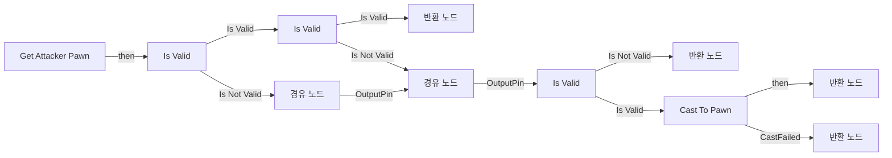

</details>

<details>
<summary>전체 노드·기본 입력 목록</summary>

| 노드 ID | 제목 | 미연결 기본 입력 / 에셋 입력 |
|---|---|---|
| `K2Node_FunctionEntry_0` | Get Attacker Pawn |  |
| `K2Node_FunctionResult_3` | 반환 노드 |  |
| `K2Node_MacroInstance_0` | Is Valid |  |
| `K2Node_Knot_0` | 경유 노드 |  |
| `K2Node_CallFunction_1` | Get Controlled Pawn<br/>타깃은 컨트롤러 |  |
| `K2Node_MacroInstance_2` | Is Valid |  |
| `K2Node_Knot_1` | 경유 노드 |  |
| `K2Node_Knot_2` | 경유 노드 |  |
| `K2Node_Knot_3` | 경유 노드 |  |
| `K2Node_Knot_4` | 경유 노드 |  |
| `K2Node_Knot_5` | 경유 노드 |  |
| `K2Node_MacroInstance_3` | Is Valid |  |
| `K2Node_FunctionResult_4` | 반환 노드 |  |
| `K2Node_Knot_9` | 경유 노드 |  |
| `K2Node_DynamicCast_3` | Cast To Pawn |  |
| `K2Node_FunctionResult_5` | 반환 노드 |  |
| `K2Node_CallFunction_4` | Get Instigator<br/>타깃은 액터 |  |
| `K2Node_FunctionResult_2` | 반환 노드 |  |

</details>

### Get Best Goal

<details>
<summary>실행 핀 플로우차트</summary>

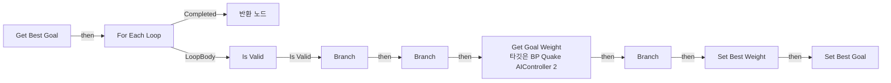

</details>

<details>
<summary>전체 노드·기본 입력 목록</summary>

| 노드 ID | 제목 | 미연결 기본 입력 / 에셋 입력 |
|---|---|---|
| `K2Node_FunctionEntry_0` | Get Best Goal |  |
| `K2Node_FunctionResult_0` | 반환 노드 |  |
| `K2Node_MacroInstance_0` | For Each Loop |  |
| `K2Node_VariableGet_0` | Get LTG |  |
| `K2Node_PromotableOperator_0` | Not Equal (Object) |  |
| `K2Node_Knot_1` | 경유 노드 |  |
| `K2Node_MacroInstance_1` | Is Valid |  |
| `K2Node_IfThenElse_0` | Branch |  |
| `K2Node_CallFunction_0` | Get Goal Weight<br/>타깃은 BP Quake AIController 2 |  |
| `K2Node_Knot_2` | 경유 노드 |  |
| `K2Node_VariableSet_2` | Set Best Weight | Output_Get=0.0 |
| `K2Node_VariableSet_3` | Set Best Goal |  |
| `K2Node_VariableGet_1` | Get Best Weight |  |
| `K2Node_PromotableOperator_2` | float &gt; float |  |
| `K2Node_IfThenElse_1` | Branch |  |
| `K2Node_Knot_4` | 경유 노드 |  |
| `K2Node_Knot_5` | 경유 노드 |  |
| `K2Node_VariableGet_3` | Get Best Goal |  |
| `K2Node_Knot_6` | 경유 노드 |  |
| `K2Node_Knot_7` | 경유 노드 |  |
| `K2Node_CallFunction_1` | Project Point to Navigation | ProjectedLocation=0, 0, 0; QueryExtent=50.000000,50.000000,100.000000 |
| `K2Node_Knot_0` | 경유 노드 |  |
| `K2Node_CallFunction_2` | Get Actor Location<br/>타깃은 액터 |  |
| `K2Node_IfThenElse_2` | Branch |  |
| `K2Node_Knot_3` | 경유 노드 |  |
| `K2Node_PromotableOperator_5` | float &gt; float | B=0.500000 |
| `K2Node_CommutativeAssociativeBinaryOperator_0` | AND Boolean |  |

</details>

### Get Goal Weight

<details>
<summary>실행 핀 플로우차트</summary>

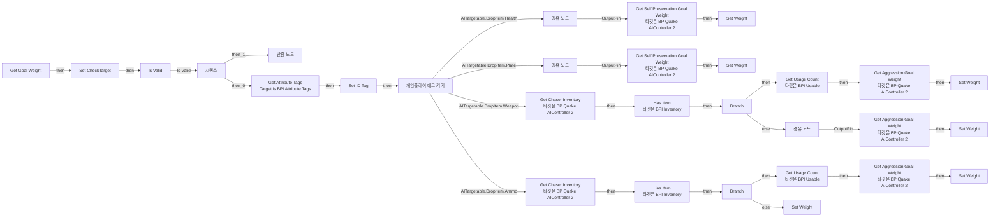

</details>

<details>
<summary>전체 노드·기본 입력 목록</summary>

| 노드 ID | 제목 | 미연결 기본 입력 / 에셋 입력 |
|---|---|---|
| `K2Node_FunctionEntry_0` | Get Goal Weight |  |
| `K2Node_FunctionResult_0` | 반환 노드 |  |
| `K2Node_MacroInstance_0` | Is Valid |  |
| `K2Node_VariableSet_0` | Set CheckTarget |  |
| `K2Node_Message_2` | Get Attribute Tags<br/>Target is BPI Attribute Tags |  |
| `K2Node_ExecutionSequence_0` | 시퀀스 |  |
| `K2Node_VariableGet_2` | Get CheckTarget |  |
| `K2Node_CallFunction_2` | Get Filtering Tag (First) | filter=(TagName="AITargetable"); Exact Match=false |
| `GameplayTagsK2Node_SwitchGameplayTag_0` | 게임플레이 태그 켜기 |  |
| `K2Node_Knot_0` | 경유 노드 |  |
| `K2Node_CallFunction_0` | Get Filtering Tag (First) | filter=(TagName="ID"); Exact Match=false |
| `K2Node_VariableSet_5` | Set ID Tag |  |
| `K2Node_Knot_1` | 경유 노드 |  |
| `K2Node_CallFunction_19` | Get Self Preservation Goal Weight<br/>타깃은 BP Quake AIController 2 | Life Type=NewEnumerator0 |
| `K2Node_VariableGet_5` | Get ID Tag |  |
| `K2Node_CallFunction_20` | Get Tag Name |  |
| `K2Node_VariableSet_9` | Set Weight | Output_Get=0.0 |
| `K2Node_CallFunction_17` | Get Self Preservation Goal Weight<br/>타깃은 BP Quake AIController 2 | Life Type=NewEnumerator1 |
| `K2Node_VariableGet_4` | Get ID Tag |  |
| `K2Node_CallFunction_18` | Get Tag Name |  |
| `K2Node_VariableSet_7` | Set Weight | Output_Get=0.0 |
| `K2Node_CallFunction_1` | Get Chaser Inventory<br/>타깃은 BP Quake AIController 2 |  |
| `K2Node_CallFunction_3` | Has Item<br/>타깃은 BPI Inventory |  |
| `K2Node_VariableGet_1` | Get ID Tag |  |
| `K2Node_IfThenElse_0` | Branch |  |
| `K2Node_CallFunction_4` | Get Usage Count<br/>타깃은 BPI Usable |  |
| `K2Node_CallFunction_5` | Safe Divide |  |
| `K2Node_CallFunction_6` | To Float (Integer) |  |
| `K2Node_CallFunction_7` | To Float (Integer) |  |
| `K2Node_VariableGet_6` | Get ID Tag |  |
| `K2Node_CallFunction_8` | Get Tag Name |  |
| `K2Node_VariableSet_1` | Set Weight | Output_Get=0.0 |
| `K2Node_Knot_4` | 경유 노드 |  |
| `K2Node_VariableGet_3` | Get ID Tag |  |
| `K2Node_CallFunction_41` | Get Tag Name |  |
| `K2Node_VariableSet_11` | Set Weight | Output_Get=0.0 |
| `K2Node_CallFunction_35` | Get Aggression Goal Weight<br/>타깃은 BP Quake AIController 2 | Ratio=0.0 |
| `K2Node_CallFunction_9` | Get Aggression Goal Weight<br/>타깃은 BP Quake AIController 2 |  |
| `K2Node_Knot_11` | 경유 노드 |  |
| `K2Node_VariableGet_14` | Get Weight |  |
| `K2Node_VariableGet_12` | Get MyCharacter |  |
| `K2Node_CallFunction_37` | Get Actor Location<br/>타깃은 액터 |  |
| `K2Node_VariableGet_13` | Get CheckTarget |  |
| `K2Node_CallFunction_38` | Get Actor Location<br/>타깃은 액터 |  |
| `K2Node_CallFunction_39` | Distance (Vector) |  |
| `K2Node_CallFunction_40` | Safe Divide |  |
| `K2Node_PromotableOperator_1` | float * float | B=0.100000 |
| `K2Node_Knot_13` | 경유 노드 |  |
| `K2Node_VariableGet_11` | Get Weight |  |
| `K2Node_PromotableOperator_3` | float &gt; float |  |
| `K2Node_CallFunction_29` | Select Float | B=-1.000000 |
| `K2Node_Knot_2` | 경유 노드 |  |
| `K2Node_Knot_3` | 경유 노드 |  |
| `K2Node_CallFunction_21` | Get Chaser Inventory<br/>타깃은 BP Quake AIController 2 |  |
| `K2Node_CallFunction_22` | Has Item<br/>타깃은 BPI Inventory |  |
| `K2Node_VariableGet_0` | Get ID Tag |  |
| `K2Node_IfThenElse_2` | Branch |  |
| `K2Node_CallFunction_23` | Get Usage Count<br/>타깃은 BPI Usable |  |
| `K2Node_CallFunction_24` | Safe Divide |  |
| `K2Node_CallFunction_25` | To Float (Integer) |  |
| `K2Node_CallFunction_26` | To Float (Integer) |  |
| `K2Node_VariableGet_10` | Get ID Tag |  |
| `K2Node_CallFunction_34` | Get Tag Name |  |
| `K2Node_VariableSet_16` | Set Weight | Output_Get=0.0 |
| `K2Node_Knot_6` | 경유 노드 |  |
| `K2Node_CallFunction_36` | Get Aggression Goal Weight<br/>타깃은 BP Quake AIController 2 |  |
| `K2Node_CallFunction_10` | Get Direct Parent Gameplay Tag |  |
| `K2Node_VariableSet_15` | Set Weight | Weight=-1.000000; Output_Get=0.0 |
| `K2Node_PromotableOperator_0` | float - float | A=1.000000 |

</details>

### Get Height Score

<details>
<summary>실행 핀 플로우차트</summary>

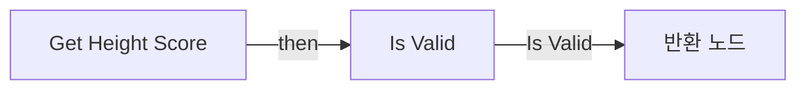

</details>

<details>
<summary>전체 노드·기본 입력 목록</summary>

| 노드 ID | 제목 | 미연결 기본 입력 / 에셋 입력 |
|---|---|---|
| `K2Node_FunctionEntry_0` | Get Height Score |  |
| `K2Node_FunctionResult_1` | 반환 노드 |  |
| `K2Node_CallFunction_0` | Get Actor Location<br/>타깃은 액터 |  |
| `K2Node_VariableGet_1` | Get MyCharacter |  |
| `K2Node_CallFunction_1` | Get Actor Location<br/>타깃은 액터 |  |
| `K2Node_CallFunction_2` | Get Height Score<br/>타깃은 BPC Various Score |  |
| `K2Node_VariableGet_2` | Get BPC_VariousScore |  |
| `K2Node_MacroInstance_0` | Is Valid |  |
| `K2Node_VariableGet_3` | Get |  |

</details>

### Get SelfPreservation Goal Weight

<details>
<summary>실행 핀 플로우차트</summary>

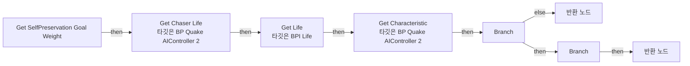

</details>

<details>
<summary>전체 노드·기본 입력 목록</summary>

| 노드 ID | 제목 | 미연결 기본 입력 / 에셋 입력 |
|---|---|---|
| `K2Node_FunctionEntry_0` | Get SelfPreservation Goal Weight |  |
| `K2Node_CallFunction_13` | Get Chaser Life<br/>타깃은 BP Quake AIController 2 |  |
| `K2Node_CallFunction_14` | Get Life<br/>타깃은 BPI Life |  |
| `K2Node_CallFunction_15` | Safe Divide |  |
| `K2Node_Knot_4` | 경유 노드 |  |
| `K2Node_Knot_5` | 경유 노드 |  |
| `K2Node_IfThenElse_1` | Branch |  |
| `K2Node_FunctionResult_1` | 반환 노드 |  |
| `K2Node_Knot_0` | 경유 노드 |  |
| `K2Node_Knot_1` | 경유 노드 |  |
| `K2Node_FunctionResult_2` | 반환 노드 | Weight=-1.000000 |
| `K2Node_CallFunction_0` | Get Characteristic<br/>타깃은 BP Quake AIController 2 |  |
| `K2Node_VariableGet_0` | Get BPC_AIDataCache |  |
| `K2Node_CallFunction_1` | Get Item Weight Row<br/>타깃은 BPC AIData Cache |  |
| `K2Node_CallFunction_2` | Calc Fuzzy Weight<br/>타깃은 BPC Goal Weight Calculator |  |
| `K2Node_VariableGet_1` | Get BPC_GoalWeightCalculator |  |
| `K2Node_IfThenElse_2` | Branch |  |

</details>

### Get Survive Score

<details>
<summary>실행 핀 플로우차트</summary>


</details>

<details>
<summary>전체 노드·기본 입력 목록</summary>

| 노드 ID | 제목 | 미연결 기본 입력 / 에셋 입력 |
|---|---|---|
| `K2Node_FunctionEntry_0` | Get Survive Score |  |
| `K2Node_FunctionResult_1` | 반환 노드 |  |
| `K2Node_VariableGet_4` | Get MyCharacter |  |
| `K2Node_VariableGet_3` | Get BPC_Life |  |
| `K2Node_CallFunction_2` | Get Survive Score<br/>타깃은 BPC Various Score |  |
| `K2Node_VariableGet_7` | Get BPC_VariousScore |  |

</details>

### Get Weapon Score

<details>
<summary>실행 핀 플로우차트</summary>

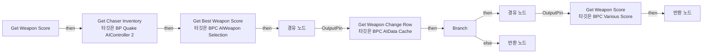

</details>

<details>
<summary>전체 노드·기본 입력 목록</summary>

| 노드 ID | 제목 | 미연결 기본 입력 / 에셋 입력 |
|---|---|---|
| `K2Node_FunctionEntry_1` | Get Weapon Score |  |
| `K2Node_VariableGet_6` | Get BPC_VariousScore |  |
| `K2Node_CallFunction_5` | Get Weapon Score<br/>타깃은 BPC Various Score |  |
| `K2Node_CallFunction_6` | Get Chaser Inventory<br/>타깃은 BP Quake AIController 2 |  |
| `K2Node_VariableGet_8` | Get BPC_AIDataCache |  |
| `K2Node_CallFunction_10` | Get Weapon Change Row<br/>타깃은 BPC AIData Cache |  |
| `K2Node_CallFunction_11` | Get Tag Name |  |
| `K2Node_Knot_2` | 경유 노드 |  |
| `K2Node_Knot_7` | 경유 노드 |  |
| `K2Node_FunctionResult_2` | 반환 노드 |  |
| `K2Node_IfThenElse_2` | Branch |  |
| `K2Node_Knot_8` | 경유 노드 |  |
| `K2Node_Knot_9` | 경유 노드 |  |
| `K2Node_FunctionResult_1` | 반환 노드 | Score=0.0 |
| `K2Node_VariableGet_4` | Get BPC_AIWeaponSelection |  |
| `K2Node_CallFunction_4` | Get Best Weapon Score<br/>타깃은 BPC AIWeapon Selection | Weapon Score=0.0 |

</details>

### Is Shorter Then LTG

<details>
<summary>실행 핀 플로우차트</summary>

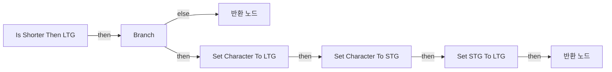

</details>

<details>
<summary>전체 노드·기본 입력 목록</summary>

| 노드 ID | 제목 | 미연결 기본 입력 / 에셋 입력 |
|---|---|---|
| `K2Node_FunctionEntry_0` | Is Shorter Then LTG |  |
| `K2Node_VariableGet_2` | Get LTG |  |
| `K2Node_FunctionResult_0` | 반환 노드 | Is Valid=false; Is Shorter=false |
| `K2Node_CallFunction_1` | Get Actor Location<br/>타깃은 액터 |  |
| `K2Node_VariableGet_1` | Get MyCharacter |  |
| `K2Node_CallFunction_2` | Is Valid |  |
| `K2Node_CallFunction_3` | Is Valid |  |
| `K2Node_CommutativeAssociativeBinaryOperator_0` | AND Boolean |  |
| `K2Node_IfThenElse_0` | Branch |  |
| `K2Node_VariableGet_5` | Get LTG |  |
| `K2Node_CallFunction_4` | Get Actor Location<br/>타깃은 액터 |  |
| `K2Node_CallFunction_7` | Distance Squared (Vector) |  |
| `K2Node_FunctionResult_1` | 반환 노드 | Is Valid=true |
| `K2Node_Knot_1` | 경유 노드 |  |
| `K2Node_VariableGet_7` | Get LTG |  |
| `K2Node_CallFunction_10` | Get Actor Location<br/>타깃은 액터 |  |
| `K2Node_VariableGet_8` | Get MyCharacter |  |
| `K2Node_CallFunction_11` | Get Actor Location<br/>타깃은 액터 |  |
| `K2Node_CallFunction_12` | Distance Squared (Vector) |  |
| `K2Node_VariableSet_0` | Set Character To LTG | Output_Get=0.0 |
| `K2Node_CallFunction_0` | Get Actor Location<br/>타깃은 액터 |  |
| `K2Node_VariableGet_3` | Get MyCharacter |  |
| `K2Node_CallFunction_5` | Get Actor Location<br/>타깃은 액터 |  |
| `K2Node_Knot_2` | 경유 노드 |  |
| `K2Node_CallFunction_6` | Distance Squared (Vector) |  |
| `K2Node_VariableSet_1` | Set Character To STG | Output_Get=0.0 |
| `K2Node_VariableSet_2` | Set STG To LTG | Output_Get=0.0 |
| `K2Node_VariableGet_12` | Get Character To LTG |  |
| `K2Node_VariableGet_10` | Get Character To STG |  |
| `K2Node_VariableGet_11` | Get STG To LTG |  |
| `K2Node_VariableGet_9` | Get Character To LTG |  |
| `K2Node_PromotableOperator_2` | float &lt; float |  |
| `K2Node_PromotableOperator_1` | float &lt; float |  |
| `K2Node_CommutativeAssociativeBinaryOperator_1` | AND Boolean |  |

</details>

### Pop Chase Point

<details>
<summary>실행 핀 플로우차트</summary>

```mermaid
flowchart LR
  n0["Pop Chase Point"]
  n1["반환 노드"]
  n2["Branch"]
  n3["반환 노드"]
  n4["Set NewLocalVar"]
  n5["Remove Index"]
  n0 -->|"then"| n2
  n2 -->|"then"| n4
  n2 -->|"else"| n3
  n4 -->|"then"| n5
  n5 -->|"then"| n1
```

</details>

<details>
<summary>전체 노드·기본 입력 목록</summary>

| 노드 ID | 제목 | 미연결 기본 입력 / 에셋 입력 |
|---|---|---|
| `K2Node_FunctionEntry_0` | Pop Chase Point |  |
| `K2Node_VariableGet_1` | Get Chase Points |  |
| `K2Node_FunctionResult_1` | 반환 노드 | Is Valid=true |
| `K2Node_CallArrayFunction_0` | Is Not Empty |  |
| `K2Node_IfThenElse_0` | Branch |  |
| `K2Node_FunctionResult_0` | 반환 노드 | Is Valid=false; Point=0, 0, 0 |
| `K2Node_VariableGet_2` | Get Chase Points |  |
| `K2Node_GetArrayItem_0` | GET | Dimension 1=0 |
| `K2Node_VariableSet_1` | Set NewLocalVar |  |
| `K2Node_VariableGet_0` | Get Chase Points |  |
| `K2Node_CallArrayFunction_1` | Remove Index | IndexToRemove=0 |
| `K2Node_Knot_0` | 경유 노드 |  |
| `K2Node_Knot_1` | 경유 노드 |  |

</details>

### Push Chase Point

<details>
<summary>실행 핀 플로우차트</summary>

```mermaid
flowchart LR
  n0["Push Chase Point"]
  n1["Is Valid"]
  n2["Add"]
  n3["Branch"]
  n4["Add"]
  n0 -->|"then"| n1
  n1 -->|"Is Valid"| n3
  n3 -->|"then"| n2
  n3 -->|"else"| n4
```

</details>

<details>
<summary>전체 노드·기본 입력 목록</summary>

| 노드 ID | 제목 | 미연결 기본 입력 / 에셋 입력 |
|---|---|---|
| `K2Node_FunctionEntry_0` | Push Chase Point |  |
| `K2Node_VariableGet_0` | Get |  |
| `K2Node_CallFunction_0` | Get Actor Location<br/>타깃은 액터 |  |
| `K2Node_MacroInstance_0` | Is Valid |  |
| `K2Node_Knot_0` | 경유 노드 |  |
| `K2Node_VariableGet_2` | Get Chase Points |  |
| `K2Node_CallArrayFunction_1` | Add | ReturnValue=0 |
| `K2Node_Knot_1` | 경유 노드 |  |
| `K2Node_CallFunction_1` | Project Point to Navigation | QueryExtent=20.000000,20.000000,300.000000 |
| `K2Node_IfThenElse_0` | Branch |  |
| `K2Node_VariableGet_1` | Get Chase Points |  |
| `K2Node_CallArrayFunction_0` | Add | ReturnValue=0 |
| `K2Node_Knot_2` | 경유 노드 |  |

</details>

### Set Current Target

<details>
<summary>실행 핀 플로우차트</summary>

```mermaid
flowchart LR
  n0["Set Current Target"]
  n1["Set CurrentTarget"]
  n2["Unbind Event from On Death"]
  n3["Is Valid"]
  n4["Is Valid"]
  n5["경유 노드"]
  n6["경유 노드"]
  n7["Set L_New Target Info"]
  n8["Bind Event to On Death"]
  n9["Set Value as Object<br/>타깃은 블랙보드 컴포넌트"]
  n10["시퀀스"]
  n11["Set Value as Bool<br/>타깃은 블랙보드 컴포넌트"]
  n12["Clear Value<br/>타깃은 블랙보드 컴포넌트"]
  n13["경유 노드"]
  n14["Branch"]
  n15["경유 노드"]
  n16["Set Value as Bool<br/>타깃은 블랙보드 컴포넌트"]
  n17["설정"]
  n18["Unbind Event from On Death"]
  n19["Is Valid"]
  n20["설정"]
  n21["시퀀스"]
  n22["경유 노드"]
  n23["경유 노드"]
  n24["경유 노드"]
  n25["Set Value as Bool<br/>타깃은 블랙보드 컴포넌트"]
  n26["경유 노드"]
  n0 -->|"then"| n7
  n1 -->|"then"| n8
  n2 -->|"then"| n6
  n3 -->|"Is Valid"| n14
  n3 -->|"Is Not Valid"| n13
  n4 -->|"Is Valid"| n2
  n4 -->|"Is Not Valid"| n5
  n5 -->|"OutputPin"| n6
  n6 -->|"OutputPin"| n1
  n7 -->|"then"| n3
  n8 -->|"then"| n10
  n10 -->|"then_0"| n9
  n10 -->|"then_1"| n26
  n13 -->|"OutputPin"| n19
  n14 -->|"then"| n4
  n14 -->|"else"| n15
  n15 -->|"OutputPin"| n17
  n17 -->|"then"| n16
  n18 -->|"then"| n23
  n19 -->|"Is Valid"| n18
  n19 -->|"Is Not Valid"| n24
  n20 -->|"then"| n21
  n21 -->|"then_0"| n12
  n21 -->|"then_1"| n22
  n22 -->|"OutputPin"| n25
  n23 -->|"OutputPin"| n20
  n24 -->|"OutputPin"| n23
  n26 -->|"OutputPin"| n11
```

</details>

<details>
<summary>전체 노드·기본 입력 목록</summary>

| 노드 ID | 제목 | 미연결 기본 입력 / 에셋 입력 |
|---|---|---|
| `K2Node_FunctionEntry_0` | Set Current Target |  |
| `K2Node_VariableSet_3` | Set CurrentTarget |  |
| `K2Node_VariableGet_11` | Get BPC_Life |  |
| `K2Node_RemoveDelegate_1` | Unbind Event from On Death |  |
| `K2Node_CreateDelegate_2` | 이벤트 생성 |  |
| `K2Node_MacroInstance_0` | Is Valid |  |
| `K2Node_MacroInstance_3` | Is Valid |  |
| `K2Node_Knot_9` | 경유 노드 |  |
| `K2Node_Knot_2` | 경유 노드 |  |
| `K2Node_Knot_3` | 경유 노드 |  |
| `K2Node_VariableSet_2` | Set L_New Target Info |  |
| `EdGraphNode_Comment_4` | 기존 Target에 대한 Unbind |  |
| `K2Node_VariableGet_10` | Get L_New Target Info |  |
| `EdGraphNode_Comment_5` | 값 대입 |  |
| `K2Node_VariableGet_6` | Get BPC_Life |  |
| `K2Node_AddDelegate_0` | Bind Event to On Death |  |
| `K2Node_CreateDelegate_0` | 이벤트 생성 |  |
| `EdGraphNode_Comment_6` | 현재 Target에 대한 Bind |  |
| `K2Node_CallFunction_8` | Get Blackboard |  |
| `K2Node_CallFunction_9` | Set Value as Object<br/>타깃은 블랙보드 컴포넌트 |  |
| `K2Node_ExecutionSequence_0` | 시퀀스 |  |
| `K2Node_CallFunction_10` | Make Literal Name | Value=Enemy |
| `K2Node_CallFunction_15` | Get Blackboard |  |
| `K2Node_CallFunction_16` | Make Literal Name | Value=Is Enemy Visible |
| `K2Node_CallFunction_14` | Set Value as Bool<br/>타깃은 블랙보드 컴포넌트 |  |
| `EdGraphNode_Comment_7` | Set 블랙보드 |  |
| `K2Node_CallFunction_20` | Get Blackboard |  |
| `K2Node_CallFunction_6` | Make Literal Name | Value=Enemy |
| `K2Node_CallFunction_11` | Clear Value<br/>타깃은 블랙보드 컴포넌트 |  |
| `K2Node_Knot_5` | 경유 노드 |  |
| `K2Node_VariableGet_7` | Get |  |
| `K2Node_IfThenElse_0` | Branch |  |
| `K2Node_PromotableOperator_1` | Not Equal (Object) |  |
| `K2Node_Knot_6` | 경유 노드 |  |
| `K2Node_CallFunction_0` | Get Blackboard |  |
| `K2Node_CallFunction_3` | Make Literal Name | Value=Is Enemy Visible |
| `K2Node_CallFunction_7` | Set Value as Bool<br/>타깃은 블랙보드 컴포넌트 |  |
| `K2Node_VariableSet_0` | 설정 |  |
| `K2Node_VariableGet_2` | Get |  |
| `K2Node_Knot_7` | 경유 노드 |  |
| `K2Node_Knot_8` | 경유 노드 |  |
| `EdGraphNode_Comment_8` | Is Visible만 갱신됨 |  |
| `K2Node_VariableGet_1` | Get BPC_Life |  |
| `K2Node_RemoveDelegate_0` | Unbind Event from On Death |  |
| `K2Node_CreateDelegate_1` | 이벤트 생성 |  |
| `K2Node_VariableGet_0` | Get |  |
| `K2Node_MacroInstance_2` | Is Valid |  |
| `K2Node_Knot_4` | 경유 노드 |  |
| `K2Node_VariableSet_4` | 설정 | CurrentTarget_IsVisible_9_088BE2B34DEEA07B7F676798FB0F66D2=False; CurrentTarget_VisibleSince_13_86DF842F4B3B526EBA18AD9C4C205926=0.000000 |
| `EdGraphNode_Comment_9` | null: 기존 Target에서 Unbind |  |
| `EdGraphNode_Comment_10` | Set Default |  |
| `EdGraphNode_Comment_11` | Clear |  |
| `K2Node_ExecutionSequence_1` | 시퀀스 |  |
| `K2Node_CallFunction_12` | Get Blackboard |  |
| `K2Node_CallFunction_13` | Make Literal Name | Value=Is Enemy Visible |
| `K2Node_Knot_10` | 경유 노드 |  |
| `K2Node_VariableGet_13` | Get |  |
| `K2Node_VariableGet_14` | Get |  |
| `K2Node_Knot_11` | 경유 노드 |  |
| `K2Node_Knot_12` | 경유 노드 |  |
| `K2Node_CallFunction_18` | Set Value as Bool<br/>타깃은 블랙보드 컴포넌트 | BoolValue=false |
| `K2Node_VariableGet_16` | Get |  |
| `K2Node_VariableGet_15` | Get |  |
| `K2Node_Knot_0` | 경유 노드 |  |
| `K2Node_VariableGet_3` | Get |  |

</details>

### Set LTG

<details>
<summary>실행 핀 플로우차트</summary>

```mermaid
flowchart LR
  n0["Set LTG"]
  n1["For Each Loop"]
  n2["Is Valid"]
  n3["Get Best Goal<br/>타깃은 BP Quake AIController 2"]
  n4["Set LTG"]
  n5["Set Value as Object<br/>타깃은 블랙보드 컴포넌트"]
  n6["Is Valid"]
  n7["Add"]
  n0 -->|"then"| n6
  n1 -->|"LoopBody"| n2
  n1 -->|"Completed"| n3
  n2 -->|"Is Valid"| n7
  n3 -->|"then"| n4
  n4 -->|"then"| n5
  n6 -->|"Is Not Valid"| n1
```

</details>

<details>
<summary>전체 노드·기본 입력 목록</summary>

| 노드 ID | 제목 | 미연결 기본 입력 / 에셋 입력 |
|---|---|---|
| `K2Node_FunctionEntry_0` | Set LTG |  |
| `K2Node_VariableGet_0` | Get CachedSpawners |  |
| `K2Node_MacroInstance_2` | For Each Loop |  |
| `K2Node_VariableGet_5` | Get Having Item |  |
| `K2Node_MacroInstance_0` | Is Valid |  |
| `K2Node_CallFunction_3` | Get Best Goal<br/>타깃은 BP Quake AIController 2 |  |
| `K2Node_VariableSet_0` | Set LTG |  |
| `K2Node_CallFunction_4` | Get Blackboard |  |
| `K2Node_CallFunction_5` | Set Value as Object<br/>타깃은 블랙보드 컴포넌트 |  |
| `K2Node_CallFunction_6` | Make Literal Name | Value=LTG |
| `K2Node_Knot_7` | 경유 노드 |  |
| `K2Node_VariableGet_2` | Get LTG |  |
| `K2Node_MacroInstance_3` | Is Valid |  |
| `K2Node_VariableGet_1` | Get All Spawned Goals |  |
| `K2Node_CallArrayFunction_1` | Add | ReturnValue=0 |
| `K2Node_Knot_0` | 경유 노드 |  |
| `K2Node_Knot_2` | 경유 노드 |  |
| `K2Node_VariableGet_3` | Get All Spawned Goals |  |

</details>

### Set LTG Timer

<details>
<summary>실행 핀 플로우차트</summary>

```mermaid
flowchart LR
  n0["Set LTG Timer"]
  n1["Branch"]
  n2["Clear and Invalidate Timer by Handle"]
  n3["Clear and Invalidate Timer by Handle"]
  n4["경유 노드"]
  n5["경유 노드"]
  n6["Set Timer by Function Name"]
  n7["Set LTG Setting Timer"]
  n0 -->|"then"| n1
  n1 -->|"then"| n4
  n1 -->|"else"| n5
  n2 -->|"then"| n6
  n4 -->|"OutputPin"| n2
  n5 -->|"OutputPin"| n3
  n6 -->|"then"| n7
```

</details>

<details>
<summary>전체 노드·기본 입력 목록</summary>

| 노드 ID | 제목 | 미연결 기본 입력 / 에셋 입력 |
|---|---|---|
| `K2Node_FunctionEntry_0` | Set LTG Timer |  |
| `K2Node_IfThenElse_0` | Branch |  |
| `K2Node_VariableGet_1` | Get LTG Setting Timer |  |
| `K2Node_CallFunction_1` | Clear and Invalidate Timer by Handle |  |
| `K2Node_VariableGet_0` | Get LTG Setting Timer |  |
| `K2Node_CallFunction_0` | Clear and Invalidate Timer by Handle |  |
| `K2Node_Knot_0` | 경유 노드 |  |
| `K2Node_Knot_1` | 경유 노드 |  |
| `K2Node_CallFunction_2` | Set Timer by Function Name | FunctionName=Set LTG; Time=0.200000; bLooping=true; bMaxOncePerFrame=false; InitialStartDelay=0.000000; InitialStartDelayVariance=0.000000 |
| `K2Node_VariableSet_0` | Set LTG Setting Timer |  |

</details>

### Set STG

<details>
<summary>실행 핀 플로우차트</summary>

```mermaid
flowchart LR
  n0["Set STG"]
  n1["Get Best Goal<br/>타깃은 BP Quake AIController 2"]
  n2["Set Value as Object<br/>타깃은 블랙보드 컴포넌트"]
  n3["Set STG"]
  n4["Filtering STG<br/>타깃은 BP Quake AIController 2"]
  n0 -->|"then"| n4
  n1 -->|"then"| n3
  n3 -->|"then"| n2
  n4 -->|"then"| n1
```

</details>

<details>
<summary>전체 노드·기본 입력 목록</summary>

| 노드 ID | 제목 | 미연결 기본 입력 / 에셋 입력 |
|---|---|---|
| `K2Node_FunctionEntry_0` | Set STG |  |
| `K2Node_CallFunction_14` | Get Best Goal<br/>타깃은 BP Quake AIController 2 |  |
| `K2Node_CallFunction_3` | Get Blackboard |  |
| `K2Node_CallFunction_24` | Set Value as Object<br/>타깃은 블랙보드 컴포넌트 |  |
| `K2Node_CallFunction_5` | Make Literal Name | Value=STG |
| `K2Node_VariableGet_0` | Get AIPerception |  |
| `K2Node_CallFunction_4` | Get Currently Perceived Actors<br/>타깃은 AI 인지 컴포넌트 | SenseToUse=/Script/AIModule.AISense_Sight |
| `K2Node_VariableSet_0` | Set STG |  |
| `K2Node_Knot_4` | 경유 노드 |  |
| `K2Node_Knot_5` | 경유 노드 |  |
| `K2Node_CallFunction_1` | Filtering STG<br/>타깃은 BP Quake AIController 2 |  |

</details>

### SetupCharacteristic

<details>
<summary>실행 핀 플로우차트</summary>

```mermaid
flowchart LR
  n0["SetupCharacteristic"]
  n1["Set CharacteristicRowNameOverride"]
  n0 -->|"then"| n1
```

</details>

<details>
<summary>전체 노드·기본 입력 목록</summary>

| 노드 ID | 제목 | 미연결 기본 입력 / 에셋 입력 |
|---|---|---|
| `K2Node_FunctionEntry_0` | SetupCharacteristic |  |
| `K2Node_VariableSet_1` | Set CharacteristicRowNameOverride | Output_Get=None |

</details>

### Start Target Lost Timer

<details>
<summary>실행 핀 플로우차트</summary>

```mermaid
flowchart LR
  n0["Start Target Lost Timer"]
  n1["Set Timer by Function Name"]
  n2["Set Target Lost Timer"]
  n3["Set Timer by Function Name"]
  n4["시퀀스"]
  n5["경유 노드"]
  n6["Set Chase Point Timer"]
  n7["Clear Target Lost Timer<br/>타깃은 BP Quake AIController 2"]
  n0 -->|"then"| n7
  n1 -->|"then"| n2
  n3 -->|"then"| n6
  n4 -->|"then_0"| n1
  n4 -->|"then_1"| n5
  n5 -->|"OutputPin"| n3
  n7 -->|"then"| n4
```

</details>

<details>
<summary>전체 노드·기본 입력 목록</summary>

| 노드 ID | 제목 | 미연결 기본 입력 / 에셋 입력 |
|---|---|---|
| `K2Node_FunctionEntry_0` | Start Target Lost Timer |  |
| `K2Node_CallFunction_1` | Set Timer by Function Name | FunctionName=Target Lost; bLooping=false; bMaxOncePerFrame=false; InitialStartDelay=0.000000; InitialStartDelayVariance=0.000000 |
| `K2Node_VariableSet_0` | Set Target Lost Timer |  |
| `K2Node_Knot_0` | 경유 노드 |  |
| `K2Node_CallFunction_2` | Set Timer by Function Name | FunctionName=Push Chase Point; bLooping=true; bMaxOncePerFrame=false; InitialStartDelay=0.000000; InitialStartDelayVariance=0.000000 |
| `K2Node_ExecutionSequence_0` | 시퀀스 |  |
| `K2Node_Knot_1` | 경유 노드 |  |
| `K2Node_VariableSet_1` | Set Chase Point Timer |  |
| `K2Node_Knot_2` | 경유 노드 |  |
| `K2Node_CallFunction_4` | Clear Target Lost Timer<br/>타깃은 BP Quake AIController 2 |  |

</details>

### Target Lost

<details>
<summary>실행 핀 플로우차트</summary>

```mermaid
flowchart LR
  n0["Target Lost"]
  n1["Set Current Target<br/>타깃은 BP Quake AIController 2"]
  n2["Clear"]
  n0 -->|"then"| n1
  n1 -->|"then"| n2
```

</details>

<details>
<summary>전체 노드·기본 입력 목록</summary>

| 노드 ID | 제목 | 미연결 기본 입력 / 에셋 입력 |
|---|---|---|
| `K2Node_FunctionEntry_0` | Target Lost |  |
| `K2Node_CallFunction_10` | Set Current Target<br/>타깃은 BP Quake AIController 2 | New_IsVisible_9_088BE2B34DEEA07B7F676798FB0F66D2=False; New_VisibleSince_13_86DF842F4B3B526EBA18AD9C4C205926=0.000000 |
| `K2Node_VariableGet_0` | Get Chase Points |  |
| `K2Node_CallArrayFunction_0` | Clear |  |

</details>

### UserConstructionScript

<details>
<summary>실행 핀 플로우차트</summary>

```mermaid
flowchart LR
  n0["Construction Script"]
```

</details>

<details>
<summary>전체 노드·기본 입력 목록</summary>

| 노드 ID | 제목 | 미연결 기본 입력 / 에셋 입력 |
|---|---|---|
| `K2Node_FunctionEntry_0` | Construction Script |  |

</details>

## 조회 범위의 한계

ObjectIterator로 발견했으나 MCP helper가 반환하지 않은 그래프입니다. delegate signature·컴파일된 중간 그래프·macro·애니메이션 내부 그래프가 섞일 수 있습니다.

- `BndEvt__BP_QuakeAIController2_AIPerception_K2Node_ComponentBoundEvent_2_ActorPerceptionUpdatedDelegate__DelegateSignature`: Graph 'BndEvt__BP_QuakeAIController2_AIPerception_K2Node_ComponentBoundEvent_2_ActorPerceptionUpdatedDelegate__DelegateSignature' not found in Blueprint.
- `CompleteTarget`: Graph 'CompleteTarget' not found in Blueprint.
- `Death`: Graph 'Death' not found in Blueprint.
- `Get Characteristic`: Graph 'Get Characteristic' not found in Blueprint.
- `GetAISetting`: Graph 'GetAISetting' not found in Blueprint.
- `GetCharacterTargets`: Graph 'GetCharacterTargets' not found in Blueprint.
- `GetChaserInventory`: Graph 'GetChaserInventory' not found in Blueprint.
- `GetChaserLife`: Graph 'GetChaserLife' not found in Blueprint.
- `GetChaserLocation`: Graph 'GetChaserLocation' not found in Blueprint.
- `GetChaserSpeed`: Graph 'GetChaserSpeed' not found in Blueprint.
- `GetCurrentTargetInfo`: Graph 'GetCurrentTargetInfo' not found in Blueprint.
- `On Swap`: Graph 'On Swap' not found in Blueprint.
- `OnAIStateChanged`: Graph 'OnAIStateChanged' not found in Blueprint.
- `OnTakeDamage`: Graph 'OnTakeDamage' not found in Blueprint.
- `ReceiveBeginPlay`: Graph 'ReceiveBeginPlay' not found in Blueprint.
- `ReceivePossess`: Graph 'ReceivePossess' not found in Blueprint.
- `SelectNextTourPoint`: Graph 'SelectNextTourPoint' not found in Blueprint.
- `Set Proper Combat Distance`: Graph 'Set Proper Combat Distance' not found in Blueprint.
- `SetAISetting`: Graph 'SetAISetting' not found in Blueprint.
- `TargetEnemyDeath`: Graph 'TargetEnemyDeath' not found in Blueprint.
- `Try Get Aggression Score`: Graph 'Try Get Aggression Score' not found in Blueprint.

[원본 MCP 스냅샷](../../../../Evidence/blueprints-070.json)
